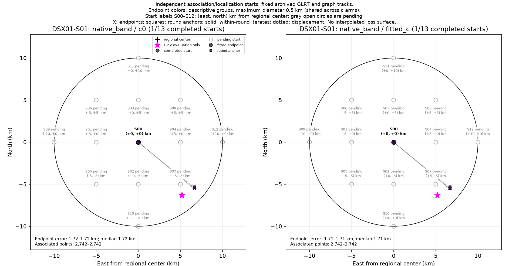
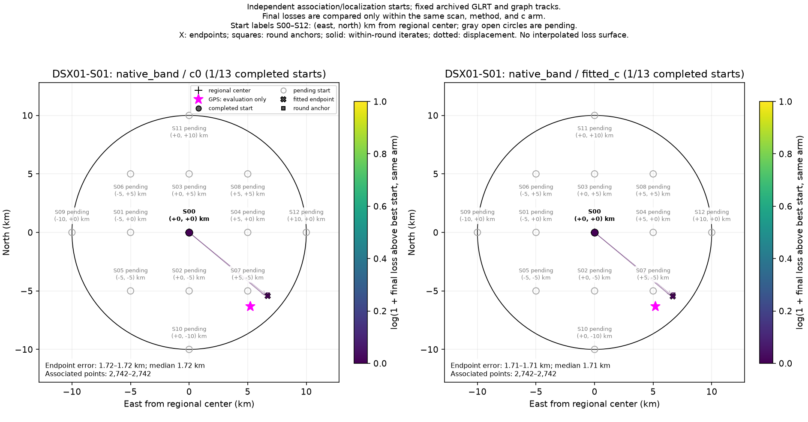

# DSX01-S01: native_band independent-start results

Each start independently reruns satellite discovery/association and localization on fixed archived GLRT observations and graph tracks. This is a basin-of-attraction experiment, not a pointwise loss or probability surface. GPS is used by this reporter only.

| Arm | Starts | Endpoint groups | Error min / median / max (km) | Associated points min–max |
| --- | ---: | ---: | --- | --- |
| c0 | 1 | 1 | 1.716 / 1.716 / 1.716 | 2,742–2,742 |
| fitted_c | 1 | 1 | 1.711 / 1.711 / 1.711 | 2,742–2,742 |

