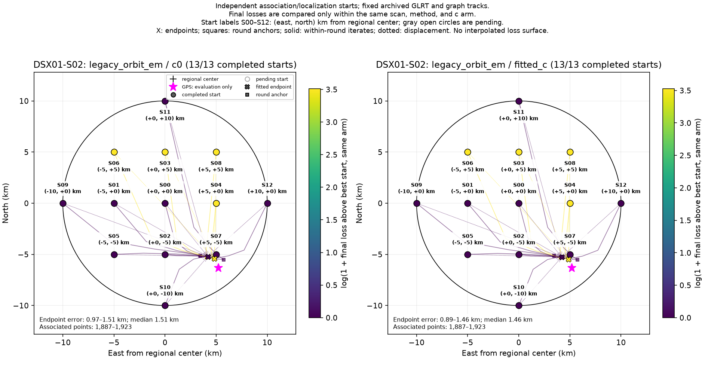

# DSX01-S02: legacy_orbit_em independent-start results

Each start independently reruns satellite discovery/association and localization on fixed archived GLRT observations and graph tracks. This is a basin-of-attraction experiment, not a pointwise loss or probability surface. GPS is used by this reporter only.

| Arm | Starts | Endpoint groups | Error min / median / max (km) | Associated points min–max |
| --- | ---: | ---: | --- | --- |
| c0 | 13 | 2 | 0.966 / 1.506 / 1.506 | 1,887–1,923 |
| fitted_c | 13 | 2 | 0.894 / 1.455 / 1.455 | 1,887–1,923 |

