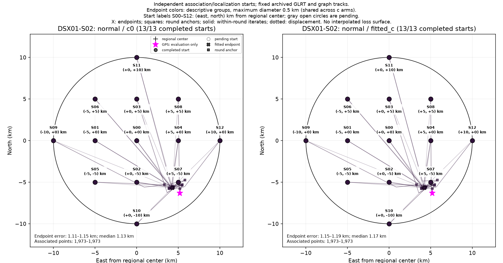
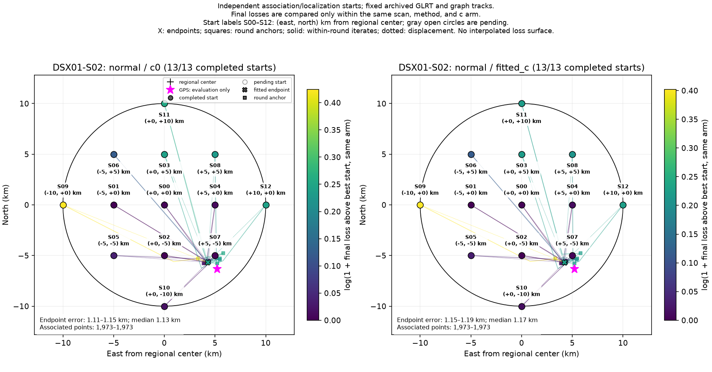

# DSX01-S02: normal independent-start results

Each start independently reruns satellite discovery/association and localization on fixed archived GLRT observations and graph tracks. This is a basin-of-attraction experiment, not a pointwise loss or probability surface. GPS is used by this reporter only.

| Arm | Starts | Endpoint groups | Error min / median / max (km) | Associated points min–max |
| --- | ---: | ---: | --- | --- |
| c0 | 13 | 1 | 1.114 / 1.130 / 1.146 | 1,973–1,973 |
| fitted_c | 13 | 1 | 1.155 / 1.169 / 1.186 | 1,973–1,973 |

