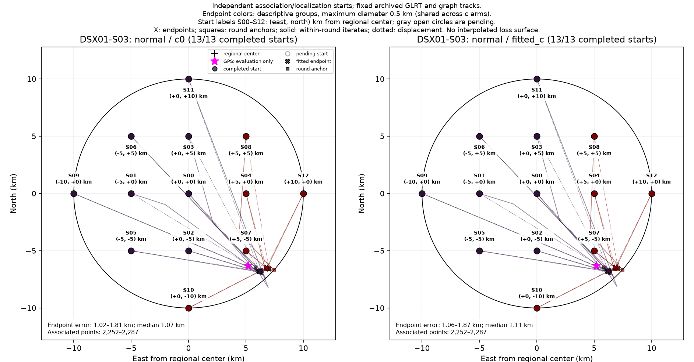
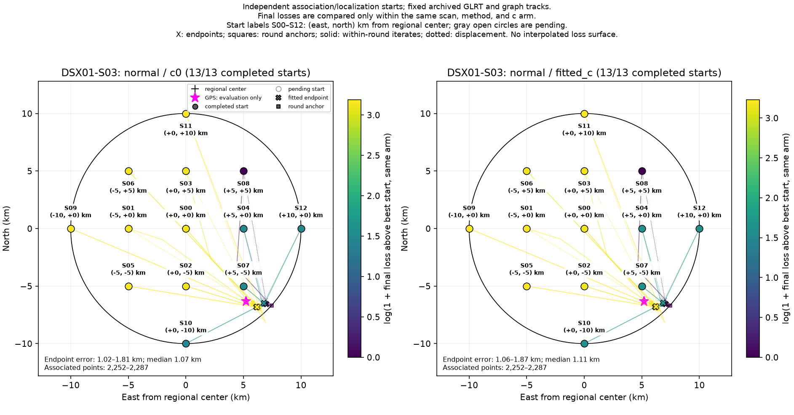

# DSX01-S03: normal independent-start results

Each start independently reruns satellite discovery/association and localization on fixed archived GLRT observations and graph tracks. This is a basin-of-attraction experiment, not a pointwise loss or probability surface. GPS is used by this reporter only.

| Arm | Starts | Endpoint groups | Error min / median / max (km) | Associated points min–max |
| --- | ---: | ---: | --- | --- |
| c0 | 13 | 2 | 1.021 / 1.073 / 1.806 | 2,252–2,287 |
| fitted_c | 13 | 2 | 1.061 / 1.114 / 1.875 | 2,252–2,287 |

