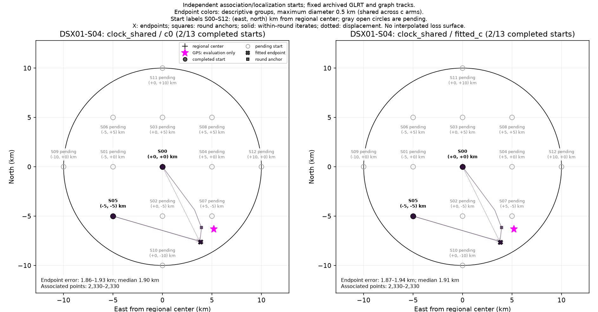
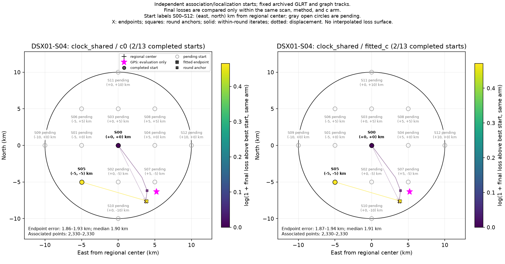

# DSX01-S04: clock_shared independent-start results

Each start independently reruns satellite discovery/association and localization on fixed archived GLRT observations and graph tracks. This is a basin-of-attraction experiment, not a pointwise loss or probability surface. GPS is used by this reporter only.

| Arm | Starts | Endpoint groups | Error min / median / max (km) | Associated points min–max |
| --- | ---: | ---: | --- | --- |
| c0 | 2 | 1 | 1.864 / 1.899 / 1.934 | 2,330–2,330 |
| fitted_c | 2 | 1 | 1.874 / 1.909 / 1.945 | 2,330–2,330 |

