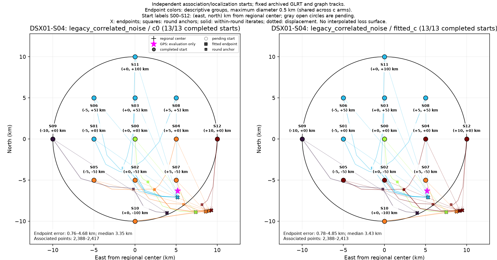
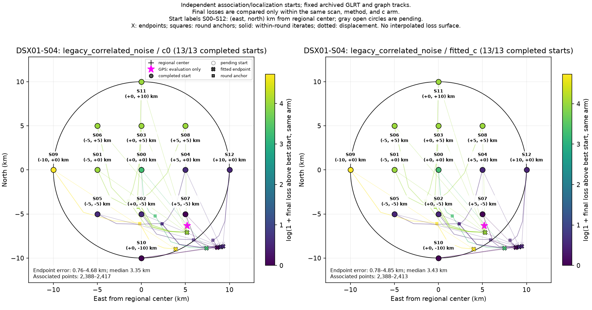

# DSX01-S04: legacy_correlated_noise independent-start results

Each start independently reruns satellite discovery/association and localization on fixed archived GLRT observations and graph tracks. This is a basin-of-attraction experiment, not a pointwise loss or probability surface. GPS is used by this reporter only.

| Arm | Starts | Endpoint groups | Error min / median / max (km) | Associated points min–max |
| --- | ---: | ---: | --- | --- |
| c0 | 13 | 5 | 0.765 / 3.350 / 4.683 | 2,388–2,417 |
| fitted_c | 13 | 5 | 0.777 / 3.429 / 4.853 | 2,388–2,413 |

