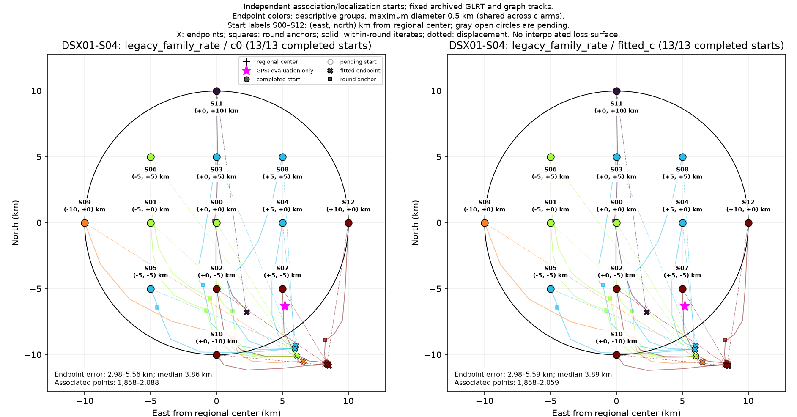
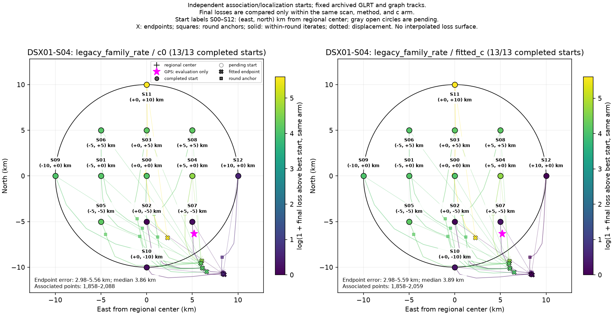

# DSX01-S04: legacy_family_rate independent-start results

Each start independently reruns satellite discovery/association and localization on fixed archived GLRT observations and graph tracks. This is a basin-of-attraction experiment, not a pointwise loss or probability surface. GPS is used by this reporter only.

| Arm | Starts | Endpoint groups | Error min / median / max (km) | Associated points min–max |
| --- | ---: | ---: | --- | --- |
| c0 | 13 | 5 | 2.981 / 3.864 / 5.558 | 1,858–2,088 |
| fitted_c | 13 | 5 | 2.979 / 3.888 / 5.587 | 1,858–2,059 |

