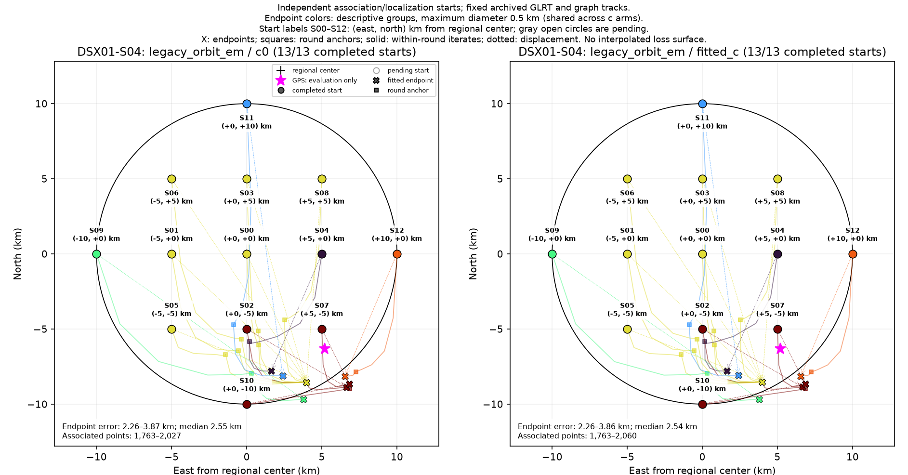
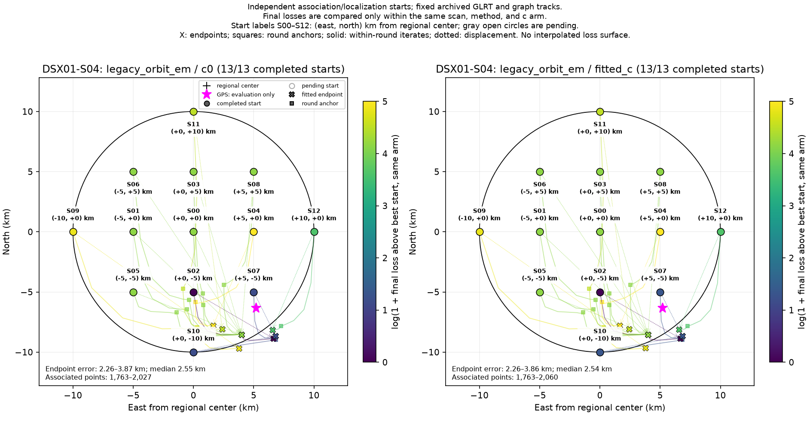

# DSX01-S04: legacy_orbit_em independent-start results

Each start independently reruns satellite discovery/association and localization on fixed archived GLRT observations and graph tracks. This is a basin-of-attraction experiment, not a pointwise loss or probability surface. GPS is used by this reporter only.

| Arm | Starts | Endpoint groups | Error min / median / max (km) | Associated points min–max |
| --- | ---: | ---: | --- | --- |
| c0 | 13 | 6 | 2.265 / 2.552 / 3.872 | 1,763–2,027 |
| fitted_c | 13 | 6 | 2.264 / 2.538 / 3.856 | 1,763–2,060 |

