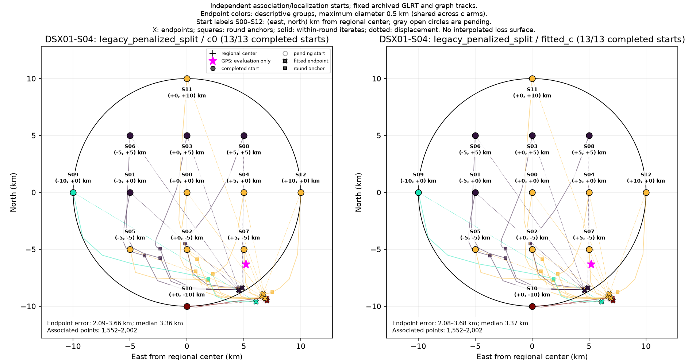
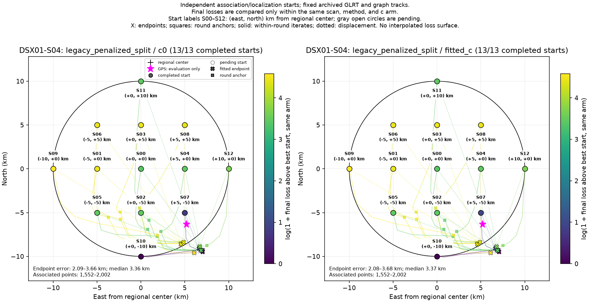

# DSX01-S04: legacy_penalized_split independent-start results

Each start independently reruns satellite discovery/association and localization on fixed archived GLRT observations and graph tracks. This is a basin-of-attraction experiment, not a pointwise loss or probability surface. GPS is used by this reporter only.

| Arm | Starts | Endpoint groups | Error min / median / max (km) | Associated points min–max |
| --- | ---: | ---: | --- | --- |
| c0 | 13 | 4 | 2.092 / 3.359 / 3.659 | 1,552–2,002 |
| fitted_c | 13 | 4 | 2.083 / 3.372 / 3.679 | 1,552–2,002 |

