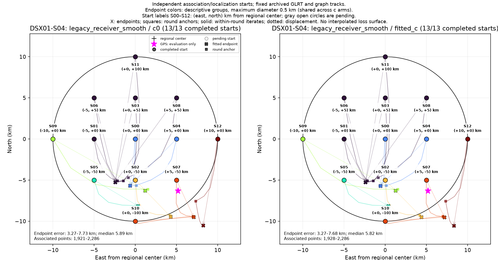
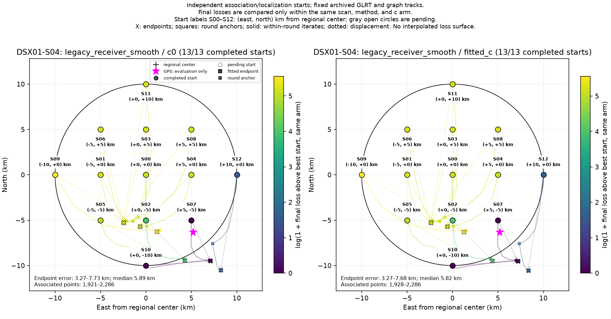

# DSX01-S04: legacy_receiver_smooth independent-start results

Each start independently reruns satellite discovery/association and localization on fixed archived GLRT observations and graph tracks. This is a basin-of-attraction experiment, not a pointwise loss or probability surface. GPS is used by this reporter only.

| Arm | Starts | Endpoint groups | Error min / median / max (km) | Associated points min–max |
| --- | ---: | ---: | --- | --- |
| c0 | 13 | 7 | 3.268 / 5.891 / 7.730 | 1,921–2,286 |
| fitted_c | 13 | 7 | 3.266 / 5.816 / 7.676 | 1,928–2,286 |

