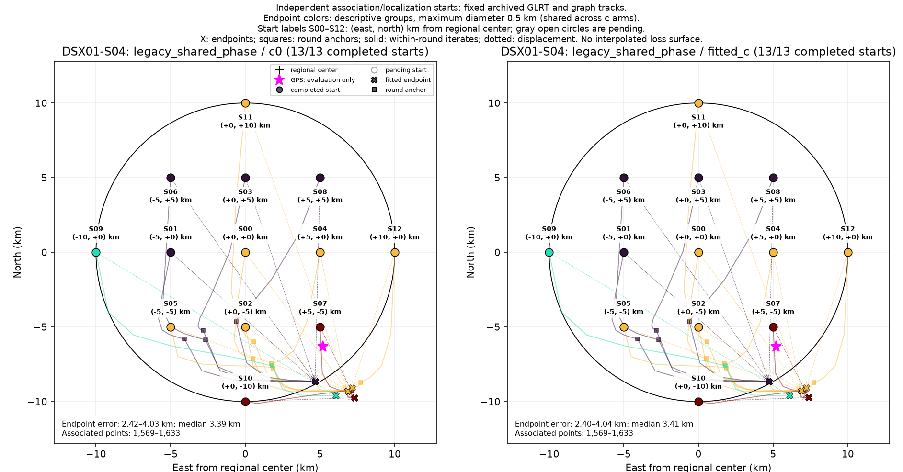
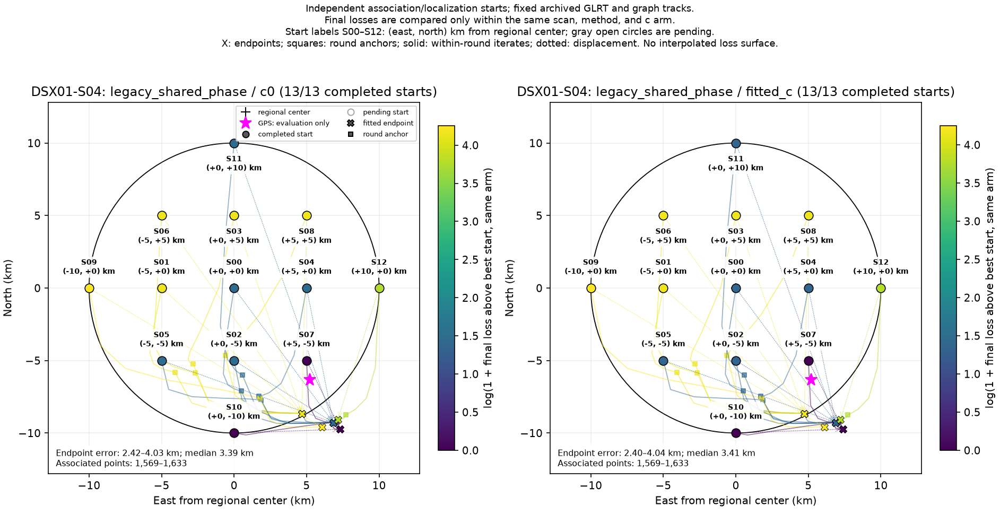

# DSX01-S04: legacy_shared_phase independent-start results

Each start independently reruns satellite discovery/association and localization on fixed archived GLRT observations and graph tracks. This is a basin-of-attraction experiment, not a pointwise loss or probability surface. GPS is used by this reporter only.

| Arm | Starts | Endpoint groups | Error min / median / max (km) | Associated points min–max |
| --- | ---: | ---: | --- | --- |
| c0 | 13 | 4 | 2.415 / 3.392 / 4.026 | 1,569–1,633 |
| fitted_c | 13 | 4 | 2.404 / 3.410 / 4.044 | 1,569–1,633 |

