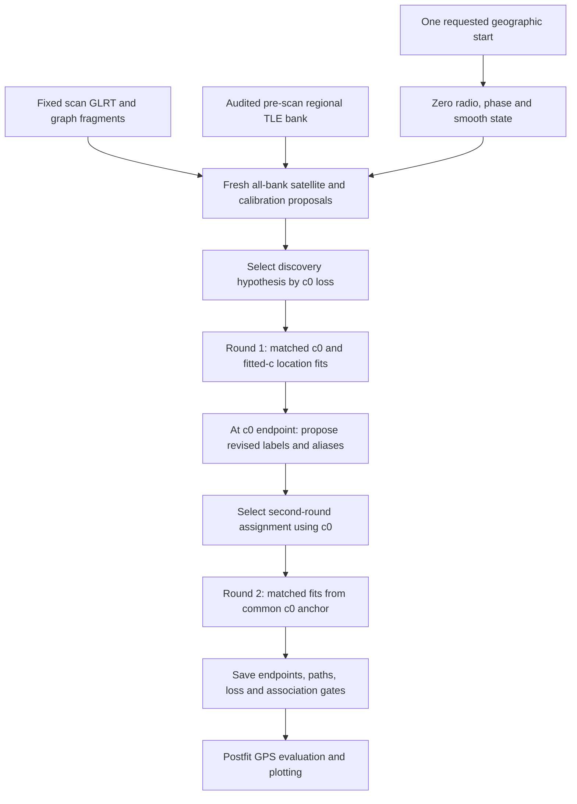

# DSX01: independent regional pipeline restarts

This experiment asks whether the same scan leads to the same position when satellite discovery starts at different locations. It supplements the original conditional loss maps with independent discovery and localization runs. It preserves the archived acquisition, GLRT measurements and graph tracks. It does not collect new RF or reacquire the archived IQ for each start.

This is a **frozen, partial campaign snapshot**. The exact number of included completed runs and its timestamp are recorded in [snapshot_receipt.json](snapshot_receipt.json). The planned campaign has five scans, 49 configurations and 13 starts: **3,185 paired pipeline runs, or 6,370 arm endpoints**, plus 65 scan/start discovery jobs. Twenty numerical workers execute the campaign. Pending configurations are explicitly marked in the [comparison galleries](comparisons/README.md); this report is not evidence that the complete campaign finished.

For the complete upstream acquisition-to-position breakdown, the original 245 conditional maps and their completed-run validation, see [the preceding algorithm report](../2026_10_18_dsx01_clean_region/ALGORITHM_BREAKDOWN.md). The 49 entries are configurations across several model families, rather than 49 unrelated algorithms.

## Regional prior and starting coordinates

The search square is **25 × 25 km**, centered at **37.906°, −122.545°**. Every position fit remains inside east/north bounds of ±12.5 km. The display circle is a 10 km radius around that same regional center; the optimizer may leave the display circle while remaining inside the square. Evaluation GPS is **37.849061591561885°, −122.48574968092912°**, added only after fitting.

| Start | East, km | North, km |
| --- | ---: | ---: |
| S00 | 0 | 0 |
| S01 | −5 | 0 |
| S02 | 0 | −5 |
| S03 | 0 | +5 |
| S04 | +5 | 0 |
| S05 | −5 | −5 |
| S06 | −5 | +5 |
| S07 | +5 | −5 |
| S08 | +5 | +5 |
| S09 | −10 | 0 |
| S10 | 0 | −10 |
| S11 | 0 | +10 |
| S12 | +10 | 0 |

These are the 5 km grid locations inside the disk. Labels such as S06 in a plot identify a start, not the DSX01 scan number.

## What one independent run does

For each scan/start pair, discovery starts without any saved fitted position, assignment atlas, radio calibration or satellite phase. The complete declared regional satellite bank is available: 1,707 / 1,479 / 1,422 / 1,427 / 1,424 candidates for scans S01–S05. Eight data-generated calibration proposals and finite all-candidate exploration produce a best c0 discovery hypothesis. Discovery is reused between configurations at the **same** scan and start. It is not shared between different geographic starts.

The satellite universe still has explicit Starlink-name and broad regional visibility restrictions, as documented in the preceding report. Both TLE collection time and element epoch must precede the scan cutoff. These runs do not use following TLEs or a manually supplied satellite-ID shortlist. Finite heuristic exploration of all candidates is not exhaustive enumeration of every possible joint labeling.

Each curved association run performs **two fitting rounds**, each with up to **24 bounded damped Gauss–Newton iterations**. Identities, aliases and the selected observation population remain fixed within each continuous round. The position-dependent Doppler prediction and the model's calibration/orbital nuisance treatment are recalculated at trial locations. Accepted optimizer steps reduce the declared objective, including its priors and flexibility penalties; this is not pure RMS descent.

Between rounds, the c0 endpoint supplies a new common geographic anchor. All-bank association is proposed again using the fitted c0 state. For modern recipes, the incumbent assignment remains a candidate and is compared with the refresh under the recipe's own c0 objective. The two arms share the chosen labels, aliases, starts, observations, other priors and numerical budgets. The fitted-c endpoint does not select the second-round anchor or satellite hypothesis. This controlled comparison can make fitted-c paths discontinuous between rounds.

The six original retention methods use their own association and nuisance formulations through adapters. The five linear-transfer configurations first use the two-round same-start normal curved fit, nominate eligible linear evidence from its c0 endpoint, and then add one matched **24-step bounded scalar-Newton predictive geometry fit** from that common endpoint. Their plots include the curved-parent paths and this final predictive-fit segment. Linear observations do not recalibrate the hardware posterior. Recipe-specific details and the original 49-configuration taxonomy remain in the preceding algorithm report.

Two rounds provide one association refresh. The implementation does **not** alternate until labels, aliases and calibration have jointly stabilized. A final optimizer stop describes a conditional numerical fit, rather than certified convergence of the entire discrete/continuous pipeline.

## How these differ from the original maps

| Property | Original conditional loss maps | New independent-start maps |
| --- | --- | --- |
| Geographic display | 10 km disk | Same disk |
| Sample locations | 81 fixed-position samples, 2 km grid | 13 starting positions, 5 km grid |
| Satellite discovery | Fresh 25-node regional assignment atlas | Fresh zero-state discovery at each start |
| Satellite identities at displayed samples | Selected branch fixed | Can differ by start and refresh between rounds |
| Position operation | Evaluate loss at each fixed sample; additional optimizer probes | Optimize from each start |
| Upstream acquisition / GLRT / tracks | Fixed archived evidence | Same fixed archived evidence |
| Surface interpolation | Used for colors and white arrows | None |
| Main question | Where does this selected branch prefer position? | Which endpoint does this initialization produce? |

The original 81 samples are east/north coordinates −10 to +10 km in 2 km steps, retaining points within the radius. They recompute geometry and model-specific nuisance integration/refitting, without rerunning satellite discovery at every pixel. White arrows on those figures are directions from the interpolated coarse loss, while the separately recorded center/endpoint gradients use actual objective finite differences with a 50 m step. This distinction is essential when interpreting apparently surrounding starts: the new starts generally optimize different conditional objectives because they can carry different labels, aliases, phase references and calibration states.

## Reading the new figures

- **Filled circles:** completed independent starts. Their labels show the start ID and east/north coordinates.
- **Gray open circles:** planned starts without an included result at the frozen snapshot.
- **Solid lines:** recorded accepted optimizer iterates within one fitting round. Connecting two iterates does not mean every intermediate point was evaluated.
- **Squares:** fitting-round anchors, including the c0-selected anchor for the second round.
- **Dotted arrows:** net displacement from original start to final endpoint. They are not additional optimizer trajectories.
- **X markers:** saved final fitted endpoints.
- **Magenta star:** evaluation GPS; a black plus marks the regional center.

Endpoint-group colors are descriptive complete-link groups with maximum diameter 0.5 km, computed jointly across both c arms within a scan/configuration. They do not certify distinct local minima, and colors have no universal physical meaning across plots. Nearby X markers can overlap. The second plot for each configuration colors runs by `log(1 + final loss above the best included start)` separately within each arm. Those losses are not calibrated probabilities and should not be compared across different model families.

The [per-start CSV](restart_summary.csv) reports position coordinates, postfit error, objective, accepted GLRT point count and percentage of **all** raw GLRT observations, accepted fragment count, residual RMS, optimizer stop and assignment differences. Raw denominators for S01–S05 are 4,797 / 3,524 / 3,988 / 3,719 / 4,056. Inferred points and postfit gate-accepted points differ; a low conditional loss does not imply every retained point passes association gates. The CSV reports the latter association count.

## Verification and publication scope

The focused six-module radial test suite passed **42 tests** on 2026-10-18. It covers discovery/adapters, reporting, original-versus-new galleries, consistency auditing and the campaign watcher. The [copied consistency audit](consistency_audit.json) records its own coverage timestamp and completeness; it can cover an earlier live subset than this frozen snapshot and must not be read as a fresh full-campaign audit. The [endpoint replay receipt](endpoint_gradient_replay.json) verifies four earlier S01 normal endpoint objectives exactly and records conditional finite-difference gradients. It does not validate every endpoint in this new snapshot.

The frozen compact result records reproduce the published trajectories, assignments and summary tables. Original full worker result SHA-256 values are retained in [live_result_bindings.json](live_result_bindings.json), and [result_bindings.json](result_bindings.json) binds the compact published records. Full residual/covariance payloads, discovery states, orbital catalogues and raw IQ remain in the local scientific archive. The source snapshot preserves the reviewed Python implementation and component tests; it is not a standalone raw-data rerun bundle. The protocol retains the full active campaign source fingerprint, including native components not duplicated here.

Earlier pilot artifacts are superseded and are excluded from the primary numerical results. Publication contains only the current source-fingerprint campaign. The superseded v1 pilot had a native-band/mixed-receiver refresh incompatibility between its 22-column smooth state and the common 11-column proposal representation; the current implementation projects the proposal state and uses a native-correct evaluation adapter. The radio observations are unchanged. Alias initialization at the actual geographic start was already a safeguard before that pilot. The figures preserve recorded optimizer paths and separate net-displacement arrows from actual steps. These distinctions concern implementation/provenance and should not be interpreted as additional independent experiments.

Hyperparameters were developed on DSX01, and the dataset supplies a known evaluation location. This remains regional same-corpus evidence, not independent validation at a new receiver location. Frequency fit, gate-accepted coverage and position error are reported separately. In particular, a fitted-c improvement in frequency loss is not evidence by itself of improved position accuracy.
