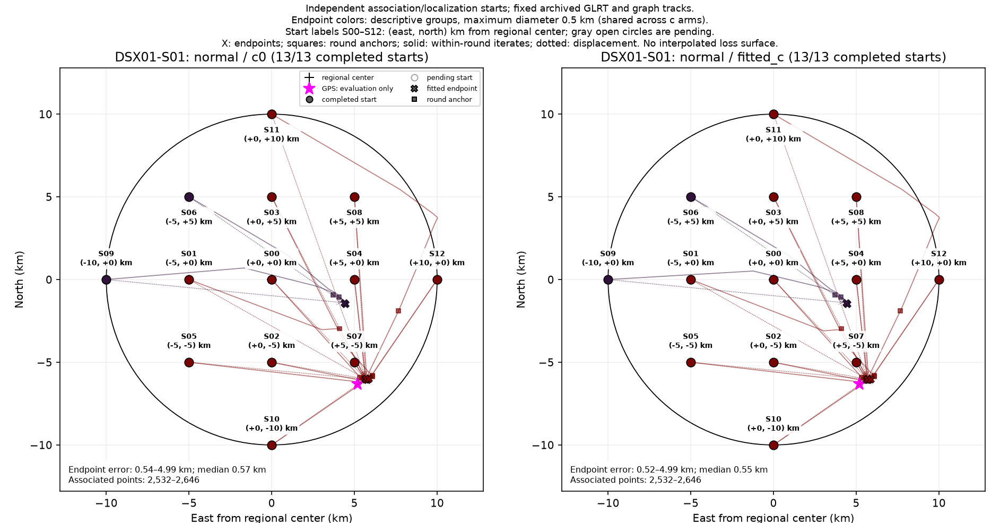
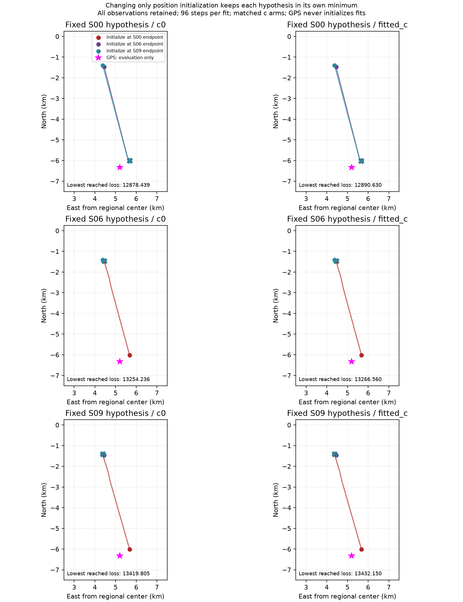
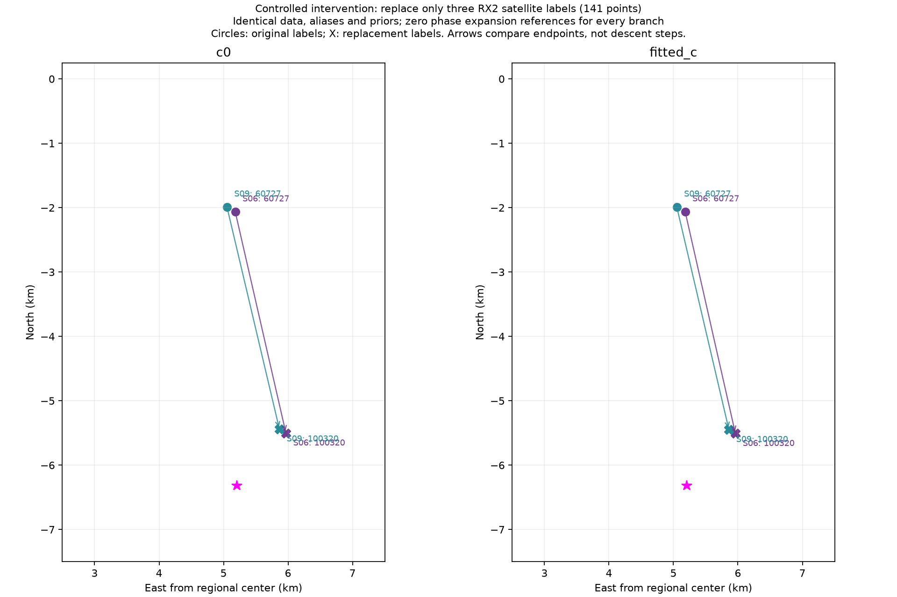
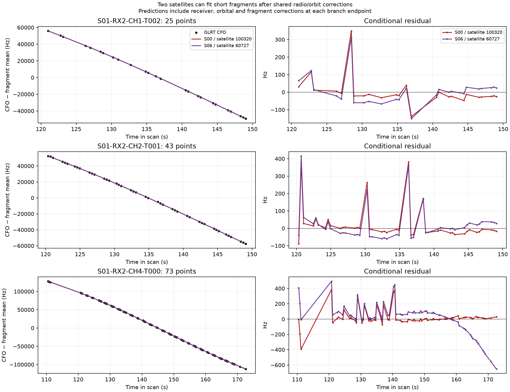
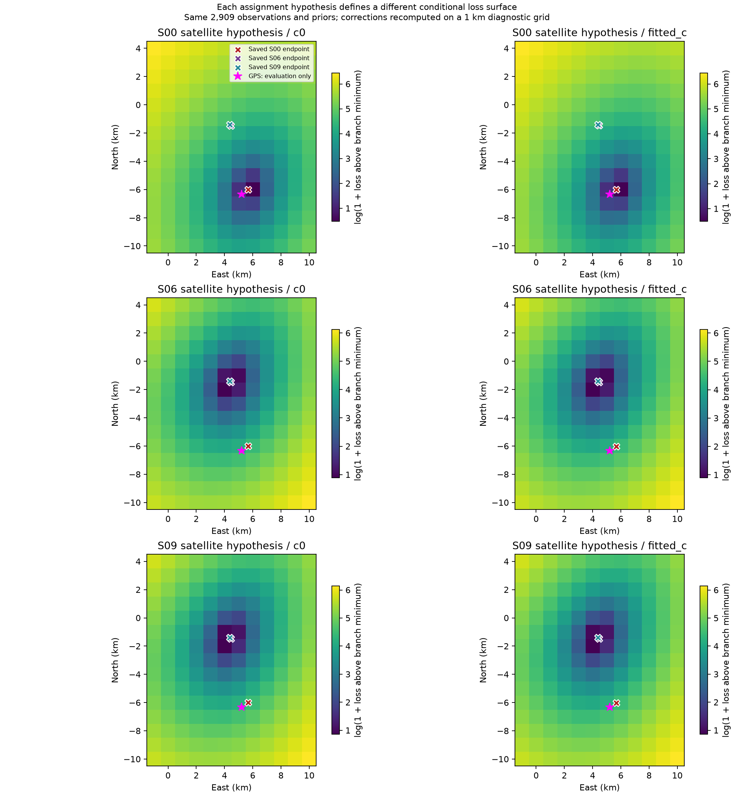
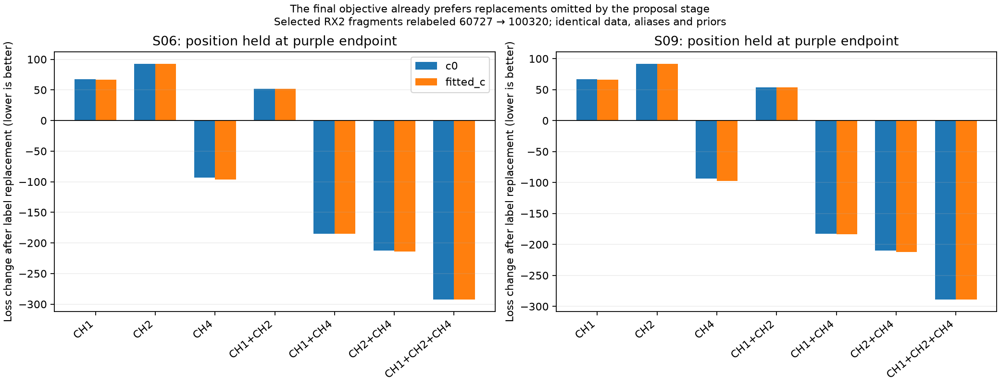
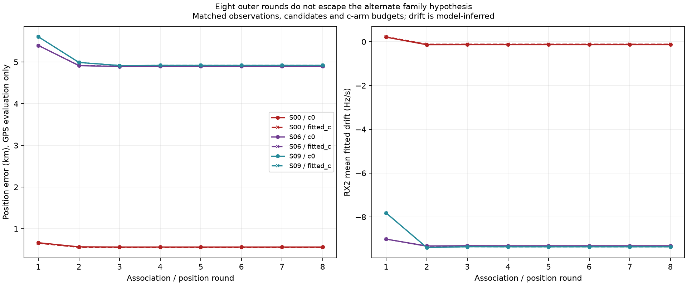

# Why S01 normal has purple endpoints away from the red group

The purple X markers are real saved endpoints from **start S06 (−5, +5 km)** and **S09 (−10, 0 km)**. They were not interpolation artifacts. Their final numerical stops report `small_step_and_improvement`, rather than hitting the 24-step cap. That is convergence of each selected conditional position fit; it does not establish that the satellite associations are correct.

| Start | Fitted-c endpoint error, km | Fitted-c loss | Accepted GLRT points | Changed final labels versus S00 |
| --- | ---: | ---: | ---: | ---: |
| S00, red reference | 0.554 | 12,890.630 | 2,646 | 0 |
| S06, purple | 4.917 | 13,266.560 | 2,532 | 3 |
| S09, purple | 4.991 | 13,432.150 | 2,532 | 5 |

The colors group endpoints by geographic proximity. A circle's color tells which endpoint group its independent run reached. The red circles passing around a purple X do not measure the gradient of the purple run's own objective at those circle positions.

The important difference is the discrete satellite hypothesis. Both purple runs assign three RX2 fragments to **NORAD 60727**, whereas the red S00 reference assigns them to **NORAD 100320**:

| Fragment | GLRT points |
| --- | ---: |
| RX2 CH1 T002 | 25 |
| RX2 CH2 T001 | 43 |
| RX2 CH4 T000 | 73 |
| Total | 141 |

That different family label was already present in fresh discovery at S06/S09. The single between-round refresh retained that family; it changed an unrelated RX1 fragment label. S09 has two additional final label differences relative to S00. The net accepted-point difference is 114, rather than all 141 points: the first two ambiguous-family fragments still pass, while RX2 CH4 T000 loses 73 accepted points and RX1 CH8 T002 loses another 41. The latter keeps its candidate 62811 but fails the residual-structure gate after position/calibration changes. Acceptance is computed by postfit gates rather than deleting the entire family from the inference population.

The inferred RX2 mean linear drift also changes substantially: approximately **−0.136 Hz/s** for S00 versus **−9.326 Hz/s** for S06 in the two-round c0 fits. This is a posterior calibration/identity/position tradeoff under the model, not an independent measurement proving the hardware actually drifted that fast.

The disputed CH4 T000 fragment illustrates the distinction between position loss and acceptance gates: its purple-model tail around **165–174 s** develops a systematic residual near **−650 Hz**, while the red-model tail stays close to zero. Its overall RMS is approximately **205 Hz**, below the 450 Hz RMS threshold, but its residual-structure gate fails. Position fitting retains all curved observations under robust Gamma-noise groups; the later compatibility gates are not hard position-optimization constraints. A converged conditional loss can therefore coexist with rejected track associations.

The c0 final objectives are **12,878.439 for S00**, **13,254.236 for S06**, and **13,419.805 for S09**. Thus the purple runs are worse by approximately **376 and 541 objective units** in the same configuration and arm. These are model-loss differences, not direct probabilities or GPS-based selections.

## Controlled cross-start test

Keeping the red S00 satellite assignments, aliases and phase references fixed, a 96-step conditional position refit started at either purple endpoint returns the red minimum essentially exactly: c0 east/north **(5.677099, −6.009536) km**, loss **12,878.43877714**; fitted-c **(5.669103, −6.018328) km**, loss **12,890.629950725**. The test starts from saved endpoints and does not use GPS to select a starting point or hypothesis.

This rules out an unavoidable red-hypothesis position trap at the purple coordinates in that controlled test. The observed pattern principally reflects **different association-conditioned objectives**. A position that is a local minimum for a wrong family labeling can lie in an area from which the better labeling descends to the red solution.

The reverse test gives the complementary result: with the S06 hypothesis fixed, starts at either the red endpoint or either purple endpoint converge near **(4.4535, −1.4729) km** in c0. With S09 fixed, those initializations converge near **(4.3801, −1.4065) km**. Changing only the numerical starting position does not repair the selected hypothesis in these tests.

Local finite differences at the original saved endpoints further support conditional local convergence:

| Branch / c0 | Gradient norm, loss per km | Hessian eigenvalues, loss per km² |
| --- | ---: | --- |
| S00 | 0.000117 | 5.841, 12.311 |
| S06 | 0.001582 | 5.030, 11.029 |
| S09 | 0.001184 | 5.139, 11.195 |

These gradients use 50 m central differences of the actual conditional objective. Positive local Hessian eigenvalues and small gradients are consistent with well-formed conditional minima. Raising the inner nuisance-precision budget to 2,048 changes objective values by at most approximately **5.5 × 10⁻¹²** across the six endpoint/arm checks, ruling out an unfinished inner solve as an explanation at these endpoints. This remains a local numerical diagnostic, not a proof of global convergence or correct physical identity.

## Isolating the three-fragment family label

The original saved branches also have different phase-expansion references. To remove that confound, a controlled intervention sets **all phase-expansion references to zero** for every branch and changes only the three RX2 fragment labels. It then refits each branch from both a red and a purple saved endpoint, in both c arms. The zero-reference experiment is a diagnostic model comparison, not a replacement production position result.

| Controlled c0 branch | Family label for the three fragments | Fitted east, north, km | Loss |
| --- | --- | --- | ---: |
| S00 reference | 100320 | 5.9668, −5.5015 | 12,894.060 |
| S06 original | 60727 | 5.1811, −2.0637 | 13,259.993 |
| S06 with only those labels swapped | 100320 | 5.9668, −5.5015 | 12,894.060 |
| S09 original | 60727 | 5.0525, −1.9878 | 13,425.635 |
| S09 with only those labels swapped | 100320 | 5.8655, −5.4385 | 13,062.857 |

For S06, changing just those three labels reproduces the controlled S00 objective and minimum, from both tested initializations. S09 moves toward the same neighborhood but retains its other two differing labels. At the fixed S06 purple coordinate, before moving position at all, the three-label swap reduces the common-reference c0 objective from **13,264.189 to 12,978.210**. That is direct evidence that a better discrete family proposal is already useful at the purple point.

These tests favor the 100320 hypothesis relative to 60727 within the declared model. They do not externally authenticate NORAD 100320. They use candidates found by another blind same-scan restart, rather than a manually supplied true satellite. Numerical receipts and additional association-round diagnostics are linked below. These interventions leave the main campaign's frozen sources and results unchanged.

Numerical evidence: [local gradients/Hessians and precision checks](purple_diagnostics/endpoint_diagnostics.json), [18 cross-start fits](purple_diagnostics/cross_branch_fits.json), [20 common-reference label-intervention fits](purple_diagnostics/controlled_family_swap.json), [64 fixed-position subset scores](purple_diagnostics/family_subset_scores.json), and [actual refresh proposals](purple_diagnostics/actual_candidate_refresh.json).

The [diagnostic validation receipt](purple_diagnostics/validation.json) confirms six saved endpoint objectives replay exactly, 18 cross-start fits have at most **0.239 m** within-branch endpoint spread across the three starting coordinates, all 24 eight-round fitting records are present, and the extended runs reproduce the first two original rounds exactly. It also records 1,080 conditional geographic samples, comprising six 12 × 15 grids used by the diagnostic surface figure. These diagnostic surfaces are fixed-branch comparisons, rather than additional independent satellite discoveries at their pixels.

The core debug process began a redundant S09 extension after a separate canonical extension worker had already finished; that redundant repeat was canceled before overwrite. All canonical diagnostic artifacts are complete and validated. The report does not claim the combined debug command exited successfully. [Original full-artifact hashes](purple_diagnostics/original_full_artifact_bindings.json) refer to the local full results; the extension bindings and publication manifest distinguish those from the compact published extension records.

## What this suggests for the algorithm

The actual refresh at both purple endpoints fails to include **100320 in the selected coherent proposal set** and returns 60727 for the three fragments. That proposal engine uses surrogate radio/phase fitting, top-four pruning and coherence thresholds, whereas the final score includes integrated shared-radio/orbit and Gamma-noise terms. Its proposal coverage does not faithfully cover the alternatives favored by the final objective.

Matched label-subset tests evaluate 64 scores across both arms and original/common-zero phase-reference controls, with each recipient position held fixed. Using the original phase references at S06's purple position, switching CH4 alone lowers the final c0 objective by **92.835**; switching all three fragments lowers it by **292.551**. At S09 the respective reductions are **93.637** and **288.934**. Switching CH1 or CH2 alone worsens the S06 objective by approximately 68 or 93. Thus the family hypothesis should be compared jointly, and at least one useful single-fragment alternative is already available without any position step. The failure is not merely a continuous-position barrier.

The pipeline should retain and compare several plausible satellite-family hypotheses across starts, rather than treating the first useful family label as final. Candidate-family swaps should be evaluated with the actual final score after readjusting shared radio/orbit nuisance terms. A final-score comparison already favors the red family in these runs without consulting GPS. Repeating an unchanged proposer may repeatedly offer the same limited alternatives; increasing the number of continuous position steps alone cannot fix this proposal-coverage failure.

Eight-round extensions confirm that this is not fixed merely by adding association-refresh rounds:

| Start | Eight-round c0 error, km | Eight-round fitted-c error, km | Accepted points |
| --- | ---: | ---: | ---: |
| S00 | 0.561 | 0.550 | 2,646 |
| S06 | 4.897 | 4.900 | 2,532 |
| S09 | 4.921 | 4.921 | 2,532 |

Both purple extensions retain the 60727 family. S06 reaches c0 **(4.4113, −1.4962) km**, loss **13,253.505**. These extended diagnostics are separate from the published two-round campaign. Compact receipts preserve all 24 fitting rounds' fit histories, states and labels: [S00](purple_diagnostics/eight_round_extension_S00.json), [S06](purple_diagnostics/eight_round_extension_S06.json), [S09](purple_diagnostics/eight_round_extension_S09.json); [bindings](purple_diagnostics/extension_result_bindings.json) retain hashes of the full local source results and compact published records.

This example does not prove that every red association is physically correct, or that the lowest in-sample loss guarantees the most accurate location on a new scan. It demonstrates why independent starts and discrete-family competition are needed alongside conditional loss maps.
