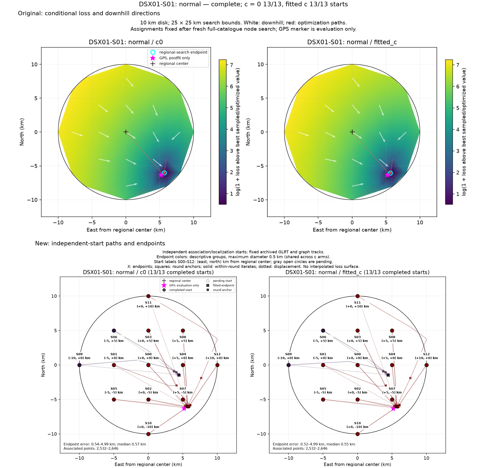

# DSX01 independent regional pipeline restarts

**Frozen partial campaign snapshot:** 497 of 3,185 paired runs, with 994 finite arm endpoints. Later live results are not silently included. See the [full methodology and plot explanation](METHODOLOGY.md), [snapshot receipt](snapshot_receipt.json), [validation](VALIDATION.md), and [purple endpoint investigation](PURPLE_ENDPOINTS.md).

| Scan | Completed paired runs / 637 | Configurations represented / 49 | Configurations with all 13 starts |
| --- | ---: | ---: | ---: |
| S01 | 105 | 12 | 7 |
| S02 | 104 | 8 | 8 |
| S03 | 104 | 8 | 8 |
| S04 | 93 | 8 | 7 |
| S05 | 91 | 7 | 7 |

Report contains 497 worker results and 994 finite c-arm endpoints. There are 0 failed/missing/nonfinite arm or worker records and 0 failed campaign jobs; consult [audit](report_audit.json) and the [protocol](protocol.json) for planned counts. Partial reports do not imply completion.

Starts lie on a 5 km grid inside the 10 km disk centered at 37.906°, −122.545°. Localization is bounded by the same 25 × 25 km regional box. Existing conditional loss maps are preserved separately. Filled circles show completed independent starts, gray open circles show pending starts, and X marks fitted endpoints. Start labels give their IDs and (east, north) coordinates in km from the regional center; no interpolated loss surface is shown. The solid paths are recorded within-round optimizer iterates; squares mark round anchors and dotted arrows show net displacement only. The c0 endpoint supplies the next round's common anchor, so the fitted-c round paths can be discontinuous. Archived acquisition, GLRT, and graph tracks are fixed. GPS is added after fitting for error measurement and plotting; no endpoint is selected using GPS.

Endpoint groups are descriptive complete-link groups of maximum diameter 0.5 km within each scan/method, shared across c arms. They are not certified distinct optima. Final objective colors are normalized separately within each method, scan, and arm; objectives must not be compared across different model families.

[Original and new plots for every configuration](comparisons/README.md) · [Per-start numerical results](restart_summary.csv) · [Result hashes](result_bindings.json)

- [DSX01-S01: clock_shared](DSX01-S01/clock_shared/README.md)
- [DSX01-S01: legacy_correlated_noise](DSX01-S01/legacy_correlated_noise/README.md)
- [DSX01-S01: legacy_family_rate](DSX01-S01/legacy_family_rate/README.md)
- [DSX01-S01: legacy_orbit_em](DSX01-S01/legacy_orbit_em/README.md)
- [DSX01-S01: legacy_penalized_split](DSX01-S01/legacy_penalized_split/README.md)
- [DSX01-S01: legacy_receiver_smooth](DSX01-S01/legacy_receiver_smooth/README.md)
- [DSX01-S01: legacy_shared_phase](DSX01-S01/legacy_shared_phase/README.md)
- [DSX01-S01: linear_white_joint](DSX01-S01/linear_white_joint/README.md)
- [DSX01-S01: mixed_rx](DSX01-S01/mixed_rx/README.md)
- [DSX01-S01: native_band](DSX01-S01/native_band/README.md)
- [DSX01-S01: native_rx](DSX01-S01/native_rx/README.md)
- [DSX01-S01: normal](DSX01-S01/normal/README.md)
- [DSX01-S02: clock_shared](DSX01-S02/clock_shared/README.md)
- [DSX01-S02: legacy_correlated_noise](DSX01-S02/legacy_correlated_noise/README.md)
- [DSX01-S02: legacy_family_rate](DSX01-S02/legacy_family_rate/README.md)
- [DSX01-S02: legacy_orbit_em](DSX01-S02/legacy_orbit_em/README.md)
- [DSX01-S02: legacy_penalized_split](DSX01-S02/legacy_penalized_split/README.md)
- [DSX01-S02: legacy_receiver_smooth](DSX01-S02/legacy_receiver_smooth/README.md)
- [DSX01-S02: legacy_shared_phase](DSX01-S02/legacy_shared_phase/README.md)
- [DSX01-S02: normal](DSX01-S02/normal/README.md)
- [DSX01-S03: clock_shared](DSX01-S03/clock_shared/README.md)
- [DSX01-S03: legacy_correlated_noise](DSX01-S03/legacy_correlated_noise/README.md)
- [DSX01-S03: legacy_family_rate](DSX01-S03/legacy_family_rate/README.md)
- [DSX01-S03: legacy_orbit_em](DSX01-S03/legacy_orbit_em/README.md)
- [DSX01-S03: legacy_penalized_split](DSX01-S03/legacy_penalized_split/README.md)
- [DSX01-S03: legacy_receiver_smooth](DSX01-S03/legacy_receiver_smooth/README.md)
- [DSX01-S03: legacy_shared_phase](DSX01-S03/legacy_shared_phase/README.md)
- [DSX01-S03: normal](DSX01-S03/normal/README.md)
- [DSX01-S04: clock_shared](DSX01-S04/clock_shared/README.md)
- [DSX01-S04: legacy_correlated_noise](DSX01-S04/legacy_correlated_noise/README.md)
- [DSX01-S04: legacy_family_rate](DSX01-S04/legacy_family_rate/README.md)
- [DSX01-S04: legacy_orbit_em](DSX01-S04/legacy_orbit_em/README.md)
- [DSX01-S04: legacy_penalized_split](DSX01-S04/legacy_penalized_split/README.md)
- [DSX01-S04: legacy_receiver_smooth](DSX01-S04/legacy_receiver_smooth/README.md)
- [DSX01-S04: legacy_shared_phase](DSX01-S04/legacy_shared_phase/README.md)
- [DSX01-S04: normal](DSX01-S04/normal/README.md)
- [DSX01-S05: legacy_correlated_noise](DSX01-S05/legacy_correlated_noise/README.md)
- [DSX01-S05: legacy_family_rate](DSX01-S05/legacy_family_rate/README.md)
- [DSX01-S05: legacy_orbit_em](DSX01-S05/legacy_orbit_em/README.md)
- [DSX01-S05: legacy_penalized_split](DSX01-S05/legacy_penalized_split/README.md)
- [DSX01-S05: legacy_receiver_smooth](DSX01-S05/legacy_receiver_smooth/README.md)
- [DSX01-S05: legacy_shared_phase](DSX01-S05/legacy_shared_phase/README.md)
- [DSX01-S05: normal](DSX01-S05/normal/README.md)
