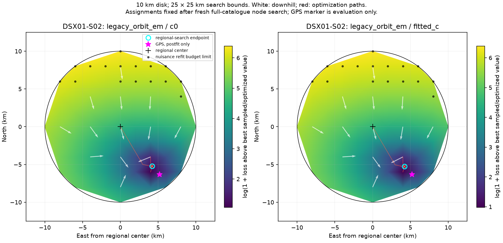
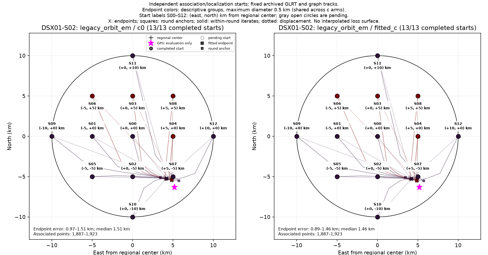

# DSX01-S02: legacy_orbit_em — complete; c = 0 13/13, fitted c 13/13 starts

## Original 10 km conditional loss map

Satellite identities and aliases are fixed during the position sweep.

## New 10 km independent-start map

Satellite discovery and calibration restart independently at each shown starting position; association is refreshed between fitting rounds. These are start-to-endpoint samples, not a probability or loss surface.

[New plot colored by final loss](../../DSX01-S02/legacy_orbit_em/restart_loss.png)
