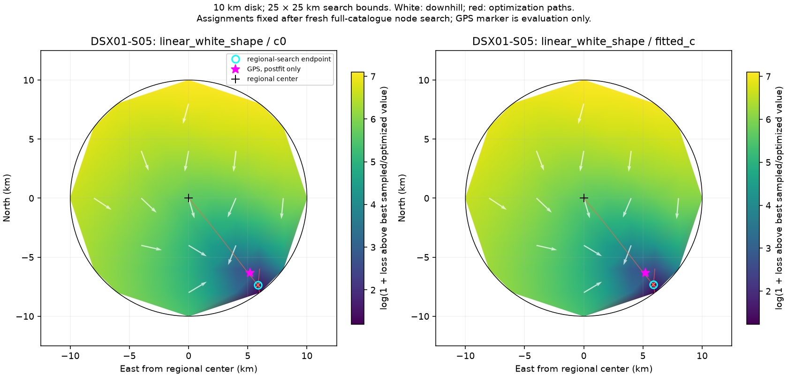

# DSX01-S05: linear_white_shape — pending; c = 0 0/13, fitted c 0/13 starts

## Original 10 km conditional loss map

Satellite identities and aliases are fixed during the position sweep.

## New 10 km independent-start map

**Pending:** no completed restart figure is available for this configuration yet.
