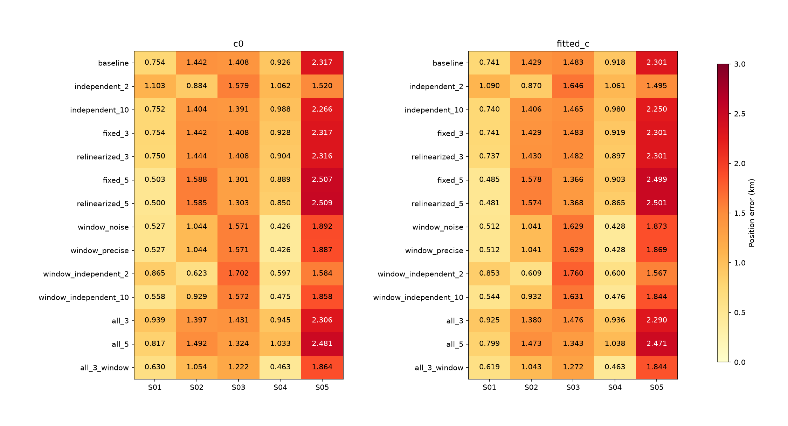
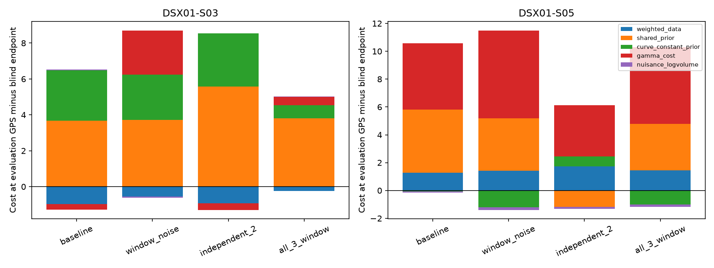
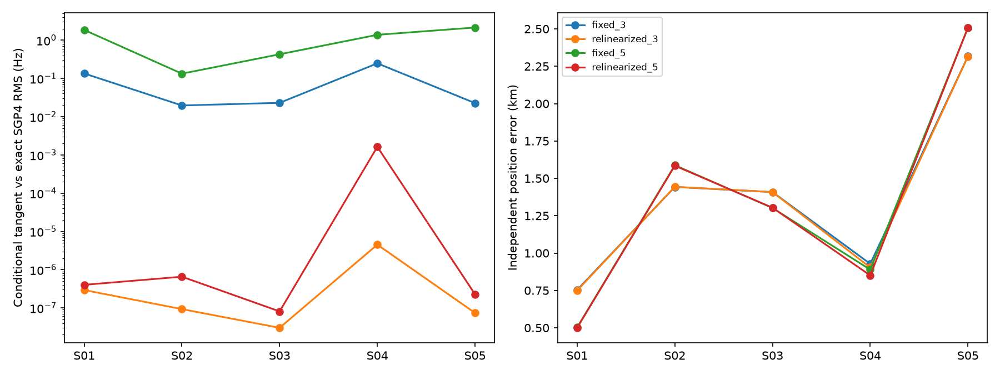
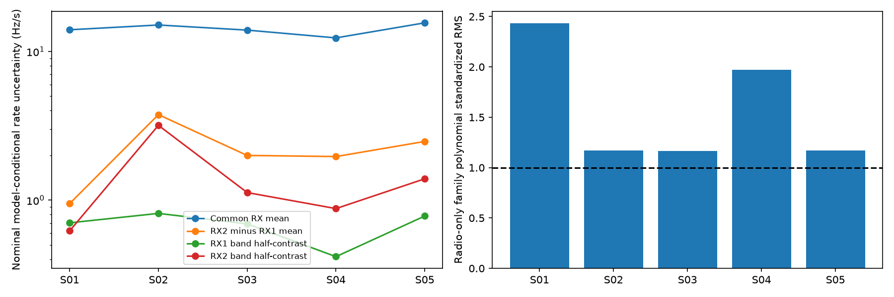

# DSX01: independent band drifts, exact-orbit references and measured point noise

**The independent all-scan sub-1 km goal remains unmet.** This iteration tests
three remedies and two followups on the original curved population. Noise
weighting helps several scans, and combining it with independent band drifts
brings S02 below 1 km, but S03 and S05 remain unresolved. Better numerical
orbit accuracy does not materially change their positions.

This follows the [published joint analysis](../2026_10_18_dsx01_joint_analysis/README.md).
All **12,724 curved observations** remain in every likelihood. No points are
withheld, labels or integer aliases are changed, future TLEs are used, or RF is
collected. GLRT-300 means **300 pilot symbols per frame at 2.5 MS/s**, measured
in archived 20 ms windows.

## Implemented tests and controls

1. **Independent receiver/band drifts:** replace the RX mean/contrast prior
   (10 and 0.5 Hz/s, implying 0.995 low/high prior correlation) with four
   independent Gaussian rates at either 2 or 10 Hz/s. This changes a declared
   hardware hypothesis; neither scale was selected using GPS error.
2. **Exact physical relinearization:** update mean-motion, inclination, RAAN
   and optional two eccentricity directions around exact combined SGP4
   states. Absolute priors remain centered on the original causal orbit.
   Fixed-reference controls have the same four outer rounds. Mean motion
   preserves scan-midpoint mean longitude.
3. **Measured per-observation noise:** estimate a frame-scatter feature after
   removing an intercept and linear within-window chirp. Calibrate it using
   radio-only polynomial residuals before geography. Enable it only if the
   extra parameter improves radio-only BIC. Retain every observation, with
   fallback scales for unsupported features. All five radio BIC gains are
   positive; this is not evidence of improved localization.

The combination uses the same fixed noise vectors with independent band
drifts. A further all-candidate covariance control gives causal physical
uncertainty to single-owner satellite hypotheses too. The usual requirement
for two RX/channel owners still governs acceptance of orbital corrections;
giving a candidate uncertainty does not authenticate it.

All searches use the **25 × 25 km** Mill Valley box centered at
**37.906°, −122.545°**, 25 grid nodes, three shared `c=0`-selected starts and
24 geographic iterations per start and arm. Radio/covariance alternatives use
three phase-reference rounds; the fixed/relinearized physical pair uses four.
Each **`c=0` / fitted-`c`** pair keeps observations, candidates, aliases, other
priors, starts and budgets matched. The known coordinate
**37.849061591561885°, −122.48574968092912°** enters postfit evaluation only.
Scans are fitted independently. This is exploratory work on the same corpus,
not an independent validation set.

## Position results

Errors are km, **`c=0` / fitted `c`**. `window_precise` is a numerical control
for the same point-noise model, not another physical algorithm.

| Model | S01 | S02 | S03 | S04 | S05 |
| --- | ---: | ---: | ---: | ---: | ---: |
| baseline | 0.754 / 0.741 | 1.442 / 1.429 | 1.408 / 1.483 | 0.926 / 0.918 | 2.317 / 2.301 |
| independent_2 | 1.103 / 1.090 | 0.884 / 0.870 | 1.579 / 1.646 | 1.062 / 1.061 | 1.520 / 1.495 |
| independent_10 | 0.752 / 0.740 | 1.404 / 1.406 | 1.391 / 1.465 | 0.988 / 0.980 | 2.266 / 2.250 |
| fixed_3 | 0.754 / 0.741 | 1.442 / 1.429 | 1.408 / 1.483 | 0.928 / 0.919 | 2.317 / 2.301 |
| relinearized_3 | 0.750 / 0.737 | 1.444 / 1.430 | 1.408 / 1.482 | 0.904 / 0.897 | 2.316 / 2.301 |
| fixed_5 | 0.503 / 0.485 | 1.588 / 1.578 | 1.301 / 1.366 | 0.889 / 0.903 | 2.507 / 2.499 |
| relinearized_5 | 0.500 / 0.481 | 1.585 / 1.574 | 1.303 / 1.368 | 0.850 / 0.865 | 2.509 / 2.501 |
| window_noise | 0.527 / 0.512 | 1.044 / 1.041 | 1.571 / 1.629 | 0.426 / 0.428 | 1.892 / 1.873 |
| window_precise | 0.527 / 0.512 | 1.044 / 1.041 | 1.571 / 1.629 | 0.426 / 0.428 | 1.887 / 1.869 |
| window_independent_2 | 0.865 / 0.853 | 0.623 / 0.609 | 1.702 / 1.760 | 0.597 / 0.600 | 1.584 / 1.567 |
| window_independent_10 | 0.558 / 0.544 | 0.929 / 0.932 | 1.572 / 1.631 | 0.475 / 0.476 | 1.858 / 1.844 |
| all_3 | 0.939 / 0.925 | 1.397 / 1.380 | 1.431 / 1.476 | 0.945 / 0.936 | 2.306 / 2.290 |
| all_5 | 0.817 / 0.799 | 1.492 / 1.473 | 1.324 / 1.343 | 1.033 / 1.038 | 2.481 / 2.471 |
| all_3_window | 0.630 / 0.619 | 1.054 / 1.043 | 1.222 / 1.272 | 0.463 / 0.463 | 1.864 / 1.844 |

For an equal three-round comparison, a single lowest normalized `c=0` bound
rule selects: **S01 all_3_window (0.619 km); S02 all_3_window (1.043 km); S03 all_3_window (1.272 km); S04 window_precise (0.428 km); S05 window_precise (1.869 km)**. Fixed/relinearized four-round experiments
are excluded from this selection, and the precise noise solver replaces its
less converged version. The omitted fixed white-noise volume is restored
before comparing noise models. This is a heuristic score rule, not calibrated
model probability; noise features were developed on this same corpus.
Choosing each scan's lowest GPS error would be an oracle.

## Why does the wrong position still win?

On S03, the baseline weighted frequency residual cost is **0.969
units lower at the true position**, yet its shared prior costs increase by
**3.680** and its per-fragment constant prior by
**2.810**. The total bound favors the displaced
endpoint by **5.256** units. This is a regularization
and model-identification tradeoff, not evidence that the data require the
wrong coordinate. All nuisance means are refitted at both diagnostic sites
using the same numerical phase/orbit reference; GPS is absent from inference.

Exact physical relinearization greatly reduces conditional-mean approximation
error while barely moving the final positions. Thus the measured tangent
error is not the main cause of the current kilometre-scale displacements.
This validates a local conditional mean, not exact nonlinear marginalization.

An orbit-free radio diagnostic projects out RF-scaled family polynomials and
measures hardware information. Common RX mean drift has nominal uncertainty
about 12–16 Hz/s; relative RX drift and band contrasts are much better
constrained. Its standardized residual RMS exceeds one, especially on S01
and S04, so these are optimistic, model-conditional information estimates.
They are not fed back as new independent priors on the same measurements.

Local curvature of the nuisance-integrated bound gives the following formal
principal scales for `c=0`, with covariance twice the inverse Hessian. These are
conditional on labels and model assumptions and are **not calibrated position
confidence**. The complete matched-c diagnostics are in
[local information](local_information.json).

| Scan | Baseline local principal scales (km) | Noise-weighted scales (km) |
| --- | ---: | ---: |
| S01 | 0.425 / 0.624 | 0.402 / 0.588 |
| S02 | 0.387 / 0.612 | 0.358 / 0.525 |
| S03 | 0.445 / 0.617 | 0.406 / 0.555 |
| S04 | 0.509 / 0.883 | 0.451 / 0.772 |
| S05 | 0.524 / 0.721 | 0.410 / 0.604 |

## Coverage and frequency accuracy

Acceptance uses the original white-residual gates. The denominator is 12,724
curved points, not all raw GLRT detections. Counts can fall when a candidate's
uncertainty now activates the existing two-owner gate. Those observations
remain in the inference likelihood. Linear-track transfer was not rerun.
RMS comparisons use common accepted observations within each matched pair.

| Model, fitted `c` | Accepted curved points | % of curved | Curves | Points/curve | Common-point RMS, c0 / fitted c (Hz) |
| --- | ---: | ---: | ---: | ---: | ---: | ---: |
| baseline | 11,362 | 89.30% | 308 | 36.89 | 131.427 / 131.419 |
| independent_2 | 11,169 | 87.78% | 304 | 36.74 | 130.179 / 130.174 |
| independent_10 | 11,362 | 89.30% | 308 | 36.89 | 131.409 / 131.401 |
| fixed_3 | 11,362 | 89.30% | 308 | 36.89 | 131.427 / 131.419 |
| relinearized_3 | 11,362 | 89.30% | 308 | 36.89 | 131.428 / 131.420 |
| fixed_5 | 11,362 | 89.30% | 308 | 36.89 | 131.309 / 131.300 |
| relinearized_5 | 11,362 | 89.30% | 308 | 36.89 | 131.311 / 131.301 |
| window_noise | 10,825 | 85.08% | 296 | 36.57 | 130.762 / 130.752 |
| window_precise | 10,825 | 85.08% | 296 | 36.57 | 130.762 / 130.751 |
| window_independent_2 | 10,882 | 85.52% | 297 | 36.64 | 130.930 / 130.923 |
| window_independent_10 | 10,920 | 85.82% | 298 | 36.64 | 130.575 / 130.564 |
| all_3 | 10,345 | 81.30% | 275 | 37.62 | 131.681 / 131.663 |
| all_5 | 10,345 | 81.30% | 275 | 37.62 | 131.552 / 131.530 |
| all_3_window | 9,879 | 77.64% | 265 | 37.28 | 131.028 / 130.999 |

## Numerical controls and reproducibility

The grouped Student bound matches the observation-space implementation on all
five saved noise-model endpoints, with score differences below 1e-5 and native
prediction differences below 1e-4 Hz. Measured kernel timings improve by about
sixfold; these are host numerical timings, not embedded-device benchmarks.
The 24-iteration latent solver had not converged on S05. `window_precise`
allows 256 updates with the same tolerance, observations and physical model.
See [backend/convergence controls](precision_backend_checks.json).

[Evaluation CSV](evaluation_summary.csv), [matched c controls](c_ablation.csv),
[full gate and objective details](frequency_details.json), and
[input bindings](evaluation_bindings.json) preserve frequency fit separately
from position error. There are **460 evaluated fit records /
230 matched pairs**, including reused controls and all outer rounds.

The next hypotheses should target the remaining source of bias: robust
satellite-level orbital priors, geometry consensus across independently
supported satellite families, and further carrier-frequency evidence from
the existing recordings. These are proposed next tests, not claimed fixes.
Production contracts and golden fixtures are unchanged. No new RF collection
is needed for the next bounded analysis.

The [frozen test receipt](frozen_tests.json) records **167 passing tests**. [Source hashes](source_manifest.json) pin **383 source snapshots**; [input hashes](input_manifest.json) pin **388 numerical/protocol inputs**. See the [completed-checkpoint validation](validation.json) and [frozen product replay](frozen_endpoint_replay.json).
