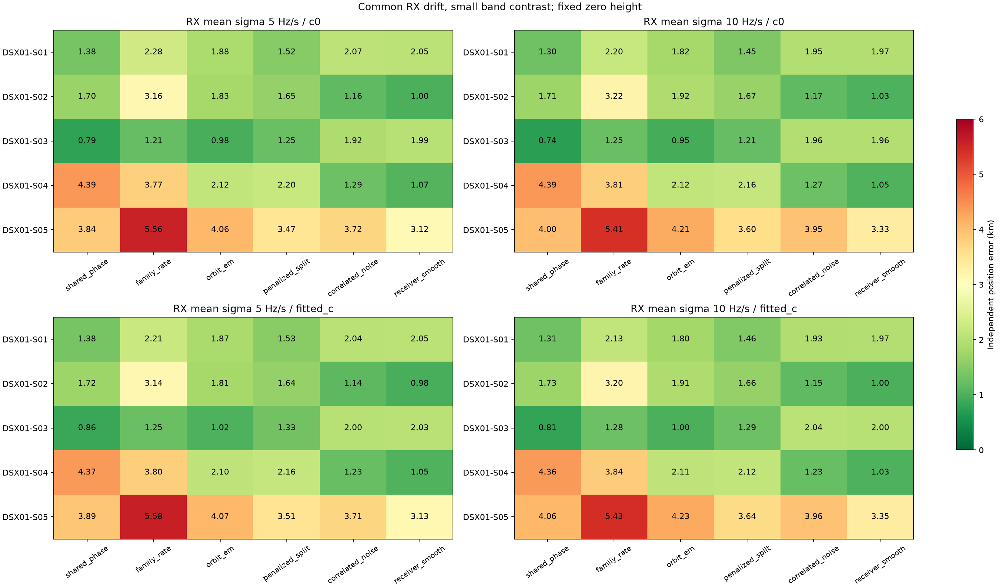
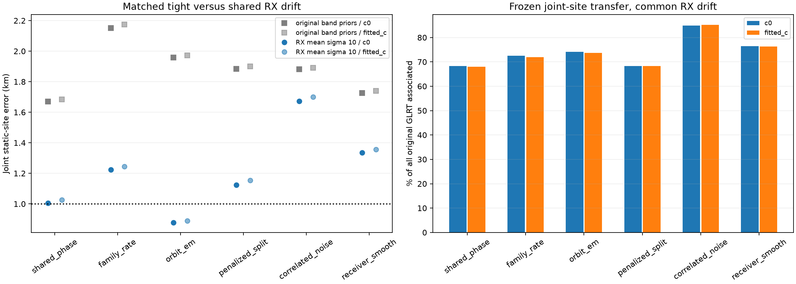
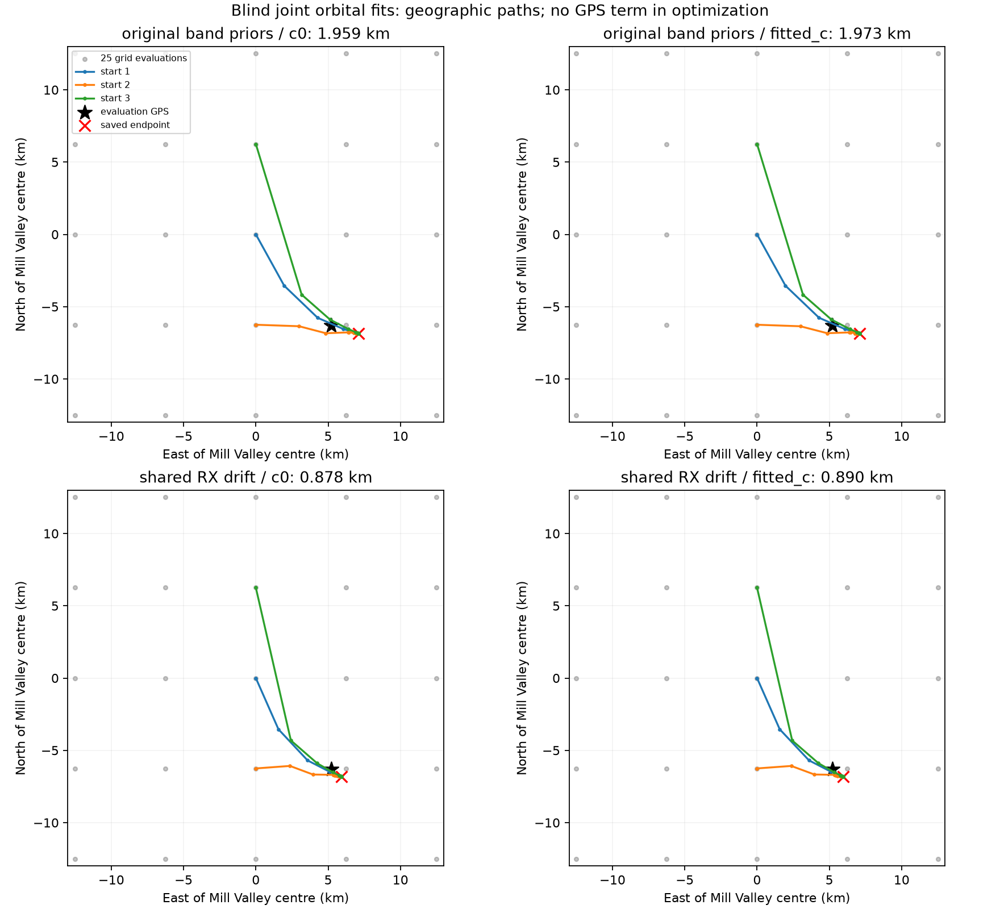
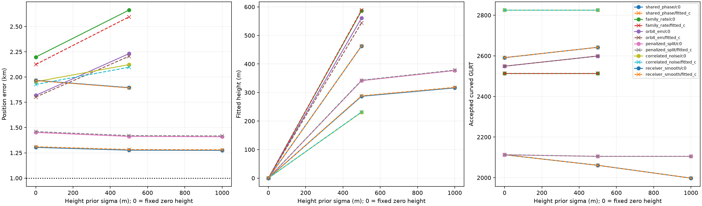

# DSX01: receiver drift, orbit checks, and a sub-kilometre joint fit

The new **joint static-site orbital fit reaches 876 m with `c=0` and 888 m with fitted `c`**, after exact-SGP4 relinearization. All five scans contribute their original curved observations; each scan retains its own receiver/band offsets, receiver drifts and satellite corrections. This is a joint frequency fit from the Mill Valley grid, not an arithmetic average of independently fitted positions.

This result assumes the receiver remained at one site between **16:15 and 22:37 UTC on 2026-10-16**. It does **not** establish reliable sub-1 km localization independently for every scan, or for every physical model. That broader goal remains open. The [preceding report](https://github.com/misko/leo-tracker-reduxredux/blob/main/reports/2026_10_18_dsx01_model_iterations/README.md) and [original S01 loss maps](https://github.com/misko/leo-tracker-reduxredux/blob/main/reports/2026_10_18_s01_local_loss/README.md) describe the earlier stages.

## Controls

The rounded Mill Valley centre remains **37.906, −122.545**. The search square is **25 × 25 km**, with 25 grid evaluations and three common `c=0`-selected geographic starts, each receiving at most 24 joint optimization iterations. The evaluation GPS **37.849061591561885, −122.48574968092912** is read only by reporting and explicitly marked oracle-audit programs. It never initializes the blind fits or enters their objectives. Exploratory model development uses this dataset and its errors; these are not independent generalization results.

Only the original individually curved fragments calibrate or locate: at least 20 s span and 250 Hz affine residual RMS. No random or interval withholding is used. Linear fragments receive calibration only after the position and nuisance parameters have been frozen. The denominator for complete-corpus association remains **20,084 original GLRT points**. Graph partition observation IDs are unique in every scan; points outside retained polynomials remain in that denominator.

The four RX/band constant offsets stay independent. The new drift prior uses a common rate per receiver and a smaller difference between its two bands:

`low-band rate = RX mean − band contrast`

`high-band rate = RX mean + band contrast`

Mean prior sigmas 5 and 10 Hz/s are tested, with contrast sigma 0.5 Hz/s and bounds ±3 prior sigmas. Parameter count is unchanged. The matched original-prior control retains four independent band rates with sigma 0.5 Hz/s and bounds ±1 Hz/s. The filename marker `mean_0` denotes that original control; it does not mean a zero-width prior.

Both `c` arms retain the same observations, candidate sets, nominations, aliases, other priors, geographic starts and iteration budgets within each experiment. `c` remains the constant RF-dependent calibration term. **Frequency fit and position accuracy are reported separately.** Latest-causal TLEs and the original radio-only graph partition are unchanged. Candidate identities remain unverified hypotheses. Composite losses are not calibrated probabilities.

## Independent scan results: the drift change is not universal

The following uses common-RX sigma **10 Hz/s**, fixed zero height. Errors are kilometres, **`c=0` / fitted `c`**. These estimates use each scan independently.

| Model | S01 | S02 | S03 | S04 | S05 |
| --- | ---: | ---: | ---: | ---: | ---: |
| Shared phase | 1.304 / 1.311 | 1.714 / 1.731 | **0.745 / 0.815** | 4.391 / 4.363 | 3.998 / 4.057 |
| Family rate | 2.198 / 2.125 | 3.218 / 3.204 | 1.245 / 1.284 | 3.811 / 3.843 | 5.407 / 5.429 |
| Orbital correction | 1.819 / 1.802 | 1.922 / 1.908 | **0.954 / 0.997** | 2.124 / 2.107 | 4.208 / 4.232 |
| Penalized subdivision | 1.452 / 1.460 | 1.672 / 1.662 | 1.209 / 1.286 | 2.161 / 2.120 | 3.601 / 3.644 |
| Correlated noise | 1.954 / 1.927 | 1.167 / 1.150 | 1.958 / 2.041 | 1.274 / 1.231 | 3.951 / 3.959 |
| Smooth receiver | 1.967 / 1.965 | 1.027 / 1.003 | 1.965 / 2.000 | 1.048 / 1.030 | 3.331 / 3.348 |

This sweep contains 120 evaluated fit records, including 12 explicitly reused S01 controls. Wider common drift improves S01 and several S03 fits, but some S02/S04 fits worsen. It is not sufficient as an independent-scan repair.

## Joint static-site comparison

The joint factors share only the position. Hardware and satellite parameters remain independent for each scan. None of the nominated satellite NORADs repeats across these scans, so this test cannot learn a repeatedly observed satellite's correction across scans. Priors are not duplicated for any shared position parameter.

The tight versus common-drift controls use identical centre-seed bytes, nominations, 25 grid locations, three geographic starts and parameter counts for all six models. Both `c` arms have matched budgets. Errors below precede the orbital exact-SGP4 continuation and are kilometres, **`c=0` / fitted `c`**.

| Model | Original band drift priors | Common RX drift prior | All-GLRT associated %, common drift |
| --- | ---: | ---: | ---: |
| Shared phase | 1.669 / 1.683 | 1.004 / 1.026 | 68.32 / 68.04 |
| Family rate | 2.152 / 2.175 | 1.224 / 1.244 | 72.58 / 72.00 |
| Orbital correction | 1.959 / 1.973 | **0.878 / 0.890** | 74.15 / 73.67 |
| Penalized subdivision | 1.884 / 1.899 | 1.124 / 1.153 | 68.29 / 68.36 |
| Correlated noise | 1.881 / 1.892 | 1.672 / 1.700 | **84.95 / 85.16** |
| Smooth receiver | 1.725 / 1.739 | 1.335 / 1.357 | 76.39 / 76.34 |

The correlated-noise method associates the most points but has a substantially larger position error. Its covariance model changes the residual criterion. Greater coverage alone does not identify the best localization model. Comparisons across different physical models remain exploratory; GPS error does not select the operational model within any fit.

## Exact-SGP4 check and continuation

For every nominated orbital candidate in all five scans, the uncorrected bank positions and velocities exactly equal propagation of the frozen causal TLE entries. This rules out a mismatch between those two nominal sources for the inspected candidates; it is not an audit of every unused candidate.

The original eccentricity-vector tangent corrections differ from exact corrected SGP4 by up to **9.45 Hz** on observed CFO points. I therefore relinearized the corrected orbital states and derivatives around the inherited blind endpoint, retaining the original zero-mean orbital priors. The continuation uses three common geographic starts inherited from the blind `c=0` fit, 24 iterations per start, and no evaluation GPS.

The resulting errors are **875.9 / 888.1 m**. Across all five scans and both arms, final predicted CFO differs from exact corrected propagation by at most **0.156 Hz**, with RMS at most **0.040 Hz**. This checks the numerical orbit approximation, not the truth of the chosen satellite labels or an empirical uncertainty interval. Exact propagation is also used in the final frozen association transfer.

| Scan | Associated points, c=0 / fitted c | Raw GLRT | Associated %, c=0 / fitted c |
| --- | ---: | ---: | ---: |
| S01 | 3,891 / 3,891 | 4,797 | 81.11 / 81.11 |
| S02 | 2,656 / 2,547 | 3,524 | 75.37 / 72.28 |
| S03 | 3,055 / 3,066 | 3,988 | 76.60 / 76.88 |
| S04 | 2,633 / 2,633 | 3,719 | 70.80 / 70.80 |
| S05 | 2,658 / 2,658 | 4,056 | 65.53 / 65.53 |
| **Total** | **14,893 / 14,795** | **20,084** | **74.15 / 73.67** |

There are **546 / 544** accepted association segments and **27.3 / 27.2 GLRT points per segment**. Position and all nuisance parameters are frozen before linear-track transfer; no legacy tight-drift calibration update is called.

On **14,784 common accepted points**, candidate identities agree for every point. Native residual RMS is **143.308 / 143.306 Hz**, while position error is **875.9 / 888.1 m**. Fitted `c` provides no material common-point RMS benefit and slightly worsens position and total coverage. Full [exact c ablation](exact_joint_c_ablation.csv), [exact summary](exact_joint_summary.csv), and [per-scan association table](exact_transfer_per_scan.csv) preserve these distinctions.

## Additional independent S01 repairs tested

The following controls all start from the same blind centre nominations. Only the candidate-refresh continuation inherits the completed blind common-drift endpoint. Reported errors use fitted `c`; complete paired metrics are in [supplementary_controls.csv](supplementary_controls.csv) and [supplementary_c_ablation.csv](supplementary_c_ablation.csv).

| Control | Result and interpretation |
| --- | --- |
| Unknown shared receiver height | Start at zero, Gaussian sigma 500 or 1,000 m, bounds −100 to 1,500 m. Shared-phase error changes 1.311 → 1.283/1.281 km; the other five models do not establish a sub-kilometre solution. Fitted height is a nuisance hypothesis, not a terrain measurement. |
| Candidate phase exploration + refresh | Profile coherent candidate phases at the wider-drift endpoint without calling the legacy ±1 Hz/s update. Three rounds return the same 1.311 km solution; the incumbent is retained by objective. |
| Weaker phase priors after releasing drift | Inflate existing phase sigmas by 3×/10×, retaining ±15 s bounds. Error worsens to 1.412/1.430 km although frequency-plus-prior loss decreases. |
| Shared per-satellite mean motion | Gaussian sigmas 0.0015/0.005 rev/day, two curved RX/channel owners required. The original TLE-epoch tangent gives 1.344/1.338 km. A better-conditioned reference holds mean longitude near scan midpoint, separating size/rate from accumulated phase: errors worsen to 1.481/2.228 km. More accepted points do not establish better position. |
| Whole-family consensus with wider RX drift | Bound each normalized family's data and phase-prior energy; retain hardware priors outside that cap. Error improves modestly to 1.251 km. Its transformed objective is not numerically comparable to the uncapped objective. |

The height controls cover all six S01 physical models; the additional phase, identity, mean-motion and family-consensus controls currently cover the S01 shared-phase model. The whole investigation contains **196 evaluated fit/stage records**, including reused controls and the two exact orbital continuations, rather than 196 independent algorithms.

## What still drives the wrong independent S01 position?

The explicitly separated oracle-only audit refits nuisance parameters at GPS while preserving the blind nominations. For the shared-phase common-drift model with fitted `c`, the displaced endpoint has loss **1653.03** versus **1664.03** at GPS. Its data term improves by **11.24**, while prior/visibility cost worsens by **0.24**. The remaining reward for displacement is mostly a data-model/identity effect, not a tighter radio prior alone.

The strongest candidate-family data rewards, blind minus GPS, are **100168: −7.44**, **69523: −3.53**, **62052: −2.96**, and **69333: −2.73**. Other families oppose the movement. Candidate 100168 contains six curved fragments / 240 points. No family is removed merely because it moves the result away from evaluation GPS.

After aligning the previous causal orbit in phase, old-minus-new median radial/cross-track disagreements over 0/150/300 s are approximately:

| Candidate | Radial (m) | Cross-track (m) |
| --- | ---: | ---: |
| 100168 | −347 | −154 |
| 69523 | +768 | −21 |
| 69333 | +388 | −12 |
| 62052 | −23 | −20 |

These are metadata-only prediction disagreements, not measured orbit errors or calibrated covariances. They motivate a **shared orbital uncertainty model** rather than interpreting every smooth discrepancy as a receiver ramp. The unsuccessful mean-motion controls show that simply adding another independently fitted orbital parameter is insufficient.

The next bounded iteration should check each scan's influence on the joint result and model causal orbital uncertainty as a shared low-rank covariance with a justified likelihood/volume penalty, then reassess family leverage and independent-scan position. An explicit signal/clutter mixture could also replace obligatory nomination of every curved fragment. The present joint result is useful, but it does not resolve independent S01/S04/S05 bias or prove which satellite hypothesis is true.

## Verification and artifacts

**48 focused tests pass**, including a run from the frozen source closure ([test log](focused_tests.json)). They cover height-versus-dense geometry, sparse orbit predictions, shared mean-motion effects, reference-time SGP4 approximation, exact eccentricity relinearization, prior-coordinate composition, bounded joint optimization, candidate phase coherence, and frozen linear transfer. Ruff passes for the changed numerical helper, tools and tests. A clean replay with no derived caches reproduces **all 28 table/figure products byte-for-byte** ([replay log](clean_replay.json)). No RF was collected, no golden scientific fixture changed, and archive/QNAP data remain read only.

[validation.json](validation.json) checks **98 matched c pairs**, bounded monotone paths and all six matched joint drift controls. It recomputes RMS, bias, mean/slope/quadratic/step/ACF residual gates and ownership on **7,727 accepted records** across methods, scans and c arms (repeated checks, not distinct physical tracks). Graph observation IDs and accepted IDs are unique. There are no ownership violations.

Machine-readable results include [independent fits](evaluation_summary.csv), [independent c ablation](c_ablation.csv), [joint fits](pooled_summary.csv), [joint c ablation](pooled_c_ablation.csv), [full transfer totals](pooled_transfer_totals.csv), and the exact tables above. [exact_joint_orbit_refined_audit.json](exact_joint_orbit_refined_audit.json) records final SGP4 approximation checks. The `oracle_only` directory is diagnostic and must never initialize inference.

New fit tools are `prototype_dsx01_receiver_geometry.py`, `prototype_dsx01_receiver_phase.py`, `iterate_dsx01_receiver_identity.py`, `prototype_dsx01_mean_motion.py`, `prototype_dsx01_receiver_consensus.py`, `prototype_dsx01_receiver_pool.py`, and `refine_dsx01_exact_receiver_orbits.py`. `report_*`, `transfer_*` and `audit_*` programs evaluate saved results; evaluation GPS is isolated to those reporting/diagnostic paths. Run with the repository virtual environment and `OPENBLAS_NUM_THREADS=1 OMP_NUM_THREADS=1 PYTHONPATH=src:tools`.

Per-experiment protocols bind source/seed versions and budgets. Local source snapshots and artifact/input hashes are recorded in [manifest.json](manifest.json); they preserve this completed iteration without changing the preceding published report.
