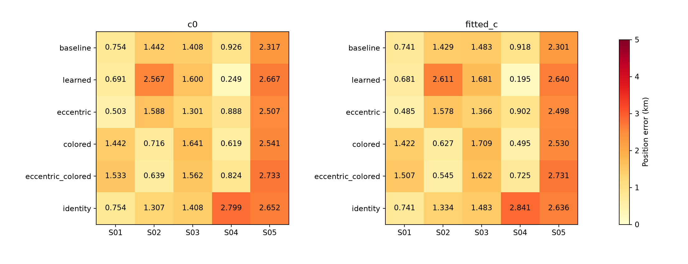
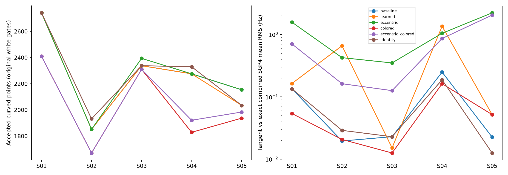
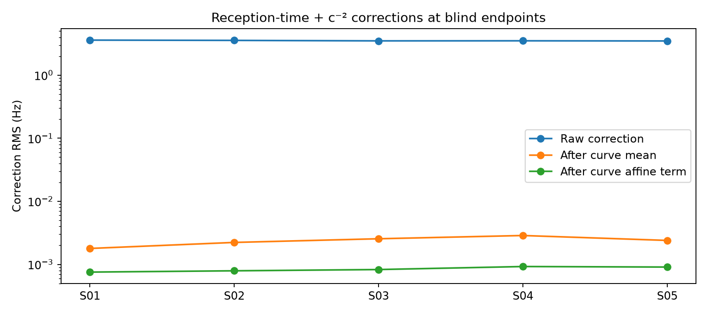

# DSX01: orbital span, structured residuals and satellite-label updates

The independent all-scan sub-1 km goal remains open. Additional eccentricity
directions improve S01 to **485 m**; a colored-residual/eccentricity combination
improves S02 to **545 m**; completed variance learning reaches **195 m** on S04.
These are different conditional models. A uniform lowest-score selection rule
still exceeds 1 km on S01, S03 and S05. None of these alternatives fixes S05.

## Hypotheses tested

This continues the [joint nuisance integration study](../2026_10_18_dsx01_joint_marginal/README.md).
Its robust likelihood keeps every curved observation, yet some nominations
failing the final residual-structure screen still affect calibration.

Three remedies were implemented and tested:

1. **Broader causal orbital covariance.** Add the two eccentricity-vector
   directions to the existing phase, mean-motion, inclination and RAAN model.
   The earlier causal TLE is propagated to the latest causal TLE epoch before
   comparing eccentricity vectors. Component sigmas are clipped to 1e-5–5e-4;
   a missing earlier element set uses 1e-4. These engineering floors/caps and
   causal differences are uncertainty hypotheses, not calibrated confidence.
2. **Colored residuals.** Add a fixed 150 Hz exponential covariance with 10 s
   correlation time to each fragment's radio-derived white covariance. Student
   latent precision scales that entire fragment covariance. Its determinant
   relative to the original white covariance is included, so flexibility has
   a volume cost. Eccentricity and colored residuals are also tested together.
3. **Full-objective satellite updates.** Generate phase/label proposals, preserve
   timing-linked groups, then rerank individual group changes and their joint
   batch using the complete robust integrated `c=0` objective. At most one
   candidate batch per round receives a full refit. An update requires at least
   one score unit of improvement; its exact fitted-`c` partner follows it.
   There are at most two rounds. This is a heuristic alternating search.

The previously launched robust variance-learning continuation also finished.
It estimates RX mean-drift, RX smooth-error and physical-orbit scale factors.

## Controls and scope

All geographic inference uses the same **25 × 25 km** square centered at
**37.906°, −122.545°**, 25 grid nodes, three common `c=0`-selected starts and
24 bounded iterations per start and arm. There are three phase-reference
rounds. Absolute phase and orbital priors retain zero means. Four independent
receiver/band offsets and RX mean/contrast drift coordinates remain in every
model. Candidate banks and original active-curvature eligibility are unchanged.

All **12,724 curved points** remain in the likelihood; none are withheld.
The latest causal bank and earlier causal uncertainty inputs are frozen.
Satellite labels remain hypotheses. The known coordinate
**37.849061591561885°, −122.48574968092912°** enters only postfit evaluation.
The model-selection rule below uses `c=0` scores, never position error.
This is exploratory development on the same corpus, not held-out validation.

GLRT-300 means **300 known pilot symbols per usable frame**, using archived
**2.5 MS/s, 20 ms IQ windows** with independent frame phases in the estimator.
The transfer report's earlier phrase “300 MHz estimator” was a documentation
error and has been corrected. The preceding frozen joint-model report's
“full-band” wording should be read with this clarification. Numerical
measurements, fits and frozen artifacts have not been changed by that erratum.

## Position results

Errors are km, **`c=0` / fitted `c`**. Each cell contains matched arms with
identical points, labels, aliases, priors and geographic search budgets.

| Model | S01 | S02 | S03 | S04 | S05 |
| --- | ---: | ---: | ---: | ---: | ---: |
| Robust joint baseline | 0.754 / 0.741 | 1.442 / 1.429 | 1.408 / 1.483 | 0.926 / 0.918 | 2.317 / 2.301 |
| Learned variance scales | 0.691 / 0.681 | 2.567 / 2.611 | 1.600 / 1.681 | 0.249 / 0.195 | 2.667 / 2.640 |
| Eccentricity directions | 0.503 / 0.485 | 1.588 / 1.578 | 1.301 / 1.366 | 0.888 / 0.902 | 2.507 / 2.498 |
| Colored residuals | 1.442 / 1.422 | 0.716 / 0.627 | 1.641 / 1.709 | 0.619 / 0.495 | 2.541 / 2.530 |
| Eccentricity + colored | 1.533 / 1.507 | 0.639 / 0.545 | 1.562 / 1.622 | 0.824 / 0.725 | 2.733 / 2.731 |
| Integrated-objective label updates | 0.754 / 0.741 | 1.307 / 1.334 | 1.408 / 1.483 | 2.799 / 2.841 | 2.652 / 2.636 |

The lowest final `c=0` total score across these alternatives chooses colored
residuals on S01, S03 and S05, and eccentricity + colored residuals on S02 and
S04. Its fitted-`c` errors are **1.422, 0.545, 1.709, 0.725 and 2.530 km**.
Thus even volume-penalized fit selection does not select the best position
consistently. Choosing each column's smallest GPS error would be an oracle.

## Frequency fit and coverage

Main acceptance uses the **original white-residual gates** for all alternatives.
For colored models, a separate count uses the assumed colored covariance to
whiten innovations. This distinguishes gaining physical associations from
relaxing the residual model.

| Model, fitted `c` | Curved points passing original gates | Curves | Points passing colored-model gates |
| --- | ---: | ---: | ---: |
| Baseline | 11,362 | 308 | — |
| Learned variance | 11,154 | 304 | — |
| Eccentricity | 11,362 | 308 | — |
| Colored residuals | 10,157 | 286 | 12,195 |
| Eccentricity + colored | 10,357 | 291 | 12,195 |
| Label updates | 11,319 | 308 | — |

These are nominated curved-fragment counts, not final all-GLRT association.
Linear-track transfer was not rerun. Colored-model acceptance assumes the
specified covariance; its larger count is not evidence of correct identities
or better position. The denominator for these counts is 12,724 curved points.

The matched `c` ablation uses the intersection of accepted observations within
each model/scan, then aggregates native squared residuals across those common
points. Position errors remain separate in the table above.

| Model | Common points | Native RMS, `c=0` / fitted `c` (Hz) |
| --- | ---: | ---: |
| Baseline | 11,362 | 131.427 / 131.419 |
| Learned variance | 11,154 | 129.791 / 129.784 |
| Eccentricity | 11,362 | 131.309 / 131.300 |
| Colored residuals | 10,157 | 132.197 / 132.136 |
| Eccentricity + colored | 10,296 | 132.505 / 132.460 |
| Label updates | 11,319 | 130.297 / 130.288 |

The RF-dependent `c` term changes RMS slightly and has mixed position effects.
Neither a larger association count nor smaller in-sample RMS establishes
better localization.

## What did the label updates reveal?

There are no proposed changes on S01 or S03. Four updates are accepted across
S02, S04 and S05; a later S05 proposal is rejected by the full score. Some
accepted updates worsen position. S04 moves from 0.918 to 2.841 km with fitted
`c`, although its `c=0` objective improves by approximately 120.5 units and the
accepted curved-point population grows. This repeats the earlier failure under
a more complete objective: improving an internally consistent fit still does
not authenticate a candidate satellite or remove model bias.

All 30 M-step fit records / 15 matched pairs, including rejected attempts and
intermediate phase rounds, were independently replayed. Selection ledgers were
checked against the one-unit `c=0` acceptance rule and exact partner retention.
See [attempt replay and selection audit](../2026_10_18_dsx01_integrated_labels/attempt_replay.json).

## Exact-orbit mean check

The reported fitting objective locally linearizes physical orbital uncertainty.
A new check combines the inferred mean-motion, inclination, RAAN and optional
eccentricity corrections into an exact SGP4 orbit, then applies the inferred
satellite phase. Mean motion retains the fitter's **scan-midpoint longitude
reference**. Applying it at the TLE epoch without that compensation would
compare different parameterizations; that error was corrected in the new
validation helper before producing the final tables.

For the fitted-`c` baseline, mean differences range approximately 0.022–0.260 Hz
RMS across scans. Eccentricity variants reach approximately **2.26 Hz** on S05;
the learned-variance S04 result has approximately **1.36 Hz** mean difference.
These are small compared with point noise, yet can matter when geographic
discrimination after calibration is only several hertz. The 195 m and 485 m
endpoints are therefore conditional tangent-model results, not evidence that
the nonlinear orbit likelihood has been solved to the same geographic accuracy.
The check validates conditional means, not the full uncertainty law.

## Could signal flight time explain the displacement?

A separate no-refit diagnostic uses each completed blind baseline position and
its frozen satellite labels/phases. It solves emission time iteratively, rotates
emission-frame ECEF states to reception-frame axes, and evaluates the one-way
frequency ratio. A second control adds the second-order velocity and Earth
monopole potential terms. The model follows the one-way frequency expansion in
[Deng and Xie, equations 2–3](https://arxiv.org/html/1312.0725#S2.SS1).
[Orekit's measurement implementation](https://www.orekit.org/site-orekit-12.1/xref/org/orekit/estimation/measurements/RangeRate.html)
also explicitly treats signal transit time.

The raw corrections are several hertz, but after removing a per-track constant,
only approximately **0.0018–0.0029 Hz RMS** remains. After a per-track affine
fit, the remainder is below **0.001 Hz RMS** on every scan. These corrections
are absorbed almost entirely by existing frequency offsets and fragment
constants. They do not explain the observed structured residuals or the
kilometre-scale displacement in this diagnostic. Atmospheric, Shapiro and
higher-order gravitational effects were not included; this is a bounded model
check, not a complete relativistic measurement model.

The [correction protocol and arrays](../2026_10_18_dsx01_reception_doppler/protocol.json)
identify the blind inputs. No additional free correction parameter or
geographic refit was introduced for this test.

## Interpretation and next bounded tests

The experiments distinguish three problems. Shared radio/orbit priors can
dominate small geographic frequency differences. A colored residual model can
absorb mismatches while reducing geographic information. Candidate proposals
can improve the complete likelihood bound and still select a worse physical
position. Full-orbit mean checks additionally expose approximation errors that
a phase-only check misses.

The next model iteration should relinearize the **physical orbital parameters**
as well as phase around exact SGP4 states, while retaining their original
absolute priors. That directly targets the measured 1–2 Hz mean discrepancies.
An independent diagnostic should quantify RX drift information from overlapping
curved tracks across RF channels, allowing shared radio-only polynomials and
checking the design rank. Finally, bounded archived-IQ frame-coherence tests
could establish whether lower carrier-frequency noise is supported by the
recordings. None of these follow-ups is claimed as implemented here; none
requires collecting new RF or selecting data by GPS error.

## Saved evidence

[Evaluation CSV](evaluation_summary.csv), [paired `c` ablation](c_ablation.csv),
[native/colored gate details and exact orbit parameters](frequency_details.json),
and [score-based model selection](c0_model_selection.json) preserve frequency,
coverage and position separately. The primary comparison has **160 evaluated
records / 80 matched pairs**, including reused baseline and selected-label
records. The additional M-step replay covers all 30 attempted fit records.

Inference code, component-owned numerical tests, input hashes and replay
receipts accompany this checkpoint. Original contracts and golden fixtures
remain unchanged; these are research tools. Archived IQ was read-only and no
RF collection was performed. Upstream frozen numerical files remain required;
the corpus is not duplicated into this report.

The [frozen-source test receipt](frozen_tests.json) records **142 passing tests**.
[Source hashes](source_manifest.json) pin **354 source snapshots**, and
[input hashes](input_manifest.json) pin **199 numerical inputs**.
[Frozen replay](frozen_endpoint_replay.json) reproduces all 160 comparison
scores, all 30 M-step scores and **11 JSON/CSV/figure products byte for byte**.
The audit's temporary file paths are canonicalized before comparison; no
numerical values are changed. The earlier frozen joint-model artifacts remain
unchanged. The independent-band-drift continuation is outside this checkpoint.
