# DSX01 S01: local loss surfaces around the known position

The six association models all have local pockets near the supplied GPS position, but none uniquely prefers those pockets: each has a more distant sampled location with lower fitted-`c` loss. The finite calibration procedure, discrete acceptance gates, and candidate reassignment strongly affect the apparent geographic surface. Starting at the correct position can reach a nearby stationary point without identifying the lowest-loss geographic basin.

This is an **oracle diagnostic, not a blind localization result**. GPS intentionally defines both the search region and initial position. The experiment establishes neither a global minimum nor a calibrated geographic probability or uncertainty interval.

## Scope and controls

The reference is **37.849061591561885° N, −122.48574968092912° E**. The search disk has **10 km radius**, rather than 10 km diameter. There is no Gaussian position penalty within that disk. East/north offsets below are relative to this reference; reported distances use the same geographic distance calculation as the preceding comparison.

The input is the existing graph polynomial partition of DSX01 S01: 4,797 original GLRT detections, 170 retained polynomial fragments containing 4,486 points, and the same frozen causal bank of **1,707 satellite candidates**. Calibration and geographic ranking use only raw actively curved fragments, defined by at least 20 s duration and at least 250 Hz affine-fit RMS. Linear tracks can receive associations afterward; they never calibrate or rank positions. Candidate labels remain hypotheses, not authenticated satellite identities.

| Model | Additional mechanism relative to shared phase |
| --- | --- |
| Shared phase | Shared receiver/band offset and drift, per-satellite phase, regularized curve constants |
| Satellite family rate | Additional shared linear frequency correction per supported satellite family |
| Orbital MAP / EM-like | Regularized eccentricity-vector correction and soft whole-curve signal/clutter responsibility updates |
| Penalized subdivision | At most two accepted curved pieces, with a split complexity penalty |
| Correlated noise | Fixed exponential residual covariance; structure gates use whitened innovations |
| Smooth receiver error | Regularized non-affine smooth frequency term shared across curved satellite families on a receiver |

The original `c=0` and fitted-`c` arms retain identical observations, candidate sets, other physical priors, spatial query sets, and nuisance/search budgets. Fitted `c` is the RF-dependent calibration coefficient; fitting it is not evidence of improved position accuracy. The orbital model uses the comparator's tangent eccentricity-vector state approximation; these surface evaluations are not an exact-SGP4 validation of every orbital association.

## How the surfaces were measured

An initial set of **93 common positions** combines a 2 km lattice inside the disk with east/west/north/south probes at 125 m, 500 m, and 1 km. Each location allows **three nuisance proposal rounds**, with candidate associations reselected. The plotted quantity is the existing gated composite loss, including frequency/noise fit, clutter treatment, and prior/complexity terms. It is an **effective finite-budget algorithm loss**, not an exactly optimized profile likelihood.

Two calibration initializations were investigated:

1. **Zero start:** the comparator's zero hardware start and original curved-only seed are reused at each geographic query.
2. **GPS calibration restart:** at GPS, compare eight-round cold and prior-blind-state calibration restarts, then retain the lower-loss state separately for each model/`c` arm. Reuse that same fixed GPS-calibration initialization at every geographic query. Parameters may refit and labels may change; previous candidate identities are not locked. This is intentionally GPS-assisted. Spatial evaluation order does not carry calibration states from one map location to another.

The local search starts exactly at GPS, initially probes **125 m** steps, and refines to **62.5 m**. Descent continuations run until every endpoint has a complete eight-neighbour stationary stencil at 62.5 m. Earlier paths using an initial 2 km step are preserved separately. Those coarse-start paths must not be mistaken for the fine-start result. All **24** fine endpoints (six models × two `c` arms × two initializations) have verified strict descent paths from GPS and no lower-loss tested neighbour at the final stencil. This is a discrete stationarity check, not a mathematical guarantee between samples.

## Local endpoints

Distances and offsets are in metres, rounded from [the full restart summary](warm_restart/summary.csv) and [zero-start summary](summary.csv). Positive east is right; positive north is up.

| Approach | Zero-start distance, fitted `c` | Restart east | Restart north | Restart distance, fitted `c` | Restart distance, `c=0` |
| --- | ---: | ---: | ---: | ---: | ---: |
| Shared phase | 225 | +250 | +62.5 | **257** | 505 |
| Satellite family rate | 225 | +1,875 | +750 | **2,018** | 88 |
| Orbital MAP / EM-like | 225 | +125 | 0 | **125** | 88 |
| Penalized subdivision | 225 | +250 | +62.5 | **257** | 279 |
| Correlated noise | 365 | −62.5 | −250 | **258** | 3,069 |
| Smooth receiver error | 225 | +312.5 | +437.5 | **538** | 2,002 |

Several zero-start fitted-`c` methods terminate at the same location. This is a property of the finite fitter and shared gating transitions; it does not constitute independent agreement on a physical position. Restart calibration changes both the fitted surface and the minimum reached.

### Restarted calibration: fitted `c`

Yellow denotes lower **log10(1 + relative loss)**, not higher calibrated probability. Stars mark GPS, orange marks the fine-start endpoint/path, grey dashed paths/crosses mark the earlier 2 km-start search, magenta marks the best sampled location in the displayed view, and red arrows show the 500 m finite-difference descent direction. Dots are actual evaluations; interpolation is for display. Zoom panels are blank outside the local sample convex hull.

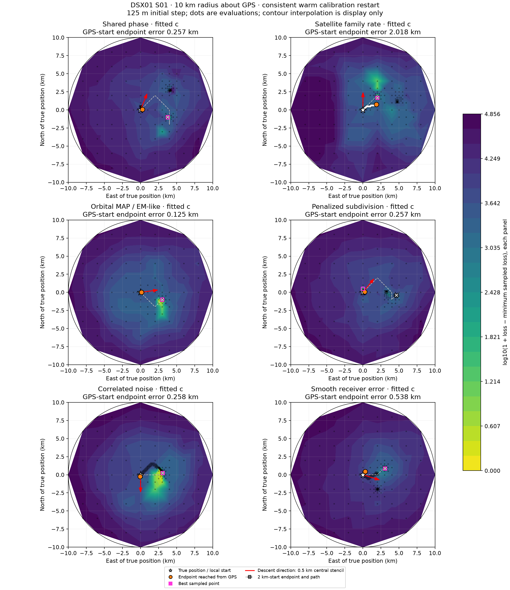

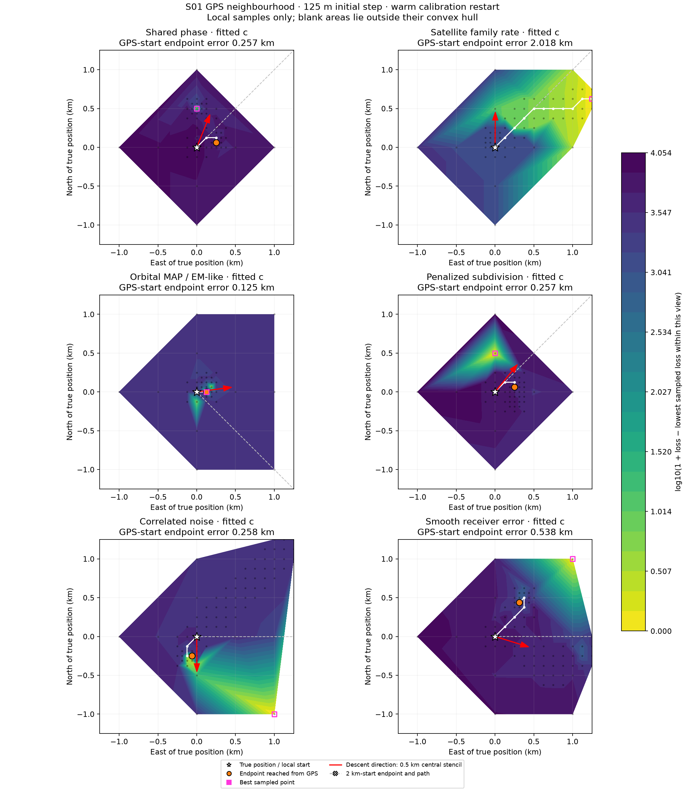

### Restarted calibration: `c=0`

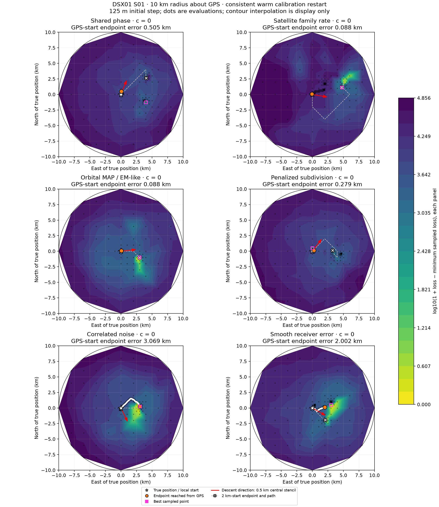

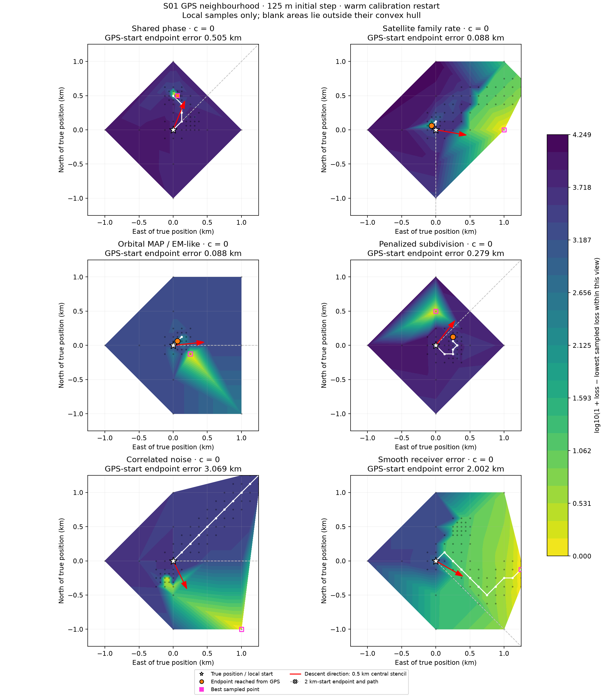

## Nearby stationarity does not identify the preferred basin

The following uses the restarted fitted-`c` branch and the best location actually sampled in its own query set. Losses are rounded; compare locations within one row. These composite losses are not comparable as calibrated probabilities across models, and best sampled does not mean globally optimal.

| Approach | Fine endpoint distance (km) | Fine endpoint loss | Better sampled distance (km) | Better sampled loss |
| --- | ---: | ---: | ---: | ---: |
| Shared phase | 0.257 | 38,903 | 3.878 | 33,685 |
| Satellite family rate | 2.018 | 38,919 | 2.617 | 37,149 |
| Orbital MAP / EM-like | 0.125 | 20,831 | 3.160 | 20,020 |
| Penalized subdivision | 0.257 | 34,622 | 0.501 | 32,076 |
| Correlated noise | 0.258 | 9,109 | 3.069 | 7,508 |
| Smooth receiver error | 0.538 | 22,799 | 3.182 | 18,457 |

Every row has lower loss farther from GPS. Therefore selecting a near-GPS endpoint because its position is accurate would use ground truth to choose among otherwise competing basins. The map does not yet provide a blind rule that reliably selects the correct pocket. [Machine-readable findings](findings.json) preserve the exact values.

## Gradient and calibration sensitivity

Central finite differences estimate east/north gradients at GPS; separate positive and negative differences reveal asymmetry. Directions change with 125 m, 500 m, and 1 km probe size. Hard residual gates, candidate reassignment, and finite calibration basins cause steps rather than a smooth single bowl. A gradient at one scale is not a reliable direction of global geographic improvement.

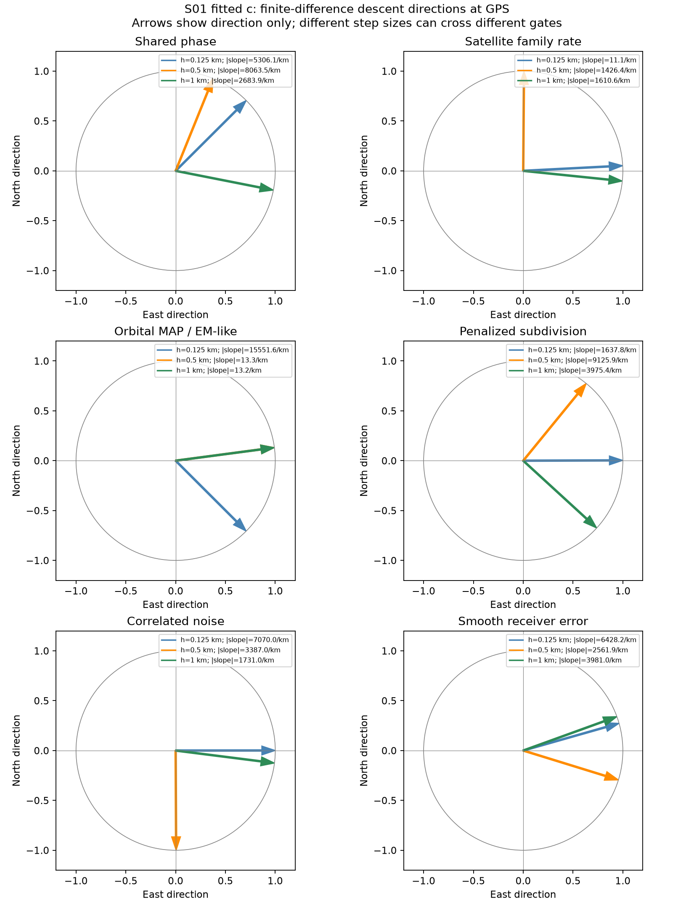

The better GPS calibration restart reduces shared-phase fitted-`c` loss at the *same correct position* from **62,997 to 43,382**. Increasing iterations alone scarcely changes the corresponding cold GPS fit. These differences implicate calibration/assignment initialization, rather than position displacement alone. The [branch comparison](warm_restart/branch_comparison.json), per-method iteration-sensitivity files, and frozen-versus-refitted cuts below separate those effects. Since the finite procedure is not an exact minimization, even an expanded parameter model need not yield a lower returned loss at every position.

## Matched `c` ablation: frequency fit separately from position

This table compares each arm at its own fine-start endpoint. RMS uses the **intersection of accepted curved points** between the two arms, avoiding a misleading comparison between different point populations. Both satellite labels agree for all listed common points. A position change and a calibration change occur together here; the companion [full ablation CSV](warm_restart/c_ablation.csv) additionally compares the arms at the identical GPS position.

| Approach | Common points | Native RMS `c=0` / fitted `c` (Hz) | Innovation RMS `c=0` / fitted `c` (Hz) | Loss `c=0` / fitted `c` | Distance `c=0` / fitted `c` (m) |
| --- | ---: | ---: | ---: | ---: | ---: |
| Shared phase | 1,668 | 129.0 / 128.7 | 129.0 / 128.7 | 34,966 / 38,903 | 505 / 257 |
| Satellite family rate | 1,248 | 125.0 / 120.1 | 125.0 / 120.1 | 40,705 / 38,919 | 88 / 2,018 |
| Orbital MAP / EM-like | 2,270 | 119.2 / 119.3 | 119.2 / 119.3 | 22,281 / 20,831 | 88 / 125 |
| Penalized subdivision | 1,870 | 126.5 / 126.5 | 126.5 / 126.5 | 34,210 / 34,622 | 279 / 257 |
| Correlated noise | 2,660 | 133.7 / 141.6 | 98.7 / 99.9 | 7,501 / 9,109 | 3,069 / 258 |
| Smooth receiver error | 1,308 | 110.8 / 114.9 | 110.8 / 114.9 | 50,599 / 22,799 | 2,002 / 538 |

The family-rate model illustrates the distinction: lower RMS and lower fitted-`c` loss accompany **worse position**, from 88 m to 2,018 m. Correlated noise has a much closer fitted-`c` endpoint despite higher common-point RMS and higher returned loss. There is no consistent position benefit from fitting `c`. None of these diagnostic endpoints should be substituted for independent blind accuracy.

## Per-method surfaces, cuts and paths

Each detail figure combines both `c` arms, their full-region maps, frozen and refitted calibration cuts through GPS, and search paths. The cuts distinguish geographic sensitivity with fixed nuisance parameters from the finite refitted loss.

### Shared phase

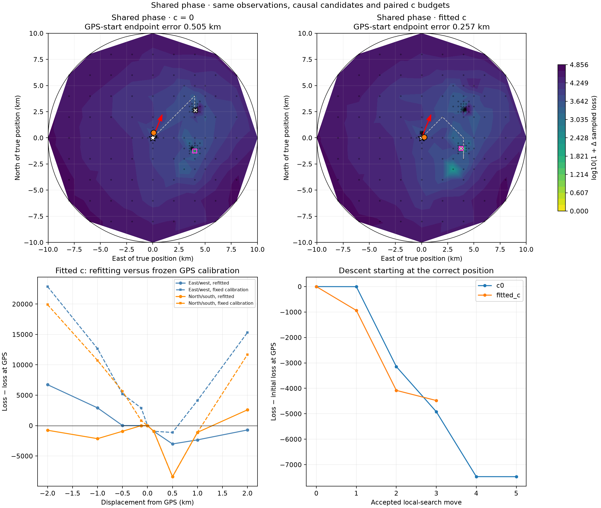

### Satellite family rate

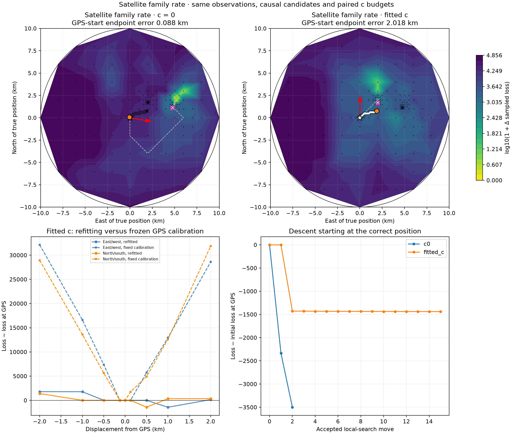

### Orbital MAP / EM-like

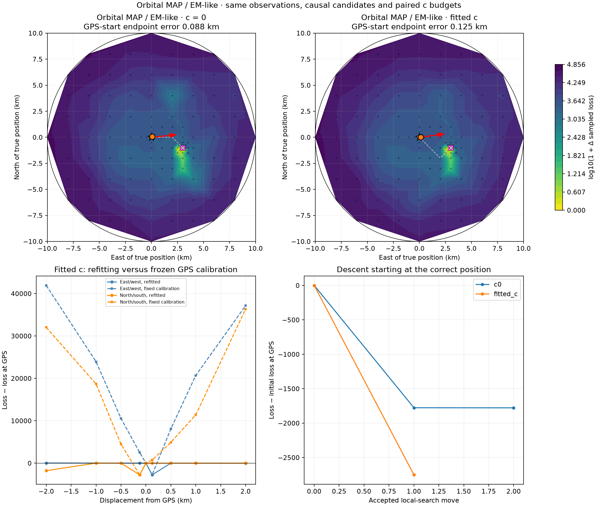

### Penalized subdivision

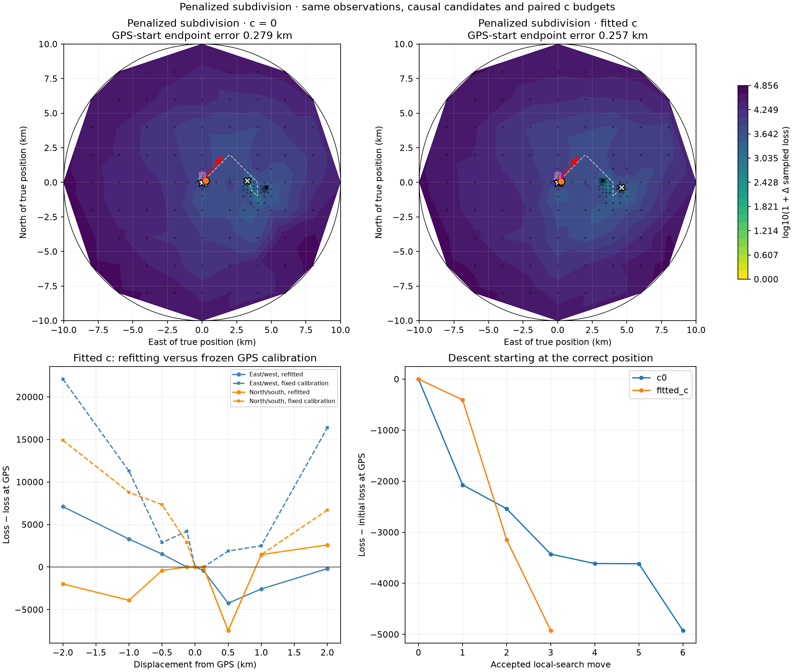

### Correlated noise

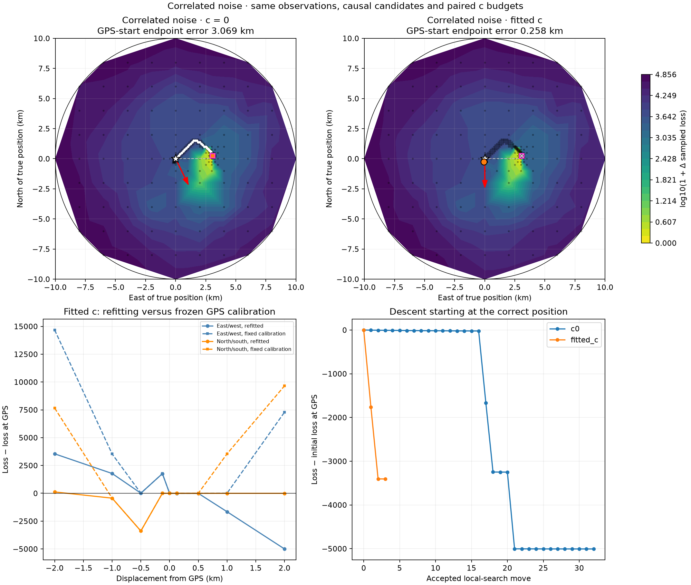

### Smooth receiver error

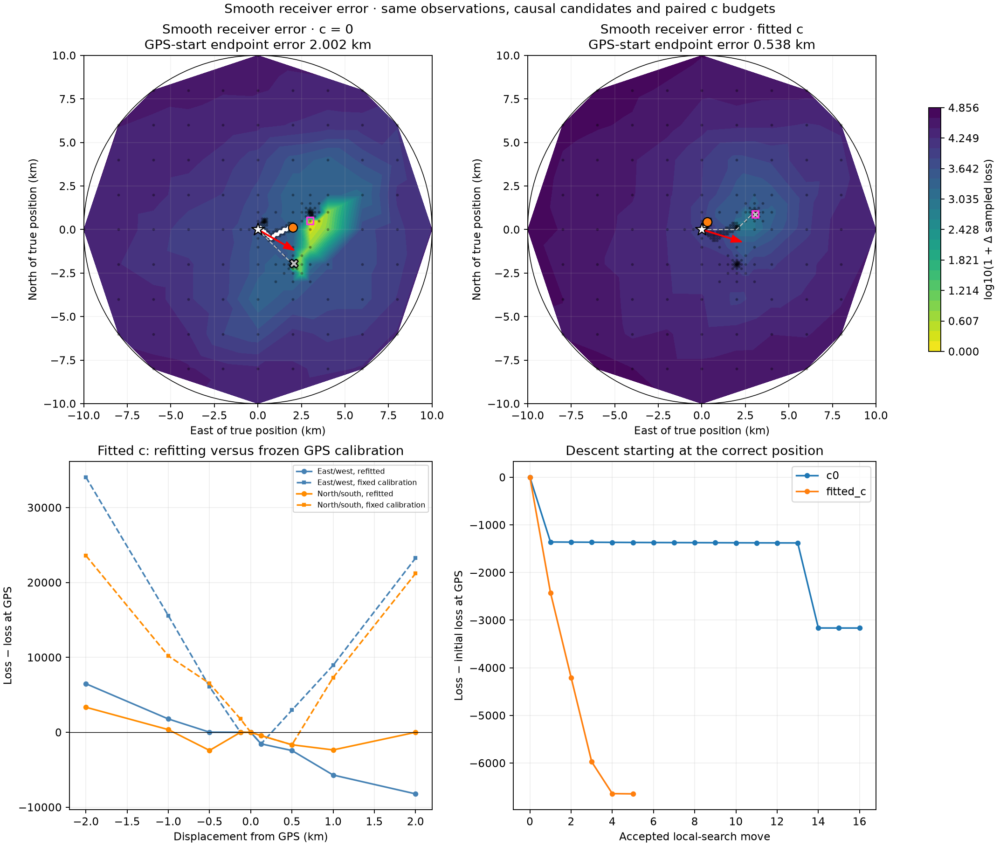

## Original zero-start controls

These use the same physical model, inputs, and priors with the original cold calibration procedure. They should be read alongside the restarted maps, rather than as a different dataset.

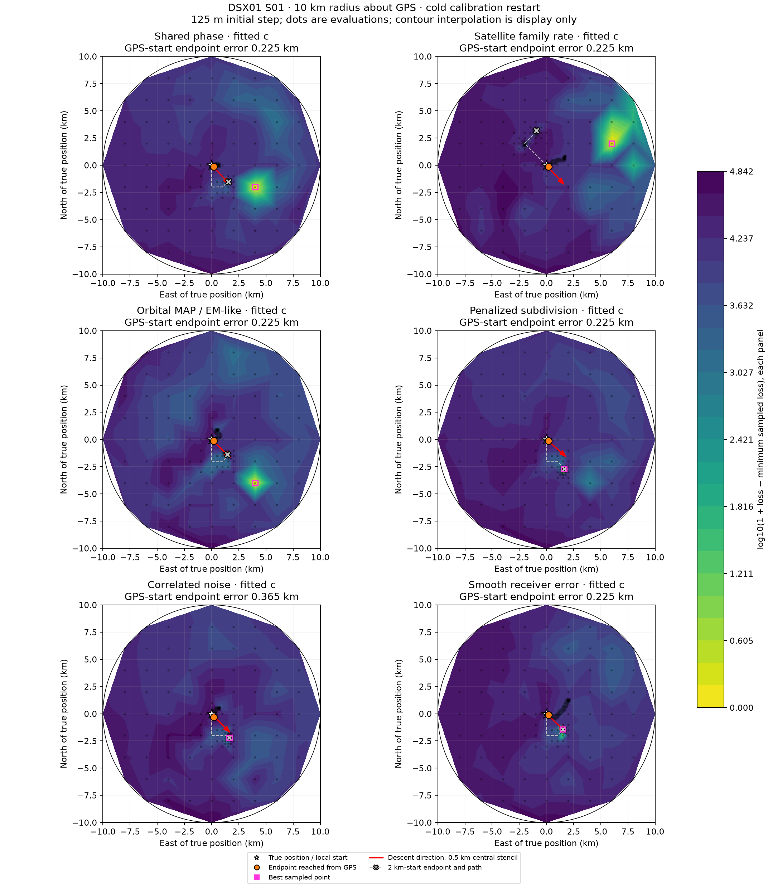

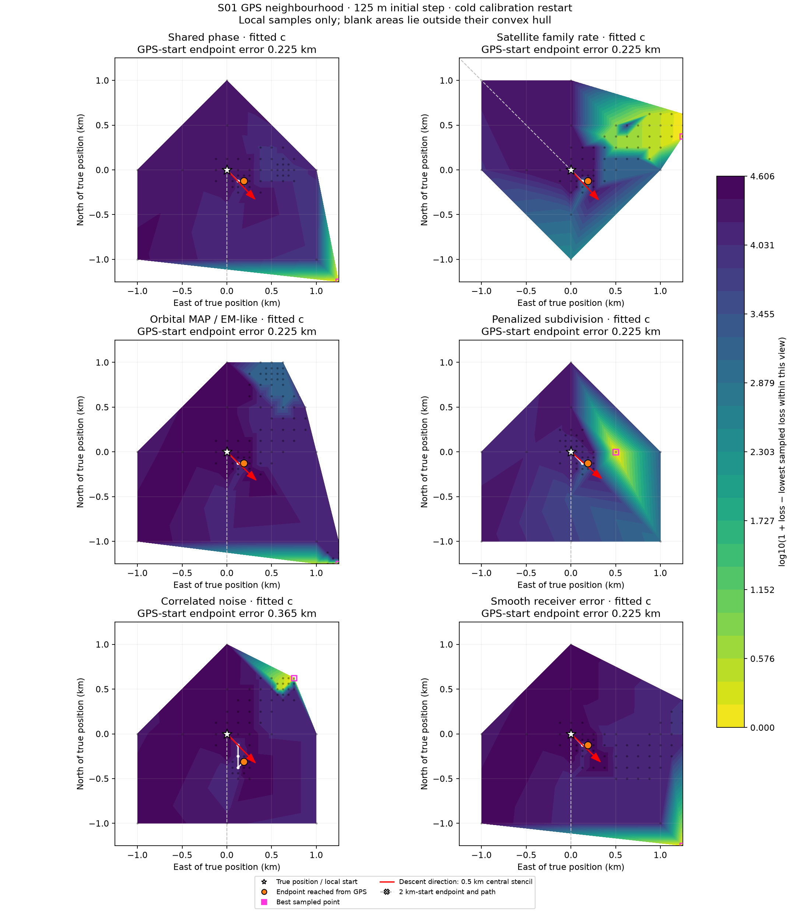

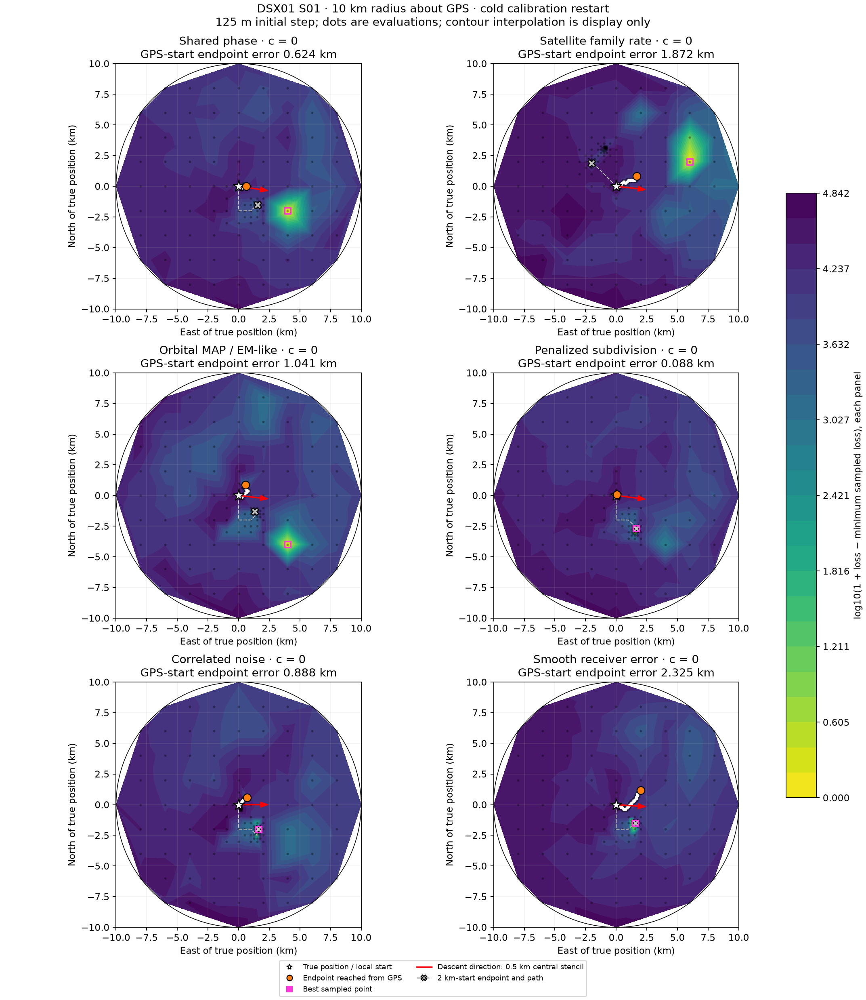

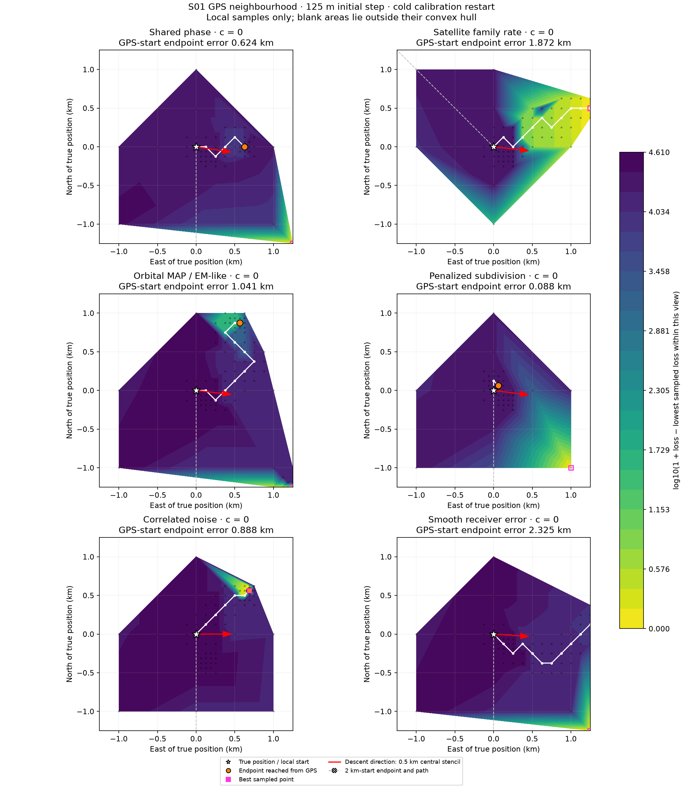

The [zero-start HTML gallery](index.html) and [restart HTML gallery](warm_restart/index.html) link the underlying controls. Download/open those files locally if the repository browser displays HTML as source.

The remaining zero-start figures are available individually: [shared phase](shared_phase_detail.png), [family rate](family_rate_detail.png), [orbital MAP](orbit_em_detail.png), [subdivision](penalized_split_detail.png), [correlated noise](correlated_noise_detail.png), [smooth receiver](receiver_smooth_detail.png), [gradient directions](fitted_c_gradient_directions.png), and the [archived initial 2 km-start preview](cold_2km_start_preview.png). Together with the embedded figures, this links all 23 PNGs in the investigation.

## Interpretation and next experiments

The data contain local position sensitivity near GPS, but the present fitter/loss does not select the right basin uniquely. Better nuisance initialization changes the surface substantially; more iterations of one calibration basin are insufficient. Hard acceptance changes can dominate a small native-RMS change. Fine initial steps retain nearby pockets that coarse steps skip, yet those pockets do not necessarily have the best score.

A useful next experiment is a bounded calibration multistart at every candidate location, comparing the lower envelope at matched budgets. Separate fixed-membership continuous frequency loss from association/clutter gains to identify which tracks create the false basins. Then test any resulting basin-selection rule on independent scans with GPS sealed until evaluation. These are proposed experiments, not results of this report.

## Validation and reproducibility

[Validation](validation.json) records **24** eight-neighbour endpoint checks at 62.5 m, monotone descent paths from GPS, matched `c` query sets, unchanged scientific inputs, **8 passing focused tests**, and passing Ruff checks. [Source manifest](source_manifest.json) records source and numerical input SHA-256 hashes plus library versions. [Artifact manifest](artifact_manifest.json) records frozen output hashes. These checks establish what was run and the stated numerical controls; they do not prove convergence or physical satellite identity.

The frozen report includes sampled surfaces, final states, paths, gradients, membership changes, iteration controls, coarse-start archives, CSV summaries, and source snapshots under `run_sources/`. The exact four hashed numerical inputs and the S01 bank receipt are bundled under `run_inputs/` using their original repository paths. Historical protocol source hashes refer to the code version at that stage; the root source manifest identifies the final tools, including continuation support. The [publication manifest](publication_manifest.json) separately hashes the bundled inputs and 81 source/dependency snapshots; additional dependency hashes were captured at publication, rather than retrospectively claimed as run-time provenance. The original dataset/archive are read-only and no RF collection was performed.

To reproduce the figures without new numerical fitting, use a disposable checkout with the recorded Python dependencies, restore `run_sources/` and `run_inputs/` into its repository root, and run `PYTHONPATH=src:tools python tools/report_s01_local_loss.py`, followed by the same command with `--warm`. The frozen surface and state files stay at this report path. Restoring snapshots can replace newer code, so keep that operation confined to the disposable checkout. The eight focused tests are the three diagnostic tests in `run_sources/tests/analysis/test_s01_local_loss_tool.py` and five numerical likelihood tests in `run_sources/tests/analysis/test_retained_track_likelihood.py`; both restore with the source bundle. No hardware, PostgreSQL, QNAP, or network access is needed to regenerate these figures from the bundled inputs.

Useful machine-readable entry points:

- [Restart summary JSON](warm_restart/summary.json) and [CSV](warm_restart/summary.csv).
- [Zero-start summary JSON](summary.json) and [CSV](summary.csv).
- [Restart paired `c` ablation](warm_restart/c_ablation.json) and [CSV](warm_restart/c_ablation.csv).
- [Zero-start paired `c` ablation](c_ablation.json) and [CSV](c_ablation.csv).
- [Restart gradients](warm_restart/gradients.json) and [zero-start gradients](gradients.json).
- [Restart curved membership changes](warm_restart/curved_membership_changes.json) and [zero-start changes](curved_membership_changes.json).
- [Initialization branch comparison](warm_restart/branch_comparison.json).
- [Protocol](protocol.json), per-method `warm_protocol.json`, [source hashes](source_manifest.json), and [validation](validation.json).
