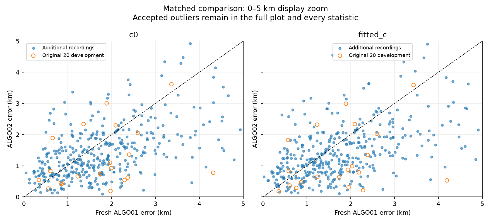
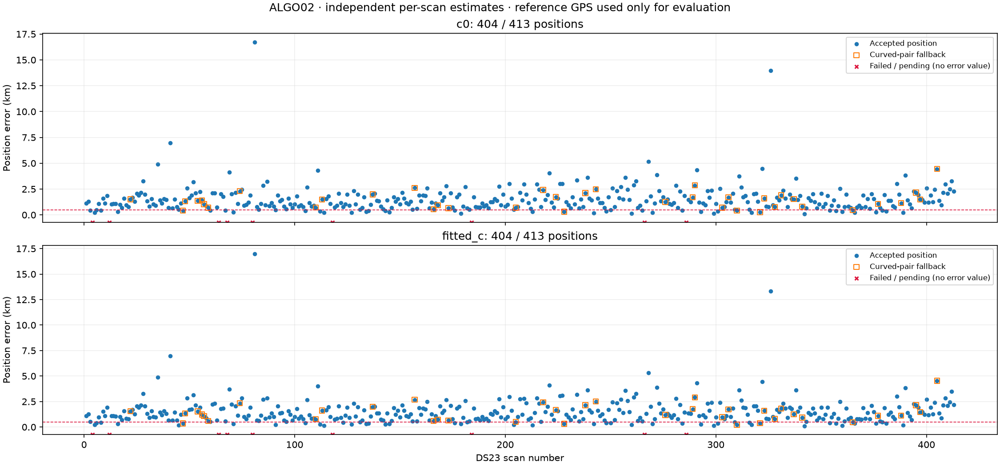
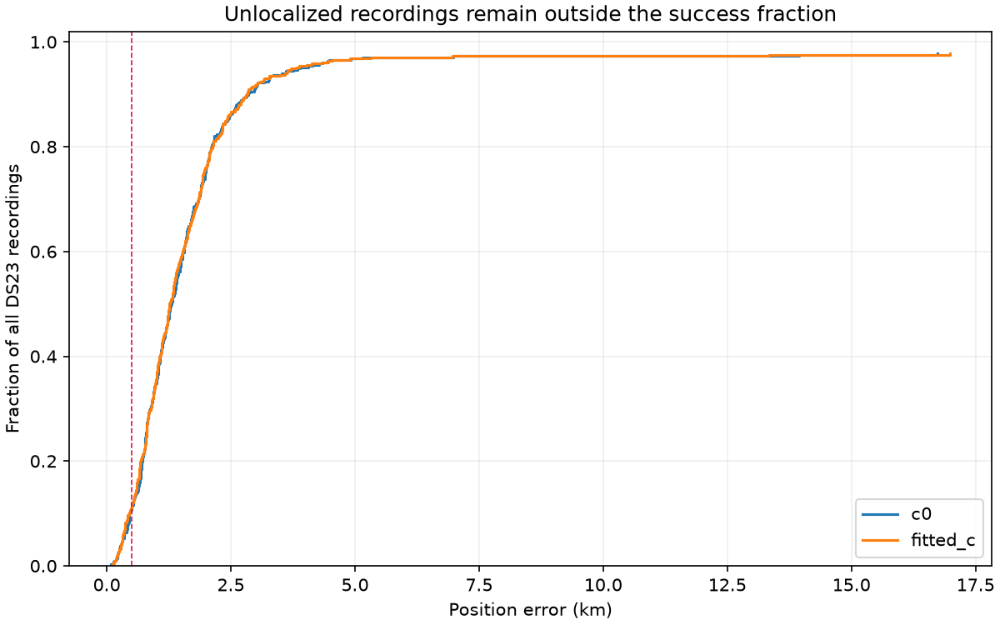
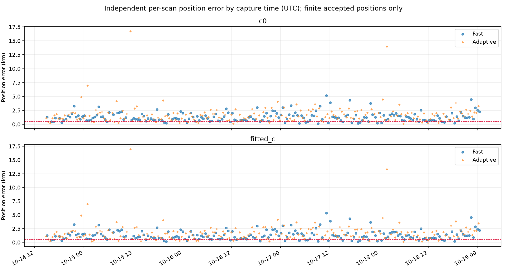
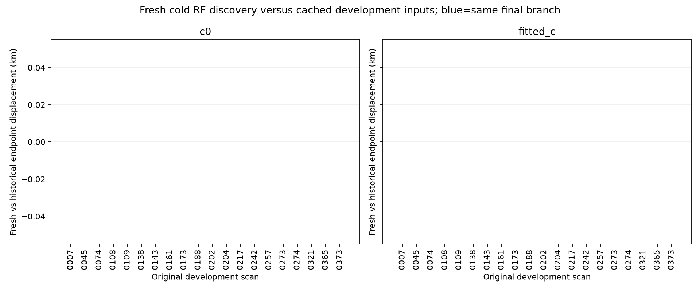

# ALGO02: completed evaluation on all 413 DS23 recordings

**ALGO02 improves both mean and median error against freshly run ALGO01 on the 404 recordings with qualified positions from both methods.** Coverage is **407/413 for ALGO01 versus 404/413 for ALGO02**; the additional unavailable positions are not silently omitted from coverage. All 413 jobs are terminal. The 0.5 km mean-and-median objective remains unmet.

| Matched subset | Arm | Qualified common pairs | Fresh ALGO01 mean / median km | ALGO02 mean / median km |
|---|---|---:|---:|---:|
| all | c0 | 404 | 1.870 / 1.633 | 1.520 / 1.270 |
| all | fitted_c | 404 | 1.870 / 1.602 | 1.508 / 1.249 |
| original20_development | c0 | 20 | 1.771 / 1.924 | 1.229 / 0.804 |
| original20_development | fitted_c | 20 | 1.747 / 1.913 | 1.177 / 0.811 |
| other393 | c0 | 384 | 1.875 / 1.612 | 1.535 / 1.292 |
| other393 | fitted_c | 384 | 1.876 / 1.588 | 1.526 / 1.257 |
| fast | c0 | 198 | 1.692 / 1.544 | 1.311 / 1.163 |
| fast | fitted_c | 198 | 1.696 / 1.540 | 1.311 / 1.147 |
| adaptive | c0 | 206 | 2.041 / 1.695 | 1.720 / 1.474 |
| adaptive | fitted_c | 206 | 2.038 / 1.655 | 1.698 / 1.438 |

On the additional 393 recordings, the common 384 pairs improve fitted-c mean/median error by **18.7% / 20.8%**. Both capture formats improve. This supports a broader **within-site** result, not new-location validation. The original 20 were development data; the other 393 were outside that sample when ALGO02 was frozen. The full corpus is one site/dataset, with temporally related RF and TLE errors.

## All-record coverage and conditional errors

Mean, median and tail errors describe finite qualified positions only. Counts below 0.5 km use the **entire recording denominator**. There is no invented error for a failed recording, trimming of accepted outliers or selection of a favorable c arm.

| Subset | Arm | Qualified / recordings | Mean km | Median km | P90 km | Maximum km | Below 0.5 km / recordings |
|---|---|---:|---:|---:|---:|---:|---:|
| all | c0 | 404 / 413 | 1.520 | 1.270 | 2.607 | 16.732 | 45 / 413 |
| all | fitted_c | 404 / 413 | 1.508 | 1.249 | 2.675 | 16.980 | 46 / 413 |
| original20_development | c0 | 20 / 20 | 1.229 | 0.804 | 2.401 | 3.612 | 4 / 20 |
| original20_development | fitted_c | 20 / 20 | 1.177 | 0.811 | 2.401 | 3.589 | 6 / 20 |
| other393 | c0 | 384 / 393 | 1.535 | 1.292 | 2.607 | 16.732 | 41 / 393 |
| other393 | fitted_c | 384 / 393 | 1.526 | 1.257 | 2.675 | 16.980 | 40 / 393 |
| fast | c0 | 198 / 207 | 1.311 | 1.163 | 2.303 | 5.146 | 25 / 207 |
| fast | fitted_c | 198 / 207 | 1.311 | 1.147 | 2.327 | 5.319 | 25 / 207 |
| adaptive | c0 | 206 / 206 | 1.720 | 1.474 | 2.837 | 16.732 | 20 / 206 |
| adaptive | fitted_c | 206 / 206 | 1.698 | 1.438 | 2.810 | 16.980 | 21 / 206 |

Three fast recordings have no frozen tracking contract: **0012, 0184, 0286**. Six fast recordings reach the declared 1200 s limit: **0004, 0064, 0068, 0080, 0118, 0266**. No retries or post-hoc budget changes are applied. Three of those timeouts retain a qualified initial ALGO01 result, explaining 407 versus 404 coverage. All 206 adaptive recordings qualify; 198/207 fast recordings qualify for ALGO02. See [failed cases](failed_cases.csv) and [execution receipts](execution.json).

Accepted failures of accuracy remain visible: scan **0081** worsens from 8.652→16.732 km c0 and 8.659→16.980 km fitted c. Scan **0326** improves from 18.580→13.948 km c0 and 18.895→13.341 km fitted c, while remaining inaccurate. Both pass the frozen model's acceptance checks. Residual gates are not proof of correct identity, location or a global optimum. No exploratory later repair is substituted into this frozen result.

## What improved and what stayed matched

[ALGO02's full specification](../ALGO02/README.md) freezes causal TLE-history phase priors, receiver-support weighting, 300 Hz fragment constants and Gaussian conditional linear evidence. Curved tracks alone calibrate hardware and satellites at a fixed position; added linear tracks carry the full shared predictive covariance. Every controlled final position refit starts at the center of the same 25×25 km regional box `(37.906,-122.545)`. Cold discovery uses each scan's broad causal catalogue. No previous-scan RF position, true site, post-scan TLE or manually supplied identity initializes inference.

The comparison reuses each scan's physical input and fresh RF discovery. Policy priors, gates and accepted masks may differ; this is an algorithm-policy comparison, not an attribution to a single parameter on identical masks. Within each policy, c0 and fitted-c share observations, identities, aliases, all other priors and numerical budgets. [Matched and independently qualified statistics](baseline_comparison.json) and [all comparison rows](baseline_comparison.csv) preserve both denominators.

Of 404 complete ALGO02 trials, **365** qualify the paired linear-evidence trial and **39** retain the qualified curved pair. Adding Gaussian linear evidence changes the common-cohort curved-only mean/median from **1.558/1.337→1.520/1.270 km c0**, and **1.552/1.313→1.508/1.249 km fitted c**. Original winners, calibration points and predictive linear points are different counts. These selected position-evidence totals are not claimed as whole-scan satellite-association percentages.

The fresh run reproduces **all 20 historical ALGO02 assignment branches, curved masks and both c-arm endpoints exactly**. The remaining accuracy difference comes from evaluating additional scans, not silently changing that development algorithm. See [replay comparison](development_comparison.json) and [per-scan values](development_comparison.csv).

## Audit, execution and reconstruction

The 30-worker, one-BLAS-thread run takes **67.22 minutes** on a host with 24 available CPUs. This includes read-only preparation and cold discovery; it is not an embedded runtime benchmark. No new RF acquisition or IQ remeasurement is performed. The 1200 s per-recording cap and all sources are fixed before submission.

The audit verifies **413** unique execution receipts, **407** written result digests (404 qualified and three input-failure outputs), every frozen Python source hash, matched c-arm ownership, unique/disjoint physical IDs and all accepted policy gates. All **808** completed raw linear-trial arms reproduce curved-only calibration with **zero coefficient difference**.

Encoded TLE bytes and collection timestamps are rechecked against each scan cutoff: **619,978** latest, **619,819** previous and **4,229,566** historical elements. No post-observation TLE is accepted. [Validation](validation.json) and [causal audit](causal_audit.json) retain the counts and per-case boundaries.

The original 232-file Python freeze did not itself pin the graph JSON or separate production adapter closure. The configuration matches every prepared receipt, and before/after audits of the 127-file adapter closure show no change or export-hash mismatch. This is supplementary provenance, not a retroactive pre-run seal or proof of every intervening filesystem state. See [resource receipts](resource_audit.json) and [before/after dependencies](runtime_dependencies_before_and_after.json).

Lossless numeric evidence is split into **11 archives**, all below 50 MB, totaling **78.4 MB**. It preserves complete ALGO02 result bytes, case receipts/logs and derived initial ALGO01 branch/record payloads with original result hashes. [Archive parts](numerical_evidence/parts.json) and [payload inventory](numerical_evidence/inventory.json) bind the hashes. Original IQ, tracking contracts, propagated banks and full TLE histories are not duplicated. [Input authorities](input_authorities.json) records their producer checksums; this is not a second full raw-input rehash. Those local/archive authorities remain required for independent scientific replay.

The supplied reference `(37.849061591561885,-122.48574968092912)` is confined to post-fit reporting. Accuracy assumes all recordings were stationary at that site; antenna altitude and the common site have not been independently survey-certified. No stationary-history position pooling is used. These results do not establish sub-0.5 km performance, calibrated confidence intervals or generalization to a new location.

[Protocol](protocol.json) · [Membership](sample.json) · [Every position and failure](positions.csv) · [Summary](summary.json) · [Case/evidence counts](case_summary.csv) · [ALGO02 source and method](../ALGO02/README.md)
