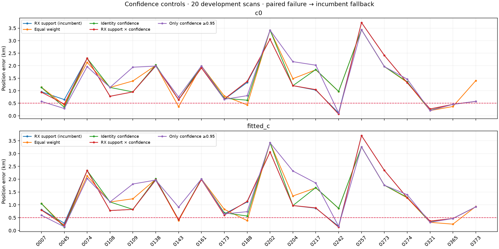
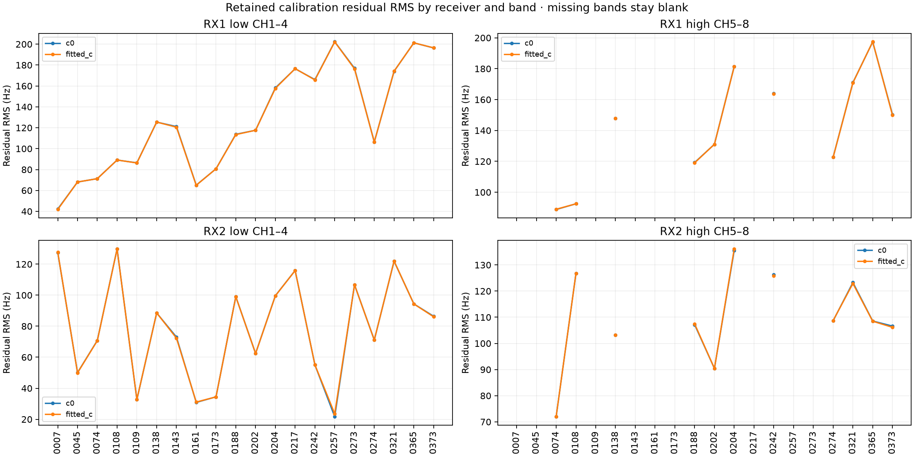
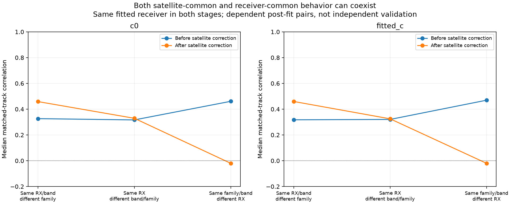
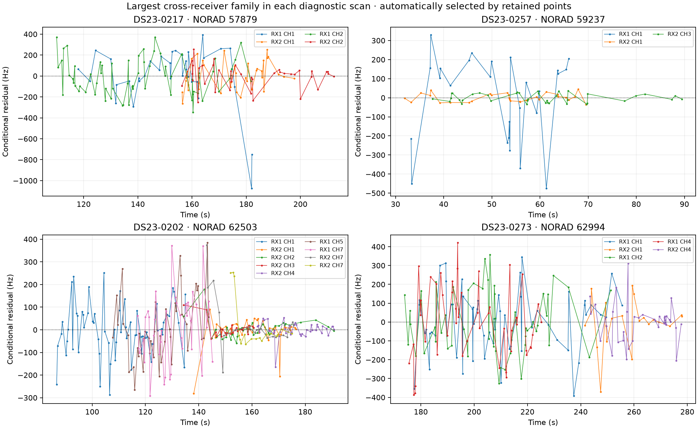
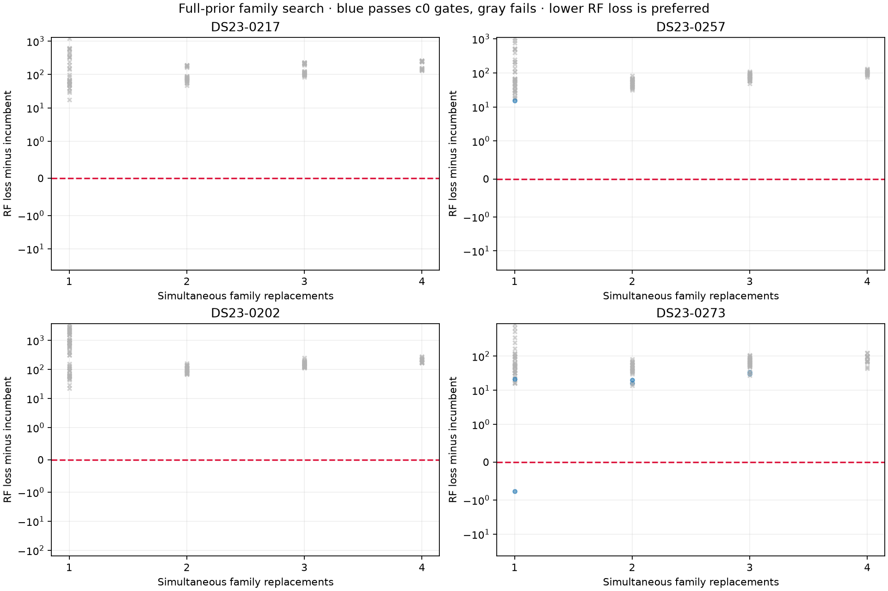
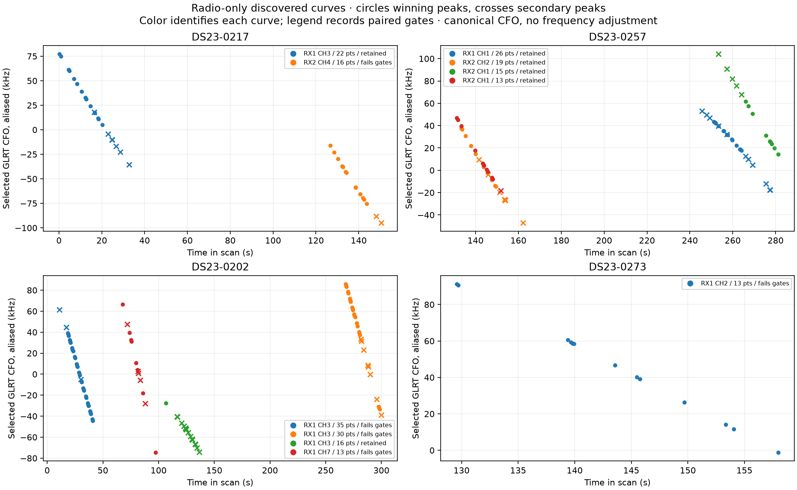

# DS23: confidence weighting, simultaneous family replacements and extra GLRT curves

The 0.5 km mean and median target remains unmet. These experiments use the
same causal catalogue, pre-RF phase-history prior, physical orbit modes and
300 Hz fragment constants as the incumbent. They do not choose satellites,
parameters or positions from GPS. Every position trial starts at the center
of the same 25 × 25 km box, latitude 37.906, longitude −122.545. The supplied
reference (37.849061591561885, −122.48574968092912) enters this report only.
Both c=0 and fitted-c use matched observations, labels, aliases and five
phase-refresh rounds with up to 48 position steps each. Existing source
observations, original winners and published ALGO01 are not modified.

## Does emphasizing certain associations help?

| Weighting policy | c0 mean / median km | Fitted-c mean / median km | Paired trial failures / 20 |
|---|---:|---:|---:|
| RX support (incumbent) | 1.315 / 0.991 | 1.266 / 0.896 | 0 |
| Equal weight | 1.411 / 1.361 | 1.320 / 1.175 | 0 |
| Identity confidence | 1.364 / 1.131 | 1.306 / 1.010 | 6 |
| RX support × confidence | 1.308 / 0.999 | 1.260 / 0.902 | 7 |
| Only confidence ≥0.95 | 1.395 / 1.298 | 1.393 / 1.255 | 5 |

All twenty development scans remain in every denominator. A failed trial in
either c arm falls back to the incumbent pair; trial failures and raw results
are preserved. Equal, confidence-only and support-times-confidence controls
keep the exact incumbent mask. The hard confidence control explicitly removes
fragments below 0.95 and is reported separately. No additional point trimming
is allowed to rescue a trial. Frozen confidence is an approximate all-bank
identity-competition weight, not a calibrated probability. Generalized losses
with different powers or observation sets are not compared to select weights.
No scan is assigned its geographically best variant.

Cross-receiver support remains useful, but more emphasis on conditional
identity certainty does not produce a material improvement. Identity certainty
does not imply an accurate TLE, correct nuisance model, or useful independent
position geometry. Hard removal can discard the few curves that distinguish
position from phase and receiver drift.

## Does the discrepancy follow hardware or a satellite?

At c0, the median scan residual RMS is RX1 low/high 119.4/147.9 Hz and
RX2 low/high 79.7/108.6 Hz. Standardizing by each point's independently
estimated radio noise gives 1.18/1.20 versus 0.64/0.88. Both bands are
available in eleven scans; all twenty have the low band.

Both receiver-common and satellite-common discrepancies are present. Compare
the same jointly fitted receiver calibration with the nominal TLE, then with
fitted phase/orbit corrections. Remove each fragment's mean in both stages.

| c0 residual comparison | Before satellite correction | After satellite correction | Matched track pairs / scans |
|---|---:|---:|---:|
| Same family/band, different RX | +0.461 | −0.020 | 124 / 19 |
| Same RX/band, different family | +0.326 | +0.459 | 593 / 20 |
| Same RX, different band/family | +0.317 | +0.329 | 444 / 11 |

The satellite-common discrepancy is real in the nominal-TLE comparison and
is largely removed by the fitted satellite terms. The remaining shared
residual follows the receiver more clearly. For the after-correction stage,
medians of per-scan medians are +0.449, +0.304 and −0.039 respectively.
This is descriptive, not a proof that the receiver causes the position bias:
both stages condition on the same jointly fitted receiver, and the fit can
trade receiver, position and satellite phase corrections against each other.
Matched track pairs are dependent. A near-zero cross-RX residual correlation
cannot exonerate the TLE or establish an identity. No interpolation is used:
nearest-distance-first unique observation pairs must be within 0.5 s, at
least six pairs per track comparison. See the original residual report for
all eight RX/band/family strata, sample counts and both c arms.

## Broader simultaneous whole-family replacement search

| Scan | Single / joint trials | Gate-passing trials | Best valid RF loss difference | Accepted replacement |
|---|---:|---:|---:|---|
| DS23-0217 | 36 / 72 | 0 | None | False |
| DS23-0257 | 39 / 72 | 1 | 15.268 | False |
| DS23-0202 | 60 / 72 | 0 | None | False |
| DS23-0273 | 39 / 72 | 6 | -0.771 | True |

This is a diagnostic set: the ongoing scan217 investigation and the three
largest c0 errors in the twenty-scan incumbent benchmark, rather than an
unbiased four-scan validation. Every track is screened against the entire
unchanged causal catalogue at the incumbent, regional center and four ±2 km
anchors. Three alternative identities per incumbent family get full-prior
c0 refits. After a measured 420 s timeout on scan202's 75-fragment model,
its proposal fits use two phase rounds and at most12 position steps;
the other three cases use five rounds and48 steps. Every promising finalist
receives the full five-round/48-step fit in both c arms and must improve
the incumbent full c0 loss. Initial failures and code versions are preserved.
A beam retains two alternatives for each of four families, then
tests all 72 pair/triple/quadruple combinations. An alternative can enter a
joint trial even when its single trial fails. Whole-family changes include
inactive fragment rows but never add their observations to the likelihood.
Original RF powers, noise, masks and physical priors remain frozen. This is
a bounded beam, not an exhaustive enumeration of every catalogue assignment.

Final selection requires lower normalized c0 negative-twice ELBO and passing
both c-arm gates; the same selected assignment is used in both arms. Invalid
trials and RF-disfavored but geographically better candidates remain visible
in the CSV. GPS cannot be used to override the radio evidence ranking.

## Recover curved evidence from alternative GLRT peaks

| Scan | New curves / GLRT points (secondary) | c0 before → after km | Fitted-c before → after km |
|---|---:|---:|---:|
| DS23-0217 | 1 / 22 (7) | 1.025 → 1.193 | 0.869 → 1.140 |
| DS23-0257 | 4 / 73 (24) | 3.722 → 3.866 | 3.699 → 3.725 |
| DS23-0202 | 1 / 16 (15) | 3.061 → 3.034 | 3.060 → 3.034 |
| DS23-0273 | 0 / 0 (0) | 2.412 → 2.412 | 2.345 → 2.345 |

The radio-only polynomial search reads all gate-passing cached peaks, excludes
all original calibration slots and already-associated incumbent c0 output tracks, and
allows exactly one peak per physical probe. Secondary peaks retain that
probe's canonical observation ID; they do not become extra independent
measurements. Discovery uses alias-aware quadratic/cubic random seeds,
existing degree-penalized refinement up to order four, residual/noise gates,
and the original active-curvature threshold of 250 Hz departure from affine.
It uses 1,800 deterministic proposal trials per lane. Curves are ranked by
their radio-only penalized gain; the largest four are tested. This is not
exhaustive. Each selected peak's margin determines its own uncertainty under
the unchanged radio-only variance law; a weaker peak does not inherit the
winning peak's smaller variance.

Each new curve gets three all-catalogue identity proposals and independent
paired cold-start fits with the original calibration. A passing identity is
chosen by normalized c0 ELBO on that same augmented observation set. The
curve is then tested jointly with earlier accepted additions. No original
calibration point is removed. This is a gate-based retention prototype, not
a calibrated existence posterior or justification to maximize point count.

The candidate CSV records both position errors and Schur-complement local
information after marginalizing the model's nuisance columns. These local
widths hold the fitted Gamma precisions fixed; they are not calibrated error
bars and changes in them do not establish better localization. Scan217's
valid new 22-point curve includes seven secondary peaks: the local RMS radius
shrinks from 1.640 to 1.567 km, but c0 error grows from 1.025 to 1.193 km.
It provides some model-conditional information without correcting the bias.

## Recommendation and limits

Keep cross-receiver support as the reference weighting. Do not promote hard
confidence selection or accept a satellite because it moves the result closer
to GPS. Use residual structure across different satellite families on the
same receiver as a hardware-model diagnostic. Use common behavior of a
satellite across independent receivers as an orbit/transmitter diagnostic.
The two can coexist and must be tested with the physical shared terms.

The next qualification should predict held-out receiver/family evidence with
calibration learned from other families, and qualify the actual dense GLRT
fractional-time estimator against dynamic delay/Doppler controls. A corrected
radio fit and more associated points are insufficient: the fixed-rule result
must also improve position on scans not used to develop it. None of these
development results establishes the 0.5 km target or performance on all 413
DS23 recordings. A separate curvature/shape study reports the other completed
twenty-scan evidence controls without changing the published ALGO01 default.

## Reproduction and receipts

Use the repository venv, PYTHONPATH=src:tools and BLAS/OMP threads one.
Run run_ds23_fixed_confidence.py for the twenty sealed sample cases.
Run probe_ds23_joint_family_search.py and probe_ds23_secondary_curves.py
with --case for the four cases in their protocol.json, then this reporting
tool. Scan202's search additionally uses --proposal-rounds 2 --proposal-steps 12.
The source_v1 snapshot reproduces the first three joint-search cases.
No new RF, IQ reread, QNAP mutation or post-observation TLE is involved.
Published lossless evidence archives unpack to the original reports/ paths;
source snapshots overlay the earlier published research tools.

[Summary](summary.json) · [Validation](validation.json) ·
[Lossless full evidence](evidence.tar.gz) · [Evidence hashes](evidence_inventory.json) ·
[Per-scan weighting](weighting_by_scan.csv) · [Joint trials](joint_trials.csv) ·
[Joint summary](joint_summary.csv) · [Recovery candidates](recovery_candidates.csv) ·
[Recovery summary](recovery_summary.csv) ·
[Before/after correction strata](satellite_correction_transfer_summary.csv) ·
[Before/after matched pairs](satellite_correction_transfer_pairs.csv) ·
[Original residual report](../2026_10_18_ds23_learned_residuals/README.md) ·
[Further causal shape and curvature controls](../2026_10_19_ds23_curvature_shape_study/README.md).
