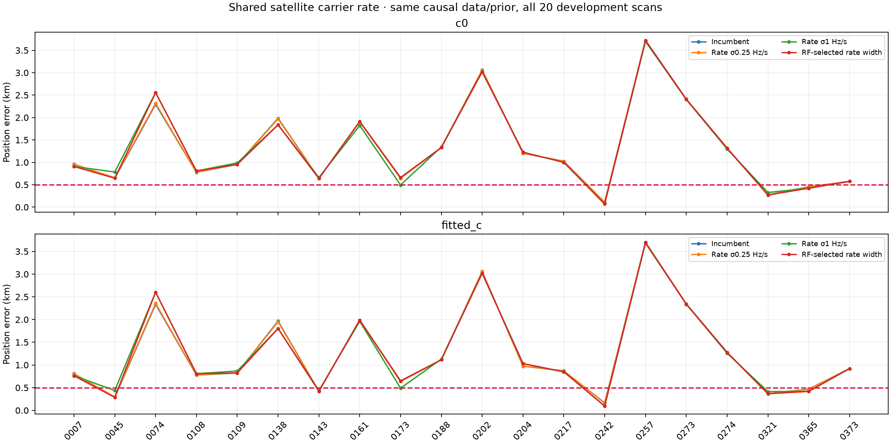
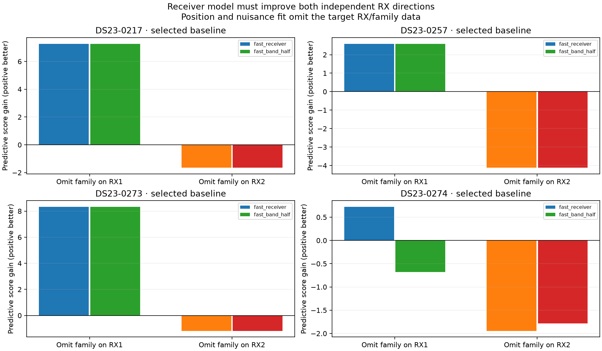
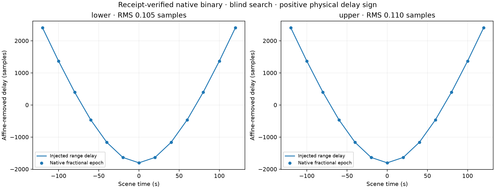
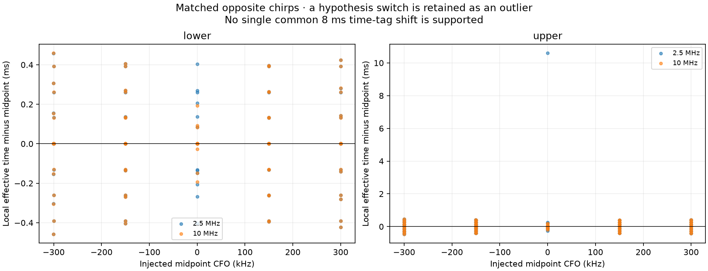
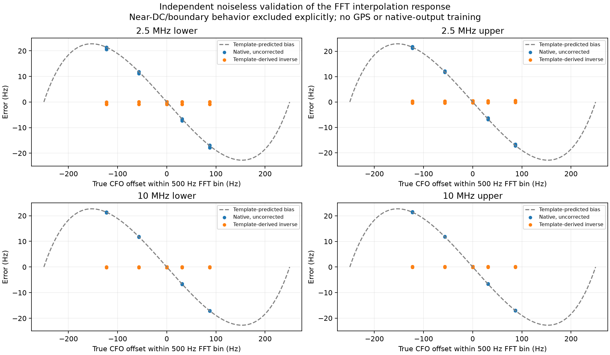

# DS23: predictive calibration, carrier rates and native CFO measurement bias

The 0.5 km mean/median target remains unmet. This continues the earlier
association study with one full twenty-scan development comparison, four
receiver-prediction probes and synthetic tests of a receipt-verified native
GLRT binary. GPS is used only by this reporting tool. The same causal
catalogue, frozen identities/aliases, observation masks, radio-noise proxies
and pre-RF-history phase priors remain in the position comparisons. Every
full fit starts at the same25×25km regional center37.906,−122.545 and uses
five phase refreshes with up to48 position steps. No new RF was collected.

## Small shared satellite carrier rates

| Carrier-rate policy | c0 mean / median km | Fitted-c mean / median km |
|---|---:|---:|
| Incumbent | 1.315 / 0.991 | 1.266 / 0.896 |
| σ0.25 Hz/s | 1.315 / 0.989 | 1.266 / 0.895 |
| σ1 Hz/s | 1.312 / 0.993 | 1.266 / 0.894 |
| RF-selected prior width | 1.314 / 0.976 | 1.263 / 0.885 |

Add one Gaussian frequency-rate coefficient for each satellite with active
curved support on both receivers: q·rate·(t−150), q=RF/11.5GHz. It is shared
across that satellite's curves and distinct from receiver/band drift, orbital
phase and state-error modes. Rate widths0.25 and1 Hz/s are engineering
hypotheses, not calibrated clock priors. Both c arms use identical columns
and observations. No data are trimmed; invalid variants fall back to the
incumbent pair. RF-only selection minimizes normalized c0 negative-twice
ELBO among paired-valid variants; it chooses width1 on ten scans and zero
on ten. The improvement is too small to resolve the localization problem.

## Does extra receiver freedom predict an omitted family?

Select the largest active cross-receiver family by point count, without GPS.
Omit all its RX1 curves, then all its RX2 curves in reciprocal folds. Train
position and nuisance corrections on the remaining measurements, starting at
the regional center; three phase rounds/24 steps are used per diagnostic
fit. Predict omitted CFOs without fitting their fragment constants, group
noise, receiver correction or receiver-side data. The same family remains
observed on the opposite RX, so its phase can be learned there. The prior
support design is held fixed; production two-owner gates are not imposed
on a deliberately omitted family inside the diagnostic fold.

Predictions include local joint position/nuisance covariance and prior
Gamma(2,2) noise variance for unobserved groups. Score the full target vector
with its correlated covariance, not independent standardized points. This is
a local moment-matched Gaussian predictive approximation, not an exact
Student posterior probability. Identity, integer aliases and radio-noise
proxies are frozen from the incumbent; this is conditional validation of
calibration transfer, not independent blind identification or raw-data
cross-validation. All points return for the final paired position fit.

Compare the slow receiver model with additional10s-spaced/5s-width receiver
features of amplitude radio_sigma/sqrt(2), and a variance-matched half-shared
cross-band version. A change must improve both RX directions and beat a
2log2 mode-selection penalty. All four probes retain the incumbent. On217,
extra receiver freedom improves RX1 predictive score by7.27 but worsens RX2
by1.65; its full-data c0 position worsens1.025→1.509km. This supports using
prediction to reject extra flexibility that merely lowers residuals.

The cases are217/257/273 plus274, the smallest-fragment high-band recording
in the sealed sample. They are diagnostic choices, not a representative or
untouched four-scan test. The full-data fixed controls and both c arms are
reported in CSV, including failures and incumbent fallback.

## Native fractional-time semantics

The existing host binary and build receipt agree by SHA256. A blind native
CFO/epoch search on26 noiseless dynamic pilot probes recovers positive
arrival-delay curvature, with RMS0.105/0.110samples on the two edges at
2.5MHz (~42/44ns). This verifies this binary's sign under the tested model;
it does not establish the binary used for every DS23 recording or qualify
real transmitter timing. The waveform is a pilot-only three-frame periodic
approximation, not a full transmitted Starlink waveform.

Matched ±2000Hz/s chirps with the same envelope/epoch isolate local CFO time
sensitivity. Most cases lie within0.459ms of the nominal sample midpoint;
one near-DC upper-edge hypothesis switch gives10.6ms and remains in the
raw records. No shared8ms midpoint correction is justified. This derivative
can change when the detector selects a different peak and cannot always be
interpreted as a physical measurement timestamp.

## A concrete interpolation bias, independently predicted

The tested native build uses500Hz FFT samples and a three-bin magnitude
parabola. The true magnitude response is not a parabola. Off-grid tones
therefore move toward bin centers even without noise. Predict the response
from the published pilot template's power over the same alternating OFDM
symbols, evaluate its Fourier magnitude at the three bins, and invert the
resulting monotone response. Native outputs are used only for validation,
not to fit the correction.

Across64 eligible cases per sample-rate/edge combination, original RMS is
about10.8Hz; the template-derived inverse reduces it to0.57/0.32Hz at2.5MHz
and0.12/0.11Hz at10MHz. These counts include aligned and off-grid cases.
Near-DC and boundary behavior are explicitly excluded from this correction;
their measurements remain in the original time-reference dataset. The
unmodeled modulation/carrier-rate experiment also changes CFO estimates by
roughly10–32Hz RMS relative to matched zero-extra-rate controls. An oracle
resampling control reduces some but not all dynamic CFO error and is not
an implementable real-data correction by itself.

This demonstrates a deterministic approximation bias for the
qualified binary, not the cause or size of DS23 position errors. No bias
correction has been applied to the DS23 measurements in this report. First
establish capture-build identity and test noisy, faded recorded windows.
Frequency-alias lifts are not multiples of500Hz: any correction must use
the original canonical CFO before lifting, never the polynomial's unwrapped
CFO. Noise propagation and near-DC fallback behavior must be qualified too.
Do not choose a correction from the known GPS position.

## Relevant signal-model literature

Qin et al. distinguish beam-dependent frame timing from carrier timing;
their observations include differing frame/carrier rates and discuss timing
precompensation as a hypothesis. These results make a simple frame-epoch
pseudorange assumption unsafe, but do not identify the cause in DS23.
See [Timing Properties of the Starlink Ku-Band Downlink](https://arxiv.org/html/2501.05302v1).
Psiaki and Bowman explicitly estimate arrival time, carrier Doppler and
intra-frame code/carrier divergence jointly from edge pilots. Their
[2026 conference abstract](https://www.ion.org/publications/abstract.cfm?articleID=20760)
motivates testing a richer raw-pilot measurement model; it does not supply
calibrated rate priors for this experiment or verify our data.

## Next step and reproduction

The next substantive test is a bounded re-analysis of existing DS23 IQ
windows, comparing the unchanged native output with direct local CFO and
modulation-rate refinement against known pilots. Establish the applicable
binary/configuration first; freeze the test windows by RF criteria and keep
GPS outside measurement fitting. Full413-scan and untouched-location
validation remain outstanding. ALGO01's published default is unchanged.

[Summary](summary.json) · [Validation](validation.json) ·
[All twenty rate results](rate_position_by_scan.csv) ·
[Receiver folds](receiver_folds.csv) · [Full receiver controls](receiver_prediction.csv) ·
[FFT validation](fft_bias_summary.csv) · [All bias cases](fft_bias_validation.csv) ·
[Evidence archive](evidence.tar.gz) · [Evidence inventory](evidence_inventory.json).

Use PYTHONPATH=src:tools and BLAS/OMP threads1 in the repository venv.
run_ds23_clock_calibration_controls.py records the bounded two-worker
cohort. The source snapshot overlays the earlier ALGO01/DBG01 research
snapshots. Unpack evidence.tar.gz at the repository root to restore exact
report paths. It includes the binary and receipt used in synthetic controls;
the host FFTW dependencies must match their recorded authority for exact
replay. Native input generation and the response model require no IQ, TLE,
GPS, network service or legacy-repository runtime dependency.
