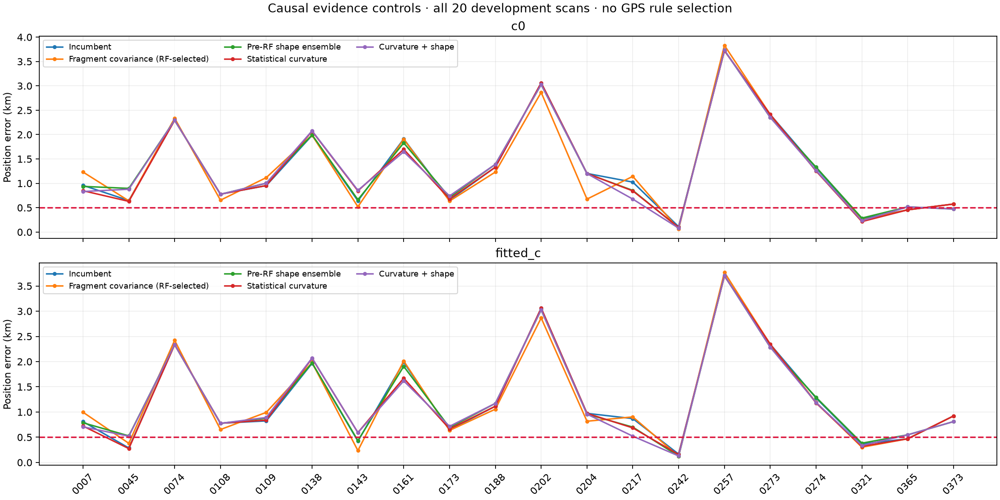
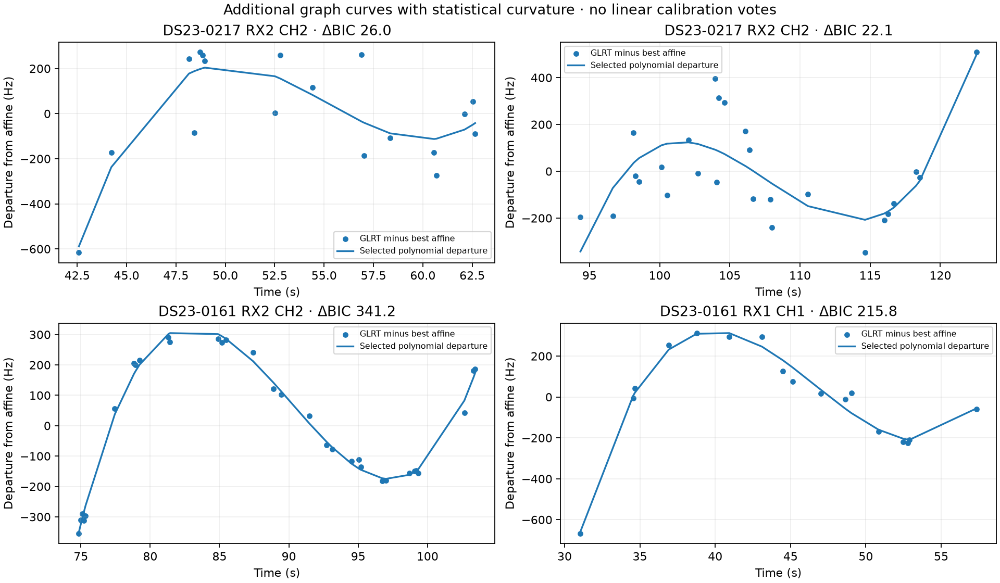
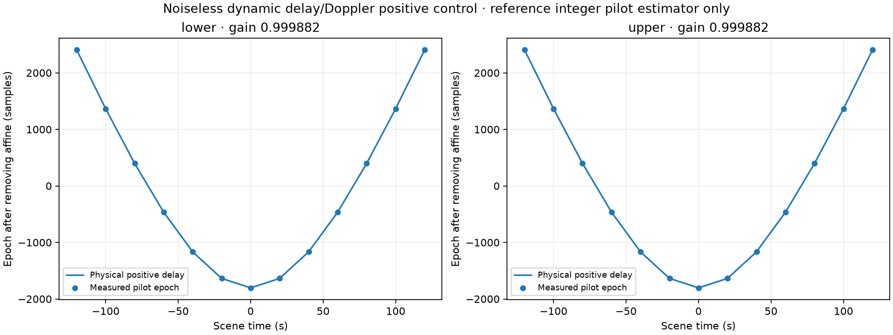

# DS23: further causal shape and curved-evidence controls

The 0.5 km mean/median target remains unmet. These are complete paired c=0 /
fitted-c controls on the original twenty development scans, not all 413
recordings or an untouched validation cohort. All start from the regional
25 × 25 km box center (37.906, −122.545); the supplied GPS reference is used
only in reporting. Inference uses the same strictly causal catalogue and
pre-scan-only TLE history, including both publication time and encoded epoch.

| Fixed rule | c0 mean / median km | Fitted-c mean / median km |
|---|---:|---:|
| Incumbent | 1.315 / 0.991 | 1.266 / 0.896 |
| Fragment covariance (RF-selected) | 1.289 / 1.130 | 1.254 / 0.957 |
| Pre-RF shape ensemble | 1.318 / 0.969 | 1.266 / 0.843 |
| Statistical curvature | 1.298 / 0.901 | 1.243 / 0.881 |
| Curvature + shape | 1.302 / 0.941 | 1.245 / 0.851 |

## Shared fragment constants

Correlate fragment constants only within the same satellite and exact
recorded RF. Every fragment retains marginal sigma 300 Hz. Correlations
0, 0.5 and 0.9 are evaluated with identical incumbent observations, labels,
aliases, physical priors and fit budgets. Selection uses minimum normalized
c0 negative-twice ELBO among variants passing both c-arm gates, then reuses
that choice for fitted-c. Rho0 passes 20/20, rho0.5 17/20, rho0.9 15/20;
the selected histogram is rho0.9 fifteen, rho0.5 two, rho0 three. Correlation
slightly improves the mean but worsens median localization. It is not a new
ALGO01 default. A cached all-bank replacement challenger on257 remains
RF-disfavored by 15.662 loss units under the selected covariance even though
its position happens to be closer to the reporting reference.

## Phase-aligned causal orbit-shape means

Use triples of genuinely earlier TLE versions A, B and C. Align A and C in
phase to B, then compare position and velocity residuals at C collection
time plus −150, 0 and +150 s, expressed in B's RTN frame. The causal history
study qualifies interpolation/extrapolation strengths by the existing
chronological 70/30 split before the RF scan; it never uses track labels,
the received frequencies or the GPS position. A robust state-prediction
criterion and one-parameter/mode complexity penalty choose the rule. The
mean state bank interpolates the phase-aligned previous and current TLE
states; this is a linear state-mean hypothesis, not a new exact SGP4 orbit.
Original Gaussian physical orbit modes and Student phase priors stay fixed.
Nineteen scans qualify: seventeen use interpolation strength0.125, two0.25;
one uses zero. All twenty paired gates pass. The overall mean scarcely
changes; fitted-c median improves to0.843 km. On217 the error changes from
1.025/0.869 to0.854/0.700 km (c0/fitted-c).

The large derived transition arrays are reproducible from the previously
published raw causal TLE histories and source snapshots. Compact receipts
under the history folder use a distinct *_shape_forecast_receipt.json name,
record full-derived-file hash/size and the rebuild command, and do not
pretend to be the full transition input. The small *_shape_ensemble.json
model choices are included. Regenerate transitions before replaying their
content-hash checks.

## Statistically supported weaker curvature

The original fixed 250 Hz departure-from-affine threshold discards some
well-sampled, statistically curved graph tracks. This control proposes
existing graph tracks with at least12 points, span20 s, weighted polynomial
order at most4 (at least four samples per coefficient), nonlinear ΔBIC≥10
and the existing residual noise screen. No merely linear trace calibrates.
The candidate must already have a frozen-calibration satellite association
and alias that agree in both c arms. Original curved calibration stays;
radio-only BIC determines greedy addition order, and both arms must pass
all old and new gates after every addition. Twenty-nine fragments add705
calibration points. These were often already associated as output tracks:
do not report them as705 newly associated GLRT points.

This curvature rule is not yet qualified against endpoint deletion or
leave-one-window-out leverage checks. A significant BIC gain can still be
driven disproportionately by a few observations. This is another reason to
keep the result as a research control rather than a new default.

Curvature promotion improves c0 mean/median from1.315/0.991 to1.298/0.901 km.
Its composition with the pre-RF shape mean keeps the same promotion pool,
observations and labels; both paired arms pass on all20. It gives
1.302/0.941 km c0 and1.245/0.851 fitted-c. This is a fixed composition,
not a scan-wise choice of the geographically better method. The two effects
are not additive and none is sufficient for the target.

## Physical timing sign control

A separate noiseless three-frame pilot experiment injects range-dependent
fractional delay and consistent carrier Doppler, then evaluates the pinned
published reference integer pilot estimator (commit772633600). Both band
edges recover positive delay curvature with gain0.999882 and RMS0.376
samples at2.5 MHz (~150 ns); a negative delay model misses by2902 samples.
The synthetic CFO search is seeded around the injected CFO. Linear
interpolation, pilot-only waveform and independent20 ms probes restrict its
scope. This is neither a blind detector evaluation nor qualification of the
actual production dense GLRT fractional-time estimator or real transmitter
clock. It does not explain the negative relation previously seen in some
real timing traces and does not justify using them as pseudoranges.

## Receipts and reproduction

[Summary](summary.json) · [Validation](validation.json) · [All position results](position_by_scan.csv) ·
[Lossless full evidence](evidence.tar.gz) · [Evidence hashes](evidence_inventory.json) ·
[Added calibration curves](new_calibration_curves.csv) · [Shape choices](causal_shape_choices.csv) ·
[Fragment choices](fragment_covariance_choices.csv) ·
[Association and peak-recovery investigation](../2026_10_19_ds23_association_evidence/README.md).

Use the source snapshot with PYTHONPATH=src:tools, BLAS/OMP one thread. The
run_ds23_fragment_covariance, run_ds23_causal_shape_ensemble,
run_ds23_statistical_curvature and run_ds23_curvature_shape_combination
tools define bounded two-worker cohorts and record exact source hashes.
Rebuild shape transitions with learn_ds23_causal_shape_forecast.py on each
raw history CASE.json, then learn_ds23_causal_shape_ensemble.py on the
derived CASE_shape_forecast.json. Lossless evidence archives unpack to the
original reports/ paths. The pilot control includes its exact pinned source.
No IQ reread, new RF collection or archive mutation was performed.
