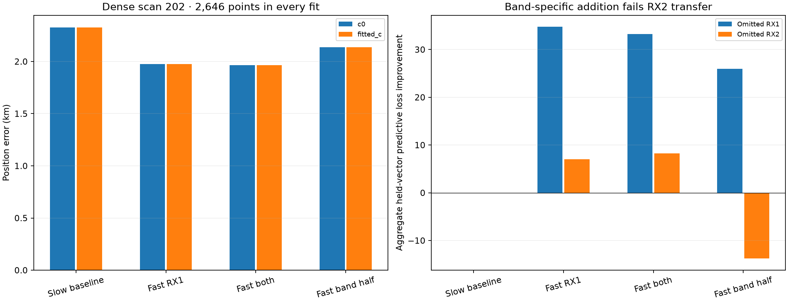
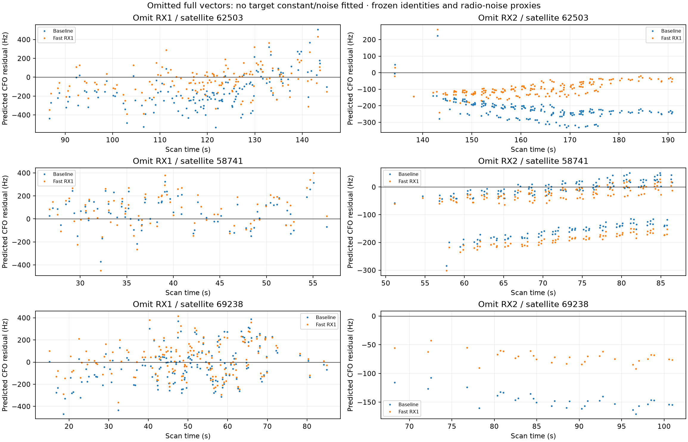
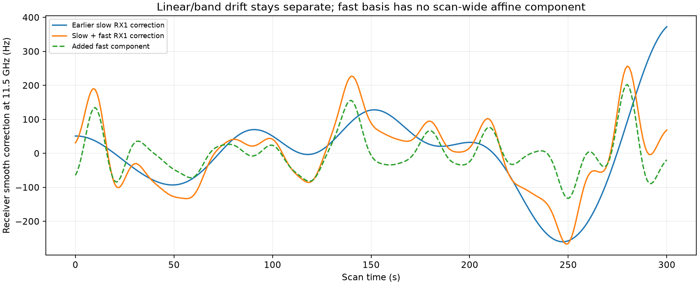
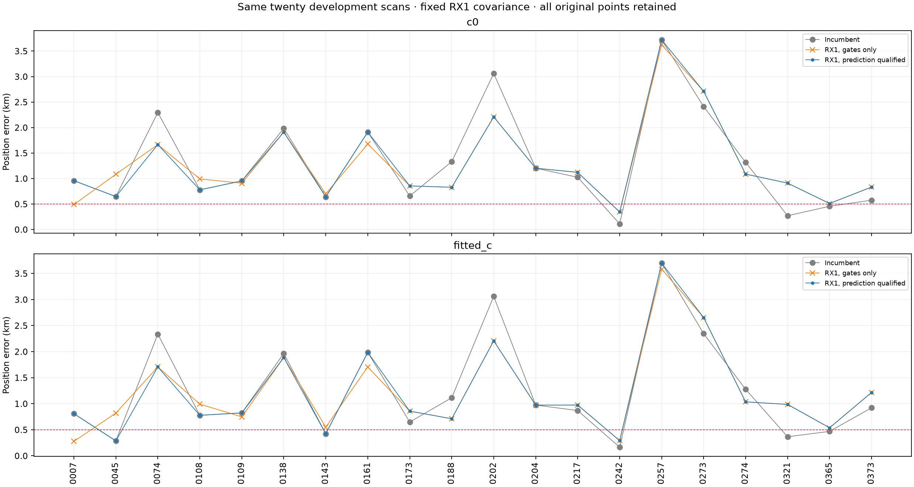
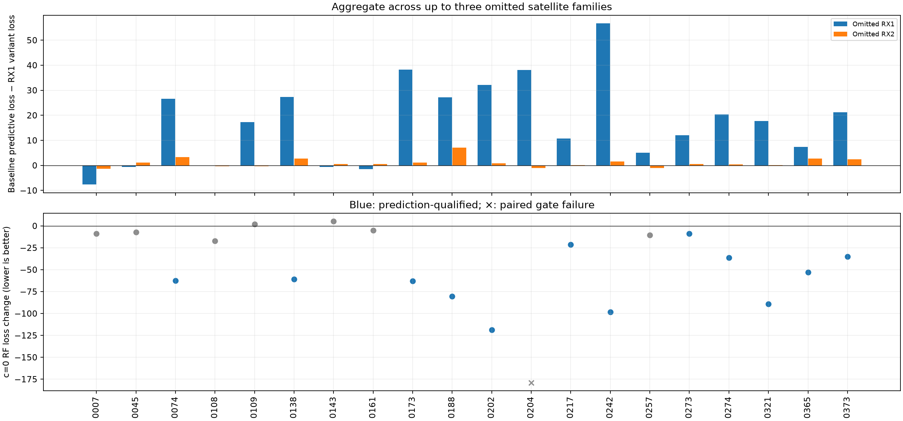

# DS23: receiver corrections qualified by omitted-family prediction

This study tests whether the receiver-common residual pattern can predict
satellite evidence that was not used to fit the correction. It includes
scan 202's precise RX2 measurements and a fixed-rule comparison on the original
twenty development scans. Geographic coordinates enter reporting only.
No new IQ is acquired or read, and no recording or persisted GLRT contract
is modified. The 0.5 km DS23 mean-and-median goal remains unmet.

The fixed receiver addition does **not** qualify as a general accuracy fix.
On all twenty scans, prediction-qualified selection slightly improves fitted-c
mean error but worsens its median. The published ALGO01 default stays unchanged.

| Policy on the same twenty scans | c=0 mean / median km | Fitted-c mean / median km |
|---|---:|---:|
| Incumbent | 1.315 / 0.991 | 1.266 / 0.896 |
| RX1 addition whenever paired gates pass | 1.283 / 1.038 | 1.236 / 0.981 |
| RX1 addition also prediction-qualified | **1.290 / 0.955** | **1.242 / 0.974** |

Twelve scans satisfy prediction, RF-objective and paired-gate requirements.
Scan 204's RX1 CH5 T008 fails a full paired gate and falls back to the incumbent.
All twenty scans remain in every denominator. A better frequency fit or
conditional prediction score is insufficient evidence of better localization.

## Receiver model and qualification rule

The reference model retains receiver/band offsets and linear drifts, the
existing slow receiver basis, causal phase-history priors, physical orbit
corrections and 300 Hz fragment constants. The proposed addition is a
zero-mean, RF-scaled Gaussian receiver process represented by 31 Gaussian
basis functions at 10-second centers, width 5 seconds. Each coefficient has
a 100 Hz prior scale at 11.5 GHz; this is an engineering hypothesis, not an
independently calibrated pointwise noise level. The basis removes its constant
and linear components over the 0–300 s scan. It is integrated with its prior
and complexity/volume contribution, not fitted as an unpenalized polynomial.

On dense scan 202 compare four frozen designs: slow baseline; extra fast RX1
only; extra fast corrections on both receivers; and the variance-matched,
half-shared cross-band version on both receivers. RX1-only adds 31 active
receiver modes; corresponding RX2 columns are zero. Existing slow modes,
linear/band drift and orbital priors remain unchanged. The Gaussian orbital
shape prior is used here, keeping the separate causal Student experiment
out of this covariance comparison.

Choose the three largest active satellite families observed on both receivers
by point count. For each, omit all RX1 evidence and then all RX2 evidence.
Fit position and calibration on the remaining data from the regional center,
using three phase-refresh rounds and at most 24 position steps. The opposite
receiver still supplies that satellite's evidence. No omitted fragment
constant, receiver-side satellite evidence or group-noise scale is fitted.

Predict the **complete omitted CFO vector** with its correlated covariance,
including joint local position/nuisance uncertainty. A missing noise group
retains its Gamma(2,2) prior, with expected inverse precision two. The local
derivative includes every current feature column: phase and all five physical
shape coordinates in the dense experiment, or the original three physical
coordinates in the incumbent cohort. Analytic dense-normal and feature-width
tests verify this accounting. The existing runtime orbit prediction already
includes the full shape design; no inherited-prediction bug was found.

Qualification requires aggregate prediction improvement on **both** omitted
receiver sides, total gain above 2 log 2 for the fixed cohort alternative,
lower normalized c0 RF loss on the full identical data, and passing gates in
both full c arms. Full fits restore every original point and use five phase
refreshes/48 steps from the same regional center. A failed gate or failed
qualification falls back to the original pair, never its geographically best
alternative. The dense four-design table exposes all results; RX1-only has
the best full RF objective among its prediction-qualified additions.

This is conditional calibration validation, **not blind raw-data cross-validation**.
Identities, alias integers, support design, likelihood powers and radio-noise
proxies are frozen. Dense local noise proxies were computed from complete
radio curves before the folds, including omitted observations. The receiver
fold does not validate that noise estimator. Position/Student uncertainty uses
a local Gaussian approximation with fitted precisions, not exact predictive
integration. Families and folds share training observations and are dependent.
An aggregate positive gain does not mean every individual family improves.

## Precise scan 202: useful receiver prediction, still kilometer error

All 2,646 original calibration points remain in every full fit. The same
canonical CFOs, effective times and local radio-noise estimates from the
[dense RX2 study](../2026_10_19_ds23_dense_rx2_and_causal_shape/README.md) are used.
NORAD 67335 remains fixed from that study's RF-selected identity competition;
no new identity is chosen from GPS. Full fits use the explicit pointwise-noise
development gates from that report, not a claim of legacy-gate acceptance.

| Receiver addition | c=0 / fitted-c error km | Omitted RX1 gain | Omitted RX2 gain | Full paired gates |
|---|---:|---:|---:|---|
| None | 2.3262 / 2.3268 | 0 | 0 | Pass |
| Fast RX1 only | **1.9763 / 1.9759** | **34.751** | **7.015** | Pass |
| Fast both RX | 1.9643 / 1.9640 | 33.248 | 8.284 | Pass |
| Fast both, half-shared bands | 2.1379 / 2.1370 | 25.987 | **−13.787** | Pass |

Gains are decreases in the approximate full-vector negative-twice log
predictive density, aggregated over three families. The band-specific variant
improves full RF fit but fails omitted RX2 prediction and is not qualified.
The slightly smaller geographic error of fast-both does not override the
RF-preferred RX1-only model. Selected-family identities, masks and budgets
are matched between c arms; no original point is removed to pass a gate.

The omitted families are 62503, 58741 and 69238. Fast RX1 gains on omitted RX1
are +33.45, −2.28 and +3.58; on omitted RX2 they are +4.88, +1.41 and +0.73.
Improvement is strongest for one family and is not uniform. Full-data
conditional RMS decreases from 97.79 to 91.10 Hz. Frequency prediction and
position error are both reported; neither is inferred from the other.

## Original twenty-scan comparison: a different measurement regime

The cohort uses the unchanged original GLRT CFOs and radio-noise law, not
scan 202's dense remeasurements mixed into the other nineteen scans. It
retains the original causal-history phase model and three physical orbit modes.
Only the same fixed 100 Hz RX1 covariance addition is tested. The original
successful five-round/48-step paired fits supply the frozen reference;
new full fits use the same budget and regional cold start.

Every scan stays in every denominator. The figures show three policies:
incumbent; use the RX1 trial whenever its paired gates pass; and require the
additional prediction qualification. Failed raw trials remain available in
the CSV, while policy outputs use the original paired result. The c=0 and
fitted-c arms share each selected design and mask. There is no geographical
selection of a policy or per-scan variant.

There are 114 reciprocal omitted-family folds, evaluated under both models
(228 prediction records). Scans 143, 257 and 273 have only two eligible
cross-receiver families; the other seventeen have three. All twenty numerical
cases completed successfully. One gate failure is distinct from a process
failure and remains recorded rather than removed from the benchmark.

The original-measurement scan 202 improves from 3.0609/3.0602 to
2.2089/2.2071 km under the qualified RX1 addition. This is a separate comparison
from dense scan 202's 2.3262/2.3268 to 1.9763/1.9759 km: their measurement sets,
noise laws, calibration masks and orbital-coordinate budgets differ. Their
gains cannot be added or substituted for each other.

Regressions are equally informative. Scan 321 qualifies on RF and prediction,
yet c0 error grows **0.2697→0.9100 km**. Scan 217 also qualifies while worsening
**1.0248→1.1210 km** (fitted-c 0.8695→0.9751). Conversely, scan 7 would improve
**0.9579→0.4890 km** at c0, but both receiver-side predictive aggregates worsen;
the fixed rule rejects that trial and retains the incumbent. GPS cannot be
used to reverse either decision.

These results are consistent with remaining position/orbit/calibration
tradeoffs: a model can predict omitted CFOs while retaining a biased position.
They do not prove that any particular satellite identity is wrong or identify
one receiver as the whole cause. The folded predictions condition on the
same orbital family and noise model as the fit. Their covariance and Student
approximations are also imperfect. Positive conditional prediction should
therefore remain a diagnostic requirement, not independent localization truth.

Keep the successful dense scan-202 result as a research case. Do not choose a
different geographically best covariance per scan or silently combine the
new rule with other favorable variants. The original fitted-c median remains
better than this extension's median, and neither is near the 0.5 km target.

## Scope, reproducibility and next action

The original box remains 25 × 25 km centered at latitude 37.906, longitude
−122.545. Every new search starts at east/north zero. The reporting coordinate
is 37.849061591561885, −122.48574968092912. Only the same causal candidate
catalogues and TLE histories enter inference. This is still the same
development site and original twenty cases, not untouched/location validation
or a result on all 413 DS23 recordings. No ALGO01 default changes here.

The next distinct test should constrain the physical relationship between
same-satellite fragment frequency biases and requalify causal orbit uncertainty
at the actual observation age, alongside receiver corrections. The current
300 Hz independent fragment constants can trade against phase and position;
this is a candidate mechanism to test, not an established explanation. The
earlier sparse-data RF-shared-constant experiment already showed that simply
adding covariance can improve RF loss while worsening position. Any new test
must preserve that negative control, use RF-only selection, and compare both c
arms on the same observations before broader validation.

Nine owned tests passed, covering correlated predictive density, Gaussian
normal-equation parity, complete physical derivatives, runtime orbit accounting,
fold partitioning, RX1-only covariance isolation and fixed policy qualification.
The two-worker cohort records terminal status and hashes for every case, with
a 420 s bound per numerical case. Dense receiver hypotheses used the same
420 s per-process bound. No multi-hour radio campaign is started.

Use the repository venv, PYTHONPATH=src:tools and BLAS/OMP threads one. Run
`probe_ds23_dense_receiver_prediction.py --case DS23-0202 --method METHOD`
for the four named methods, then `run_ds23_rx1_prediction_cohort.py` for all
twenty original cases. `report_ds23_dense_receiver_prediction.py` verifies
receipts and builds tables/figures. The numeric archive restores original
repository-relative paths. Sources overlay the previous
[dense-measurement](../2026_10_19_ds23_dense_rx2_and_causal_shape/README.md) and
[causal-history](../2026_10_18_ds23_history_calibrated_phase/README.md) research
snapshots. Original checksum-bound tracking, bank and history authorities
remain prerequisites; this is not a standalone downloadable radio corpus.

[Summary](summary.json) · [Validation](validation.json) ·
[All paired cohort positions](cohort_position.csv) ·
[All prediction folds](cohort_prediction_folds.csv) ·
[Dense scan-202 results](dense202_position.csv) ·
[Original causal receipt audit](causal_input_receipts.json) ·
[Lossless numeric evidence](evidence.tar.gz) ·
[Evidence hashes](evidence_inventory.json) · [Source hashes](source_inventory.json).
