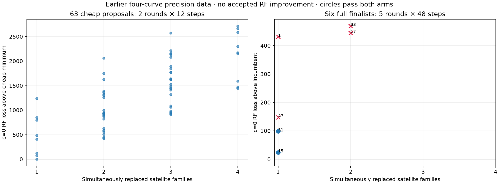
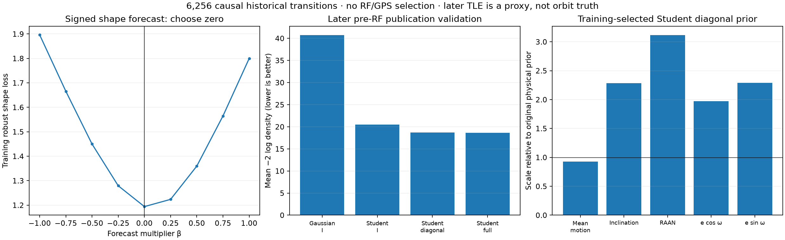
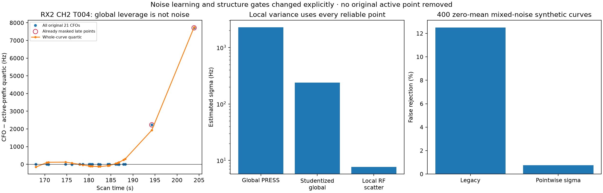
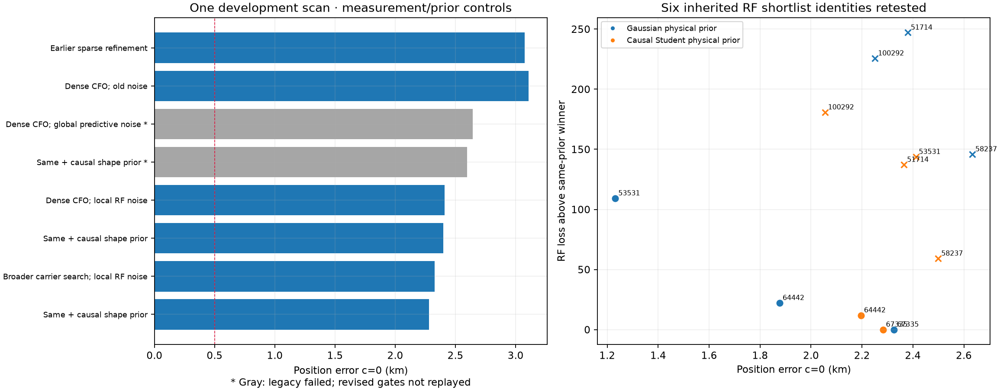
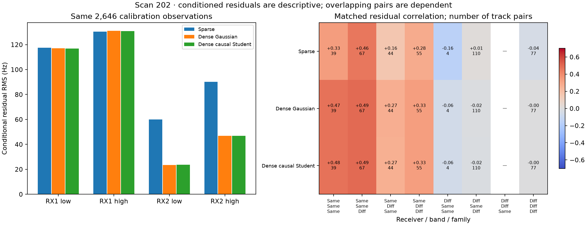

# DS23: dense receiver evidence, causal orbital priors and simultaneous identity changes

Scan 202 improves from **3.076/3.076 km to 2.326/2.327 km** error at c=0/fitted-c
after remeasuring the original active RX2 curves, estimating local radio noise,
and using uncertainty-consistent residual gates. A separately pre-RF-qualified
Student orbital-shape prior gives **2.282/2.283 km**. These are two research
variants on one inspected development scan, not a new DS23 cohort benchmark.
The 0.5 km mean **and** median goal remains unmet.

All **2,646 calibration points** remain: 1,603 on RX1 and 1,043 on RX2.
There is no GPS-selected identity, point removal to pass a gate, future TLE,
new RF collection, recording mutation, or change to the production DSP or
persisted GLRT contracts. The changed gates and noise model are explicit below.

## What the requested association experiments establish

The [20-scan weighting and association report](../2026_10_19_ds23_association_evidence/README.md)
contains the complete first set of requested comparisons. Its fixed incumbent
receiver-support policy gives c0 mean/median **1.315/0.991 km**, fitted-c
**1.266/0.896 km**. Multiplying by identity confidence gives **1.308/0.999**
and **1.260/0.902 km**, with paired gate failures falling back to the same
incumbent pair on seven scans. Hard confidence filtering is worse:
**1.395/1.298** and **1.393/1.255 km**. Certainty of identity is not the same
as accurate orbital prediction or independent position geometry.

That study tested 174 single-family and 288 simultaneous replacement trials
on scans 217, 257, 202 and 273. It also recovered six curved components with
111 previously unused points, including 46 secondary peaks. One chosen peak
per physical probe is permitted; a secondary peak never becomes a second
independent observation. Scan 217's new 22-point curve shrank a local,
nuisance-marginalized information radius from 1.640 to 1.567 km, while c0
position error **increased from 1.025 to 1.193 km**. More usable curved evidence
does not by itself remove model bias. Those recovered curves are not silently
added to the different scan-202 precision experiments in this report.

## Simultaneous family replacement with the newly precise family active

Repeat the bounded search after scan 202's previously excluded 71-point family
has reentered and both original channel companions have been remeasured.
This uses the earlier four-curve precision dataset, **before** the dense RX2
remeasurement below. Its incumbent family identity is the RF-selected 67335.

Screen all 1,569 causal candidates using a shared phase per family at the
regional center, RF-derived valid alternative endpoints and four regional-box
corners. Candidate pools cover four families; the main precise family gets
three alternatives and the other families two each. Cartesian combinations
allow simultaneous swaps while preventing accidental family mergers. There
are **63 proposals**, including alternatives that fail in isolation. Proposal
fits use two phase-refresh rounds and 12 position steps at most; the best six
receive five rounds and 48 steps in **both** c arms. This is a bounded search,
not exhaustive full fitting of every catalogue combination.

None of the six full finalists both improves the same normalized c0 RF loss
and passes all paired gates. Valid single-family alternatives 64442 and 53531
give 2.667 and 0.926 km c0 errors, but lose RF evidence; GPS cannot select them.
The tested pair replacements fail gates. The reported incumbent stays at
3.076 km. The complete proposal/finalist records, including failures, are in
the lossless evidence archive. A new global rescreen on the later dense data
is still required; the dense identity check below retests only six inherited
RF shortlisted identities.

## Qualify orbital shape using historical data available before RF

The preexisting phase forecast remains unchanged. For orbital shape, build
**6,256** three-version transitions from the same causal regional history:
1,569 candidates and 9,427 historical versions. Both TLE epoch and collection
are at or before the actual RF cutoff. Training uses the first 70% of distinct
publication events, not a random row split: 2,905 training transitions and
3,351 later validation transitions. The validation TLE is later than its
historical predictors but still **before this RF observation**.

Two separate proposals are tested:

- **Signed shape mean:** phase-align older/later states to the middle version
  with exact SGP4, compare position and 150-second-scaled velocity at 0/150/300 s,
  and test signed forecast multipliers −1 to +1 in increments of 0.25. Training
  selects **zero**. No deterministic shape forecast is adopted.
- **Zero-mean shape uncertainty:** standardize innovations in mean motion,
  inclination, RAAN, e cos ω and e sin ω using the existing physical prior
  scales. Compare Gaussian identity covariance, Student identity, Student
  diagonal and Student full covariance. Training BIC selects **Student diagonal,
  ν=3**; later pre-RF validation −2 log density improves **54.12%** over the
  original Gaussian identity prior. This is an innovation-density improvement,
  not a 54% improvement in localization or true-orbit accuracy.

Learned diagonal covariance is [0.865, 5.215, 9.694, 3.898, 5.245], giving standard
deviation multipliers [0.930, 2.284, 3.114, 1.974, 2.290]. Each supported satellite
gets one shared Student scale across its five physical shape coordinates;
phase retains its separately learned prior. This adds no free polynomial in
frequency. The small held-out density benefit of a full covariance does not
overcome its additional training complexity penalty, so it is not chosen.

On the earlier four-curve measurement set, this prior gives 2.959/2.959 km;
Gaussian with the same learned covariance gives 3.338/3.338 km. These ablations
retain their own outcomes and are not substituted into the dense-data table.
Historical next-publication innovations are correlated and imperfect proxies
for orbital error. Actual RF-age-matched historical qualification is outstanding.

## Bounded archived-IQ remeasurement of all active RX2 curves

Select every original graph curve on RX2 having any active calibration point,
independent of satellite residual or position error: **30 curves, 1,050 whole
original points**. Seven points were already masked; 1,043 remain active. The
public ShortWindowReader verifies declared recording manifests, chunks and
windows, reading 6,323 existing windows within the declared 7,000-window and
1,200-point limits. This is fast-scan 20 ms IQ at 2.5 MHz, not an implementation
for every adaptive recording format. Raw IQ remains local and is not published.

Each point receives radio-only known-pilot carrier, epoch and modulation-rate
fitting, control-template margins, odd/even-frame checks and an effective time.
Boundary or control failures retain the original CFO and uncertainty. Earlier
RX1 refinements supply 37 points on two curves; the combined input has 1,087
unique refined-input rows. No duplicated companion/probe is counted twice.

A later carrier-basin check scouts ±600 Hz in 20 Hz increments at nominal and
previous epoch/rate settings, then refines within a fixed ±800 Hz bound. It
accepts only a higher radio score and valid exact/control margin. This changes
**19** formerly quality-failing estimates; no TLE, satellite fit, polynomial
shape or GPS guides that search. Every original integer alias is retained.
The frequency alias period is **227,272.727 Hz** (1 / 4.4 μs).

A bounded frequency-rotation cache and immutable pilot-wave cache change only
computation reuse. Synthetic parity tests match CFO, score and search behavior
with caching disabled. A local benchmark is 0.604 s versus 0.242 s; this is not
an embedded or whole-pipeline speed claim.

## Correct measurement variance and mixed-noise residual tests

The old radio-noise rule used whole-curve polynomial prediction/PRESS error.
That can describe uncertainty in extrapolating a polynomial rather than the
noise of a measured CFO. RX2 CH2 T004 exposes the difference: 21 original points,
19 active prefix points and two late points already excluded by the original
calibration mask. Whole-curve quartic leverage reaches **0.99665**. PRESS gives
**2,289 Hz**, studentized whole-curve scatter **238 Hz**, while local RF scatter
is **7.65 Hz**. This does not establish that the late points belong to another
satellite; it establishes that global polynomial prediction is a poor local
measurement-noise estimate here.

The new RF-only scale is the median scatter of sliding 16-reliable-point
windows, selecting degrees 0–3 by a profile complexity penalty. It is floored
at 5 Hz and the independent odd/even-frame proxy. All reliable measurements
can contribute, including originally masked points; no satellite residual,
geographic error or active-mask selection is used to learn the scale. Fallback
points keep their original noise. This is a development variance law, and
same-data noise learning and correlated errors still need calibration.

The legacy residual test also assumes a common noise scale. A weak prefix of
RX2 CH6 T000 illustrates the resulting mismatch: first-point sigmas are about
128–137 Hz, most later sigmas about 13.7 Hz. The raw step statistic is **4.956**,
above its unchanged limit 4. There is also a roughly 5.5-radio-sigma individual
point. These details remain visible; passing a structure test does not certify
iid Gaussian noise or prove the association.

The research gate now uses declared pointwise sigmas for GLS profile residuals,
weighted mean/slope/step tests, quadratic BIC and whitened lag-one correlation.
The standardized scatter is floored at one. Numeric limits remain 3/3/10/4 and
4/√N. Original unweighted hard RMS/bias bounds, GLS profile bounds, alias,
elevation, conditional RMS and independent receiver/channel support checks
remain. This is an explicit statistical-model change, not a claim that the
previous gate passed these fits.

With uniform 75 Hz sigma, every structure statistic reproduces the legacy
implementation to numerical precision. In 400 fixed-seed synthetic zero-mean
curves with a five-point noisy prefix, false rejection drops from **12.5% to
0.75%**. Separate controls still reject a real slope or discontinuity. This
limited toy experiment does not establish a calibrated real-data false-alarm
rate. Saved five-round posteriors are replayed exactly before the gate audit;
the objective changes by less than 10⁻⁵. There is **no refit or point removal to
make this audit pass**.

## Position results and renewed RF identity competition

Each fit cold-starts at the center of the same 25 × 25 km region,
37.906° N, −122.545° E. GPS (37.849061591561885, −122.48574968092912) is used only
here for error reporting. Both c arms use identical observations, candidate
identities, alias integers, other priors and five-round/48-step search budgets
within each comparison. No scan-specific geographically best result is adopted.

| Scan-202 measurement/prior variant | c=0 / fitted-c error, km | Legacy gates | Pointwise-noise gates |
|---|---:|---|---|
| Earlier sparse refinement, RF-selected 67335 | 3.0759 / 3.0763 | Pass | Not replayed here |
| Dense CFOs, old uncertainties | 3.1067 / 3.1073 | Pass | Not replayed here |
| Dense CFOs, original global predictive noise | 2.6438 / 2.6435 | Fail | Not replayed here |
| Dense CFOs, local RF noise | 2.4088 / 2.4097 | Fail | Pass |
| Same + causal Student shape prior | 2.3987 / 2.3996 | Fail | Pass |
| Broader carrier search + local RF noise | **2.3262 / 2.3268** | Fail | Pass |
| Same + causal Student shape prior | **2.2823 / 2.2826** | Fail | Pass |

The original output files preserve rejection/fallback under the legacy rules.
The subsequent gate audit is separate and records the revised development
outcome. These are not automatically accepted by the published ALGO01 default.
Losses across differing data/variance laws are not a substitute for a matched
accuracy test. On the identical dense data, the Gaussian shape prior actually
has a lower normalized RF loss than the causal Student prior; the latter was
selected independently by historical prediction, not by its smaller GPS error.

Retest all six inherited RF shortlisted identities with the dense data and
both priors, using full paired fits and the revised gates. **67335 remains the
RF winner with both priors.** With Gaussian shape, 64442 gives 1.877 km but
loses RF evidence by 22.15; 53531 now passes revised gates and gives 1.232 km
but loses by 109.20. With the Student shape prior, 64442 gives 2.196 km and
loses by 11.90; 53531 fails gates. GPS still cannot choose them. This is six
full identity refits, not a fresh all-1,569-candidate dense-data rescreen.

## Does the remaining discrepancy follow a receiver or a satellite?

The earlier 20-scan comparison shows both. Same-family, same-band cross-RX
median residual correlation falls from +0.461 with nominal TLEs to −0.020
after satellite corrections. Different-family, same-RX/band correlation remains
+0.459 after corrections. This points to receiver-common residual behavior
in addition to orbit/transmitter discrepancies already absorbed by the model.

On scan 202, the same active point counts are compared below. These are
conditional residuals after jointly fitting position, hardware and satellite
terms, not independent receiver-cause tests.

| c=0 residual group | Points | Sparse RMS, Hz | Dense local-noise RMS, Hz |
|---|---:|---:|---:|
| RX1 low band | 926 | 117.5 | 117.0 |
| RX1 high band | 677 | 130.4 | 131.1 |
| RX2 low band | 791 | 59.9 | 23.6 |
| RX2 high band | 252 | 90.1 | 46.8 |

Within RX1, different-family median matched correlation stays **+0.454→+0.465**
(101 track pairs). RX2 changes **−0.243→+0.095** (21 pairs). Same-family cross-RX
median is **−0.161→−0.059**, based on only four pairs. Matches use unique actual
observations within 0.5 s, with at least six matches per track pair, never
interpolation. All eight RX/band/family strata and both c arms are in the CSV.
Track pairs overlap and are dependent; these counts are not independent
significance tests. A small cross-RX correlation cannot establish satellite
identity or exonerate TLE errors already absorbed by fitted terms.

The direct measurement intervention strongly reduces RX2 residuals while RX1
remains largely unchanged. It supports investigating the remaining RX1
measurement/calibration behavior. It does not prove that correcting it will
meet the localization target or that one receiver explains the entire bias.

## Reproduction, publication and next qualification

Use PYTHONPATH=src:tools and one BLAS/OMP thread in the repository venv.
Entry points are the snapshotted tools for joint search (prepare/worker/finalize),
causal forecast/distribution, history-shape position controls, receiver panel
(prepare/export/refine/combine), carrier broadening (worker/combine), local-noise
position fits, exact gate audit and dense catalogue refits. All paired final
fits start at the regional center. Rebuild these figures with
`tools/report_ds23_dense_receiver_study.py` after restoring the numeric archive
at its repository-relative paths. No new archive access is needed for replay
of the published historical evidence.

The full source snapshots include the two earlier source versions matching
the original position and broad-audit output hashes. Dependencies and original
causal bank/tracking authorities are prerequisites pinned in the previous
[catalogue](../2026_10_19_ds23_refined_catalogue/README.md),
[precision](../2026_10_19_ds23_refined_precision/README.md) and
[raw-pilot](../2026_10_19_ds23_raw_pilot_refinement/README.md) reports. Raw local
panel IQ is intentionally absent; its checksum, manifest authorities and
window hashes remain in numeric metadata. Fresh raw refinement requires those
readable recordings. This is not a standalone downloadable full radio corpus.

Twenty-one owned tests passed: pilot cache parity, joint combinations,
historical chronology/selection, physical-coordinate transforms, noise/merge
checks and heterogeneous residual tests. Publication adds research reports,
receipts and source snapshots, preserving the current ALGO01 specification.

Next: freeze a measurement/noise/gate policy before an untouched cohort;
repeat global association search under the new dense inputs; qualify the
shape prior at RF-age-matched historical horizons; test receiver/family
prediction and residual clocks with these more precise observations. Broader
DS23 and new-location validation remain outstanding. This report does not
replace the unchanged 20-scan aggregate with a one-scan improvement.

[Summary](summary.json) · [Validation](validation.json) ·
[Paired position table](position_comparison.csv) ·
[Dense identity trials](dense_identity_comparison.csv) ·
[Receiver/band groups](receiver_band.csv) ·
[Matched residual pairs](matched_residual_pairs.csv) ·
[All correlation strata](residual_correlations.csv) ·
[Synthetic gate receipt](gate_simulation.json) ·
[Lossless numeric evidence](evidence.tar.gz) ·
[Evidence hashes](evidence_inventory.json) · [Source hashes](source_inventory.json).
