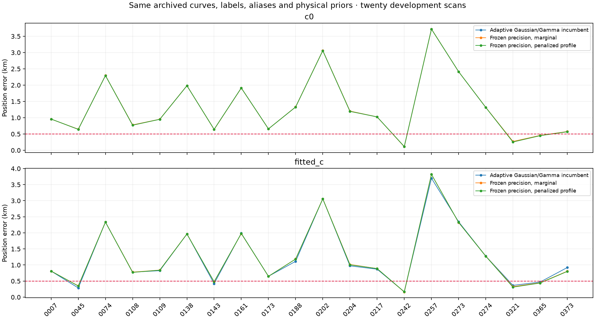
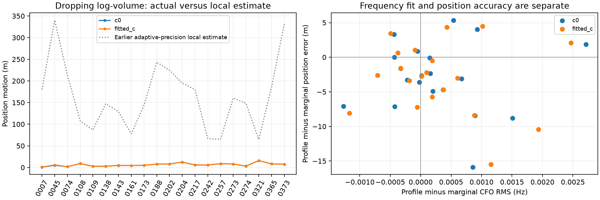

# DS23: frozen-precision marginal and penalized-profile position fits

The nuisance integration log-volume does not explain the kilometre-scale position
errors in the twenty development scans. This controlled comparison keeps the
archived observations, masks, candidate labels, alias integers, receiver-support
powers, radio-noise law, phase-history means/scales and three physical orbit
directions fixed. It changes neither ALGO01's default nor published measurements.

| Policy | c0 mean / median km | Fitted-c mean / median km | Paired valid /20 |
|---|---:|---:|---:|
| Adaptive Gaussian/Gamma incumbent | 1.315 / 0.991 | 1.266 / 0.896 | 20 |
| Frozen precision, marginal | 1.315 / 0.991 | 1.275 / 0.865 | 20 |
| Frozen precision, penalized profile | 1.312 / 0.992 | 1.272 / 0.864 | 20 |

## What is isolated

Replay the incumbent c0 fit at its saved phase reference and position. Freeze
its per-fragment noise precision and per-coordinate nuisance prior precision.
The fixed Gaussian posterior reproduces its coefficient mean to numerical
precision. Use the same c0-derived values in both c arms, inserting a unit
Gaussian precision only for the extra ninth fitted-c hardware coefficient.
All original phase means remain absolute after every relinearization. Fragment
constants retain their physical 300 Hz scale. This is a conditional empirical
Gaussian control, not a newly calibrated prior learned independently of RF.

For residual y, design U, W=diag(power*precision/sigma²) and diagonal prior P:

    A = P + U' W U
    eta = A^-1 U' W y
    Q = (y-U eta)' W (y-U eta) + eta' P eta
    V = logdet(A) - logdet(P)

The conditional marginal uses Q+V. The penalized profile uses Q alone. Both
retain the same fitted nuisance mean and Gaussian prior penalty at a given
position; they differ only by V. For power=1, Q+V plus the diagonal Gaussian
noise normalization is the exact integrated Gaussian density. Fractional powers
give generalized evidence. Q alone is not a marginal likelihood; its raw score
cannot select it against Q+V. Compatibility key negative_twice_elbo in the shared
optimizer is explicitly labeled objective_kind in every final result; the
profile value must not be described as an ELBO or normalized probability.

Both controls start at the regional center (37.906,-122.545), with the same
25x25 km box, five phase refreshes and at most48 position steps per refresh.
They keep every incumbent observation. Either-arm residual/alias/visibility/
owner failure or final phase-reference movement above0.01 s causes paired
fallback, without additional point trimming. All forty paired controls pass.
No approach is selected per scan by GPS or by comparing these different losses.

## Interpretation

Freezing precisions preserves the c0 endpoint, but changes fitted-c results
slightly: this isolates precision feedback rather than log-volume. Dropping
log-volume with common frozen precisions moves c0 positions by a median
5.84 metres, with maximum 15.89 metres. Mean accuracy changes only slightly;
there is no material gain toward the0.5 km mean and median target.

The earlier local sensitivity estimate had median154m. Its derivatives allowed
the original variational precisions to change and used a local Gauss–Newton
approximation. It was not a refit, and this controlled result must supersede any
interpretation of that estimate as an achievable position correction. The two
diagnostics answer different questions; the larger sensitivity is not evidence
that discarding Gaussian integration fixes location.

Evaluation alone uses (37.849061591561885,-122.48574968092912), under the same
unconfirmed assumption that this site applies to every sampled recording.
All TLE inputs remain causal. No IQ is reread, RF collected, identity selected,
or antenna coordinate supplied to inference. These are twenty development
scans, not validation on the other393 DS23 recordings or on a new location.

The next unused observation class is the linear graph extensions. They can
test position conditionally on calibration learned from curved tracks, but
must not estimate receiver offsets or drifts. Their predictive covariance
must retain shared calibration uncertainty; counting them as independent,
perfectly calibrated frequency samples would create false information.

## Reproduction

Use the repository venv, PYTHONPATH=src:tools and BLAS/OMP threads one. Run
tools/run_ds23_frozen_precision.py, then tools/report_ds23_frozen_precision.py.
Two numerical subprocesses have180s per-case limits. Four owned tests check
dense-data covariance normalization/posterior parity, fractional-power ridge
profiling, fitted-c coordinate insertion and zero-feature/invalid-input controls.
Source snapshots overlay the prior height, causal-history and ALGO01 reports.

[Positions including raw trials](positions.csv) · [Volume changes](volume_effect.csv) ·
[Summary](summary.json) · [Validation](validation.json) · [Protocol](protocol.json) ·
[Execution](execution.json) · [Causal receipts](causal_receipt_audit.json) ·
[Full lossless evidence](evidence.tar.xz) · [Evidence hashes](evidence_inventory.json).
