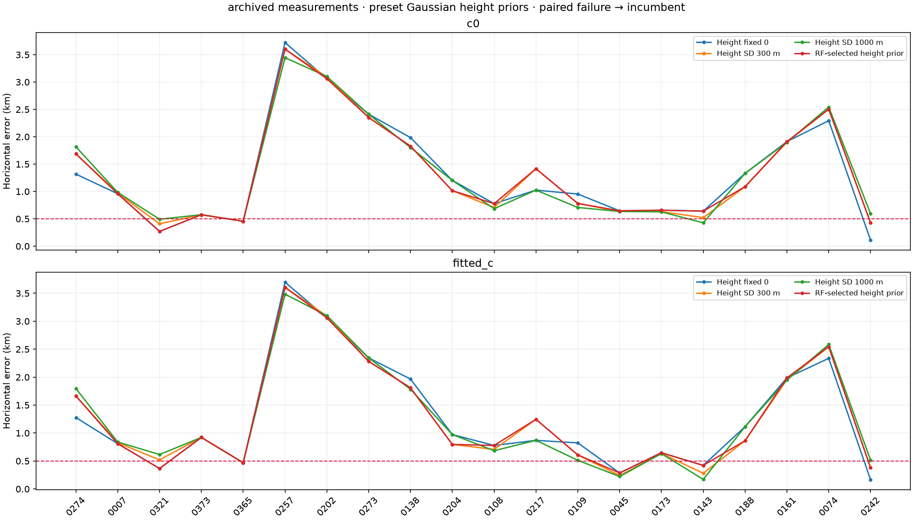
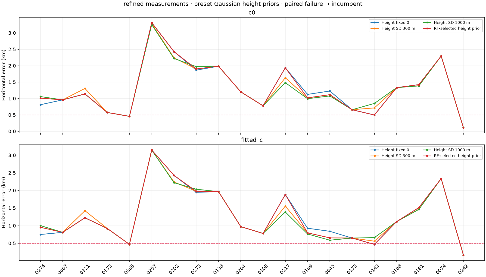
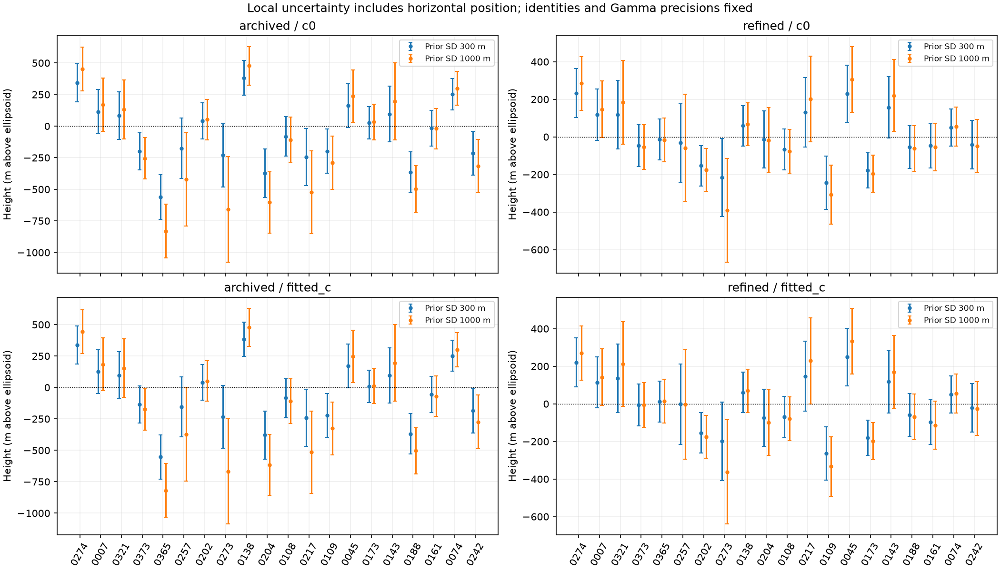
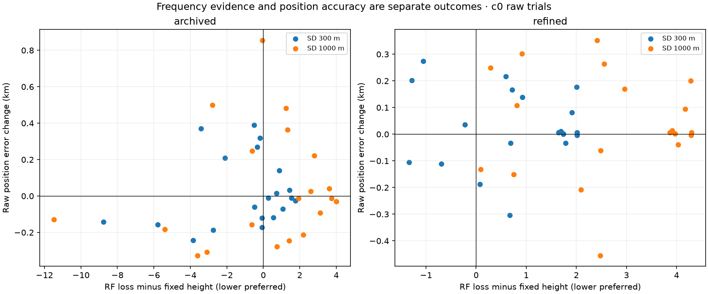
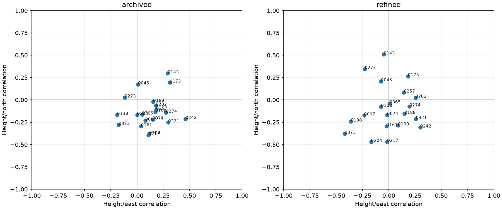
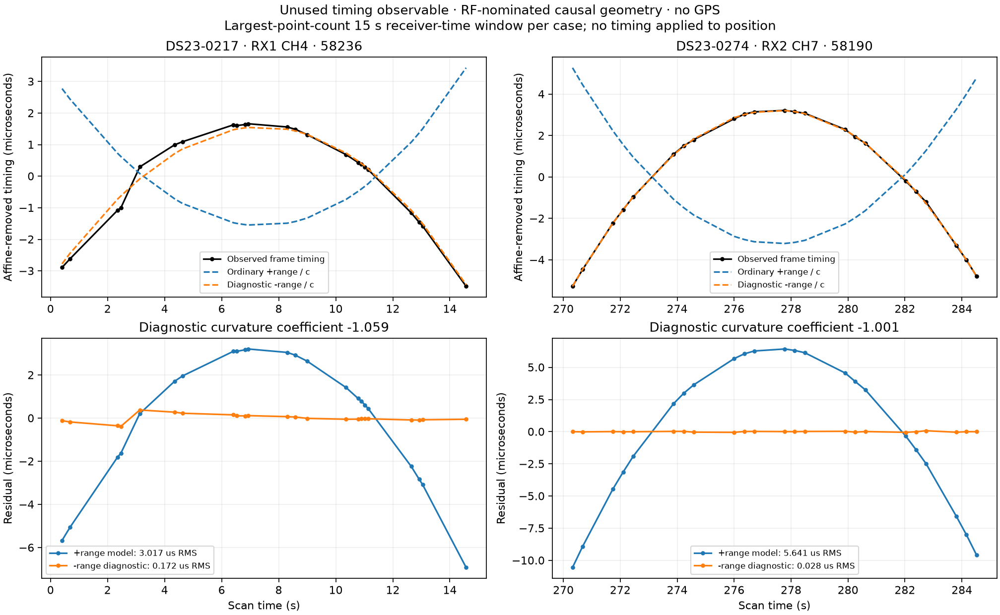
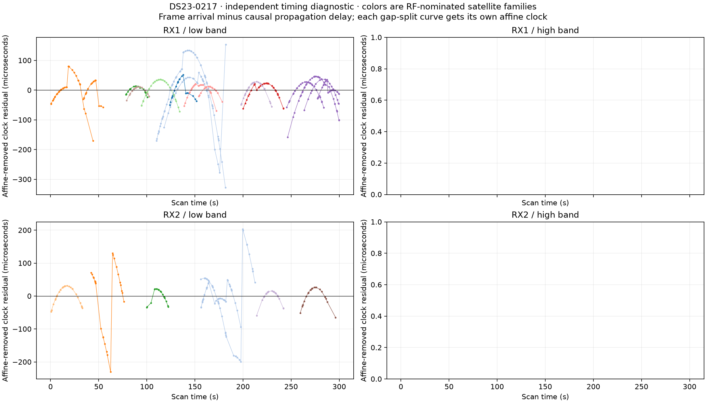
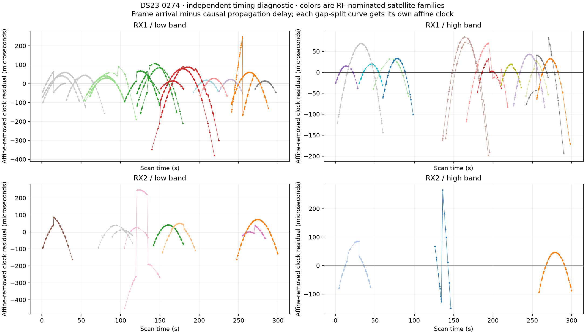
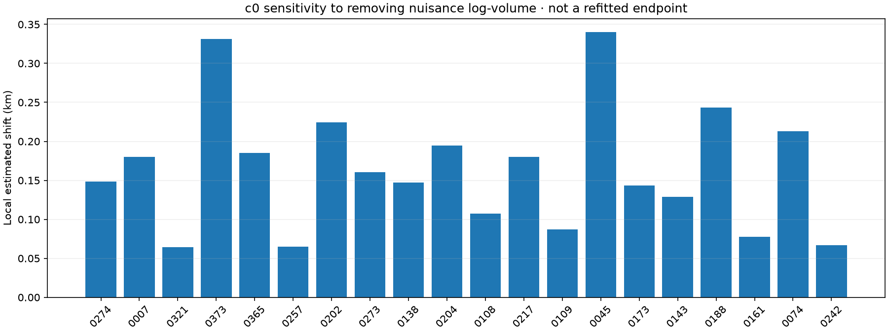

# DS23: antenna-height uncertainty and horizontal localization

This is a fixed-rule height ablation on the original twenty development scans,
using both the archived measurements and the separately refined RX2 measurements.
It tests a missing geometry term without selecting a height from evaluation GPS.
It does not establish the 0.5 km goal on all 413 DS23 recordings or a new location.
ALGO01's published default remains unchanged.

| Measurements / policy | c0 mean / median km | Fitted-c mean / median km |
|---|---:|---:|
| archived / Height fixed 0 | 1.315 / 0.991 | 1.266 / 0.896 |
| archived / Height SD 300 m | 1.330 / 0.993 | 1.272 / 0.845 |
| archived / Height SD 1000 m | 1.338 / 1.004 | 1.279 / 0.896 |
| archived / RF-selected height prior | 1.332 / 0.986 | 1.277 / 0.836 |
| refined / Height fixed 0 | 1.306 / 1.171 | 1.266 / 0.950 |
| refined / Height SD 300 m | 1.298 / 1.159 | 1.248 / 0.964 |
| refined / Height SD 1000 m | 1.289 / 1.109 | 1.234 / 0.988 |
| refined / RF-selected height prior | 1.307 / 1.128 | 1.261 / 0.964 |

All scans remain in every denominator. A failed trial in either c arm retains
the previously published pair for that measurement policy; no extra point is
trimmed. A fixed height prior is applied to every scan, and the RF-selected
policy chooses the lowest full normalized c0 objective among paired-valid
hypotheses. Both c arms share the selected hypothesis. The archive includes
raw regressions and failed trials, not only final fallbacks.

## Model, prior and complexity

Keep the previous curved graph observations, satellite labels, alias integers,
point masks, receiver-support powers, radio-noise law, causal phase-history
forecast, three physical orbit directions and 300 Hz fragment constants.
The three alternatives are height fixed to 0, or one scan-wide Gaussian height
with mean 0 and SD 300 or 1000 metres. These are engineering hypotheses relative
to the geodetic ellipsoid, not surveyed antenna heights, terrain constraints,
or independently calibrated priors. A posterior mean outside -500 to 9000 m
fails an explicit broad engineering plausibility gate; the Gaussian itself is
not truncated. No coordinate-dependent terrain or supplied GPS enters this fit.

Height is a single shared physical nuisance across all receivers, bands and
satellites. Recompute range-rate, elevation, phase derivatives and all physical
orbit features at the current reference height. Differentiate the current
physical mean, including its previous orbital correction, with a central 50 m
height difference. Append sigma_height times this derivative as one Gaussian
feature. Subtract derivative times reference_height from the intercept so the
absolute prior remains centered at zero after every relinearization. The
existing normalized Gaussian/Gamma integration includes the extra coefficient
penalty and determinant; this is not a free vertical correction chosen to
reduce residual RMS. A zero height column integrates to one, including under
the existing Student phase prior.

All fits start at the center of the same 25x25 km region, 37.906, -122.545,
with phase and height references initially zero. Use five phase/height refreshes
and at most 48 position steps per refresh, identically in both c arms. The
horizontal position remains two nonlinear coordinates; height is marginalized
as a local Gaussian nuisance. Height and physical orbit references update from
the curved-data posterior only. No linear track calibrates offsets or drifts.

The refined scope uses the same CFOs, effective times and cached local noise
from the previous RX2 cohort, without rereading IQ. The archived scope uses
the original causal-history/receiver-support incumbent. Score differences are
only compared within one measurement scope; cross-noise RF scores are not
used to choose a geographically favorable measurement policy.

## Geometry checks and interpretation

Every full fit replays the complete physical design at its posterior height,
keeping its fitted coefficients and phase reference. Qualification requires
maximum prediction difference below 0.1 point-noise units and final height
reference movement below 0.5 m, alongside the unchanged residual, alias,
visibility and owner gates. Pointwise-noise development gates remain explicit
for refined data; archived data retain their original gates. A failed replay
or gate causes paired fallback, never a hidden deletion or relaxed threshold.

The zero-height controls reproduce the earlier endpoints and full objectives;
null_replay.csv records all eighty comparisons. Four owned height tests
check zero-height parity with the original physics, height derivatives including
orbit corrections, exact integration of an unused Gaussian height feature under
Student phase priors, and the sign/scale of a known-height Doppler signal.

Height uncertainty bars are local Gaussian approximations conditional on fitted
Gamma precisions and discrete identities. They include horizontal-position
coupling via the complete position/nuisance normal system. They are not
calibrated survey confidence intervals. Different scans can estimate different
heights because height trades against receiver and orbital errors. Do not pool
their fitted heights into a new site prior or select a prior using GPS error.

Reported horizontal errors use 37.849061591561885, -122.48574968092912, only in
this reporting tool. The dataset manifest supplies no per-recording surveyed
coordinate or antenna height. The existing assumption that every scan shares
that reference remains explicit; its confirmation has been requested. Every
TLE epoch/collection receipt still precedes the original cutoff, and no future
TLE, GPS-selected identity or new satellite nomination is introduced here.

## Unused frame timing: a separate sign/clock diagnostic

Scans 217 and 274 also test archived frame epochs as a possible additional
observable. Use the immutable device counter, within-visit probe offset and
integer/fractional epoch to form arrival time; never substitute the concatenated
IQ payload offset. Compute causal range at that arrival time using the
CFO-fitted position, phase and physical orbit modes, without evaluation GPS.
The first plots remove one affine clock per curve/gap segment. Their clock
residual RMS is tens of microseconds, which does not qualify a stable-clock
pseudorange model across a long graph track.

Inspect fixed 15 s receiver-time windows, separately testing window origins
0, 3, 6, 9 and 12 s. These are sensitivity controls, not asserted network
reconfiguration boundaries. Within each window, remove an affine component
from observed arrival phase and geometric range/c. Fit their curvature ratio
gamma only as a diagnostic; also report fixed gamma=+1 and -1 without fitting
that coefficient. The raw frame interval ambiguity remains 1/750 s. Long
gaps split at 10 s and no short-gap unwrap is certified solely by continuity.

At receiver-window origin 0, median gamma is -1.012/-0.991 for scans 217/274.
The ordinary +range/c model leaves median RMS 3.580/3.896 microseconds; the
opposite-sign diagnostic leaves 0.075/0.041 microseconds. The other window
origins show the same approximate negative coupling. Window records are
dependent and some curvature ratios are unstable when geometric curvature
is weak. The illustrated window is chosen by point count, not fit quality.

This does not justify reversing propagation delay or applying a timing-derived
position. Candidate explanations include frame-clock behavior and acquisition
epoch conventions; neither is established by this diagnostic. Synthetic controls
recover the expected positive-delay sign, but they do not identify the binary
used for every archived capture. No clock timing, free gamma or resulting
position enters any height experiment or ALGO01.

[Qin et al., Timing Properties of the Starlink Ku-Band Downlink](https://arxiv.org/html/2501.05302v1)
report beam-dependent frame clocks, timing adjustments, and frame/carrier rate
differences that can include opposite signs. Their clock-steering explanation
does not establish the cause of our measured curvature. This is an independent
reason to qualify a transmitter-clock model before interpreting frame timing
as pseudorange. Three timing/identity tests and two signed-curvature tests
supplement the four height tests; all nine pass.

## Local sensitivity to nuisance integration

A separate c0-only calculation differentiates the original objective's
quadratic, integration log-volume and Gamma terms at each archived RF endpoint.
The local Gauss–Newton estimate of the position change after dropping only
log-volume has median 0.154 km and maximum 0.340 km. This is a sensitivity
calculation, not a refitted position, a new inference policy or a c ablation.
The original adaptive precision updates still run inside the derivatives.
It neither certifies a distant alternative minimum nor establishes which
direction improves actual accuracy.

This warrants a controlled comparison of penalized profiling and marginal
integration with common frozen precisions, before attributing any change to
geometry volume. Their raw objective numbers would not be comparable as the
same probability. Such a position algorithm has not been run in this report.
Positive beam-clock agreement could also help validate additional track
identities, while absolute timing remains unqualified. Linear extensions may
provide position evidence only with calibration learned from curved tracks;
they must not learn receiver offsets or drifts.

## Reproduction and evidence

Run tools/run_ds23_height_cohort.py --stage pilot, then --stage cohort, followed
by tools/probe_ds23_frame_timing.py --case DS23-0217 and --case DS23-0274,
tools/probe_ds23_volume_gradient.py, then tools/report_ds23_height.py with the
repository venv, PYTHONPATH=src:tools
and BLAS/OMP threads one. Two numerical subprocesses each have a 600 s limit.
There is no IQ access, RF acquisition, external service or QNAP mutation.
Source snapshots overlay the previous causal-history and RX2 reports. Full
case/scope fits, phase/height refresh histories, raw gates and covariance/replay
checks are preserved in the lossless archive.

[Summary](summary.json) · [All positions and heights](position_and_height.csv) ·
[Null controls](null_replay.csv) · [RF model selection](selected_priors.csv) ·
[All clock windows](timing_curvature_windows.csv) · [Clock-window summaries](timing_curvature_summary.csv) ·
[Validation](validation.json) · [Causal receipt audit](causal_receipt_audit.json) ·
[Lossless evidence](evidence.tar.xz) · [Evidence hashes](evidence_inventory.json).
