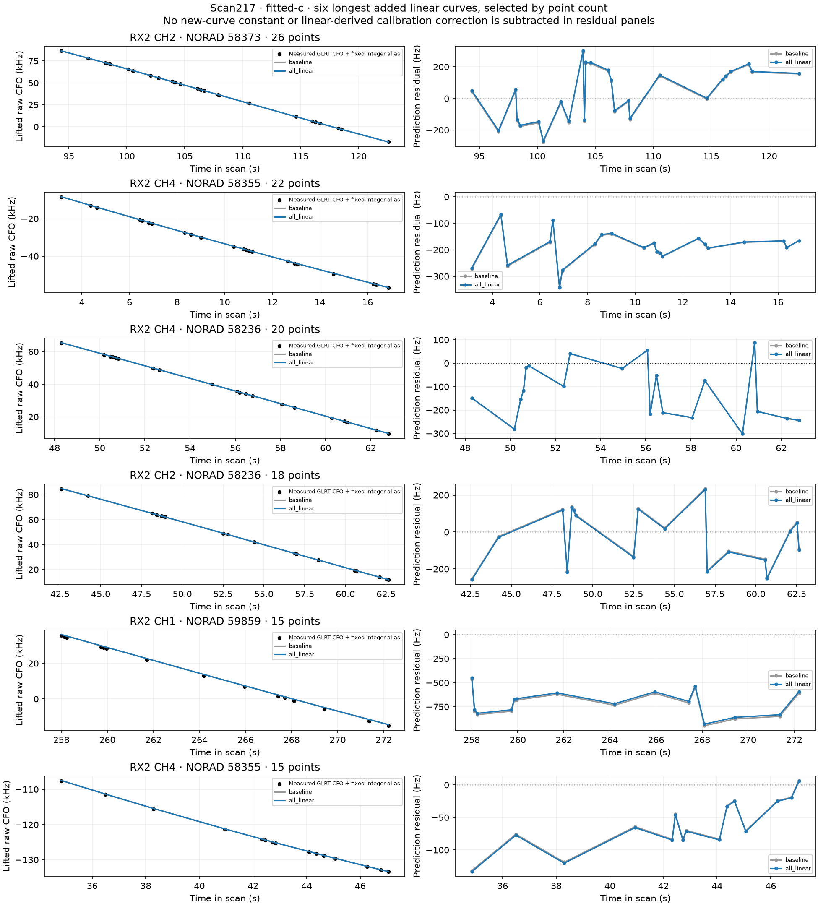

# DS23: linear-track position evidence with curved-only calibration

This prototype uses already associated linear graph extensions as additional
position evidence. Receiver offsets, receiver/band drifts, smooth hardware terms
and satellite corrections are still inferred from the original curved set only.
Shared calibration uncertainty is propagated across every added observation.
The 0.5 km mean and median goal is not established, and ALGO01 is not promoted.

| Policy | c0 mean / median km | Fitted-c mean / median km | Paired valid /20 |
|---|---:|---:|---:|
| Curved calibration incumbent | 1.315 / 0.991 | 1.266 / 0.896 | 20 |
| All qualified linear extensions | 1.229 / 0.804 | 1.177 / 0.811 | 16 |
| Cross-RX-supported linear extensions | 1.276 / 0.924 | 1.221 / 0.827 | 19 |

Across the twenty scans, all-linear offers441curves/7,046points. Paired gates
retain357curves/5,734points in16scans. The cross-RX policy offers188curves/
3,169points and retains179curves/3,034points in19scans. These are additional
predictive observations; they do not enlarge the calibration set or its owner
votes. Four all-linear trials fall back:321,365,173 and74. Scan321 fails a
new linear gate;365 and173 fail an original curved gate;74 fails both. The
cross-RX trial on74 also fails an original curved gate. No failed curve is
quietly removed to retain the rest of its trial.

## Selection and matching controls

At the incumbent c0 RF-derived position, run the existing frozen-calibration
extension against families supported by accepted curved tracks. Keep only
non-curved graph tracks with at least6 original probes and no canonical-ID
overlap with curved evidence or another added curve. The all-linear control
uses every such extension. The cross-RX control keeps only families whose
original active curved evidence already spans both receivers. Both policies
are applied to every scan; there is no per-scan GPS choice. Labels and aliases
are frozen from c0 and identical in the fitted-c arm. The existing catalogue
and every TLE receipt remain causal; there is no new satellite nomination.

Original observations, masks, aliases, receiver-support powers, phase-history
prior, three physical orbit modes and300Hz fragment constants remain unchanged.
Every arm starts at the center of the same25x25km regional box centered on
(37.906,-122.545), with five phase refreshes and up to48 steps each. Original
curved gates, new-curve residual/alias/visibility gates and a0.01s phase-refresh
gate must pass in both arms. Otherwise keep the incumbent pair, without removing
another observation or relaxing a gate. Raw failures and regressions remain.

## Conditional predictive likelihood

At each trial horizontal position, fit the original curved-data hierarchical
model and recover coefficient mean m and conditional Gaussian precision A.
Rebuild the same physical features U_L at each new linear observation, including
its actual RX, band, RF and time. Existing curved-fragment constant columns are
zero for the new curves; their biases cannot leak into another track.

    calibration_mean = m(curved data, position)
    predictive_mean = nominal_Doppler_L + U_L m
    covariance_L = D_L + U_L A^-1 U_L' + 300² Z Z'

Z gives one independent constant per new curve. D_L uses the original radio-only
point-noise law, multiplied by2 in variance: an unseen Gamma(2,2) noise precision
has E[1/tau]=2. This is a Gaussian approximation to a heavy-tailed predictive
distribution, not a fitted extra noise law or calibrated probability. Added
linear predictive factors have power1; the original curved powers are unchanged.
The full calibration covariance is shared across tracks, receivers and families.
It is conditioned on the curved posterior Gamma precision means, not on fixed
perfect hardware or independent pointwise calibration error bars.

The optimizer adds the normalized Gaussian predictive cost to the existing
curved bound. New linear points never enter calibration normal equations,
Gamma updates, owner votes or phase-reference estimates. They can affect the
chosen horizontal position, at which curved data alone are refit. This is a
modular predictive research objective; do not call it the exact full
hierarchical joint posterior. Its coefficient replay against curved-only
calibration at the same position is exactly unchanged in every saved fit.

Unlike fitting all points jointly, a coincident linear slope cannot create its
own receiver drift. Unlike a plug-in calibration estimate, the shared covariance
prevents many copies of the same uncertain calibration direction becoming
independent evidence. The synthetic dense-covariance and shared-mode controls
verify that distinction. Gaussian nuisance integration includes both the prior
penalty and determinant; extra points are not rewarded simply for being added.

## Scan217 and limits

The nine accepted extensions supply151points; the cross-RX subset supplies77.
The all-linear raw trial changes c0 error from1.025 to0.775km and fitted-c error
from0.869 to0.529km. This was the pilot development case, not an untouched
validation. The second pilot, scan274, regresses with all-linear evidence:
1.277 to1.345km fitted-c. Both outcomes are retained in the cohort table.

The figure uses the six longest added tracks by point count, not by accuracy
or residual improvement. CFOs are original measurements plus a fixed integer
alias; residuals subtract the complete curved-only mean, without subtracting
a newly fitted constant or a linear-derived calibration term. These plots do
not establish the truth of the frozen satellite identities. Alternative label
competition and receiver/family predictive calibration remain relevant.

Actual position error uses (37.849061591561885,-122.48574968092912) in this
reporter only, under the existing unconfirmed same-site assumption. These are
the original twenty development scans, not all413 DS23 recordings or independent
new-location validation. Compare each prespecified policy across all scans,
including fallback failures. Losses with different observation sets cannot be
ranked to select a geographically favorable policy; lower CFO RMS alone cannot
establish more accurate position. No new RF, IQ read or QNAP mutation occurs.

## Reproduction

Use the repository venv, PYTHONPATH=src:tools and BLAS/OMP threads one. Run
tools/run_ds23_predictive_linear.py and tools/report_ds23_predictive_linear.py.
Two subprocesses have300s per-case bounds. Four owned tests check dense
predictive covariance parity, dependence of repeated shared-mode observations,
an empty extension identity, and zero feedback to curved calibration despite
inconsistent added linear measurements. Overlay the frozen-precision/height
and earlier ALGO01 source snapshots before these research sources.

[Positions and raw trials](positions.csv) · [Additional evidence](extension_counts.csv) ·
[Failed components](failed_components.csv) ·
[Summary](summary.json) · [Validation](validation.json) · [Protocol](protocol.json) ·
[Execution](execution.json) · [Causal receipts](causal_receipt_audit.json) ·
[Lossless full evidence](evidence.tar.xz) · [Evidence hashes](evidence_inventory.json).
