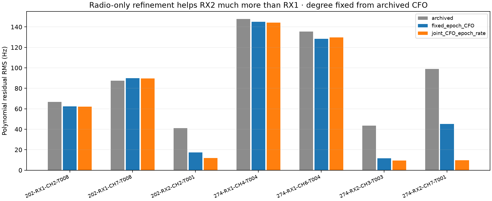
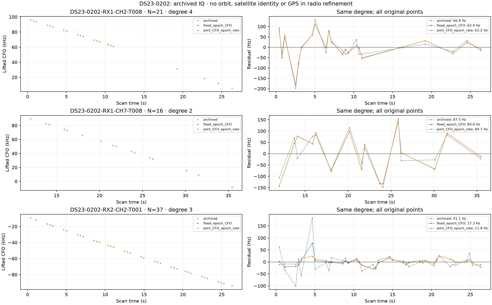
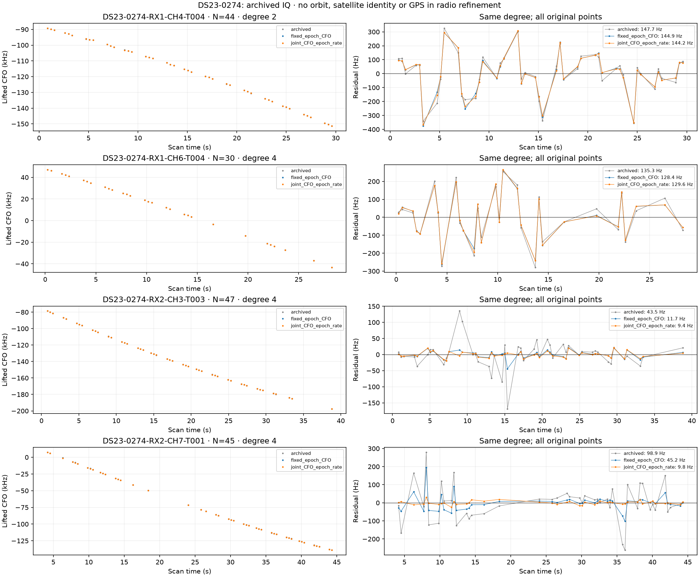

# DS23: bounded archived-IQ CFO refinement

Re-analysis of seven complete early graph curves (240 GLRT observations) finds
a substantial estimator-dependent component on RX2: local known-pilot fitting
reduces its polynomial residual RMS from about41–99Hz to9–12Hz. RX1 improves
less. This is radio-only evidence, not proof of the physical cause or of an
unbiased satellite position. Partial position refits with the old uncertainty
law improve scan274 by about20m and leave scan202 essentially unchanged.
The0.5km goal remains unmet; the full413 DS23 recordings are not evaluated.

## Fixed radio-only experiment

Use the existing read-only short-window port and hash-verified declared segment
manifests. Select the largest original active-curvature graph track per RX/band,
12–96 points, all visits below1024, without satellite labels, GPS or position
errors. Export every selected point; no missing-group replacement. Cases202
and274 are development diagnostics selected in earlier failure/receiver studies,
not an untouched validation set. Case202 has three eligible groups;274 has four.
Never publish raw-IQ panel payloads. Their hashes and manifest receipts are in
the full result JSON inside evidence.tar.gz; replay needs authorized local data.

The local model uses the published edge-pilot template, Fourier interpolation,
all complete guarded frames, an independent complex amplitude and DC per frame,
and direct continuous carrier-frequency fitting. The fixed variant retains
the archived epoch and nominal code rate. The joint variant searches epoch
within0.75sample and one code-rate parameter within40ppm. This one parameter
ties frame cadence to intra-frame modulation; it does not distinguish every
physical frame/sample/carrier clock. Unknown channel response, fading,
interference and transmitter clock behavior remain possible model errors.

Carrier search is local and bounded; clipped solutions remain flagged. Joint
epoch/rate boundaries and exact-versus-control margin are recorded. Disjoint
odd/even-frame fits are also retained; their effective times differ, so their
CFO difference cannot be interpreted as independent measurement noise without
accounting for Doppler rate. Three synthetic tests check off-grid CFO under
independent frame phases, distinct code/carrier rates and disjoint-frame timing.
Three further tests check alias-preserving updates, boundary fallbacks, wrong
peak rejection and reconstruction of an unpersisted acquired-CFO residual bin.

## Radio fits, with the original degree fixed

Degrees0–4 are compared using archived-CFO RSS/original-radio-sigma² +
(degree+1)log(N), at least four points per coefficient. The chosen degree and
all original points then remain fixed for every refined curve. Table values
show the raw diagnostic estimates, including flagged boundary solutions;
the CSV additionally reports boundary-fallback RMS and effective-time variants.
A polynomial forces zero fitted mean/trend; this alone does not establish white
noise. Lag-one correlation and half-track mean steps are provided in the CSV.

| Scan / track | Points | Degree | Archived RMS | Fixed epoch RMS | Joint epoch/rate RMS |
|---|---:|---:|---:|---:|---:|
| DS23-0202-RX1-CH2-T008 | 21 | 4 | 66.84 Hz | 62.36 Hz | 62.18 Hz |
| DS23-0202-RX1-CH7-T008 | 16 | 2 | 87.51 Hz | 89.81 Hz | 89.67 Hz |
| DS23-0202-RX2-CH2-T001 | 37 | 3 | 41.11 Hz | 17.29 Hz | 11.84 Hz |
| DS23-0274-RX1-CH4-T004 | 44 | 2 | 147.73 Hz | 144.91 Hz | 144.16 Hz |
| DS23-0274-RX1-CH6-T004 | 30 | 4 | 135.35 Hz | 128.41 Hz | 129.64 Hz |
| DS23-0274-RX2-CH3-T003 | 47 | 4 | 43.50 Hz | 11.67 Hz | 9.36 Hz |
| DS23-0274-RX2-CH7-T001 | 45 | 4 | 98.86 Hz | 45.24 Hz | 9.80 Hz |

These are independent radio-model fits to the same stored observations, not
additional independent measurements or extra satellite associations. Values
are updated by canonical observation ID before restoring the original integer
alias lift. The actual repository alias period is1/(4.4microseconds), about
227272.727Hz. No500Hz template correction is applied to a lifted graph CFO.

## Acquisition provenance still matters

The experimental native library exactly matches its own build receipt, but its
CFOs do not exactly reproduce the archived acquisition. Its static500Hz FFT
inverse correction is therefore not qualified for these measurements.
The owned public fractional GLRT64 scorer reproduces archived exact/control
scores for67/74 observations in202 and141/166 in274. A bounded search over
five possible unpersisted acquired-CFO residual bins does not resolve the
remaining7 and25 cases. These remain explicit provenance/configuration
exceptions, not silently declared corrupt or repaired. The tracking contract
does not persist the original acquired CFO. Captured-binary/config identity,
frame support and alternative acquisition aliases need further qualification.

The archived normalized GLRT score uses symbol-correlation coherence, whereas
the local projection score uses raw IQ energy. Different numerical score
scales are not evidence of wrong pilots, nor are they comparable evidences.
More in-sample explained energy does not prove more accurate CFO.

## Partial position intervention: separately measured

| Scan | Method | c=0 error km | Fitted-c error km | Changed calibration points |
|---|---|---:|---:|---:|
| DS23-0202 | incumbent | 3.0609 | 3.0602 | 0 |
| DS23-0202 | fixed_epoch_CFO | 3.0653 | 3.0645 | 37 |
| DS23-0202 | joint_CFO_epoch_rate | 3.0653 | 3.0645 | 37 |
| DS23-0274 | incumbent | 1.3173 | 1.2769 | 0 |
| DS23-0274 | fixed_epoch_CFO | 1.3080 | 1.2673 | 152 |
| DS23-0274 | joint_CFO_epoch_rate | 1.2980 | 1.2563 | 165 |

Use the same causal catalogue, pre-RF phase-history distribution, physical
orbit modes, radio uncertainty, family powers, fragment constants, active
mask, aliases, labels, timestamps and five-by48 search budget as the incumbent.
Every fit starts at the center of the25×25km box37.906,−122.545. The supplied
GPS enters only this reporting tool. Both c arms use identical changed values.
Boundary estimates revert to original CFO rather than remove observations;
joint control failures also revert. If either arm fails a native gate, report
the original incumbent pair and preserve raw failures. All four new paired
trials pass the final gates. Unrefined points remain exactly unchanged.

Only37 active calibration points change in202: the two selected RX1 curves
are active, while the cleaner37-point RX2 curve is outside the incumbent
calibration mask after the learned phase-prior fit. Its CFO improvement cannot
affect this fixed-mask position trial. In274, fixed refinement changes
152 and joint refinement165 active points. These are deliberately partial
interventions, not full-scan re-acquisition. The old radio-noise law has a40Hz
floor and receiver-blind variance learning; it does not give the newly cleaner
RX2 curves their apparent9–12Hz precision. Changing that uncertainty model
requires a separate controlled study. Lower radio RMS alone does not establish
the correct weighting or solve position/phase/receiver degeneracy.

## Next qualification

Keep the completed confidence and simultaneous-family tests as controls.
Pin actual acquisition/config provenance, broaden local CFO searches only by
a fixed RF rule, and calibrate per-receiver/band refined uncertainty through
independent frames or predictive radio fits before changing localization
weights. Test whether the more precise RX2 evidence predicts other receiver
curves and independently improves position, with matched c arms and all scans
retained. Preserve failures and use untouched scans before promoting a default.
Do not force an answer by GPS-favored identities or weaker physical priors.

## Evidence and reproduction

[Summary](summary.json) · [Curve metrics](curve_metrics.csv) ·
[Position comparison](position_comparison.csv) · [Full numerical evidence](evidence.tar.gz) ·
[Inventory](evidence_inventory.json) · [Source snapshots](source_snapshot/) ·
[Earlier weighting, family and secondary-peak study](../2026_10_19_ds23_association_evidence/README.md).

Use repository venv, PYTHONPATH=src:tools, BLAS/OMP threads1. Export using
export_ds23_curved_pilot_panel.py through the authorized recording read port,
redirecting stdout to the local NPZ panel. Run probe_ds23_raw_pilot_refinement.py
with --panel-label tracks; replay_ds23_archived_pilot_scores.py;
probe_ds23_refined_curve_position.py; then this reporter, each with --case for
the two scans where applicable. Existing initial six-point exploratory files
are not mixed into these full-curve results. Raw recording mutation and new RF
collection are absent. Source snapshots and receipt hashes pin these experiments.
