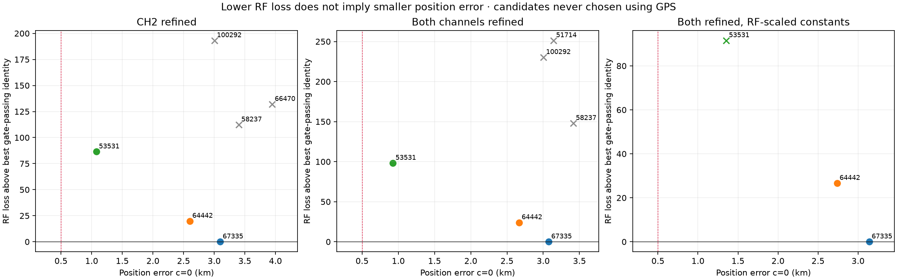
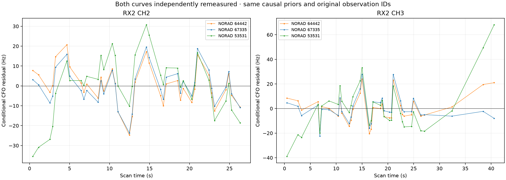
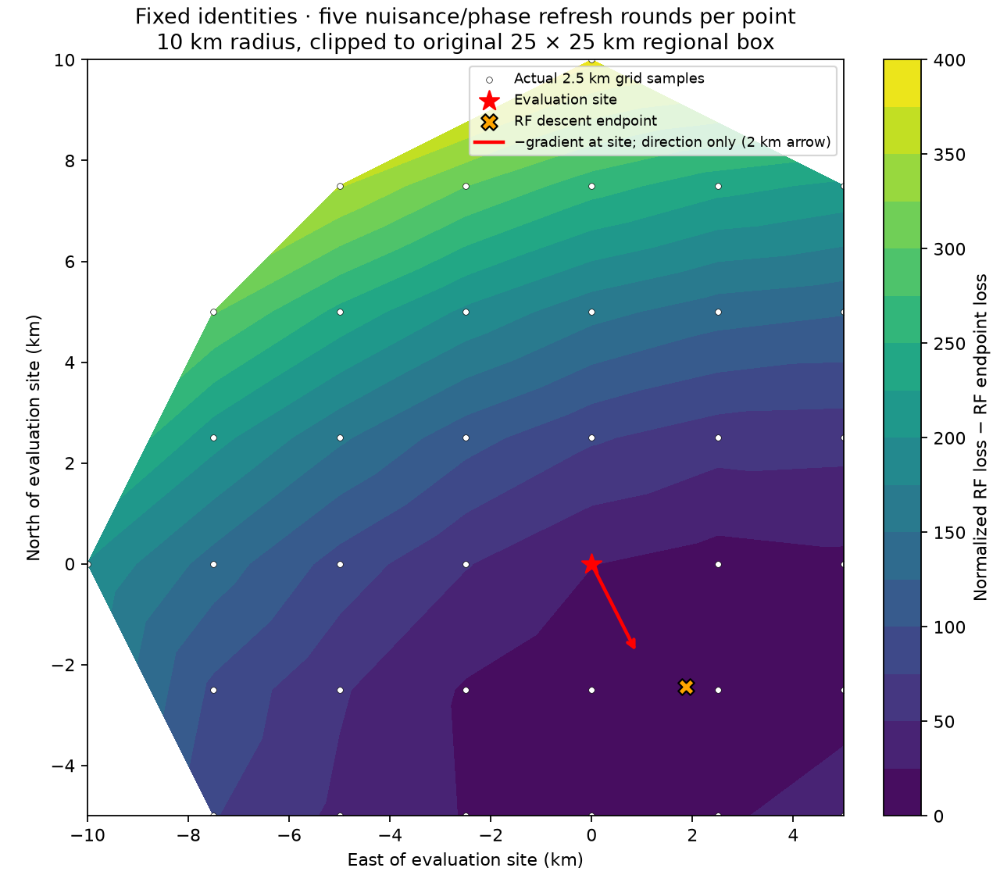
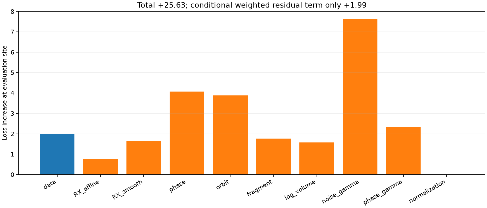

# DS23 scan 202: broader precise-family association and remaining position bias

Broader RF search overturns the earlier conditional accuracy gain. The prior
2.601km result retained NORAD64442. After screening all1,569 causal candidates,
NORAD67335 has lower penalized RF loss and passes both-arm gates, but gives
3.076km error after both channel curves are refined. NORAD53531 gives0.926km
yet loses RF evidence by98.26 and fails a precision-scaled family residual
screen. It cannot be selected using GPS. The0.5km DS23 goal remains unmet.

## Search uses one phase per family and the same physical model

The previously restored71-point family is now active. Screen the entire
unchanged causal bank at the regional center, the RF endpoint and four±2km
axial offsets. At each anchor integrate one shared family phase and separate
300Hz fragment constants, using pointwise RF noise and frozen family powers.
This prevents two curves borrowing independent phases in the proposal score.
The Gaussian proposal is an approximation to the final Student-phase model;
no orbital modes enter this cheap screen. Six shortlisted identities get full
five-round/48-step regional-center cold fits in both c arms with shared physical
orbit/eccentricity modes. Already-active family mergers are outside this
bounded test. This is full-catalogue screening, not exhaustive full refitting.

TLE epochs and collection cutoffs remain causal. No identity whitelist, GPS
prior or future TLE enters inference. Observation IDs, masks, physical priors,
noise laws, likelihood powers and budgets match across each identity comparison.
All failed trials are preserved; the best normalized c=0 RF objective among
both-arm gate-passing identities determines the RF winner.

## The companion supplies independently remeasured curved evidence

Export all34 original RX2 CH3 companion points through ShortWindowReader,
using declared manifests and hash-verified chunks/windows. The bounded exporter
reads915 windows, below its1,024 limit. This is targeted development evidence,
selected as the original family companion rather than by position error.
No new RF is collected or original recording changed. Raw NPZ payloads remain
local replay prerequisites and are not published.

Local carrier/epoch/code-rate refinement gives a degree4 polynomial RMS9.71Hz
and RF-only predictive noise10.81Hz; the archived graph residual was57.88Hz.
This comparison includes a possible degree change; the key new test is the
matched full position fit. CH2's predictive scale is11.33Hz. All108 selected
scan202 observations across the original three curves and this companion
remain available, with every original calibration point preserved. Refinement
and noise learning use no orbit, GPS or chosen satellite.

| Data / covariance | NORAD | RF loss above best valid | c=0 / fitted-c error km | Legacy gates | Refined family screens |
|---|---:|---:|---:|---|---|
| CH2 refined | 67335 | 0.00 | 3.0972 / 3.0975 | True | True |
| CH2 refined | 64442 | 19.88 | 2.6014 / 2.6013 | True | True |
| CH2 refined | 53531 | 86.41 | 1.0771 / 1.0767 | True | False |
| Both channels refined | 64442 | 24.06 | 2.6673 / 2.6670 | True | True |
| Both channels refined | 67335 | 0.00 | 3.0759 / 3.0763 | True | True |
| Both channels refined | 53531 | 98.26 | 0.9262 / 0.9257 | True | False |
| Both refined, RF-scaled constants | 67335 | 0.00 | 3.1389 / 3.1386 | True | True |
| Both refined, RF-scaled constants | 64442 | 26.65 | 2.7377 / 2.7374 | True | True |
| Both refined, RF-scaled constants | 53531 | 91.54 | 1.3549 / 1.3582 | False | True |

The both-channel comparison strongly favors67335 over64442 (RF loss gap24.06).
At the unchanged64442 identity, refining the companion changes c=0 error from
2.601 to2.667km. Better CFO measurement and more observations do not guarantee
better localization under the fitted nuisance/prior model. The previous report's
2.601km result is valid only for its unchanged identity, not the broader search.

## A precision-aware residual diagnostic rejects the GPS-favored candidate

The legacy screen floors its scale at75Hz. Apply that same screen to75*r/sigma,
using each observation's RF-only sigma, to expose structure relative to actual
measurement precision. This is a conditional diagnostic, not a calibrated
posterior-predictive test. Both67335 and64442 pass on the two family curves in
both c arms.53531 fails CH2's step screen, even though legacy gates pass and
its geographic endpoint is closer. A focused test demonstrates a small linear
component hidden by the old75Hz floor and detected after scaling.

## Cross-RF shared constants improve evidence while worsening accuracy

Test90% shared same-family clock covariance, proportional to RF, across channels,
bands and receivers. Normalize RF to the family's maximum and retain an
independent diagonal remainder, preserving every fragment's300Hz marginal
uncertainty. Different families remain independent. This extends earlier
same-family/exact-RF covariance controls without simply tightening all offsets.
Use the top three gate-passing identities from the both-refined search and
retain the incumbent. All c pairs keep the same measurements and budgets.

RF evidence improves by about72 for67335, yet error grows to3.139km. The winner
does not change;53531 now fails legacy gates too. This is evidence that a better
frequency/prior objective need not improve localization. This covariance is an
engineering hypothesis, not a qualified new default.

## The fitted objective itself prefers the biased location

Hold RF-selected67335 and every other identity/mask fixed. At each diagnostic
position perform five phase/nuisance refresh rounds; do not run association,
graph discovery or position descent. The plot samples37 points on a2.5km grid
inside a10km radius of the supplied evaluation site and inside the original
25×25km regional box. Contours interpolate those samples. The red arrow shows
the negative gradient direction at the site, drawn with an arbitrary2km length;
it is not an optimization trajectory or a probability contour.

The normalized objective at the evaluation site is25.63 higher than at the RF
endpoint. Finite-difference gradients at0.05/0.1km agree: approximately
(-7.56,+14.91)loss/km at the site versus(-0.084,-0.015) at the RF endpoint.
The major error is therefore not explained by simply failing to descend this
particular fixed-identity objective. This is a diagnostic surface; it does not
prove that the joint discrete/continuous search found a global minimum.

The conditional weighted residual term contributes only+1.99 of that gap.
Phase prior means/precisions, orbital prior penalties, receiver/fragment terms,
noise-scale Gamma cost and integration volume make up the rest. This algebraic
decomposition exactly reproduces the full normalized objective, but it is not
an independent causal attribution: all terms share jointly fitted nuisance
parameters. The leading family data-plus-mean-prior changes are distributed
across58735,62503 and65837; no one term accounts for the full discrepancy.

## What to do next

Retain the broader-search regression and do not promote the earlier conditional
accuracy gain as a general improvement. The fresh precise family can now help
revisit simultaneous replacements of other families; earlier joint searches
used the old measurements and a mask excluding this family. More generally,
extend bounded precise remeasurement beyond the early family and qualify signed
full-state orbital forecasts on strictly pre-RF TLE transitions, without GPS
selection. Prediction across independent receiver/family evidence is needed to
separate correlated hardware error from miscalibrated orbit priors.

These are one-scan development diagnostics. They do not establish full413 DS23
accuracy, untouched-scan generalization or the0.5km mean/median goal. All causal,
physical-support and matched-c requirements remain in force.

## Evidence and reproduction

[Summary](summary.json) · [Identity comparisons](identity_comparison.csv) ·
[Full evidence](evidence.tar.gz) · [Inventory](evidence_inventory.json) ·
[Validation](validation.json) · [Source snapshots](source_snapshot/).

Use the repository venv, PYTHONPATH=src:tools and BLAS/OMP threads1. Run
probe_ds23_refined_family_catalogue.py --case DS23-0202 with and without
--companion. The companion panel is exported with export_ds23_companion_panel.py
using the exact original CH3 track key; refine it through the frozen
probe_ds23_raw_pilot_refinement.run(case,'companion') function. Then run
probe_ds23_cross_rf_constants.py, diagnose_ds23_refined_loss.py (evaluation-only)
and this reporter. Five owned tests cover dense Gaussian parity, shared-phase
consistency, integer aliases/visibility, precision sensitivity and RF covariance.
