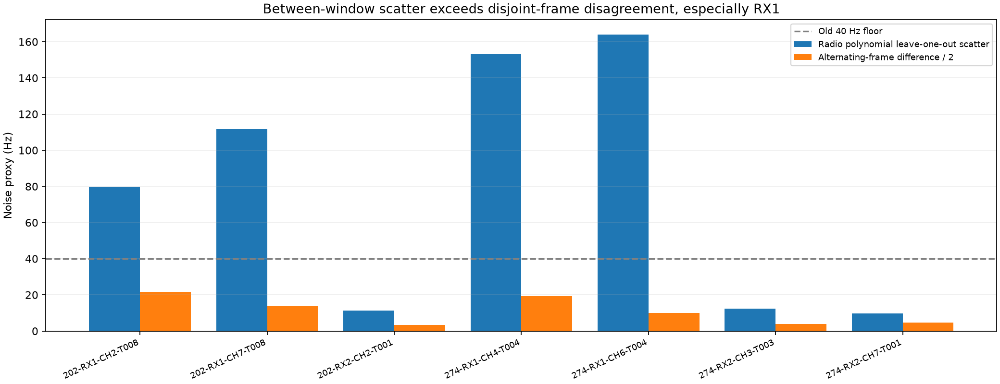
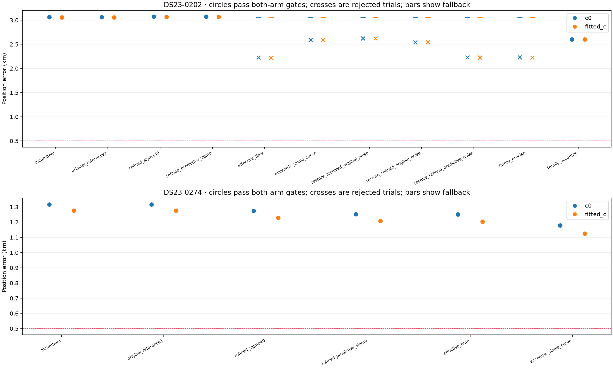
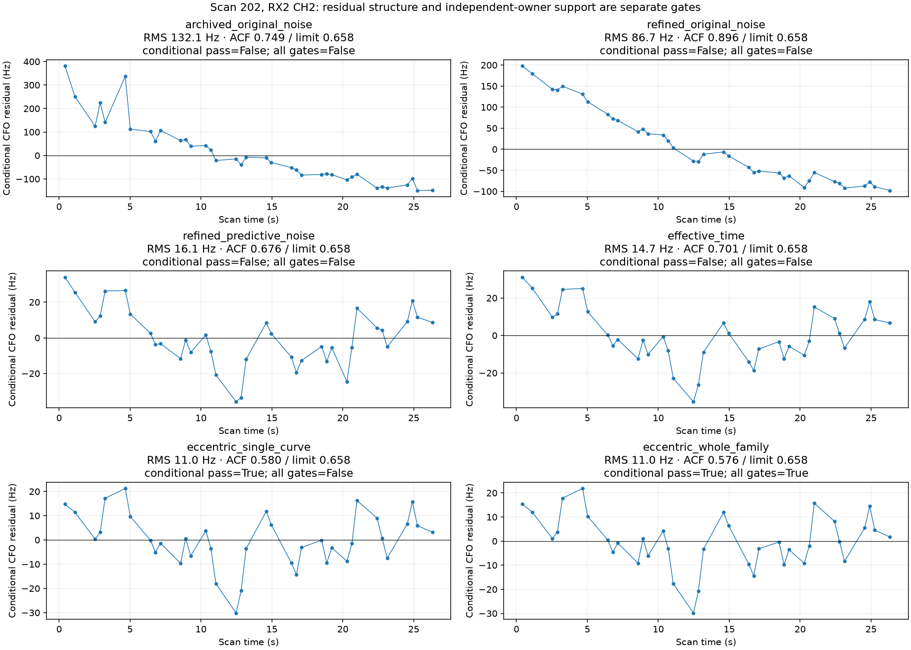

# DS23: precise CFO uncertainty, family reentry and missing orbital directions

This development study improves two diagnostic scans without relaxing a gate
or using GPS in inference. Scan 202 can recover an originally excluded 71-point
satellite family with shared physical eccentricity modes: c=0/fitted-c error
falls from3.0609/3.0602 to2.6014/2.6013km. Scan274's RF-selected simpler model
reaches1.2507/1.2048km from1.3173/1.2769. These are two inspected development
scans, not a new 20-scan benchmark or evidence for the 0.5 km DS23 goal.

## An observation-ID correction changes the diagnosis

The earlier raw-IQ report incorrectly stated that scan202's two RX1 curves
were outside calibration. Exact ID intersection shows the opposite: RX1 CH2
andCH7 contribute21+16 active points, while the cleaner37-point RX2 CH2 curve
was masked. Both RX2 CH2 and its34-point CH3 companion, NORAD64442, were
excluded by the learned phase-prior refit. The numerical position results were
correct; the earlier explanation was not. The earlier report and its generator
are corrected. This audit explains why refining the RX2 curve alone did not
affect a fit with the old fixed mask.

## Learn noise from radio evidence, preserving original measurements

For each complete selected curve, fit degrees0–4 on reliable refined CFOs using
profile BIC, at least four samples per coefficient and a declared5Hz floor.
Use the RMS leave-one-out polynomial prediction error, r/(1−leverage), as a
conservative scatter proxy. Also compute alternating-frame frequency
differences after correcting for their distinct effective times and the
radio-polynomial rate; difference RMS/2 supplies another lower bound. Select
the maximum of these and5Hz. The alternating fits share epoch/rate assumptions,
so this is not fully independent validation or a calibrated error bar.

RX2 proxies are about10–13Hz; RX1 proxies are80–164Hz. Between-window scatter
is much larger than alternating-frame disagreement, especially RX1. This can
reflect hardware drift/jitter, interference, template mismatch or unresolved
curvature; the experiment does not identify a unique cause. A shared component
must be predicted across independent families before changing a receiver model.

Boundary/control failures retain original CFO and its exact original effective
noise. They do not learn the refined scale. Every unmodified point retains its
old uncertainty; original observations, aliases and contracts remain unchanged.
Native WindowNoise still enforces40Hz. A separate research closure accepts
positive scales below40Hz and uses a common1Hz residual reference in every arm.
The normalized ELBO already includes absolute noise normalization. Tests prove
that changing reference alone changes only a constant, not the likelihood or
its derivatives; real baseline endpoints reproduce within1m. Fragment constants,
family powers, Gamma noise and phase/orbit priors otherwise remain fixed.

## Position results include failed trials and fallback

| Scan | Trial | c=0 / fitted-c error km | Both-arm gates | Reported c=0 / fitted-c km |
|---|---|---:|---|---:|
| DS23-0202 | incumbent | 3.0609 / 3.0602 | Pass | 3.0609 / 3.0602 |
| DS23-0202 | refined_sigma40 | 3.0721 / 3.0710 | Pass | 3.0721 / 3.0710 |
| DS23-0202 | refined_predictive_sigma | 3.0721 / 3.0710 | Pass | 3.0721 / 3.0710 |
| DS23-0202 | effective_time | 2.2248 / 2.2230 | Fail; fallback | 3.0609 / 3.0602 |
| DS23-0202 | eccentric_single_curve | 2.5897 / 2.5897 | Fail; fallback | 3.0609 / 3.0602 |
| DS23-0202 | family_precise | 2.2301 / 2.2281 | Fail; fallback | 3.0609 / 3.0602 |
| DS23-0202 | family_eccentric | 2.6014 / 2.6013 | Pass | 2.6014 / 2.6013 |
| DS23-0274 | incumbent | 1.3173 / 1.2769 | Pass | 1.3173 / 1.2769 |
| DS23-0274 | refined_sigma40 | 1.2740 / 1.2298 | Pass | 1.2740 / 1.2298 |
| DS23-0274 | refined_predictive_sigma | 1.2523 / 1.2068 | Pass | 1.2523 / 1.2068 |
| DS23-0274 | effective_time | 1.2507 / 1.2048 | Pass | 1.2507 / 1.2048 |
| DS23-0274 | eccentric_single_curve | 1.1787 / 1.1246 | Pass | 1.1787 / 1.1246 |

Every pair uses identical data, aliases, labels, priors and search budgets:
regional-center cold start in25×25km, five phase rounds with48 position steps.
The fixed-mask controls differ only in refined CFO/noise. Reentry controls
explicitly augment the mask, with both c arms matched and no incumbent point
removed. Gate failures fall back to the incumbent pair; their geographically
better raw trial endpoints are not accepted results.

## Why the recovered curve was still rejected

Restoring just scan202 RX2 CH2 with archived data yields132Hz conditional RMS,
significant slope/step and lag-one correlation. Refined CFO with the old noise
reduces RMS to87Hz but leaves structure. Refined predictive noise reduces RMS
to16Hz; effective timestamps reduce it to15Hz. The remaining lag-one
correlation still exceeds4/sqrt(37)=0.658. A small RMS is not a white residual.

The original model already includes phase, mean motion, inclination and RAAN
uncertainty, but not both eccentricity-vector directions. Add those two physical
directions for each supported family, shared across receiver/channel tracks.
Widths come only from latest/previous causal TLE eccentricity disagreement,
transporting the previous TLE to the latest epoch, with the existing declared
floors/caps. They are uncertainty hypotheses, not measured covariance or free
per-track polynomials. This reduces CH2 conditional RMS to11Hz and passes its
residual screen. It still fails the existing independent-owner gate: its only
other nominated channel was masked. This is a support failure, not permission
to loosen residual gates or fit an unsupported extra orbit.

Restore the original curved family companions as a unit, restricted to points
accepted before the learned phase-prior exclusion. CH3 retains archived CFO
and original noise; no new measurement is invented. Without eccentricity both
curves fail. With the shared physical modes both pass, restoring71 calibration
points, and every other active track still passes in both c arms. Identities
and aliases are unchanged. No satellite was chosen by position error.

Effective timestamps use the local frequency-information instant within each
original20ms window. All time-dependent geometry, indexes, whiteners and
receiver bases are rebuilt. A synthetic asymmetric-envelope control with
opposite±2000Hz/s chirps predicts the local fitted CFO within0.2Hz. This qualifies
that local model calculation, not the actual historical acquisition timestamp.

## Complexity and selection matter

On the identical augmented observation set in202, eccentricity improves
penalized c=0 RF evidence by16.894 and is the only family-reentry model passing
both-arm gates. On274, adding eccentricity improves geographic error to
1.1787/1.1246km but worsens RF evidence by0.084. The RF-only development
selection therefore keeps the simpler precise/timestamp model on274, even
though GPS favors the more complex result. Do not compare raw ELBOs across
different observation sets, confidence powers or denominators to admit data.
Family reentry here uses physical support and the existing gates. Model
comparison is permitted only within the same observations and likelihood.
The legacy residual screen has a75Hz scale floor and a conservative correlation
threshold. Passing it means no structure detected by that screen, not proof of
independent noise at the new10Hz precision. Precision-aware predictive checks
are needed before treating this prototype as a default.

## Limits and next experiment

The0.5km mean/median goal remains unmet. These are post-hoc development
prototypes on two inspected scans. Neither full413 DS23 performance nor
untouched/location generalization has been established. Association totals
after full salvage have not been recomputed:71 restored calibration points
are not a claim of71 new globally associated GLRT points.

The newly active precise family should now be screened against the entire
unchanged causal catalogue, because earlier broad replacement searches could
not rank a family whose observations were masked. Refine its channel companion
from a bounded existing-IQ panel, test whether receiver-common discrepancies
are predictable rather than merely downweighted, and freeze a rule before
untouched scans. No future TLE, GPS-favored hyperparameter or rejected-trial
position is allowed to determine inference.

## Reproduction and receipts

[Summary](summary.json) · [All trials](position_comparison.csv) ·
[Full evidence](evidence.tar.gz) · [Inventory](evidence_inventory.json) ·
[Validation](validation.json) · [Source snapshots](source_snapshot/).

Use repository venv, PYTHONPATH=src:tools, BLAS/OMP threads1. Run
probe_ds23_refined_precision.py, probe_ds23_refined_timestamps.py and
probe_ds23_refined_eccentricity.py with --case for202/274;
probe_ds23_refined_restoration.py and probe_ds23_refined_family_reentry.py for202;
then this reporter. Raw panels are unchanged local prerequisites from the
previous study; no raw-IQ payload, new collection or recording mutation occurs.
Eight focused tests cover degree/scatter recovery, unit shifts, input validation,
likelihood-reference invariance, point-noise preservation, complete-curve/family
restoration, effective-time response and shared eccentricity design.
