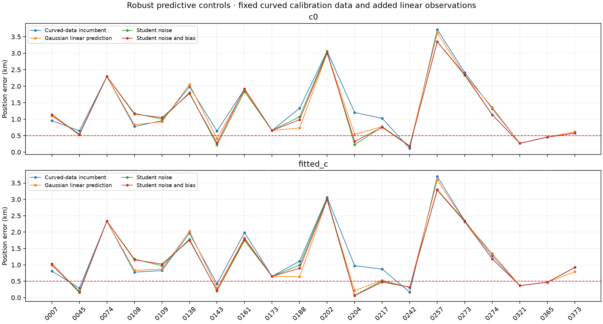
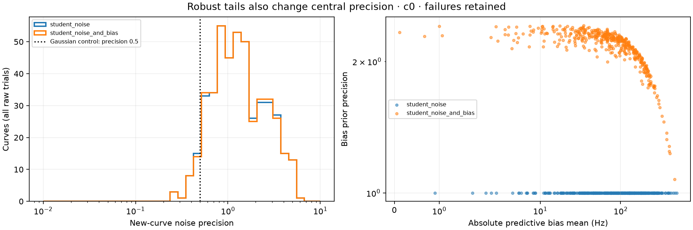
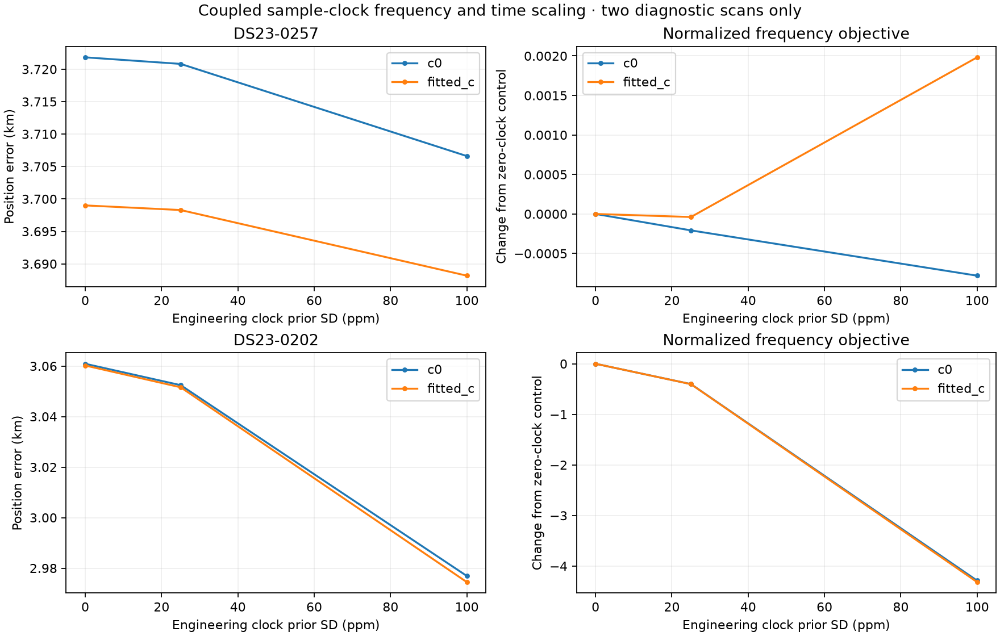
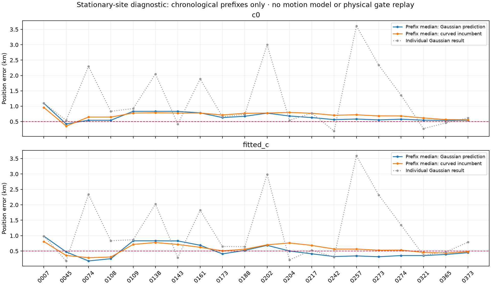
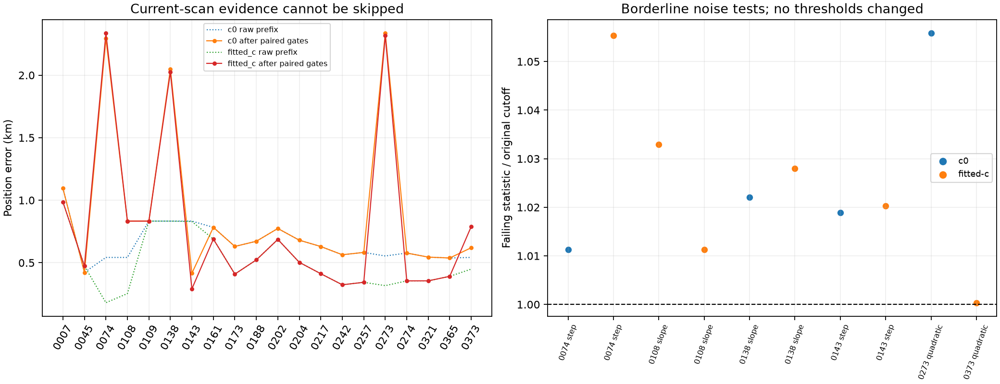

# DS23: robust linear prediction, sample clocks and stationary-history diagnostics

The robust models do not improve both mean and median. Retain the earlier
Gaussian linear-prediction prototype as the comparison reference; no ALGO01
default is changed. All results here are twenty development scans or explicitly
smaller diagnostics, not validation across all 413 DS23 recordings.

| Policy | c0 mean / median km | Fitted-c mean / median km | Paired valid /20 |
|---|---:|---:|---:|
| Curved-data incumbent | 1.315 / 0.991 | 1.266 / 0.896 | 20 |
| Gaussian linear prediction | 1.229 / 0.804 | 1.177 / 0.811 | 16 |
| Student noise | 1.204 / 1.039 | 1.176 / 0.983 | 15 |
| Student noise and bias | 1.209 / 1.016 | 1.171 / 0.973 | 15 |

Every scan remains in every denominator. If either c arm fails an original
curved gate, a new linear gate, phase refresh or predictive-precision convergence,
the pair falls back to the curved incumbent. There is no hidden point deletion.
The Gaussian comparator has four such failures; both robust policies have five.
Raw positions, failed components and precision estimates are archived.

## Robust conditional prediction

Freeze exactly the previous Gaussian experiment's added track IDs, labels and
integer aliases. Keep original curved points, masks, receiver-support powers,
noise, phase-history means/scales and physical orbit modes unchanged. Each fit
starts at the same 25x25 km regional center (37.906,-122.545), with five phase
refreshes and up to 48 position steps each. No supplied GPS, following TLE,
IQ reread or new RF enters inference. Every source catalogue remains causal.

At each horizontal position, curved data alone produce mean m and conditional
Gaussian calibration precision A. Added linear observations are predicted with
the original physical features U_L. Integrate shared uncertainty through
U_L A^-1 U_L'; do not give every point an independent calibration error.
The two controls change only the new-track predictive distribution:

* Student noise: a separate Gamma(2,2) noise precision per added curve; its
  marginal variance is 2*sigma_radio², matching the previous Gaussian model.
* Student noise and bias: the same noise model plus a four-degree Student bias
  per new curve with variance 300² Hz², matching the Gaussian bias variance.

Use the existing normalized Gaussian/Gamma variational integration, including
determinants, prior penalties, noise normalizations and Gamma terms. The new
predictive latent means are not applied as calibration corrections. Every
saved fit reproduces the curved-only calibration mean, noise precisions and
prior precisions exactly at that position. The covariance still conditions on
curved Gamma means, so this is an approximate modular predictive objective,
not an exact full hierarchical posterior or calibrated identity probability.

Heavy tails do not merely remove outliers. After seeing a new curve, posterior
noise precision can exceed the Gaussian control's fixed 0.5, and the variance-
matched Student bias has a more concentrated center. Some valid-looking linear
evidence can therefore exert more influence. Here median c0 noise precision is
about 1.252 in both robust models, and median bias prior precision is 2.236 in
the Student-bias model, versus 1 for Gaussian bias. The small mean improvement and
worse median do not justify a new default. Scan 217 reaches 0.475 km fitted-c
with Student noise/bias, versus 0.529 km for Gaussian prediction, but that one
pilot cannot select the cohort algorithm. Scan 321 still fails a new linear
gate. No failed point is discarded merely because it prevents a better error.

## A distinct physical check: coupled sample-clock scale and elapsed time

The common RF-times-time drift control tested earlier is not the same effect.
Let epsilon = actual_sample_rate/nominal_sample_rate - 1. For a carrier measured
in nominal sample-rate units and a counter-derived elapsed time, test:

    observed_frequency = physical_frequency(t_observed/(1+epsilon))/(1+epsilon)
    first-order column = -physical_frequency - t_observed*frequency_rate

Use one epsilon per receiver. Existing offset/drift coefficients stay in
observed-time coordinates. Finite differences include the current orbital
correction; update orbit and phase references from curved data only. Append
two Gaussian nuisance columns before the fragment constants and retain the
full integrated complexity penalty. Priors SD 0,25,100 ppm are engineering
hypotheses, not measured oscillator tolerances or hardware specifications.

Both diagnostic scans (257 and 202) retain the same observations/aliases and
pass every c-arm gate. Zero-clock replays reproduce the incumbent. At 100 ppm
prior SD, fitted-c error changes 3.699→3.688 km on 257 and 3.060→2.974 km on
202. The latter fits approximately +129/-127 ppm on RX1/RX2; this is not
independent evidence of actual clock errors. RF preference can represent
compensation for another model discrepancy. Exact time/frequency replay checks
the linearization, not the truth of its clock interpretation.

The small changes do not resolve these failures. This is a two-scan diagnostic,
not a full-cohort clock benchmark. Its protocol receipt is assembled after the
completed pilots; it does not pretend to be a prospective cohort registration.

## Conditional stationary-history diagnostic: a different information source

The twenty inputs span about four days. Independently localized errors point
in different directions, suggesting a test of averaging rather than another
single-scan nuisance term. For each chronological prefix, calculate the spatial
median of RF-derived positions observed so far, including the current scan.
No later scan affects an earlier prefix, and no GPS enters this calculation.
All original individual fits still start cold in their original regional box.

| Input policy | c0 prefix mean / median km | Fitted-c prefix mean / median km |
|---|---:|---:|
| Curved-data incumbent | 0.705 / 0.718 | 0.569 / 0.563 |
| Gaussian linear prediction | 0.659 / 0.606 | 0.507 / 0.431 |
| Student noise | 0.705 / 0.591 | 0.589 / 0.457 |
| Student noise and bias | 0.704 / 0.578 | 0.585 / 0.456 |

This table is the raw diagnostic, explicitly conditional on the receiver remaining
at one site throughout the prefix. It borrows earlier scan results and has no
movement/reset model. The raw coordinates do not by themselves qualify against
the current scan's physical gates. They are not an ALGO01 result, a general
solution for independent new locations, or attainment of the full DS23 goal.
The existing same-site evaluation
assumption and antenna-height question remain unconfirmed. A receiver move
would invalidate pooling across that boundary. The prefix estimates are not
assigned calibrated uncertainty bars or treated as independent TLE observations.

A separate replay now holds each prefix coordinate fixed and refits the current
curved calibration for five phase rounds. Use exactly the current Gaussian
policy's evidence, including linear tracks only when its original paired trial
qualified. Check all original curved and new linear gates in both arms. All
twenty individual-coordinate null replays pass; only 14/20 prefix pairs pass.
With paired fallback, errors are **0.894/0.651 km c0** and **0.794/0.513 km
fitted-c**. Do not report the raw 0.507/0.431 km fitted-c prefix values as a
gate-qualified algorithm result. The replay changes calibration only at the
given coordinate; it is not a joint history-aware RF optimization.

Failures occur on 74,108,138,143,273 and373. Some are just beyond the statistical
threshold: slope z reaches 3.099 against3; a step z is4.081 against4; one BIC
gain is10.0036 against10. Aliases and the 450Hz RMS bound do not explain those
conditional failures. The exact failed-track statistics are published; a final
family-support failure can also cascade from a companion's failed noise gate.
These margins do not authorize changing thresholds at favorable coordinates.
They motivate a noise-only false-rejection audit of the multiple checks across
all tracks, ideally including parameter fitting and group correlations. Any
replacement should set its error rate without GPS and then rerun all cases,
including regressions and independent validation. No gate is relaxed here.
It must also retain power against injected ramps, curvature and steps; a lower
false-rejection rate alone can hide real model errors. Satellite-identity
competition remains separate from accepting a noise goodness-of-fit test.

The spatial median uses a convex vertex optimality check, then a regularized
Weiszfeld iteration if needed. A midpoint convention preserves non-unique
two-point/collinear median intervals. A future-input perturbation test exposed
slow convergence in the first version; that diagnostic/source is retained under
stationary_history_v1, and the fixed implementation passes the causal test.
This is a numerical correction, not a geographical correction of the estimates.

The useful next steps are statistical gate qualification and a causal history
model with movement/reset handling, current-scan physical gates and explicit
scan dependencies.
It must be compared separately from single-scan performance. Broader satellite
competition using the new linear evidence is another remaining association
test; the earlier replacement search used the curved calibration set alone.
Neither direction authorizes GPS-selecting identities or dropping hard scans.

## Validation and reproduction

Five robust-prediction tests cover exact grouped Student noise density with no
design, selective group downweighting, Student-bias tails, no calibration feedback
and input validation. Four clock tests cover null geometry, coupled derivative
sign/scale and receiver isolation, zero-column prior normalization and an
injected physical clock error. Three history tests cover rigid-coordinate
equivariance, future-prefix invariance and single/duplicate-time conventions.
All twelve pass; they do not prove physical calibration or new-location accuracy.

Run tools/run_ds23_robust_predictive_linear.py with the repository venv,
PYTHONPATH=src:tools and BLAS/OMP threads one. Two subprocesses have 300 s bounds.
Run tools/probe_ds23_sample_clock.py --case for 257 and 202, then
tools/probe_ds23_stationary_history_diagnostic.py and this reporting tool.
Run tools/probe_ds23_history_gate_replay.py after the stationary diagnostic and
before reporting; this sequential numerical replay also preserves the full gates.
Clock tests also require tests/analysis on PYTHONPATH for the prior synthetic
geometry fixture. Sources overlay the earlier height and predictive reports.
Reporting alone uses (37.849061591561885,-122.48574968092912) for error.

[Position trials](positions.csv) · [Predictive precisions](predictive_precisions.csv) ·
[Failed components](failed_components.csv) · [Clock trials](sample_clock.csv) ·
[Clock null replays](sample_clock_null.csv) · [Stationary prefix errors](stationary_history_errors.csv) ·
[Gate-checked prefix errors](history_gate_errors.csv) · [Failed gate statistics](history_failing_statistics.csv) ·
[Summary](summary.json) · [Validation](validation.json) · [Protocol](protocol.json) ·
[Execution](execution.json) · [Causal receipts](causal_receipt_audit.json) ·
[Full lossless evidence](evidence.tar.xz) · [Evidence hashes](evidence_inventory.json).
