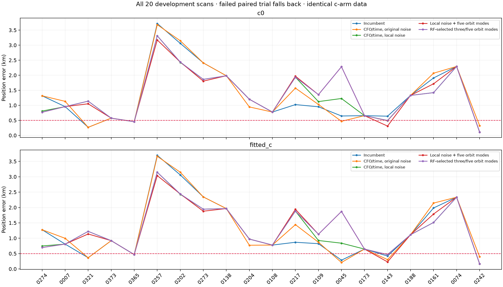
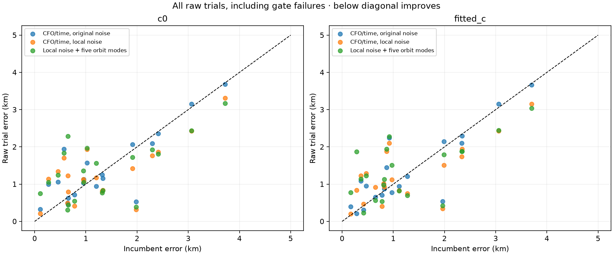
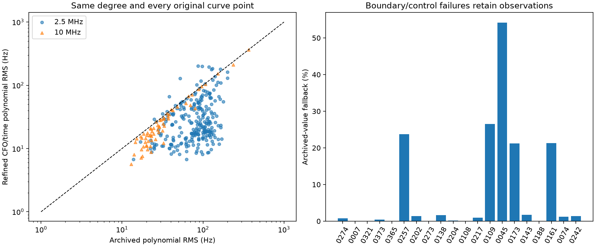
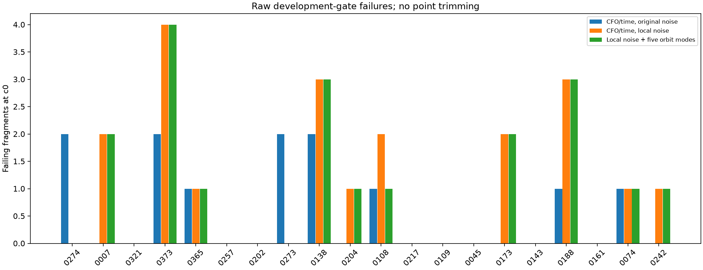
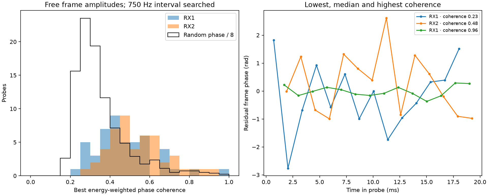

# DS23: precise RX2 measurements across both recording formats

This study remeasures every point in every originally seeded curved RX2 graph
track in the original twenty development scans. It tests whether cleaner radio
measurements improve position, keeping the existing satellite hypotheses fixed.
It is not a new full association pipeline or validation on all 413 recordings.
The 0.5 km full-DS23 mean-and-median goal remains unproven.

| Fixed policy | c0 mean / median, km | Fitted-c mean / median, km | Paired-valid scans |
|---|---:|---:|---:|
| Incumbent | 1.315 / 0.991 | 1.266 / 0.896 | 20 / 20 |
| CFO/time, original noise | 1.347 / 1.081 | 1.309 / 0.960 | 10 / 20 |
| CFO/time, local noise | 1.306 / 1.171 | 1.266 / 0.950 | 10 / 20 |
| Local noise + five orbit modes | 1.362 / 1.267 | 1.317 / 1.123 | 10 / 20 |
| RF-selected three/five orbit modes | 1.369 / 1.267 | 1.325 / 1.123 | 10 / 20 |

Every failed paired trial falls back to the original pair, with its raw outcome
preserved. No scan is dropped and no extra point is trimmed to rescue a fit.
The policies are fixed rules, not the geographically best variant per scan.
Passing counts refer to new trials; the RF-selected policy uses ten valid
new trials and ten incumbent fallbacks. It selects three orbit modes on six
scans and five on four. All final policy results remain in the denominator.

Radio measurements improve substantially: median fixed-degree curve RMS drops
from 78.07 to 22.18 Hz. Of 11,167 probes, 10,581 receive valid refinements and
586 retain archived CFO/noise at a boundary. This does not deliver a general
position improvement. Local noise barely lowers c0 mean while worsening its
median; fitted-c mean is essentially unchanged and its median worsens. Adding
physical directions or choosing them by RF objective does not resolve this.
The published ALGO01 default remains unchanged.

## Measurement and controls

The sealed selection is 322 original curves and 11,167 physical probes, including
masked points of seeded curves. The initial position comparison keeps the exact
original calibration mask: measuring a masked curve does not silently restore it.
Canonical IDs, satellite labels and integer alias lifts remain unchanged. The
alias period is 1/(4.4 microseconds), 227272.72727272726 Hz.

The continuous fitter uses the same known pilot, independent complex gain/DC
per frame and three carrier/epoch/code-rate parameters as the reference grid.
It uses analytic variable-projection derivatives, a damped 3x3 Gauss–Newton
solve, and independently rechecks the likelihood through the original scorer.
Bounds are archived carrier ±800 Hz, epoch ±0.75 samples and code rate ±40 ppm;
a common ±600 Hz/100 Hz scout precedes fixed epoch/rate seeds. A boundary or
nonpositive exact-control margin retains the archived value and original noise.
Effective CFO times remain inside the original 20 ms probe. Odd/even frame
fits are retained as a noise diagnostic with their different effective times.
More explained IQ energy is not proof of unbiased CFO.

The first policy changes CFO/time only. The second also uses radio-only local
scatter: sliding windows of up to 16 points, degree 0–3 complexity selection,
median scatter, a 5 Hz floor and the timing-adjusted odd/even proxy floor.
The plotted before/after polynomial RMS separately freezes a degree 0-4 chosen
from archived CFO with a 150 Hz complexity score, retaining every curve point.
That whole-curve diagnostic is distinct from the local measurement-noise proxy.
Only successful refined points receive the new uncertainty; fallback points
retain their original uncertainty. These are estimated noise proxies, not
externally calibrated error bars. Complete radio curves learn them; there is
no claim of blind raw-data validation.

The third policy adds the two missing eccentricity-vector directions to the
original three physical orbit coordinates, shared per supported satellite.
Their scales come from latest/previous causal TLE disagreement transported to
the latest epoch, with the existing 1e-5 to 5e-4 bounds. Existing physical
priors are unchanged. This generic follow-up was motivated by structured
residuals revealed by the initial precise measurements. It is reported for all
twenty scans, with no GPS-selected use of extra freedom.

One additional policy selects between the local-noise three/five-mode trials
by the normalized c0 RF objective, requiring gates to pass in both arms.
Both candidates have the same CFOs, times, noise, points and other priors.
The selected design applies to both c arms; if neither passes, retain the
incumbent pair. This is distinct from choosing a design using geographic error.

All full position trials start at zero in the same 25x25 km region centered at
37.906, -122.545. Both c arms have identical observations, nuisance hypothesis
and five phase-reference refreshes with up to 48 position steps each. Causal
catalogues, pre-RF phase forecasts, receiver terms, 300 Hz fragment constants
and receiver-support powers remain fixed. Evaluation uses the supplied
37.849061591561885, -122.48574968092912 coordinate and height 0 m, under the
existing assumption that this reference applies to every sampled recording.
The dataset manifest has no independent per-recording surveyed position.

## Read-port qualification and performance

Fast captures are read through ShortWindowReader. Their virtual tracking
session spans original segment session IDs; dataset-bound manifest hashes,
selected window hashes, compressed payload and index hashes are checked.
Stopping inside a final chunk does not claim its complete decoded chunk hash.
Adaptive captures use the additive NativeAdaptiveReader: schema-14 manifests,
single-visit schema-12 chunks, complete compressed/decoded digests and counters.
Chunk first_visit_index addresses the retained stream, not the original device
visit. The receipt retained_visit_indices maps the ordinal back to device time.
The initial reader rejected a capture with omitted visits; its failed receipts
are retained under qualification_v1. The corrected mapping is covered by an
owned gap fixture and real 10 MHz replay. Payload offsets never become time.

Per-case bounds are 1,200 selected probes, 12,000 fast windows, 8 GiB decoded,
64 MiB per adaptive chunk and 900 seconds. Two read/fit workers use existing
recordings only. The read subprocess has read authorization; its non-root
orchestrator owns stdout results. No recording, tracking contract or QNAP
path is changed. No new RF is collected and no IQ payload is published.

The earlier sealed 96-probe 2.5 MHz benchmark gives 15.004 s reference versus
4.937 s continuous core fitting (3.04x), maximum carrier difference 1.249 Hz,
and no likelihood regression below 1e-6. Three-start and initial one-start
versions are retained rather than removed. The final estimator also passes
synthetic 10 MHz tests, including both edges and high signed carriers.
The 96-probe panel was reused for implementation optimization, so it is a
development benchmark, not untouched accuracy validation.
The separate real qualification panel contains 42 probes: fast 2.5 MHz,
adaptive 2.5 MHz and adaptive 10 MHz. See qualification.csv for rate-specific
runtime, likelihood differences and boundary counts. The reference qualification
timings exclude the common scout while continuous core timings include it;
the 96-probe benchmark is the matched timing comparison. These are core fitter
timings, not embedded-device or full-pipeline benchmarks.

Scoring at archived final CFO does not reproduce every archived GLRT score,
as in the earlier bounded pilot study: the acquired CFO is not persisted.
Exact-replay exceptions remain in qualification.csv and are not used to select
points. The independent local likelihood does not require those archived
normalizations to match. This does not certify capture-binary provenance.

## Residual acceptance and interpretation

Pointwise-noise development gates test mean, trend, quadratic structure,
steps and lag-one correlation under the proposed measurement uncertainty.
The same thresholds, alias/elevation/RMS/bias bounds and independent-owner
requirements apply in both c arms. Original legacy gate results are retained
alongside these explicit development gates; they are not silently called
production ALGO01 acceptance. Losing an owner can reject another fragment
even when that fragment's own residual screen passes.

A lower polynomial RMS, tighter conditional information or better full-data
frequency objective does not establish better position. Every raw regression
and gate failure remains visible. A more precise receiver may expose orbit,
calibration or identity mismatch that the old noise floor hid. Frozen identities
make this a controlled measurement experiment, not proof that those identities
remain optimal after the change. Do not promote any variant from these
development cases alone. Fresh causal identity competition and independent
predictive checks are required under any materially changed measurement model.
The largest final phase-reference discrepancy is 65.4 ms in a failed scan-74
five-mode trial; among passing trials it is 1.204 ms. These are reported in
position_by_scan.csv rather than declaring every five-round fit converged.

## Fresh identity and frame-phase diagnostics

Two diagnostic cases recheck the family most affected by the RX2 measurement
change, ranked by summed active squared CFO changes divided by original radio
variance. Inference does not use GPS to choose that family. Scan 217 is the
ongoing failure investigation; scan 321 is an observed geographic regression,
so these cases are not an unbiased validation sample. Every causal candidate
is screened at the new endpoint, regional center and four clipped +/-2 km
anchors. Screening shares one phase across the family's fragments, with their
300 Hz independent constants and pointwise noise. Its Gaussian phase proxy
omits physical orbit modes; four alternate finalists receive exact paired
five-round/48-step fits with all five physical directions. Mergers and changes
to other families are excluded, so this is not global reassociation.

All eight alternate finalists fail paired gates. The incumbent labels remain
57879 on scan 217 and 59616 on scan 321 under this bounded RF decision rule.
Identity trials, failed gates and geographically better losers are preserved
in identity_trials.csv and the lossless archive. Passing the incumbent does
not establish its identity, nor exclude a more coordinated reassignment.

On the separate sealed 96-probe panel, fit a common frame phase/frequency and
measure energy-weighted phase coherence while allowing frame amplitudes to
differ. Search one 750 Hz frame-rate interval; the integer frame-rate alias
remains unresolved. Median coherence is 0.475, versus 0.313 for fixed-seed
random-phase surrogates with matched amplitudes/energy. Only two probes exceed
0.9. RX1/RX2 median residual phase RMS is 0.927/0.795 rad. This does not qualify
a universally coherent carrier model; no coherent CFO is applied. Some probes
may support a separate future phase-continuity test. Surrogates are diagnostics,
not independent measurements or a calibrated existence probability. The first
common-amplitude version is preserved under phase_coherence_v1.

## Evidence and reproduction

Run tools/remeasure_ds23_rx2_cohort.py --stage prepare once to seal selection.
Run tools/run_ds23_rx2_measurement_cohort.py --stage qualify and then --stage
measure. The only privileged stage reads declared existing recording members;
stdout files are owned by the unprivileged runner. Run
tools/run_ds23_rx2_position_cohort.py on ready cases, then this reporter.
Use the repository venv with PYTHONPATH=src:tools and BLAS/OMP threads one.
Position_v1 preserves the original two-policy pilots; the final comparison
reports all three policies on all twenty scans. A null replay exactly reproduces
the prior endpoint and ELBO for scan 7 under both c arms.

[Summary](summary.json) · [Measurement counts](measurement_by_scan.csv) ·
[All positions including failed trials](position_by_scan.csv) ·
[Curve metrics](curve_metrics.csv) · [Gate metrics](gate_metrics.csv) ·
[Qualification](qualification.csv) · [Validation](validation.json) ·
[Fresh identity trials](identity_trials.csv) ·
[Lossless evidence](evidence.tar.xz) · [Evidence hashes](evidence_inventory.json).
Sources overlay the earlier causal-history and dense-measurement reports.
Original checksum-bound recording/catalogue authorities remain prerequisites.
