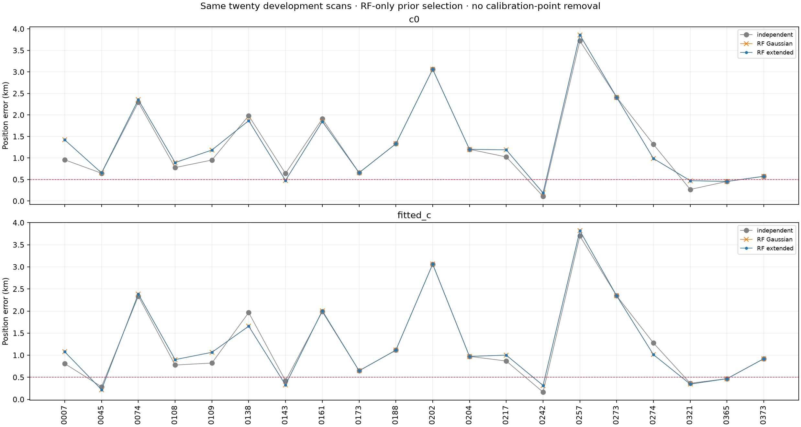
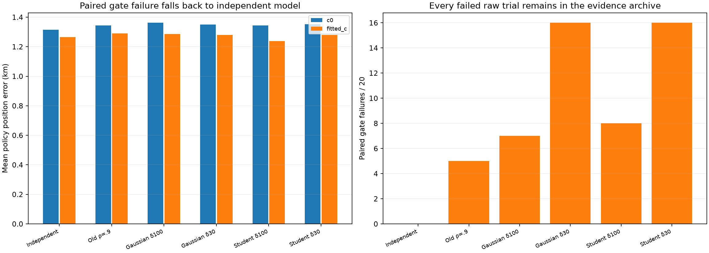
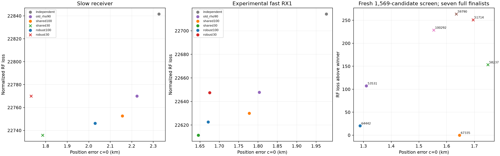
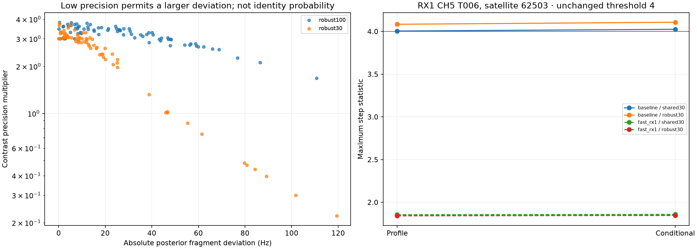

# DS23: shared satellite carrier biases and robust fragment deviations

This study tests a physical link between the frequency biases of tracks
assigned to the same satellite, instead of treating every fragment's bias as
independent. It compares Gaussian and heavy-tailed deviations, preserves the
earlier correlation control, and rechecks scan 202's identity against the
entire causal catalogue. The 0.5 km mean-and-median DS23 goal remains unmet.

Shared carrier regularization does **not** improve the original cohort.
The RF-selected policy, including robust alternatives, worsens both mean and
median error. The ALGO01 default remains unchanged.

| Policy on all twenty scans | c=0 mean / median km | Fitted-c mean / median km | Paired gate failures |
|---|---:|---:|---:|
| Independent 300 Hz reference | **1.315 / 0.991** | **1.266 / 0.896** | 0 |
| Old ρ=.9 | 1.345 / 1.142 | 1.291 / 1.065 | 5 |
| Gaussian δ100 | 1.362 / 1.194 | 1.285 / 1.016 | 7 |
| Gaussian δ30 | 1.351 / 1.117 | 1.279 / 0.991 | 16 |
| Student δ100 | 1.343 / 1.219 | 1.239 / 0.972 | 8 |
| Student δ30 | 1.351 / 1.180 | 1.279 / 0.948 | 16 |
| RF selection across all six | **1.355 / 1.187** | **1.284 / 1.007** | Reference fallback available |

Every fixed-hypothesis row uses the original pair if either c arm fails gates;
its raw failure and raw position error are retained separately. The slightly
smaller fitted-c mean of fixed Student δ100 does not justify adopting it:
its median and c0 results worsen, and RF selects it on no scan.

## Physical model and controlled comparisons

For fragment i assigned to satellite s, model its frequency bias as

    b_i = q_i c_s + d_i,   q_i = RF_i / 11.5 GHz.

The common satellite carrier offset c_s has a zero-mean Gaussian prior with
300 Hz standard deviation at 11.5 GHz. Independent deviations d_i have either
Gaussian or Student ν=3 priors with standard deviation δ=100 or 30 Hz. In the
Student case δ is the marginal standard deviation, not the Student scale
parameter. Its scale is δ/√3. The phase prior remains unchanged.

The Gaussian form implies

    Cov(b_i,b_j) = 300² q_i q_j [same satellite] + δ² [i=j].

Different satellites have independent carrier priors. Receiver/band offsets,
linear drifts, receiver smooth terms and physical orbital corrections remain
in the model. A shared offset is statistical regularization, not a forced
join. The proposals introduce no polynomial coefficients or new GLRT points.

Six hypotheses are compared on exactly the same observations per scan:

- Independent 300 Hz Gaussian fragment biases: the reference.
- The earlier ρ=.9 same-family correlation, preserving each 300 Hz marginal.
- Shared carrier plus Gaussian δ=100 or 30 Hz deviations.
- Shared carrier plus Student ν=3 δ=100 or 30 Hz deviations.

The new Gaussian models intentionally allow marginal variance to scale with
RF. They are not claimed to preserve the reference's per-fragment variance.
The old ρ=.9 hypothesis is retained as a control rather than quietly replaced.
Its earlier sparse-data scan-202 experiment improved RF fit while worsening
geographic error; the [published negative result](../2026_10_19_ds23_refined_catalogue/README.md)
still stands. Dense and original-noise comparisons below are distinct datasets.

For Gaussian models, a Cholesky representation uses the existing fragment
coordinate count. Tests verify equality to an explicit shared carrier plus
independent deviations, including normalized Gaussian/Gamma evidence. The
Student extension uses explicit Gaussian carriers and separate Gamma
precision groups for active fragment deviations. Large deviations can receive
low precision while the shared carrier stays supported by agreeing fragments.
Low contrast precision is not a satellite-correctness probability.

All full fits cold-start at east/north zero in the same 25 × 25 km box centered
at 37.906° N, −122.545° E. Both c=0 and fitted-c receive five phase-refresh
rounds with at most 48 position steps and the same chosen hypothesis. Fixed
receiver-support powers, masks, alias integers, observations and other priors
remain unchanged. No incumbent calibration point is removed to pass a gate.

RF selection minimizes normalized c0 negative-twice ELBO among hypotheses
passing both c arms. The independent reference is always available. Fixed-mode
policies fall back to that original pair when a gate fails; all twenty scans
stay in every denominator. Raw failures remain in the CSV/archive. This is a
generalized variational RF criterion with fixed likelihood powers, not a
calibrated Bayes factor or probability of identity. GPS never selects a model.

## Original twenty scans: receiver noise remains unchanged

The cohort uses the original measurements, radio-noise proxies and three-mode
physical orbit model of the causal-history reference. It does not insert scan
202's dense pilot measurements among nineteen unchanged scans. Gaussian and
robust batches each evaluate all twenty cases; the robust batch preserves
the Gaussian results byte-for-byte as nested controls. All final c arms retain
their original active point counts.

All twenty Gaussian and all twenty robust numerical cases finish successfully.
RF selection chooses independent priors on six scans, old ρ=.9 on eight,
Gaussian δ100 on six, and neither δ30 nor either robust variant on any scan.
Adding Student alternatives therefore leaves the RF-selected cohort result
unchanged. Its c0 median worsens 0.991→1.187 km and fitted-c median
0.896→1.007 km.

The fixed Student δ30 model still fails paired gates on sixteen scans. Allowing
occasional large constant deviations does not cure the systematic residual
failures at these sharing strengths. This weakens the proposed simple shared
carrier explanation; it does not prove that all existing identities are
correct or that real carrier biases cannot be time-dependent or beam-specific.

Scan 217 selects old ρ=.9 but worsens from 1.0248/0.8695 to
1.1895/1.0022 km. Scan 7 also selects that model while worsening
0.9579/0.8096→1.4215/1.0778 km. These regressions are retained. The original
measurement scan 202 remains near 3.063 km under its RF-selected old-correlation
model, while the distinct dense model below improves substantially. It is not
valid to insert the dense case into this cohort and report a mixed-method gain.

## Dense scan 202: receiver and shared-bias effects interact

The dense comparison retains the previously remeasured CFOs, effective times
and local radio-noise law, all 2,646 calibration points, five physical orbital
shape coordinates and the existing Gaussian shape prior. It evaluates both
the original slow receiver basis and the experimental fast RX1 addition.
The latter was previously prediction-qualified under independent fragment
biases; that qualification does not automatically transfer to a changed bias
prior. No new blind or omitted-family qualification of the combined model
is claimed here.

| Carrier hypothesis | Slow RX: c0 / fitted-c km | Fast RX1: c0 / fitted-c km |
|---|---:|---:|
| Independent 300 Hz | 2.3262 / 2.3268 | 1.9763 / 1.9759 |
| Old ρ=.9 | 2.2240 / 2.2248 | 1.8032 / 1.8052 |
| Gaussian δ100 | 2.1559 / 2.1563 | 1.7772 / 1.7783 |
| Gaussian δ30 | 1.7856 / 1.7684, **fails gates** | **1.6460 / 1.6300** |
| Student δ100 | **2.0291 / 2.0307** | 1.6714 / 1.6665 |
| Student δ30 | 1.7316 / 1.7070, **fails gates** | 1.6750 / 1.6588 |

Slow-RX RF selection chooses Student δ100; fast-RX1 RF selection retains
Gaussian δ30. The best geographic number is not substituted for the RF-selected
model. Receiver and carrier effects cannot be added independently: tighter
Gaussian sharing fails with the slow receiver but passes after its correction.

The slow-RX Gaussian δ30 failure is RX1 CH5 T006, 43 points associated with
62503. Its hard physical bounds pass, but profile/conditional step statistics
are **4.00495/4.02507**, above the unchanged limit 4. Slope statistics are
2.941/2.956, below limit 3; conditional RMS is 156.63 Hz, below its hard bound.
The exact failure remains in the archive; no threshold is relaxed to accept it.

## Recheck satellite identity under the changed dense model

The dense fast-RX1 winner uses Gaussian δ30. A fresh common-phase screen of
all **1,569** causal catalogue entries integrates the corresponding correlated
fragment biases at the regional center, RF endpoint and four ±2 km axial
anchors, clipped to the original box. Its Gaussian phase approximation omits
physical orbit modes, so it proposes candidates rather than replacing the
full fit. The current identity and previous RF shortlist are retained; already
occupied-family mergers are excluded. Seven finalists receive full paired
five-round/48-step fits from the regional center. Candidate phase means are
recomputed in each candidate's label order, and the exact baseline aliases
are preserved when its saved fit is reused.

**67335 remains the RF winner**, giving 1.6460/1.6300 km. Satellite 64442 gives
1.2875 km at c0 but loses RF evidence by about 20.46; 53531 gives 1.3103 km
and loses by about 107.49. All three pass paired gates under this model.
The other four finalists fail gates. GPS cannot choose the geographically
closer alternatives. This is renewed full-catalogue screening plus bounded
full refitting of one family, not a global enumeration of every assignment,
family split or merger. The robust slow-RX result is still conditional on
the inherited identity and is not given this separate identity-search claim.

## Exact collapse of unobserved fragment priors

An independent fragment deviation with no active measurements integrates to
one. Retaining a Gaussian/Gamma mean-field approximation for that entirely
unobserved Student prior would add a gratuitous **0.3146289** contribution to
negative-twice ELBO per empty contrast. The final implementation analytically
collapses these contrasts. It preserves their prior second moment for empty
Gaussian bookkeeping columns; only active precisions are interpreted.

The first dense pilot results and their exact source are preserved under
pilot_v1 and source_v1 in the evidence/source snapshots. Corrected final runs use
the same data. Numerical checks at three regional positions verify identical
geometry and active residuals, with exactly the expected empty-prior score
difference. A unit test compares the collapsed model to outright removal of
an unobserved column. The implementation also avoids solving a discarded old
Gamma posterior merely to obtain geometry. Neither correction changes the
active model's observations, priors or physical modes.

## Reproduction and outstanding work

Ten owned tests passed: physical covariance/RF scaling; independent and old
control parity; compact versus explicit Gaussian and Gamma likelihoods;
correlated common-phase screening versus dense integration; shared-clock and
contrast behavior; and exact empty-prior collapse. No golden fixture or
production DSP changes were made. No new RF, IQ read, archive mutation or
post-scan TLE retrieval is involved. The reporting coordinate
37.849061591561885, −122.48574968092912 enters only the reporting stage.

Use PYTHONPATH=src:tools and one BLAS/OMP thread in the repository venv.
Run the Gaussian and robust cohort launchers, each with two workers and a
420 s per-case bound. Dense controls use the same two receiver names. Run
the shared-carrier catalogue tool's prepare/fit stages, then
`report_ds23_carrier_study.py`. The lossless archive restores exact original
repository-relative numeric paths. Source snapshots overlay the previous
[dense receiver](../2026_10_19_ds23_dense_receiver_prediction/README.md) and
[dense measurement](../2026_10_19_ds23_dense_rx2_and_causal_shape/README.md)
snapshots; original checksum-bound tracking, bank, radio-noise and causal
history inputs remain prerequisites. This is not a standalone radio corpus.

The next priority is to qualify a faster local pilot estimator and apply a
fixed measurement policy beyond the single dense case, using bounded reads
from the existing corpus and the appropriate public port for each recording
format. That separates measurement-quality gains from repeated nuisance-prior
changes. RF-age-matched historical qualification of orbital priors is another
independent test, using only records available before each actual RF scan.
The failed shared-carrier and robust controls remain available for comparison.
No new RF collection is required or authorized by this analysis.

These remain the same twenty development cases at the supplied reference
site. All 413 DS23 recordings and new-location validation are outstanding.
No one-scan gain is substituted for cohort accuracy or the 0.5 km objective.

[Summary](summary.json) · [Validation](validation.json) ·
[Causal input receipt audit](input_receipt_audit.json) ·
[All policy position results](position_by_scan.csv) · [Raw failures](raw_trials.csv) ·
[Selected hypotheses](selected_hypotheses.csv) ·
[Dense controls](dense202_trials.csv) · [Identity comparisons](dense202_identities.csv) ·
[Lossless evidence](evidence.tar.xz) · [Evidence hashes](evidence_inventory.json) ·
[Source hashes](source_inventory.json).
