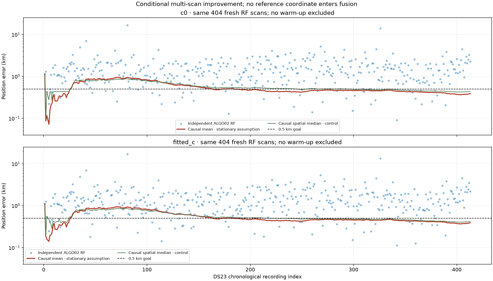
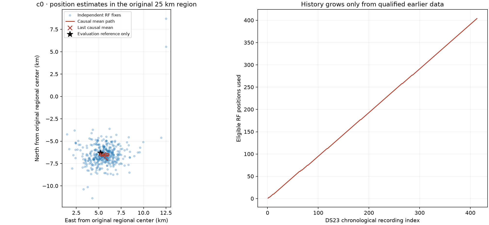
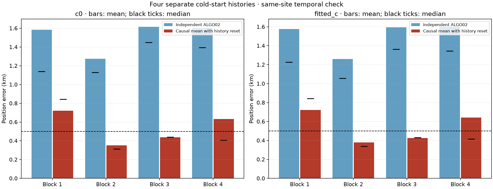

# DS23: conditional improvement from causal stationary RF consensus

**This is a separate multi-scan experiment, not single-scan ALGO03.** When the
receiver is declared stationary, averaging qualified RF positions available up
to each scan reduces DS23 mean/median error from **1.520/1.270 to 0.539/0.465 km**
with `c=0`, and **1.508/1.249 to 0.540/0.464 km** with fitted `c`. Both metrics
improve in all four disjoint chronological blocks when their histories restart.
The whole-corpus mean still exceeds 0.5 km. This result does not complete the
single-scan accuracy goal or establish performance at another location.



## Hypothesis and scope

Individual Doppler solutions can move along shallow position/orbit/calibration
directions despite acceptable CFO residuals. If the physical receiver stays at
one location, earlier independent RF solutions provide position evidence for
later scans. The hypothesis is that their errors cancel sufficiently to improve
the common-position estimate without using a known position.

Every underlying [ALGO02](../ALGO02/README.md) result still starts cold at the
center of its 25 × 25 km region, uses its own causal TLE boundary and independently
fits its own receiver calibration. The consensus does not rerun associations,
share satellite identities, change priors, recover GLRT points, or initialize an
individual fit from another scan's location. It combines the resulting RF
positions after those fits. This is a conditional point estimator, not a joint
RF likelihood or calibrated uncertainty calculation.

The conditional stationarity assumption is explicit. It must not silently be
applied to a moving receiver or carried across a relocation. A new declared
stationary interval resets history; absent that declaration the estimator fails
closed. No motion detector is implemented. Real-time compute latency has not
been benchmarked; the experiment is an offline replay with causal data access.

## Evaluation-reference and recording audit

The read-only [reference audit](evidence/reference_authority_audit.json) verifies
the sealed raw metadata for all **413 recordings**, the same roof radio serial
throughout, and capture starts inside the declared roof-authority interval.
All **206 adaptive** recordings have existing capture-pose companions whose
recording ownership, binding digest, authority digest and complete capture-time
validity verify. The **207 fast** recordings have the matching radio/time
eligibility, without an adaptive pose-companion binding.

The operator-supplied roof authority is only **0.747 m** from the supplied
evaluation coordinate, `37.849061591561885, -122.48574968092912`. Thus the two
documented reference coordinates do not explain kilometre-scale errors. The
authority is an operator declaration, not an independent GNSS survey or motion
measurement; altitude and survey uncertainty remain unknown. The reference was
not changed to improve results.

Neither these reference coordinates nor the coordinates in pose companions enter
consensus inference. The inference inputs are only RF estimates, capture timing,
case identity and a declared stationary-segment identity. The source files for
evaluation and inference are separate.

## Exact estimator and causality

For scan `i`, form an eligible set containing:

1. Its own independently qualified ALGO02 RF position, when available.
2. Qualified positions from the same declared stationary interval whose scan
   cutoff precedes scan `i` and whose **last GLRT observation ends before scan
   `i`'s cutoff**.

Return the arithmetic mean of those east/north positions. Apply exactly the
same rule separately to the matched `c=0` and fitted-`c` arms. All eligible
positions have equal positive weight; there is no GPS-based rejection, satellite
selection or fitted coordinate correction. The mean stays within the convex
hull of the original regional solutions.

We also report the spatial median as a fixed robust control. It minimizes the
sum of Euclidean distances to eligible RF estimates, using modified Weiszfeld
iterations with a `1e-10 km` stopping tolerance. This control is not selected by
its accuracy. The ordinary mean is the primary, parameter-free hypothesis.

The stored [inference receipts](evidence/inference.json.gz), losslessly compressed
JSON, enumerate every
contributing scan for every output. Future scans and scans overlapping the
current cutoff cannot contribute. Tests check prefix invariance when future
records are appended, overlapping-record exclusion, interval resets, repeated
points in the spatial median, and explicit history-only forecasts. No RF points
are withheld from the underlying localization.

## Full DS23 results

The primary denominator is the same **404 recordings with fresh qualified RF
positions** as the published full ALGO02 comparison. All 413 members remain in
the coverage denominator. Errors use the supplied coordinate only in reporting.

| Method, on the same 404 recordings | c0 mean / median km | Fitted-c mean / median km |
|---|---:|---:|
| Independent ALGO02 | 1.520 / 1.270 | 1.508 / 1.249 |
| **Causal arithmetic RF mean** | **0.539 / 0.465** | **0.540 / 0.464** |
| Causal spatial RF median, control | 0.569 / 0.514 | 0.556 / 0.498 |

The independent run's **three missing tracking contracts and six timeouts remain
RF-localization failures**. A stationary history can supply a carried estimate at
those times, but this is explicitly labeled a history-only forecast, not a
recovered RF solution. For the three missing-contract cases the fallback capture
timestamp is not a qualified first-sample cutoff, so those forecasts also lack
the timing authority of a qualified recording. They are excluded from the
primary 404-scan accuracy comparison. No failure is assigned a zero error.



The final retrospective RF mean of all 404 solutions is about 0.39 km from the
reference. That final aggregate is a diagnostic only: it cannot be assigned to
earlier scans because it uses their future data. The causal result in the table
includes the full startup period; no accuracy-based warm-up is removed.

## Separate cold starts in four time blocks

To test reliance on one favorable long history, divide the 413 chronological
members into four consecutive blocks as `min(3, floor(4*index/413))`, and reset
the declared stationary segment at each boundary. The boundaries depend only on
membership/order. No RF positions or GPS errors choose a boundary. This is a
same-site temporal robustness check after development, not an untouched
new-location validation.

| Cold-start block | Fresh RF scans | Independent c0 mean / median km | Causal mean c0 mean / median km | Independent fitted-c mean / median km | Causal mean fitted-c mean / median km |
|---|---:|---:|---:|---:|---:|
| 1 | 99 | 1.584 / 1.138 | **0.720 / 0.842** | 1.577 / 1.225 | **0.721 / 0.843** |
| 2 | 101 | 1.275 / 1.129 | **0.352 / 0.313** | 1.260 / 1.056 | **0.380 / 0.337** |
| 3 | 101 | 1.616 / 1.450 | **0.437 / 0.441** | 1.595 / 1.363 | **0.426 / 0.432** |
| 4 | 103 | 1.603 / 1.395 | **0.633 / 0.407** | 1.601 / 1.343 | **0.642 / 0.416** |



Both error metrics improve in every block and both `c` arms, but blocks 1 and 4
still exceed 0.5 km mean error. Accumulation helps; it does not guarantee that
each new stationary deployment will reach the target within a particular time.

## Interpretation for ALGO03

This is evidence that temporal reuse can improve DS23 under a declared
stationary-receiver operating mode. The estimator itself contains no learned
site coordinate and can be reset at a new region. Its actual accuracy at a new
location, during movement, or under different satellite geometry is unverified.
It depends on values outside a single scan and must be presented separately from
single-scan methods. The original single-scan 0.5 km mean-and-median goal remains
active; no ALGO03 promotion is made by this report.

The next useful tests are independent temporal/location datasets and a joint
common-position likelihood that accounts for repeated ephemeris errors. Simply
treating hundreds of nearby-in-time RF fixes as independent does not provide a
valid confidence interval. A mobile mode additionally needs a qualified motion
model and reset mechanism.

The distinction is consistent with published LEO work that treats ephemeris and
timing errors explicitly and separates stand-alone estimation from differential
or externally aided methods. See [Towards Navigation with Non-Cooperative LEO
Satellites: Resolving Ephemeris and Timing Errors](https://doi.org/10.1109/PLANS61210.2025.11028189).
That paper does not validate this consensus estimator or establish an accuracy
floor for DS23.

## Evidence and replay

- [Compact RF-only position inputs](evidence/rf_positions.json), with individual
  timing eligibility and no reference position.
- [Full causal ownership receipts](evidence/inference.json.gz), gzip-compressed JSON.
- [Accuracy and all per-scan values](evidence/report_evidence.json).
- [Four restarted-block comparisons](evidence/quartile_reset_comparison.json).
- [RF-only inference source](source_snapshot/ds23_stationary_consensus.py) and
  [original dataset driver](source_snapshot/probe_algo03_stationary_causal.py).
- [Reference-audit source](source_snapshot/audit_ds23_reference_authority.py),
  which is not imported by the estimator.
- [Validation and hashes](validation.json) and [artifact manifest](publication_manifest.json).

From this directory, using the existing numerical environment:

```bash
OPENBLAS_NUM_THREADS=1 python replay_consensus.py --output /tmp/ds23-stationary-replay.json
MPLCONFIGDIR=/tmp/ds23-stationary-mpl OPENBLAS_NUM_THREADS=1 python build_report.py
PYTHONPATH=source_snapshot python -m pytest -q tests
```

The first command reads only the compact RF inputs and writes both causal
estimators. The second is evaluation-only and regenerates all figures/tables.
No IQ, archive access, network service, GPS fitting or new RF collection is
required for this replay. Recomputing the upstream RF estimates requires the
separate frozen ALGO02 numerical/input package and its declared dependencies.
