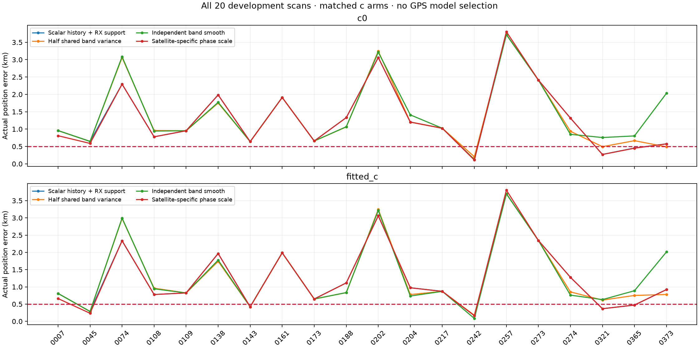
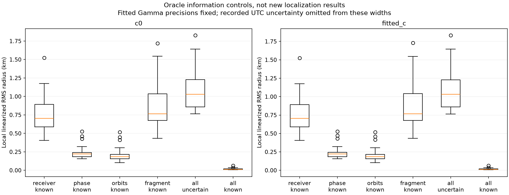
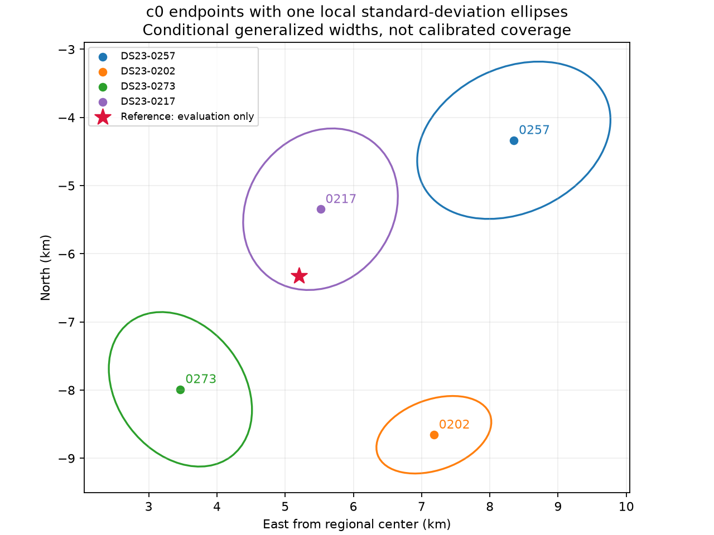
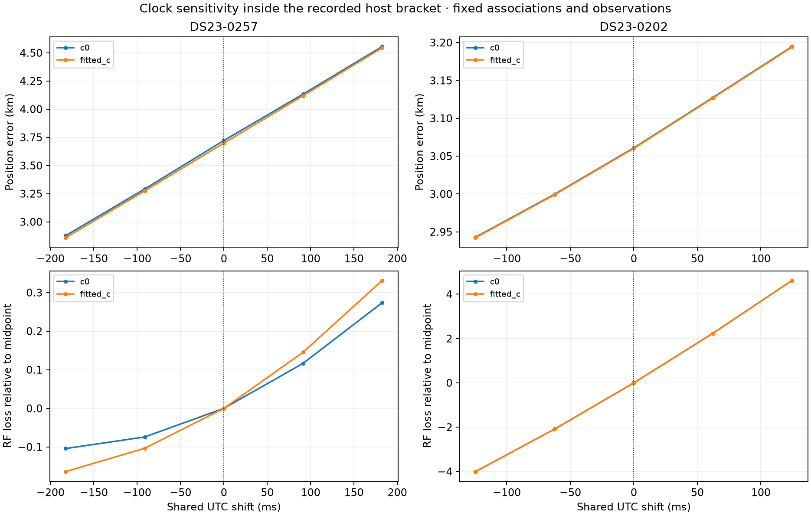

# DS23: receiver covariance, satellite uncertainty, UTC and evidence integration

**The 0.5 km mean/median target remains unmet.** This report retains every outcome
on the original20 development scans; it is not validation on all413 DS23 scans
or at a new location. ALGO01 and DBG01 remain the published baseline/debug
specifications. No GPS-derived prior or candidate choice is introduced here.

| Actual position algorithm | c0 mean / median, km | Fitted-c mean / median, km |
|---|---:|---:|
| Scalar history + RX support | 1.315 / 0.991 | 1.266 / 0.896 |
| Half shared band variance | 1.350 / 0.959 | 1.280 / 0.828 |
| Independent band smooth | 1.450 / 0.991 | 1.338 / 0.852 |
| Satellite-specific phase scale | 1.309 / 0.989 | 1.261 / 0.896 |

## 1. Receiver and band covariance

The [residual audit](../2026_10_18_ds23_learned_residuals/README.md) shows more
correlation within one receiver than across receivers. Test a common receiver
smooth process plus independent low/high band processes. For correlation rho,
basis blocks are sqrt(rho)*B, sqrt(1−rho)*B_low, sqrt(1−rho)*B_high. Per-band
marginal variance and all within-band covariance remain unchanged. Cross-band
covariance alone becomes rho times the original. Test rho1,0.5,0; retain the
same linear-drift priors. Expanded seed states exactly preserve the initial
predicted correction. Low-only scans are numerical null controls.

All20 paired final gates pass. Half-sharing slightly improves the median but
worsens the mean; independent bands worsen the mean further. This covariance
split does not solve the localization error. Conditional frequency RMS and
retained calibration counts are reported separately in position_comparison.csv;
better frequency fit is not taken as geographic improvement. Every fit begins
with identical original retained observations, fixed labels/aliases, and uses
five phase-reference rounds,48 position steps and four paired gate/refit rounds.
Gate exclusions apply to both c arms; final masks may differ between policies.

## 2. Satellite-specific uncertainty from causal history

Keep the scalar historical phase forecast and Student tail model. Add a
population-centered log-scale mixture for each satellite. Normalize its prior
so E[tau²]=1. Earlier updates estimate a posterior scale, and use
sqrt(E[tau² | past updates]) as the moment-matched Student scale multiplier.
Unseen identities and zero scale spread retain multiplier1. Fit candidate-
bank-wide histories, never an RF-selected satellite whitelist. Test spread
0,0.25,0.5,1 using the existing chronological70/30 historical split, all before
RF. Require at least30 validation transitions and predictive gain greater than
log(validation count). Only4/20 scans qualify; the mean gain is about6m c0.
This does not materially solve the goal. Historical selection and qualification
share the later pre-RF block; RF accuracy is the subsequent evaluation, and
these20 scans are now development data. No per-scan choice uses GPS.

## 3. What limits the local position information?

| Oracle nuisance control | Median local RMS radius c0 / fitted-c, km |
|---|---:|
| receiver_known | 0.704 / 0.704 |
| phase_known | 0.221 / 0.222 |
| orbits_known | 0.183 / 0.183 |
| fragment_known | 0.765 / 0.768 |
| all_uncertain | 1.029 / 1.031 |
| all_known | 0.012 / 0.012 |

These are **local generalized information scales**, not achieved position
errors, calibrated confidence intervals or a fundamental CRLB. At each saved
RF endpoint, condition on fitted noise and Student prior precisions. Form the
position derivative D, nuisance features U, point precision W, nuisance prior
precision P, and Schur information
I=D'WD−D'WU(P+U'WU)^−1U'WD. Its local covariance is I^−1; RMS radius is
sqrt(trace(I^−1)). Finite differences at0.01/0.02km agree within6.1e−10 in
relative derivative norm. The algebra is tested against dense marginalization.

Freeze selected nuisance groups at their fitted values for oracle controls;
do not set them to zero or refit claimed improved positions. Satellite phase
uncertainty dominates these local widths more than receiver uncertainty.
On257, all-uncertain RMS radius1.827km becomes1.522km if receiver corrections
are known,0.527km if satellite phases are known, and0.064km if all corrections
are known. Across20 scans, median radius drops from1.029km to0.221km when
phase is known. This motivates better independent orbital-phase information
and stronger geometric evidence, rather than merely more RF points.

The calculation conditions on Gamma precisions, excludes their uncertainty,
does not marginalize discrete identities, and initially assumes the recorded
UTC midpoint. Those omissions can make widths optimistic. Receiver/family
parameters remain correlated. This diagnostic identifies sensitivity, not
proof that any particular TLE is wrong or that0.5km is impossible.

## 4. Recorded UTC uncertainty was omitted from the position model

The prepared public observations explicitly retain the host timing bracket:
257 has±182.55ms;202 has±124.59ms. The previous fits use its midpoint. Test
five common clock nodes at−1,−0.5,0,0.5,1 times that half-width. Orbit-bank
queries shift in ECEF time, including Earth rotation. Hardware/smooth terms
remain functions of elapsed device time. This is one common UTC hypothesis
for both receivers/all satellites, not an independent orbital phase per family.
The catalogue cutoff stays at the original earliest UTC bound, so all selected
TLEs remain causal for every tested clock. Phase priors, observations, aliases
and labels stay fixed. No observation is trimmed within clock selection; both
arms must pass all original gates. All five nodes have equal fit budgets.

RF-only profile selection picks the early endpoint on both probes. On257 it
changes3.722/3.699km to2.877/2.859km, but improves c0 RF loss by only0.104:
the clock is weakly identified there. On202 it changes3.061/3.060km to
2.943/2.942km. These two probes do not establish a cohort correction. A
boundary maximum on a nearly flat clock profile is not a precise clock
measurement; proper uncertainty propagation is preferable to forcing a node.
No clock default or new ALGO01 accuracy claim is adopted from these cases.

The read-only archive inventory also checked the latest three pre-scan257
snapshots: none contained regional candidates with reference epochs after
the scan. A stale catalogue caused solely by excluding already-published
future-reference epochs is therefore unsupported on those inspected snapshots.
No such elements or post-observation TLEs were used in any fit.

## 5. Does the variational approximation reject the better geographic identity?

The257 alternative63070→48482 passes gates and gives a smaller evaluated
position error, while the existing RF objective rejects it. Audit the same
Gaussian/Gamma model with Rao-Blackwell importance sampling: sample noise
and phase precisions from the fitted variational Gamma proposal, analytically
integrate all Gaussian nuisance coefficients, and apply the exact prior/
proposal ratio. Likelihood powers and every normalization constant are kept.
The implementation is checked against analytic Student integration and direct
Gaussian quadrature, including fractional powers. No position is refit and
no model/prior changes. This is a c0 objective audit, not a c-arm algorithm
comparison. The paired localization results remain in the tables above.

The1024-draw audit gives a challenger disadvantage15.329 RF units versus
15.268 from the variational bound. Estimated bound gaps2.475/2.414 are nearly
the same for the two candidates; effective sample sizes847/868 and nominal
Monte Carlo SE0.029/0.027 pass the declared sampling rule. A4096-draw repeat
is in importance_audit.csv and the raw receipts. Sampling diagnostics do not
prove coverage of unseen modes, but this check supplies no evidence that the
variational approximation causes this identity decision. It leaves the causal
phase model, identities and underlying information as the relevant questions.

| Candidate at its saved RF endpoint | Variational loss | Importance estimate | MC SE | ESS / draws |
|---|---:|---:|---:|---:|
| incumbent | 5122.631 | 5120.115 | 0.015 | 3340 / 4096 |
| challenger | 5137.900 | 5135.449 | 0.014 | 3426 / 4096 |

## Evidence and reconstruction

[Position CSV](position_comparison.csv) · [Local information](local_information.csv) ·
[UTC controls](UTC_comparison.csv) · [Evidence audit](importance_audit.csv) ·
[Summary](summary.json) · [Validation](validation.json).

Raw protocols/outputs reside in ../2026_10_19_ds23_band_covariance/,
../2026_10_19_ds23_satellite_phase_scale/,
../2026_10_19_ds23_position_information/,
../2026_10_19_ds23_utc_bracket/ and
../2026_10_19_ds23_marginal_evidence/.
Scale receipts overlay ../2026_10_18_ds23_causal_phase_mean/history/.
Source snapshots overlay the prior ALGO01/DBG01 and research snapshots.
Use the repository venv, PYTHONPATH=src:tools, OPENBLAS_NUM_THREADS=1 and
OMP_NUM_THREADS=1. Numerical runs use bounded subprocesses; no new RF,
IQ reread, QNAP mutation or production component change is included.
