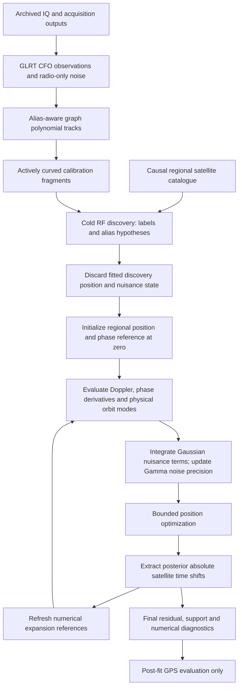
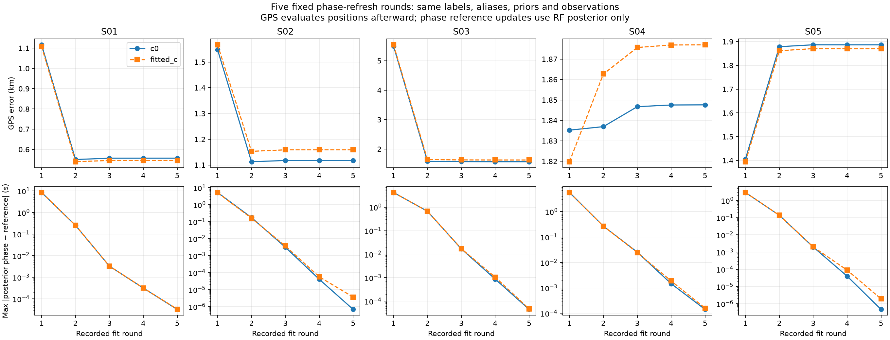

# DSX01: phase-refreshed graph-track localization

This report documents the current research algorithm, the confirmed phase-linearization correction, the five-scan root-cause investigation, and the recommended next steps. It accompanies the [full root-cause report and 63 diagnostic figures](../2026_10_18_dsx01_localization_root_cause/README.md). The publication date is October 18, 2026 in the user's Pacific time zone; the directory uses the execution host's October 19 UTC date.

The accompanying [DS dataset inventory and creation-date evidence](../2026_10_18_ds_dataset_inventory/README.md) lists 20 located named datasets, plus the DS2-22 revision. Explicit creation timestamps are distinguished from inventory completion dates and acquisition-cutoff proxies.

**Recommendation: retain phase refresh as the numerical treatment, and validate receiver-calibration priors on other archived scans before adopting a new calibration policy.** Phase refresh corrects an approximation without adding coefficients or moving the absolute phase prior. It materially improves S01–S03. It does not establish correct satellite identities, calibrated TLE uncertainty, or sub-kilometer accuracy on every scan. S04 remains unresolved.

## What “phase refreshed” means

Phase here is a **time displacement in seconds along a satellite's predicted Doppler curve**. It is not the carrier's wrapped RF phase. Tracks assigned to the same satellite share this displacement within a scan. The calculation includes the Earth-rotation convention implemented by the phase geometry; it is not just an arbitrary polynomial translation in CFO.

The earlier stepwise reassociation experiment used a tangent approximation at zero displacement while allowing posterior displacements of several seconds. A tangent at zero can then be a poor approximation to the actual shifted orbit curve. Phase refresh fits the displacement, rebuilds the curve and its derivative near that displacement, and refits position and calibration. The posterior phase remains an absolute displacement under its original zero-centered prior.

Let \(f_s(t;\mathbf{x},\phi_s)\) be predicted Doppler at the 11.5 GHz reference frequency, \(\mathbf{x}\) receiver position, and \(r_s\) the numerical expansion reference. The approximation is

\[
f_s(\phi_s)\simeq f_s(r_s)+f'_s(r_s)(\phi_s-r_s)
=\underbrace{f_s(r_s)-r_s f'_s(r_s)}_{\text{intercept}}+f'_s(r_s)\phi_s.
\]

The **intercept subtraction is essential**. The standardized coefficient is still \(z_s=\phi_s/\sigma_{\phi,s}\), with \(z_s\sim\mathcal N(0,1)\). Refreshing \(r_s\) never changes that prior to \(\phi_s-r_s\sim\mathcal N(0,\sigma^2)\). Dropping the subtraction would effectively recenter the prior and change the scientific model on every round.



The diagram shows the complete analysis chain. In the controlled root-cause experiments, acquisition, GLRT and graph construction were already cached. They were **not rerun at every position or for every ablation**.

## Inputs, region, and causal boundary

The regional search is a **25 × 25 km east/north box centered at latitude 37.906°, longitude −122.545°**, bounded by ±12.5 km on each axis. Controlled refits start at the box center. It is a declared regional prior, not a location inferred from this scan. The broader visibility catalogue covers a 250 km radius centered at 37.5°, −122.0°; it is not a hand-selected list of satellite identities. Candidate counts for S01–S05 are 1707, 1479, 1422, 1427 and 1424.

Both **TLE collection time and the epoch encoded in the TLE bytes must precede the scan cutoff**. Previous causal elements can inform engineering uncertainty estimates. No following TLE, later scan or evaluation GPS enters inference or model selection. The read guard enforces the allowed input boundary and records hashes. TLE uncertainty therefore uses pre-scan history outside the current observation scan; the algorithm is single-scan inference, not wholly single-scan input.

The supplied evaluation coordinate is 37.849061591561885°, −122.48574968092912°. It is read by reporting and an explicitly diagnostic, forbidden-as-inference post-fit tool only. Receiver altitude remains fixed at 0 m; altitude and the physical site height were not ablated. A small numerical discrepancy against SGP4 is evidence of approximation consistency, not independent evidence that the TLE is physically accurate.

| Scan | All GLRT points | Original curved calibration points | Calibration fragments | Nominated families |
|---|---:|---:|---:|---:|
| S01 | 4,797 | 2,909 | 81 | 29 |
| S02 | 3,524 | 2,317 | 63 | 29 |
| S03 | 3,988 | 2,609 | 72 | 25 |
| S04 | 3,719 | 2,530 | 67 | 21 |
| S05 | 4,056 | 2,359 | 63 | 23 |
| Total | 20,084 | 12,724 | 346 | 127 scan-family instances |

The calibration-point counts are modeled observations, **not final accepted satellite association counts**. Each original point keeps its observation identifier. Linear tracks may be associated or overlapped after calibration, but they do not determine offsets or drift. Active curvature requires at least 20 seconds of duration and at least 250 Hz RMS departure from an affine fit. Eligibility is based on observed shape, not the polynomial degree alone.

## Alias handling and satellite association

A fragment has observed CFO \(y_i\), integer alias \(a_k\), and period \(P=1/(4.4\,\mu\mathrm{s})\simeq227272.727\) Hz. Its lifted measurement is \(\tilde y_i=y_i+a_kP\). Satellite labels and alias integers are discrete RF-discovered hypotheses, held fixed during an individual continuous fit. The continuous solver does not round aliases on every iteration and therefore avoids artificial alias rounding cliffs in its objective.

There are three related experiments; their capabilities must not be conflated:

1. **81-start stepwise reassociation:** each scan starts at 81 points on a 2 km grid inside a 10 km disk, with a common bank of whole-assignment hypotheses derived from 13 independent cold RF discoveries. Every hypothesis is rescored at the start and after each accepted position step; a better label/alias branch replaces the incumbent. All branches used a common zero phase expansion. The resulting 810 trajectories were tightly clustered, but this did not protect against phase-approximation bias.
2. **Controlled phase-refresh and nuisance ablations:** start at the regional center, hold the selected original label/alias assignment fixed, and repeat the continuous fit with updated numerical phase references. This isolates the approximation change. It is not 81 independent phase-refreshed rediscoveries or proof of a global identity optimum.
3. **Expanded phase-refreshed hypothesis tests:** refit every unique old-bank hypothesis, broader catalogue proposals and finite family/fragment coordinate moves, plus 80 unique hypotheses from a 25-node full-box cold RF atlas. Atlas nuisance states and positions are discarded. Every tested branch gets the same five-round phase-refreshed refit; c0 RF objective selects a branch, and the incumbent remains eligible. This is finite search, not exhaustive enumeration of joint labels and aliases.

The [stepwise experiment report](../2026_10_18_dsx01_joint_descent/README.md) and [expanded RF-only results](../2026_10_18_dsx01_localization_root_cause/README.md#wider-rf-only-satellite-search) preserve these distinctions. In S03, a lower-loss identity alternative worsens GPS error. An RF score is useful evidence but does not authenticate a satellite label.

## Continuous measurement model

For point \(i\) in fragment \(k\), assigned to satellite \(s\), define \(q_i=f_{\mathrm{RF},i}/11.5\,\mathrm{GHz}\). The conditional mean is

\[
\mu_i=q_i\big[f_s(r_s)-r_sf'_s(r_s)+f'_s(r_s)\phi_s
+\mathbf m_{s,i}^{\mathsf T}\boldsymbol\eta_s\big]
+\mathbf h_i^{\mathsf T}\boldsymbol\beta
+\mathbf b_i^{\mathsf T}\boldsymbol\gamma+d_k.
\]

\(\boldsymbol\eta_s\) are causal physical orbit modes, \(\boldsymbol\beta\) receiver/band terms, \(\boldsymbol\gamma\) receiver smooth terms and \(d_k\) the independent fragment constant. The design matrix includes each coefficient's engineering prior scale, so the underlying latent coefficients have unit Gaussian priors. These scales are hypotheses, not calibrated posterior uncertainty.

| Component | Baseline structure and prior scale |
|---|---|
| Native band/RX offsets | Four constants, one per RX × low/high band; standard deviation \(P/\sqrt{12}\) Hz |
| Receiver mean drift | One mean linear drift per RX, centered at 150 s; σ = 10 Hz/s |
| Within-RX band drift contrast | One contrast per RX, σ = 1 Hz/s; individual bands get mean ± half contrast |
| Receiver smooth curve | One saved smooth basis per RX, scaled by native RF ratio; coefficient σ = 200 Hz |
| Satellite phase | One absolute time shift per nominated family; σ is causal-history-derived with a 1 s minimum |
| Physical orbit correction | Three scaled modes: mean motion, inclination and RAAN, for satellites represented by at least two distinct RX/channel owners |
| Fragment constant | One independent Gaussian constant per original fragment, σ = 1000 Hz |
| RF-dependent calibration `c` | Optional single shared coefficient; design is \((f_{\mathrm{RF}}/\mathrm{GHz}-11.5)\times200000\); unit Gaussian latent coefficient |

The optional `c` is a learned hardware calibration term, not the speed of light in the Doppler expression. It is compared against a matched `c=0` arm throughout. There is **no extra free linear Doppler term for every satellite** in this baseline. Phase plus physical orbit modes and receiver drift already offer considerable freedom; a flexible independent satellite line would create additional identification ambiguity.

Orbit-mode scales use aligned differences between latest and previous causal elements. Engineering minimum radial/cross-track scales are 0.05/0.025 km when previous records exist; missing-history defaults are 0.5/0.25 km. Radial uncertainty maps to mean-motion perturbation; normal uncertainty maps to inclination and RAAN perturbations. Finite differences of consistently propagated SGP4 states build modes. Larger physical floors and two additional eccentricity modes were tested as controls, not silently added to the standard model.

## Robust objective and complexity accounting

Write \(\mathbf r=\tilde{\mathbf y}-\mathbf q\,\mathbf f_{\mathrm{intercept}}\), and \(U\) for the prior-scaled nuisance design. At fixed position and reference,

\[
\mathbf z\sim\mathcal N(0,I),\qquad
r_i\mid\mathbf z,\lambda_{g(i)}\sim
\mathcal N((U\mathbf z)_i,\sigma_i^2/\lambda_{g(i)}),\qquad
\lambda_g\sim\operatorname{Gamma}(2,2).
\]

The Gamma distribution uses the shape/rate convention. \(\sigma_i\ge40\) Hz is fixed from radio-only window features or the previously declared scan noise scale, selected before localization; \(\lambda_g\) is a learned precision for each original fragment. A noisy fragment is softened as a whole rather than each point receiving an unconstrained independent weight.

For current expected weights \(W_{ii}=E[\lambda_{g(i)}]/\sigma_i^2\), the Gaussian conditional mean and covariance are

\[
\Sigma=(I+U^{\mathsf T}WU)^{-1},\qquad
\bar{\mathbf z}=\Sigma U^{\mathsf T}W\mathbf r.
\]

Each precision update includes residual energy **and posterior prediction variance**. The code alternates Gaussian and Gamma updates, up to 256 iterations, stopping when the largest log-rate change falls below \(10^{-5}\). The position objective is the variational frequency/prior bound: weighted residual energy, Gaussian coefficient penalties, nuisance-integration log-volume, Gamma terms, fixed noise volume, and a negative-elevation penalty \(\sum_i[\max(0,-e_i)/2]^2\). It is not pure CFO RMS. Normalization constants must be restored when comparing changed observation/group structures or noise laws.

Consequences for interpretation:

- More nuisance freedom is penalized by priors and integration volume; it is not an unpenalized curve fit.
- A lower composite objective can coexist with higher unweighted CFO RMS, because fragment precision changes.
- Keeping every observation row does not imply every observation is explained well or accepted by residual gates.
- Residual means, slopes, discontinuities and structure still need examination. A robust bound can tolerate a fragment that fails a conditional noise screen.
- Scores for different deletion masks cannot be ranked as though they explain the same data. Split tests restore full normalization and add a \(3\log n\) cut penalty.

## Exact phase-refresh procedure and stopping rules

The current controlled prototype performs **five complete rounds**, not an unbounded “repeat until solved” loop. Satellite identities and aliases are fixed for each branch being compared. Position is carried forward between rounds; nuisance coefficients are reintegrated under the same original priors.

```text
for each RF-discovered label/alias hypothesis H:
    for arm in [c = 0, fitted c]:
        x = [0, 0] km relative to regional center
        reference[s] = 0 seconds for every satellite in H
        repeat exactly 5 rounds:
            build normal model with H and reference
            at every tested position:
                evaluate Doppler f(reference), elevation, physical orbit modes
                derivative = [f(reference + 0.01s) - f(reference - 0.01s)] / 0.02s
                intercept = f(reference) - reference * derivative
                construct prior-scaled radio, smooth, phase, orbit, constant columns
                integrate Gaussian nuisance coefficients and update Gamma precision
                return residual coordinates including objective penalties
            x = bounded damped Gauss–Newton(model, x, maximum 48 iterations)
            absolute_phase = posterior phase coefficient * original phase sigma
            save fit, stopping status, reference, absolute_phase, and their difference
            reference = clip(absolute_phase, -15s, +15s)
        save final-round model and fitted position
        compare exact corrected SGP4 conditional mean with final tangent mean
select only through the declared same-data RF objective policy
evaluate GPS error afterward in a separate reporting stage
```

The reference clip is a numerical expansion safeguard, **not a hard bound on the posterior phase coefficient**. State interpolation refuses extrapolation beyond the propagated bank. The returned model corresponds to the reference used in round five; the reference computed after round five is logged conceptually for a possible next round but is not used to fabricate a sixth fit.

Gauss–Newton uses a 0.001 km finite-difference position step, initial damping \(10^{-2}\), and at most nine damped proposals per outer iteration. Proposals are clipped to the regional bounds and accepted only for a loss decrease greater than \(10^{-9}\). Damping decreases by a factor of three after acceptance and increases by five after rejection. A small-step stop requires both displacement below \(10^{-4}\) km and improvement below \(10^{-5}\). Other statuses are no accepted damped step or iteration budget reached. A rejection stop alone is not a stationarity certificate.

Of the ten final main phase-refreshed endpoints, six stopped with small step and improvement and four with no accepted damped step. Across all 50 recorded round fits, those counts are 30 and 20. No main round reached the outer iteration cap. Final reference changes are small (maximum below approximately \(1.6\times10^{-4}\) s). Separate post-fit checks found small profiled-position gradients, and increasing the inner precision budget from 256 to 1024 did not change objectives or noise precisions. Together these support numerical stability of these endpoints; they are not proof of a global nonlinear optimum. The older large campaign did not persist full inner variational convergence fields, so its 6,370 endpoints must not inherit stronger convergence claims from this newer experiment.



This figure uses recorded accepted endpoints and absolute reference changes from each of the five rounds. The geographic error curves are evaluation diagnostics; the solver never uses them as its stopping rule. [Compact phase receipts and exact values](phase_receipts.json) preserve these data without the large raw numerical design matrices.

## Measured effects, with matched `c` controls

Position errors are kilometers. The two arms use the same observations, satellite labels, aliases, other priors and iteration budgets. The zero-reference fit is replayed from the previous experiment before refreshing.

| Scan | Fixed-zero error c0 / fitted c | Refreshed error c0 / fitted c | RF-selected offset σ, Hz | Offset-scale error c0 / fitted c |
|---|---:|---:|---:|---:|
| S01 | 1.117 / 1.108 | **0.557 / 0.546** | 200 | 0.477 / 0.435 |
| S02 | 1.548 / 1.567 | **1.117 / 1.159** | 300 | 0.424 / 0.560 |
| S03 | 5.500 / 5.542 | **1.571 / 1.630** | 300 | 1.818 / 1.857 |
| S04 | 1.835 / 1.820 | 1.848 / 1.877 | 300 | 1.647 / 1.878 |
| S05 | 1.406 / 1.395 | 1.887 / 1.870 | 100 | 0.998 / 1.010 |

The last two columns are a **separate experimental policy**: one common independent-fragment offset σ is selected per scan from 50, 100, 200, 300, 600 and 1000 Hz by c0 RF bound; the same selected σ is then used in fitted-c. It does not choose a separate σ for each fragment. The extra learned hyperparameter costs \(\log n\) relative to a fixed-scale model. This empirical-Bayes finite grid is not a fully marginalized hyperparameter posterior.


| Scan | Exact-minus-tangent RMS, zero reference, Hz | After refresh, Hz |
|---|---:|---:|
| S01 | 98.324 | 0.157 |
| S02 | 71.497 | 0.046 |
| S03 | 62.728 | 0.038 |
| S04 | 78.603 | 0.342 |
| S05 | 49.946 | 0.030 |

These are all-point conditional CFO discrepancies against exact SGP4 mean evaluation using the **same fitted physical corrections**, not residuals against independent orbit truth. They demonstrate that the updated approximation is consistent. S05's worsened GPS error, despite a better RF bound, indicates that the older approximation partially canceled other bias. Keeping the old numerical error for geographic agreement would not be a sound correction.


Full objective, RMS and geographic results are in [the model/candidate table](../2026_10_18_dsx01_localization_root_cause/models_and_candidates.csv) and the exact [compact phase receipts](phase_receipts.json). The figures deliberately keep fit and position effects separate.

## What the failure investigation established

| Scan | Evidence | Parsimonious next action and limit |
|---|---|---|
| [S01](../2026_10_18_dsx01_localization_root_cause/DSX01-S01/README.md) | Phase refresh halves geographic error. Removing a large influential family worsens accuracy; no archived multi-piece calibration join exists. | Keep refresh and points. RF-selected 200 Hz offset prior is a candidate, but RMS rises **362 → 889 Hz** even as position improves. Do not call this a better explanation of all measurements. |
| [S02](../2026_10_18_dsx01_localization_root_cause/DSX01-S02/README.md) | Calibration/noise assumptions have strong influence: a 1 Hz/s mean-drift prior gives 0.252 km; a fixed OU covariance gives 0.103 km. | Validate receiver stability and temporal noise correlation independently. These impressive rows were identified retrospectively, not selected by a validated deployment policy. RF-selected offset scale gives 0.424/0.560 km. |
| [S03](../2026_10_18_dsx01_localization_root_cause/DSX01-S03/README.md) | Refresh removes most of the original 5.5 km error. At GPS the weighted data cost is lower, but prior/Gamma terms favor displacement. Best single-family deletion remains 1.051 km. Separating the only archived join worsens error. | Obtain independent receiver smoothness evidence. A 20 Hz smooth prior gives 0.438 km but worsens RF objective by about 183; choosing it by GPS would be oracle tuning. The RF-selected offset policy worsens position. |
| [S04](../2026_10_18_dsx01_localization_root_cause/DSX01-S04/README.md) | Refresh leaves ~1.85 km. No single-family deletion, archived join repair or expanded tested association pool resolves it. Larger physical orbit floors are not a solution. | Keep this case explicitly unresolved. Test independently measured calibration stability, causal orbit covariance and remaining identity/timing/height assumptions. Do not invent a TLE correction solely to hit GPS. |
| [S05](../2026_10_18_dsx01_localization_root_cause/DSX01-S05/README.md) | Correcting the tangent exposes bias. Hard RF-gate rejection worsens error to 3.118 km; best one-family deletion is 1.582 km. | A common RF-learned 100 Hz fragment-offset prior reaches ~1 km, with matched control ~1.01 km. This is not a robust sharp-threshold pass or a policy proven on new locations. |

Every original family and curved fragment was removed once with matched c arms, nuisance dimensions and original physical-mode support preserved. Family deletion was tested at zero and refreshed references. Four RX/band and three time-block deletions were also tested. The three highest-influence families supplied all three pairs and their triple. This is extensive influence testing, not exhaustive subset search. GPS-best deletions are explicitly oracle diagnostics, not an automatic blacklist.

Only S03 has an archived multi-piece calibration track. An actively curved, point-preserving unjoin changes its refreshed c0 error from 1.571 to 1.649 km. Most proposed residual-step cuts produce a child without active curvature and were disallowed as calibrators. A large step statistic can reflect orbit/calibration mismatch; it does not by itself establish a bad track join. Point assignment errors within a single original polynomial remain possible.


The per-scan reports show family/track influence, predicted and observed GLRT CFO, best low-order polynomial residuals, orbital residuals, and 20-second zoom panels. High unweighted residual RMS and high geographic influence are different properties: robust weighting can greatly reduce the leverage of a visibly bad fragment.

## Relation to the completed independent-start campaign

The earlier independent-start campaign is now complete: **49 configurations × five scans × 13 cold discovery starts = 3,185 paired runs, 6,370 endpoints**, 65 distinct discovery receipts and 735 figures. It is a different frozen experiment from the 81-start bank-based stepwise descent and the current phase-refresh ablations.

Its archived audits checked all 202 bound source hashes and both collection and byte-epoch causality for 15,443 past-only element records. There were no failed jobs; **40 endpoints reached their iteration budgets**, and 1,472 stopped with no accepted damped step. These statuses must not be described as universal convergence. Four selected S01 endpoint objectives were replayed exactly, with their inner updates converging; this applies to those four replays, not automatically to every endpoint. The campaign's engine and auditor passed 17 focused tests. A compact [campaign validation snapshot](campaign_validation.md) is included; the full 735-figure gallery and raw histories remain in the local archived campaign.

The campaign reinforces the distinction between good optimization and a correct observation model. Lower RF loss can select a worse geographic endpoint; additional starts cannot repair an inaccurate phase tangent, uncertain calibration prior or wrong identity family by themselves.

## Recommended algorithm and next experiments

Retain the same absolute-prior model with phase refresh as the baseline numerical treatment. Preserve phase-reference histories, exact conditional-mean checks and stopping statuses. A future production solver should use explicit reference-change and exact-mean tolerances with a finite cap; the present five-round prototype is the measured implementation, not already that adaptive production solver.

Keep calibration restricted to actively curved fragments. Allow linear tracks to join, overlap or extend already calibrated families, subject to residual consistency, without letting them set offsets or drift. Retain original observations for diagnostic review; the present ablations do not establish a generally safe satellite blacklist or automatic join-breaking rule.

Next, test the one-scalar RF-only offset-scale policy on **unseen archived datasets/locations**, alongside fixed baseline priors and matched c controls. Report raw and robust frequency metrics, accepted associations and GPS error separately. Fit any receiver drift/smoothness prior from independently justified hardware or calibration evidence. Avoid assembling a per-scan “best” model by inspecting GPS. More satellite freedom should follow physically defensible causal covariance rather than adding arbitrary per-satellite trends to force agreement.

There is currently **no single validated policy that puts all five DSX01 scans below 1 km**. S03 demonstrates prior/calibration ambiguity; S04 has no established physical root cause. Receiver altitude, timing/frame conventions, unexplored joint identities and real causal-TLE errors remain legitimate untested explanations. Exact numerical agreement with a corrected TLE does not distinguish those causes.

## Provenance, implementation mapping and publication scope

This is a documentation publication, with no new RF collection or runtime algorithm modification. All plots reuse completed archived-data analyses except `phase_rounds.png`, which visualizes already recorded round receipts. The full root-cause report contains 63 figures, six Markdown reports, two result CSV tables, summary and validation receipts. Its source verification records **56 passing focused tests and clean Ruff checks**; those are the existing analysis implementation checks, not a claim that this publication reran raw acquisition.

| Implementation source | Responsibility |
|---|---|
| `tools/investigate_dsx01_localization_failures.py` | GPS-blind context/read guard, baseline normal model, five-round `refreshed`, intervention fits and audits |
| `tools/dsx01_joint_marginal.py` | Absolute phase intercept, prior-scaled design, native band/RX structure, conditional phase extraction |
| `tools/dsx01_hierarchical_bound.py` | Gaussian/Gamma bound, precision iterations, integration volume and normalization |
| `src/leo/analysis/research/continuous_curve_fit.py` | Phase geometry, finite interpolation and bounded damped Gauss–Newton |
| `tools/build_dsx01_orbit_modes.py` | Causal physical mode construction and engineering orbit scales |
| `tools/dsx01_window_noise.py` | Fixed radio-only per-point noise |
| `tools/dsx01_failure_followups.py` and `tools/dsx01_failure_*` | Declared nuisance, split, identity and offset-scale controls |
| `tools/probe_dsx01_failure_postfit.py` | GPS-only retrospective loss/approximation diagnostic, forbidden as inference input |
| `tools/report_dsx01_failure_investigation.py` | Figures, geographic evaluation, tables, report validation |

The exact source hashes and compact phase/input receipts are in [phase_receipts.json](phase_receipts.json). These paths identify the local analysis source versions; this documentation commit does not publish a standalone runnable replacement for their full dependency graph. Large per-run design matrices, raw IQ and unrelated dirty workspace files are excluded. Original root-cause validation hashes refer to that full local archived analysis. The separately generated publication manifest binds the files actually shipped here, and its link check validates this smaller publication bundle. Source tests, archived-run validation and publication checks serve different purposes.

Primary technical context: [CelesTrak's SGP4 tutorial](https://celestrak.org/software/tutorials/sgp4.php) explains consistent treatment of TLE mean elements and their propagator. [Double-difference Doppler positioning with ephemeris-error correction](https://arxiv.org/abs/2409.05026) and [Bayesian calibration of LEO orbital errors](https://arxiv.org/abs/2511.06060) motivate clock/orbit uncertainty treatment; they do not authenticate the engineering scales or satellite identities in this experiment. No differential reference receiver from those methods is assumed here.
