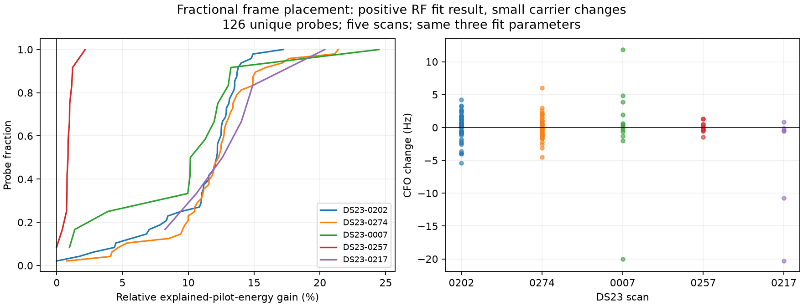
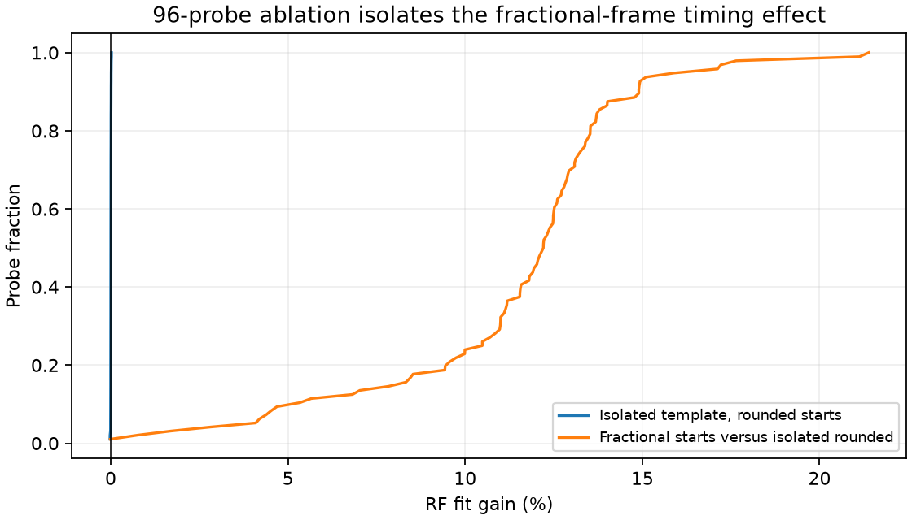

# Fractional frame placement improves the known-pilot RF fit

Placing Starlink frames at fractional sample epochs improves the local pilot fit on **124 of 126 unique receiver probes from five DS23 scans**. The comparison preserves the same three nonlinear parameters, complete-frame sample support, and per-frame complex-gain/DC nuisance terms. A separate padding ablation attributes the gain to frame placement.

**This is an RF estimator result, not an ALGO03 localization result.** Typical carrier changes are only about 1 Hz. No observations, satellite assignments, receiver calibration or position estimates are changed by this experiment. ALGO02 remains frozen, and the 0.5 km mean-and-median position objective remains unmet.

## Result and scope

The score is the fraction of DC-removed IQ energy explained by the fitted known-pilot replica after eliminating each frame's complex gain. A relative score increase is an increase in explained pilot energy on identical samples. It is not a calibrated probability, a detection-rate improvement, or a position-accuracy measurement.

| Scan | Capture | Sample rate | Receiver probes | Score increased | Median relative score gain | Median / maximum absolute CFO change |
|---|---|---:|---:|---:|---:|---:|
| DS23-0202 | Fast | 2.5 MHz | 48 | 47 | 12.18% | 1.19 / 5.38 Hz |
| DS23-0274 | Fast | 2.5 MHz | 48 | 48 | 12.34% | 1.06 / 5.99 Hz |
| DS23-0007 | Adaptive | 2.5 MHz | 12 | 12 | 10.71% | 1.63 / 20.00 Hz |
| DS23-0257 | Adaptive | 10 MHz | 12 | 11 | 0.86% | 0.46 / 1.48 Hz |
| DS23-0217 | Adaptive | 2.5 MHz | 6 | 6 | 13.31% | 0.67 / 20.31 Hz |

The two individual decreases are **0.0171% and 0.0185%**. They remain in every summary. All five scan medians improve. At 10 MHz, the same fractional-sample rounding corresponds to a smaller physical timing error, consistent with the smaller gain on scan 0257.



The first 96 probes reuse a previously sealed, saved-IQ benchmark from scans 202 and 274, including both receivers. The additional 30 probes come from inherited RF-only qualification plans for scans 7, 257 and 217 and are RX2 measurements. Their original recording adapters verify the physical probe bindings. The three read-only runs take 1.2–6.8 seconds each and decode about 0.15 GiB in total. No new RF collection occurs.

These additional scans test the numerical effect across capture formats and sample rates. They are not a random navigation benchmark or validation at a new location. No GPS, TLE, satellite label or polynomial prediction enters the local fit. The [input authorities](input_authorities.json) bind the private IQ sources and original numerical results; raw IQ is not republished.

## Cause and correction

A nominal frame lasts 1/750 second. At 2.5 MHz this spans **3,333⅓ samples**; at 10 MHz it spans **13,333⅓ samples**. The legacy local refinement helper constructs a three-frame waveform by concatenating copies of a sampled frame at rounded integer starts, then interpolates that waveform. This retains a repeating fractional timing error between frames.

The corrected model evaluates each frame at its fractional position. For sample index `n`, fitted epoch correction `d`, frame period `P = fs/750`, and fitted common rate `r`, define:

```text
u = (n - epoch - d) * (1 + r * 1e-6)
frame_index = floor(u / P)
local_position = u - frame_index * P
```

An interpolated single-frame pilot template is evaluated at `local_position`. The carrier rotation remains continuous in receiver sample time, while the fitted complex gain and DC remain independent for each complete frame. The three nonlinear parameters are CFO, epoch correction and a shared timing-rate correction. This comparison does not add a separate intra-frame clock parameter or assume transmitter carrier-phase continuity between frames.

This corrects the **experimental local refinement helper**. The report neither changes the native acquisition kernel nor retroactively replaces any published GLRT contract or ALGO02 result. No runtime or embedded-speed improvement is claimed.

## Padding control and numerical checks

Changing to an isolated, zero-padded single-frame interpolation template could itself affect the fit. A 96-probe control therefore uses the isolated template while retaining rounded frame starts. All three models use the same fitter, nonlinear parameter count, samples, frequency scout, frame gains and DC terms.

| Controlled change | Median relative score gain |
|---|---:|
| Isolated padding only; rounded starts retained | 0.00096% |
| Fractional starts versus isolated rounded starts | **12.208%** |



The padding effect is negligible compared with the timing effect. Five packaged numerical tests also check the nested clock model, analytic gradients against finite differences, agreement with the independent reference scorer, recovery of distinct clocks in a synthetic signal with independent frame phases, and the integer-frame-period limit. At a 3 MHz sample rate, where a frame spans exactly 4,000 samples, isolated rounded and fractional placement produce identical replicas.

Every legacy fit replays on the same input IQ to a score tolerance of `1e-10`. Measurement identities are unique across all 126 probes. The frozen ALGO02 source verifier also passes after the work.

## Reconstruction and interpretation

The [numeric evidence](evidence.json) retains every fit outcome and the padding control. [Summary values](summary.json) and both figures can be regenerated without private IQ:

```bash
.venv/bin/python reports/2026_10_19_fractional_frame_pilot_refinement/replay.py
```

The [source snapshot](source_snapshot) contains the pure numerical fitter and its legacy reference. The interpolation shim consists of the two exact numerical functions extracted from the recorded source authority, with unrelated hardware orchestration excluded. [Source hashes and versions](source_manifest.json) distinguish the historical comparison helper from the later snapshot that adds the padding-control class. The production pilot constants remain in `src/leo/analysis/starlink/templates.py`, whose digest is recorded.

Run the standalone numerical tests with the snapshot first on `PYTHONPATH`:

```bash
PYTHONPATH=reports/2026_10_19_fractional_frame_pilot_refinement/source_snapshot:src \
  .venv/bin/python -m pytest -c /dev/null -p no:cacheprovider -q \
  reports/2026_10_19_fractional_frame_pilot_refinement/tests/test_decoupled_pilot_clocks.py
```

Independent RF refitting additionally requires access to the private recording authorities. The figures and table are a lossless replay of packaged numeric evidence, not a substitute for that raw-data reproduction.

The small CFO changes and remaining inter-frame phase variation do not establish better navigation. A position experiment would still need matched `c=0` and fitted-`c` arms and a separate evaluation of localization accuracy. This correction is a verified improvement to the RF model; it does not explain the dominant DS23 position errors or qualify ALGO03.
