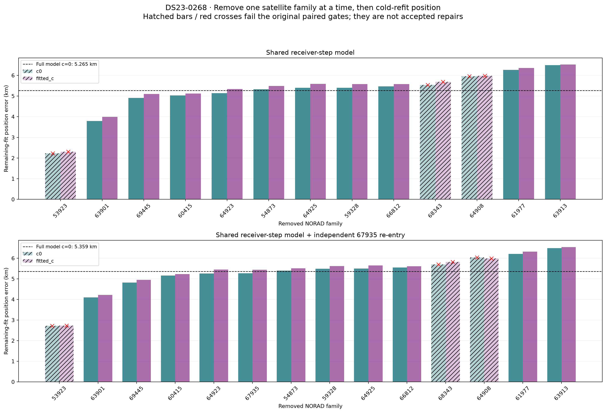
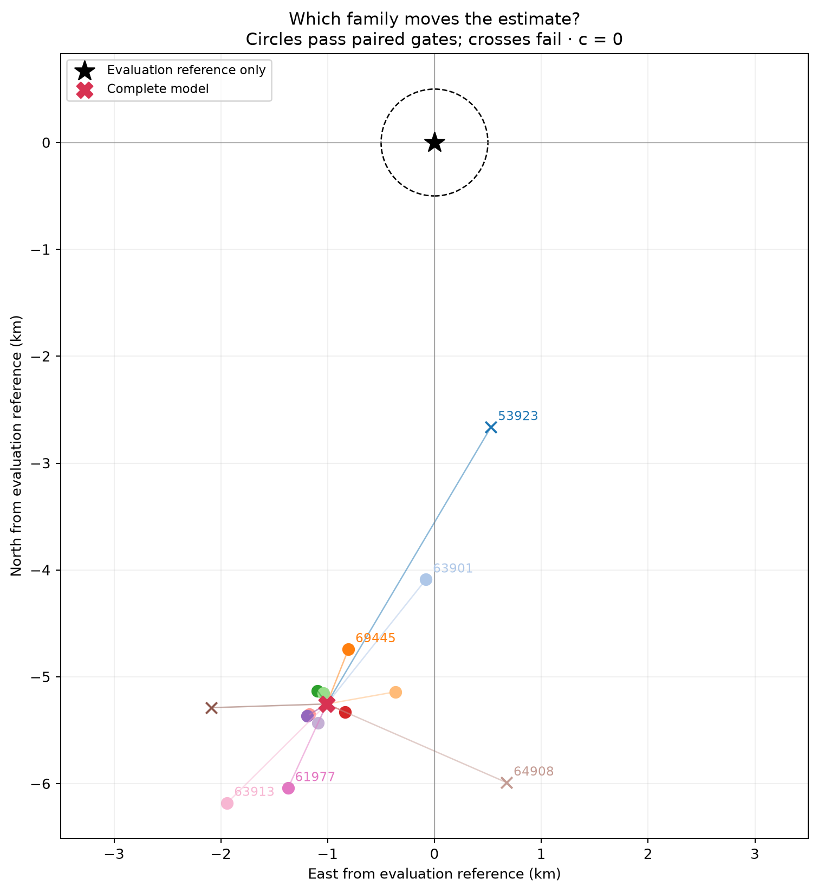
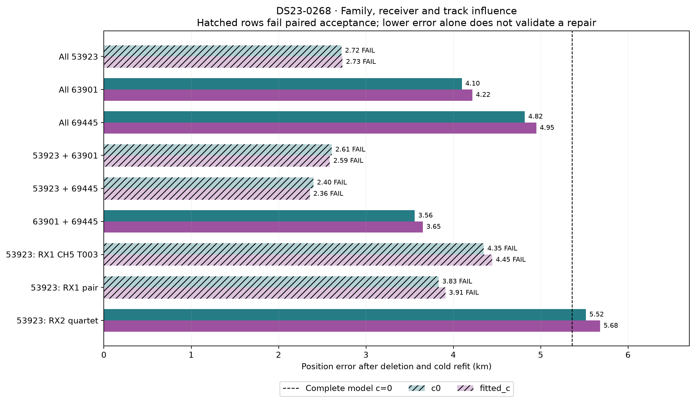
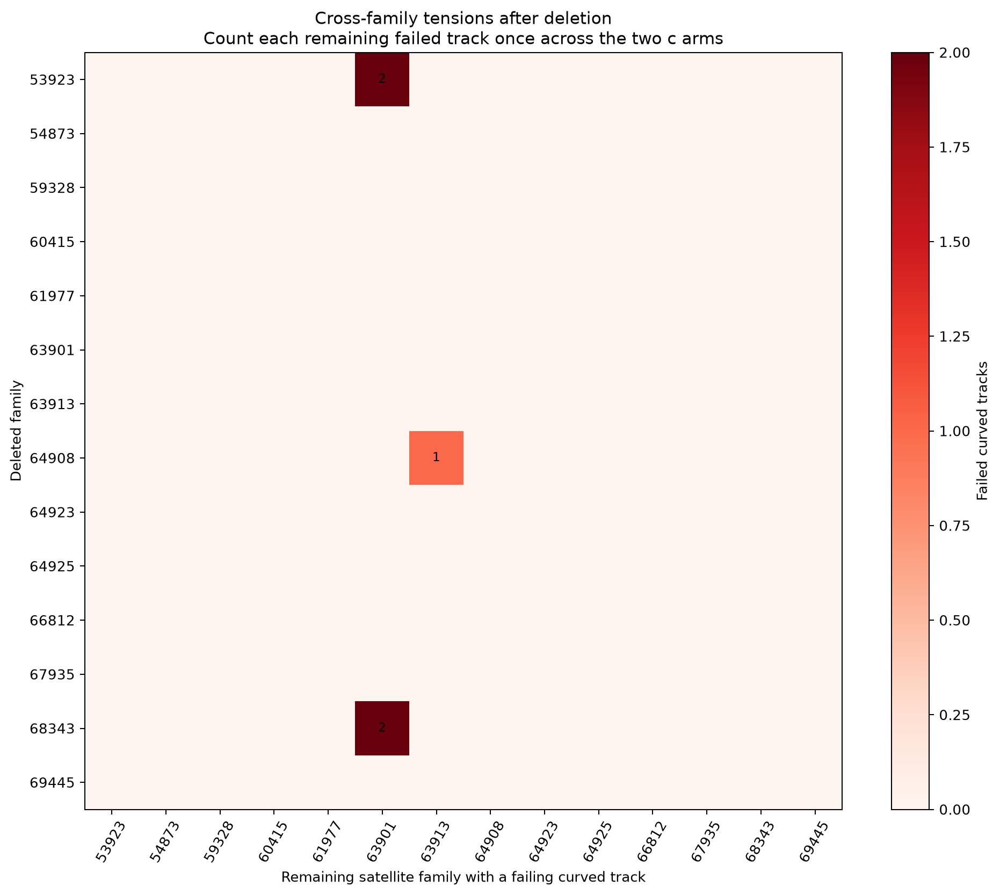

# DS23-0268: satellite-family influence after frequency-event repair

**Several satellite families pull the position estimate in conflicting directions; the poor position is not explained by the newly recovered long curve alone.** Removing family **53923** gives the largest single-family geographic change, but the remaining fit then fails the original gates. Removing **63901** and **69445** together passes the paired gates and reduces error from **5.359 / 5.485 km to 3.558 / 3.651 km** for `c=0` / fitted `c`, still well outside the desired accuracy.

This is a diagnosis of the [shared frequency-event prototype](../2026_10_20_ds23_frequency_events_v3/README.md), not a new accepted localization policy. A lower geographic error after deletion does not prove a wrong satellite identity. These selected deletions must not become a location-specific operational rule.

## What was tested

The main single-family experiment enumerates every family that contributes retained curved or predictive position observations, without using the reference position. It runs **27 matched paired deletions**: 13 families in the shared-receiver-step model and 14 in the receiver-step model with the independently screened 67935 re-entry. Each deletion removes all retained curved and predictive factors of the specified family.

A subsequent **13 paired follow-ups** investigate combinations and receiver/track blocks associated with the largest geographic influence. Those follow-up targets explicitly use geographic influence for diagnosis; they are not blind inference or an RF-only deletion-selection rule. Two additional paired controls retain all observations and replay a finite, previously RF-selected satellite-identity alternative.

All **40 paired deletion runs** completed without execution errors: **28 pass and 12 fail** the original paired gates. The 27 single-family runs took **84.09 seconds** and the 13 follow-ups **28.51 seconds**, using up to 24 single-thread workers. The two identity controls are additional and both fail.

Every refit starts cold at regional `(0,0)` within the same **25 × 25 km box centered at `(37.906, -122.545)`**, with five phase-refresh rounds and 48 position steps per round. Event time **108.5 seconds**, the **300 Hz Gaussian amplitude prior**, the remaining satellite labels and aliases, original support powers and the full original nuisance-coordinate design are retained. The event amplitude and remaining nuisance coefficients are refitted. Original predictive linear factors keep their shared covariance and do not calibrate the nuisance posterior at fixed position.

Both `c` arms use matched remaining measurements, labels, aliases, priors and search budgets. Satellite propagation and prior authority remain causal; no later TLE or surveyed position enters a fit. The reference coordinate is used only for geographic evaluation and the explicitly disclosed follow-up prioritization. No RF is collected and no new acquisition or exhaustive satellite-discovery run is performed.

Deleting measurements changes the likelihood normalization and evidence. **Raw fit losses across different deletion masks are not compared.** The original-powers and recomputed-support identity controls are separate experiments, and their losses must not be compared across powers.

## Single-family results

The receiver-step baseline has **1,757 curved + 211 predictive position observations** and geographic error **5.265 / 5.437 km**. With re-entry it has **1,828 curved + 211 predictive position observations** and error **5.359 / 5.485 km**. These position-factor counts differ from the full extended association totals, respectively **1,989** and **2,111** original GLRT winners.



Hatched bars and red crosses identify refits that fail the original paired gates. Their geographic errors are diagnostic trial values, not accepted fixes.

| Family removed, re-entry model | Error `c=0`, km | Error fitted `c`, km | Paired gates | Curved / predictive points removed |
|---|---:|---:|---|---:|
| None | 5.359 | 5.485 | Pass | 0 / 0 |
| 53923 | **2.720** | **2.731** | **Fail** | 309 / 59 |
| 63901 | 4.098 | 4.218 | Pass | 73 / 18 |
| 69445 | 4.818 | 4.950 | Pass | 82 / 8 |
| 60415 | 5.162 | 5.228 | Pass | 169 / 8 |
| 64923, including recovered target family | 5.257 | 5.450 | Pass | 252 / 33 |
| 67935, independent re-entry | 5.265 | 5.437 | Pass | 71 / 0 |
| 61977 | 6.206 | 6.320 | Pass | 84 / 41 |
| 63913 | 6.488 | 6.540 | Pass | 41 / 44 |

Family 53923 has the largest geographic influence, followed by 63901 and 69445. Several other families help hold the estimate nearer the reference: removing 61977 or 63913 makes the error worse. This is a coupled system of geometric and nuisance constraints rather than a count of independent good/bad votes.

Removing 67935 exactly restores the receiver-only baseline to reported precision. The added independent family therefore accounts for the modest change between the two repaired models, not the original several-kilometer bias. Removing 64923, the family containing the 82-point target, changes error only modestly. Recovering that curve was useful for association coverage, but is not the main cause of the bad location.



Lines connect the full-model endpoint to cold-refitted deletion endpoints; they are **influence vectors, not optimizer trajectories**. Circles pass paired gates and crosses fail. Geographic errors in the tables use geodesic distance; the visual axes use a local map approximation.

## Combined deletions and track/receiver localization

| Diagnostic deletion from re-entry model | Error `c=0`, km | Error fitted `c`, km | Paired gates |
|---|---:|---:|---|
| 63901 + 69445 | **3.558** | **3.651** | **Pass** |
| 53923 + 63901 | 2.610 | 2.587 | Fail |
| 53923 + 69445 | 2.399 | 2.357 | Fail |
| 53923 RX1 CH1 T005 + RX1 CH5 T003 | 3.833 | 3.910 | Fail |
| 53923 RX2 quartet | 5.517 | 5.680 | Pass |
| 53923 RX1 CH5 T003 alone | 4.350 | 4.446 | Fail |
| 53923 RX1 CH1 T005 alone | 5.250 | 5.371 | Pass |
| 63901 RX1 CH1 T002 alone | 4.204 | 4.294 | Fail |
| 63901 RX1 CH7 T001 alone | 5.545 | 5.667 | Fail |

The 53923 influence is concentrated in its **RX1 evidence**, especially **CH5 T003**, rather than its RX2 quartet. Its RX1 CH1 T005 spans **225.68–251.94 seconds** and RX1 CH5 T003 spans **225.15–258.86 seconds**. The influential RX1 curves across families 53923 and 63901 occupy approximately **217–276 seconds**, well after the repaired frequency step. Removing the RX2 quartet instead worsens the location. This narrows the next investigation to receiver/time support, family identity and orbit/calibration compatibility, but does not distinguish those causes by itself.

The 63901 fragments also constrain one another: deleting its CH1 curve makes the remaining CH7 curve fail, whereas deleting CH7 leaves CH1 **locally valid but without the required independent-owner support**. Deleting the whole family passes, but discards both constraints. Such a change is an influence diagnostic rather than independent confirmation that both measurements are wrong.



## Why the geographically best trials fail

After deleting 53923, **63901 RX1 CH7 T001** has genuine residual structure despite RMS of only **176.1 / 174.2 Hz**:

| CH7 residual statistic | `c=0` | Fitted `c` | Original limit |
|---|---:|---:|---:|
| Absolute slope statistic | 3.757 | 3.672 | ≤3 |
| Maximum step statistic | 4.723 | 4.679 | ≤4 |

The other flagged 63901 curve, **RX1 CH1 T002**, passes all six replayed local checks: profile RMS, fragment bias, profile-noise structure, conditional residuals, alias and visibility. Its final rejection is **support-only**, following the CH7 failure. The same distinction appears when CH7 alone is removed. A list of two failed tracks must therefore not be interpreted as two independent malformed residuals. See the [saved-endpoint gate/support audit](gate_support_audit.json).

Deleting 53923 and 63901 together removes that conflict, but the fitted-`c` arm then fails on **64908 RX1 CH3 T003**: quadratic BIC gain is **10.193**, just above the unchanged limit of **10**. That trial's 2.610 / 2.587 km error is therefore also invalid as a paired repair. No threshold is relaxed to accept the closer position.

## Same-observation identity controls

A previously RF-selected alternative moves **53923 RX1 CH1 T005 and RX1 CH5 T003 to 67953**, while retaining the RX2 53923 curves. Two controls apply that finite proposal to the repaired re-entry model, preserving every curved and predictive measurement. This is not a fresh exhaustive catalogue search.

| Control | Trial error `c=0`, km | Trial error fitted `c`, km | Paired gates |
|---|---:|---:|---|
| Original support powers, matched-mask identity change | 2.786 | 2.718 | **Fail** |
| Recomputed prior/support powers | 3.300 | 3.288 | **Fail** |

With original powers, the `c=0` full RF bound changes from **18,855.969 to 18,845.694**, and the fitted-`c` bound from **18,865.471 to 18,856.361**. This same-mask frequency-fit gain does not make the candidate acceptable: the 63901 CH7 conflict and predictive **RX1 CH4 T007** incompatibility remain, with CH1 also flagged through family support. Both controls are invalid. The recomputed-support objective uses different powers, so its raw score is not compared with the original-powers control or baseline. Neither closer position proves the proposed identities correct.



This matrix counts each remaining failing curved track once across the two `c` arms. It is not a matrix of identity errors and does not include every global policy gate.

## Interpretation

The successful frequency repair and the remaining position problem have different evidential roles. The step explains an otherwise rejected curve and increases associations. Family ablations show that several later constraints still disagree about location. Removing one influential family may expose incompatible residuals elsewhere, so the closest deletion endpoint cannot simply be accepted.

The parsimonious next diagnostic is to compare the influential RX1 late-time curves against the same families across receivers, inspect their joins and native GLRT evidence, and test specific shared calibration or causal orbit-error explanations. Satellite identity alternatives should compete on the same observations with explicit complexity penalties and unchanged gates. Receiver/time effects should be corroborated by independent curved families. Neither geographic improvement after deletion nor a lower in-sample RF residual supplies identity ground truth.

No deletion from this report is installed as an inference rule, no original ALGO02 definition changes, and no generalization claim is made from one debug scan.

## Numerical archive and reconstruction

- [All 80 arm-level deletion rows](ablation_metrics.csv) and [machine-readable evaluation](evaluation.json).
- [Original single-family protocol](protocol.json), [single-family execution receipts](singles_execution.json), [explicitly diagnostic follow-up requests](followup_request.json) and [follow-up execution receipts](followup_execution.json).
- [Detailed gate/support replay](gate_support_audit.json), [influential physical-track inventory](influential_track_inventory.json), [compact fit/gate receipts](fit_receipts.json) and [identity-control metrics](identity_controls.json).
- [Publication checksums/provenance](publication_manifest.json) and [link/numerical validation](link_validation.json).

The removal-mask/event/coverage/debug test suites pass **11 tests**:

```sh
env PYTHONPATH=src:tools OPENBLAS_NUM_THREADS=1 OMP_NUM_THREADS=1 \
  .venv/bin/python -m pytest -q \
  tests/analysis/test_ds23_event_satellite_ablation.py \
  tests/analysis/test_ds23_frequency_events.py \
  tests/analysis/test_ds23_algo01_coverage_tool.py \
  tests/analysis/test_dbg01_algo02_0268.py
```

The frozen **232-source ALGO02** verification also passes unchanged.

This compact archive records the measurement-removal counts, retained counts, paired validity, endpoints and event amplitudes for every deletion. It is a report archive rather than a self-contained executable release. Large per-fit posterior arrays and helper dependencies remain outside the publication.
