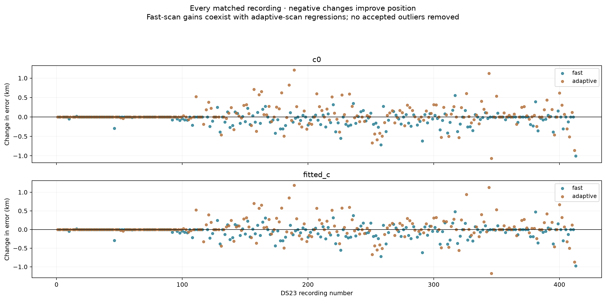
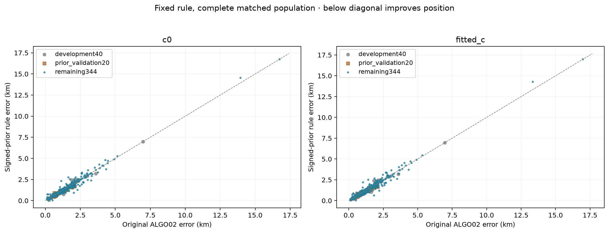
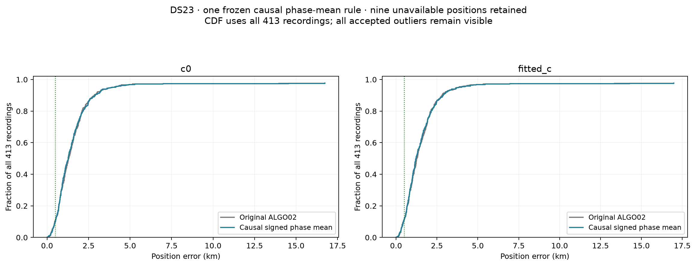
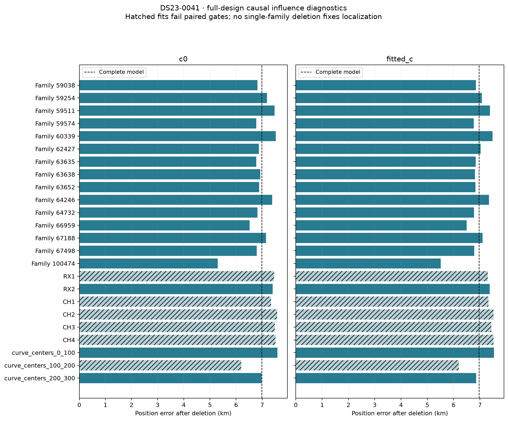
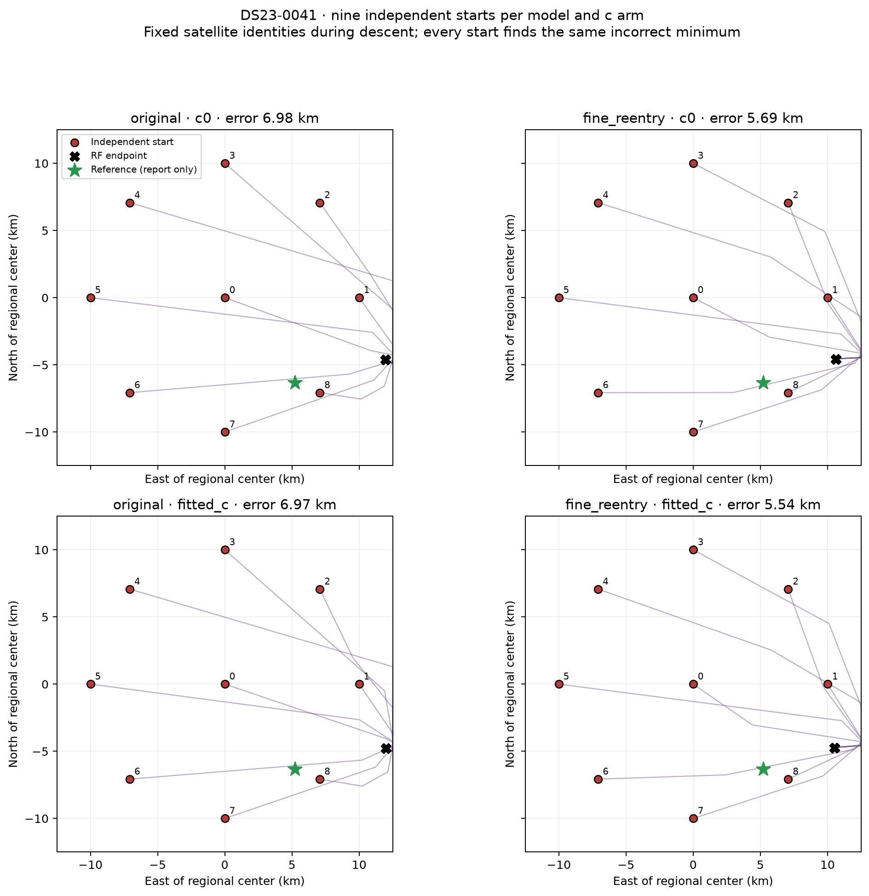

# DS23: causal signed phase priors, with modest and uneven position gains

The frozen prior correction improves mean and median error on all **404 qualified DS23 positions** and on the **344 recordings outside its two development checks**. The effect is small: fitted-`c` mean improves by **9.8 m**, and median by **60.7 m**. Fast scans improve more clearly; adaptive-scan mean error worsens. This is a limited same-site result, **not a new default ALGO03 or achievement of the 0.5 km objective**.

All 413 recordings remain in the coverage denominator. The same nine recordings that lack an accepted original ALGO02 position remain unavailable. No failed new trial, accepted outlier, or unfavorable `c` arm is removed.

| Subset | Arm | Positions / recordings | ALGO02 mean / median km | Signed-prior mean / median km |
|---|---|---:|---:|---:|
| All DS23 | `c=0` | 404 / 413 | 1.520 / 1.270 | **1.509 / 1.262** |
| All DS23 | fitted `c` | 404 / 413 | 1.508 / 1.249 | **1.498 / 1.188** |
| Remaining confirmation recordings | `c=0` | 344 / 344 | 1.562 / 1.332 | **1.558 / 1.288** |
| Remaining confirmation recordings | fitted `c` | 344 / 344 | 1.553 / 1.292 | **1.549 / 1.258** |
| Fast | `c=0` | 198 / 207 | 1.311 / 1.163 | **1.254 / 1.052** |
| Fast | fitted `c` | 198 / 207 | 1.311 / 1.147 | **1.254 / 1.065** |
| Adaptive | `c=0` | 206 / 206 | 1.720 / 1.474 | 1.755 / **1.405** |
| Adaptive | fitted `c` | 206 / 206 | 1.698 / 1.438 | 1.733 / **1.391** |



## Hypothesis and the exact model change

The existing history learner estimates a symmetric Student phase prior around a zero or shrunken phase forecast. Pre-scan TLE update innovations have a signed bias in several histories. The experiment tests whether learning its center improves inference while preserving the existing phase variance and tail law.

For each satellite, use the existing nominal phase scale `sigma`, age `a` at scan midpoint, scale multiplier `m`, and ordinary forecast mean `mu0`. The proposed center is

`mu = clip(mu0 + beta * h, -L, L)`, where `L = min(15 s, 3*sigma)`.

The four candidate features are `h = 1`, `sigma*m`, `a/(12 hours)`, or `(a/(12 hours))^2`. The standardized feature has a dimensionless coefficient; the other coefficients are in seconds. The zero correction is an explicit candidate. This changes a prior center, not the recording clock, receiver drift model, or measured CFO.

The learner uses **all regional-catalogue causal histories**, before consulting the current scan's selected satellite families. It never uses a scan's RF residuals, estimated position, or evaluation GPS to estimate `beta` or choose a feature.

1. Keep the original chronological split at the earliest 70% of TLE publication times. Exclude satellites with `NORAD mod 5 = 0` from fitting.
2. Fit each one-coefficient mean with the existing normalized Student/Gaussian historical density. Constrain `beta` to `[-3,3]`; minimize density cost plus `beta^2`.
3. Compare its criterion `cost + log(N) + 2*log(4) + beta^2` with the unchanged zero correction.
4. Require density improvements greater than `log(N)+2*log(4)` on both later publications and their satellite-disjoint subset. Each subset needs at least 30 transitions. No candidate is chosen using these validation targets.
5. Refit only the qualified feature on all pre-scan updates, using the existing full-history scale/tail parameters. The nested zero model can still win. Apply that center to the current scan's nominated families.
6. Cold-refit both `c` arms from `(0,0)` in the original 25×25 km box, with five phase-refresh rounds and 48 position steps per round. Require the original paired curved/predictive gates and phase convergence; otherwise retain the complete original ALGO02 policy.

The correction qualifies on **283/404** histories. **263/404** corrected position pairs pass all existing gates; 20 use the original position fallback. The other 121 histories use the exact original policy. No gate is relaxed and no gate-constrained position rescue is used.

The pre-scan TLE updates are prediction proxies, not orbit truth. The correction's density gain is not a satellite-identity probability or a calibrated position-confidence statement.

## What stayed controlled

The acquisition, GLRT observations, graph polynomials, satellite identities, alias integers, original masks, likelihood powers, fragment constants, receiver offsets/drifts/smooth model, phase scales/tails, and physical orbit modes stay fixed. Curved points alone calibrate the nuisance model; predictive tracks retain shared calibration covariance and make **zero** coefficient update at fixed position.

Every `c=0` / fitted-`c` comparison shares observations, candidate assignments, all other priors, and search budgets. This is a conditional prior ablation on frozen ALGO02 discovery results; **cold catalogue discovery is not rerun**. It does not demonstrate improved full-scan GLRT association or a new complete discovery pipeline.

The region remains centered at `(37.906,-122.545)`. The supplied reference `(37.849061591561885,-122.48574968092912)` enters only the reporter. No preceding scan's RF position, site-specific correction, or following TLE enters inference. The original causal-bank audit and source freeze remain applicable.

[ALGO02 reconstruction](../ALGO02/README.md) and [the full original DS23 evaluation](../2026_10_19_algo02_ds23_full/README.md) describe the unchanged stages from acquisition and GLRT through graph construction, discovery, calibration, and position.

## Confirmation sequence and limits of generalization

Forty previously examined recordings first show a modest mean/median improvement. A further 20 are drawn with seed `15485863` from 341 accepted recordings outside earlier position experiments identified by report artifacts. Their original ALGO02 results and a global FAI inventory were already available; they are not claimed to be a completely untouched corpus.

On that additional 20, both means improve by about 72–74 m, but both medians are unchanged. That misses its declared strict confirmation criterion. No coefficient, feature set, threshold, gate, or inference rule changes afterward.

The full 404-position run is then frozen, with the remaining 344 separately declared as confirmation. Its criterion requires lower mean **and** median in **both** `c` arms on both the full population and that remaining subset. It passes with zero execution failures. The remaining mean gains are only **4.2 m / 3.5 m**; they should not be overstated.

These are retrospective recordings from one assumed stationary site, with related TLE/RF errors. They establish a small within-site aggregate result, not statistical independence, an external-location accuracy guarantee, or universal improvement across capture formats.




## Frequency fit and position accuracy are separate results

| Quantity, averaged across the same 404 recordings | `c=0` before → after | Fitted `c` before → after |
|---|---:|---:|
| Conditional CFO RMS, Hz | 111.0470 → 111.0474 | 110.9909 → 110.9906 |
| Mean full RF marginal-objective gain | +0.9065 | +0.9138 |

RMS is a mean of per-recording RMS values, not a pooled per-point RMS. The objective includes the changed prior and is not a geographic accuracy score. All position comparisons use separately evaluated geodesic errors.

The limited gains coexist with adverse outcomes:

- Adaptive mean error increases by about **35–36 m**.
- P90 error worsens from **2.607→2.637 km** in `c=0`, and **2.675→2.682 km** with fitted `c`.
- The number below 0.5 km falls from **45→42** in `c=0`; fitted `c` stays **46/413**.
- In `c=0`, 143 recordings improve, 120 regress, and 141 remain unchanged. Fitted `c` has 145 improvements, 118 regressions, and 141 unchanged.
- Scan 189 worsens from **1.129→2.335 km** in `c=0`; scan 344 worsens from **1.638→2.761 km**. These accepted regressions remain in every aggregate.

The recommendation is to keep the published default unchanged while investigating why the same physically motivated prior has different consequences across formats and family assignments. This study does not validate a scan-number, receiver, or location exception.

## Scan 41: why more optimization or one deletion does not fix it

The largest error in the preceding 40-recording check is **6.979 / 6.966 km**. Its retained curved evidence consists of 514 points in 19 curves, plus 139 predictive points. The original conditional CFO RMS is about 66 Hz.

All single-family deletions and receiver/channel/time-block deletions are cold-refitted in both arms, retaining the complete original nuisance design and support priors. Removing family 100474 gives the best single-family result, **5.296 / 5.509 km**, so there is no demonstrated one-family repair. Receiver-only fits also remain poor; some deletion controls fail gates. Deletion scores on different observation masks are not compared as model evidence.



Offering the two longest unused original-nominee curves adds **114 points** for 68071. A finer receiver basis, normalized to the original average prior variance, makes all retained gates pass. Error becomes **5.687 / 5.544 km**. The other long unused family and the combined offer do not qualify. These are separate debug trials, not inserted into the full-corpus prior experiment.

Nine independent regional starts, at the box center and a 10 km circle, converge to the same incorrect solution for each fixed-association model and arm. Removing all predictive tracks instead gives **7.562 / 7.499 km**. The evidence points to a biased conditional model minimum; it does not establish that a specific satellite identity is wrong or that exhaustive reassociation could not help.



Local curved-only information has an RMS radius of about **1.74–1.75 km** with all nuisance quantities uncertain, versus **0.44–0.45 km** when phases are treated as known. These are conditional local information diagnostics, not calibrated error bars or achieved oracle algorithms. They exclude predictive information, Gamma uncertainty, and identity uncertainty.

The signed-mean rule does **not** qualify on scan 41's historical validation, so its full-corpus output remains the original result. No debug-specific recovery is silently substituted.

## Reproduction and numerical evidence

The [full protocol](protocol.json), [per-recording results](positions.csv), [summary](evaluation.json), [frequency summary](frequency_fit_summary.json), and [audit](evaluation_audit.json) retain all denominators and adverse outcomes. The [numerical archive](numerical_evidence.tar.xz) preserves the new trial values, with redundant baseline/policy copies removed according to its [reconstruction inventory](numerical_evidence_inventory.json). Original baseline records and input authorities are those already documented by the full ALGO02 report; IQ and large propagated banks are not duplicated.

The [source hash map](source_snapshot/sha256.json) preserves the same-repository import closure of the new inference, debug tools, reporter, and owned tests. Overlay it only in an isolated checkout with the checksum-bound local ALGO02 input authorities. The original ALGO02 freeze is unchanged. Snapshot imports include historical report helpers with GPS constants; the new inference never uses those constants.

```bash
env PYTHONPATH=/tmp/algo03-feasible-deps:src:tools OPENBLAS_NUM_THREADS=1 OMP_NUM_THREADS=1 \
  .venv/bin/python reports/2026_10_20_ds23_causal_phase_location_report/replay_all.py \
  --output-directory /tmp/ds23-signed-prior-replay --workers 20
```

The command needs SciPy; the temporary dependency directory is this host's existing installation, not a portable deployment requirement. Install the versions in [runtime versions](runtime_versions.json) in another environment. The [replay driver](replay_all.py) bypasses earlier trial caches and evaluates the complete population after replay. It requires a new output directory. `--case DS23-0041` instead performs a single-record smoke replay without population evaluation. Prepared original ALGO02 observation, tracking, bank, and causal-history authorities remain necessary.

[Validation](validation.json) records 21 passing workspace tests, seven passing tests against the source snapshot, a null replay on scan 41, a qualified correction replay on scan 257, and reconstruction of all 404 archived trials back to the published position table. Both smoke replays match prior selection and both `c`-arm positions. The original 232-file ALGO02 freeze also verifies unchanged.

No new RF collection or IQ campaign was run. **The full DS23 0.5 km mean-and-median goal remains unmet.**
