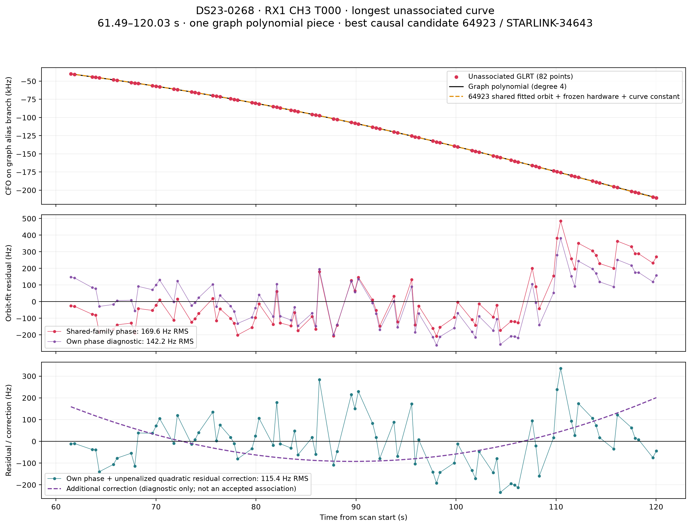
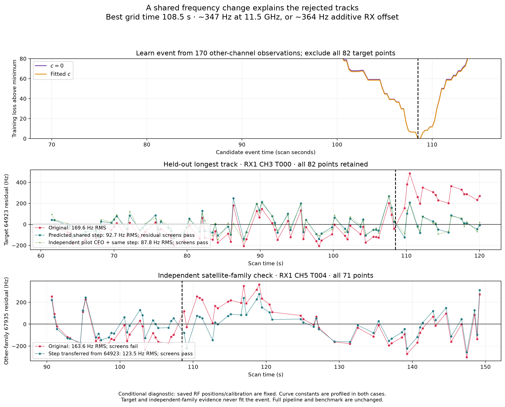
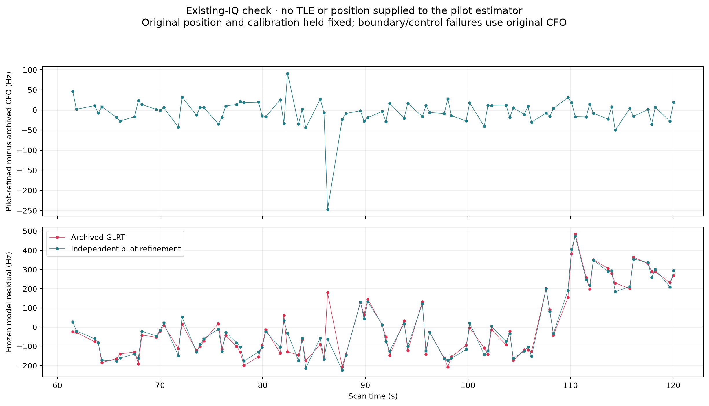
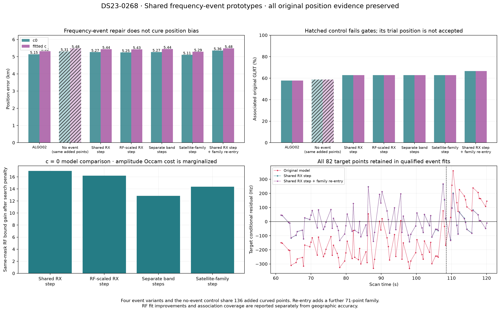
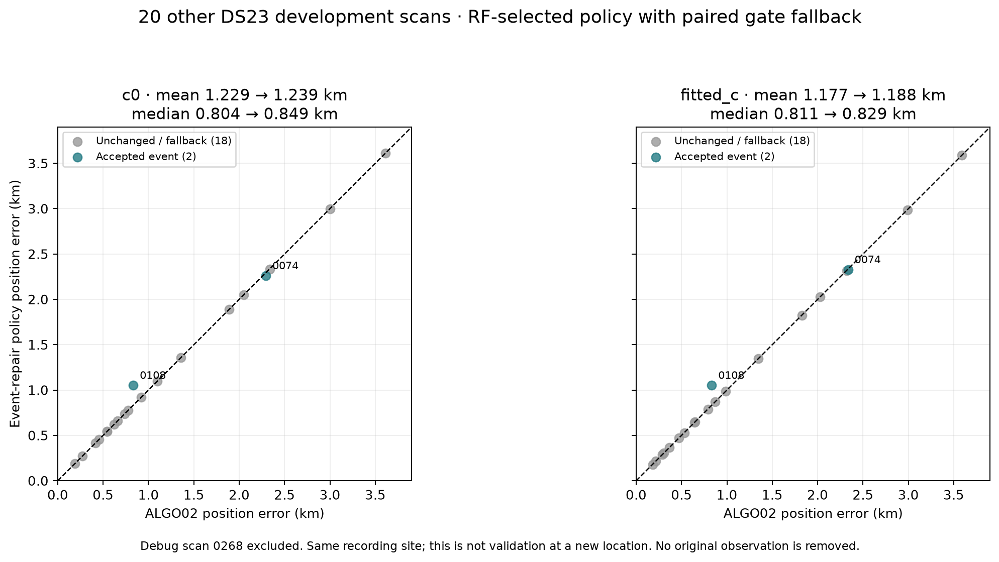

# DS23 shared frequency-event experiments

**A small shared frequency step recovers a long rejected satellite curve, but does not yet improve localization reliably.** The four tested event models retain all 82 points of the longest unassociated curve in DS23-0268 and pass the original joint-fit gates. The preferred RF model raises associated coverage from **57.88% to 62.84%**, while position error changes from **5.146 / 5.319 km to 5.265 / 5.437 km** for `c=0` / fitted `c`. A separate family re-entry experiment reaches **66.70%** coverage, also without improving position.

The conservative receiver-step policy was then tested on 20 other DS23 development scans. Two repairs passed; one improved position and one worsened it. Both mean and median position error increased slightly. These results are an association-repair prototype, **not a replacement for [ALGO02](../ALGO02/README.md) or an ALGO03 localization improvement**.

This report documents experiments completed October 19, 2026, Pacific time. Artifact paths use the following UTC date. The existing acquisition and GLRT outputs were reused; no new RF was collected.

## Why the long curve was missing

DS23-0268 contains **3,165 original winning GLRT observations**. Its longest wholly unassociated graph curve is **RX1 CH3 T000**, with **82 points from 61.486 to 120.026 seconds**, spanning 58.539 seconds. It is one graph piece, with a maximum internal measurement gap of 1.774 seconds.

The strongest candidate in the **1,402-satellite causal catalogue** is **64923 / STARLINK-34643**. The earlier pipeline had already nominated that satellite: whole-track residual gates rejected the curve, and ALGO02 inherited its empty retained mask. The final frozen-calibration extension also rejected its structured residuals. This was therefore a model-compatibility failure after nomination, rather than failure to include that satellite in the catalogue. The candidate is strongly supported by the frequency evidence, but is not independent identity ground truth.



[Twenty-second GLRT zooms](evidence/twenty_second_segments.png) show the physical measurements used to examine the curve by eye.

An approximately **350–365 Hz frequency change near 108.5 seconds** is not represented by the original constant, linear and smooth calibration coordinates. The preceding diagnosis estimated the step from **170 points on six other-channel components**, excluding all 82 target observations. This held-out prediction reduced target RMS from **169.59 to 92.65 Hz** with `c=0` and **168.33 to 92.63 Hz** with fitted `c`; all target observations then passed the original profile association screens. Those conditional diagnostics preceded the joint position experiments below and are not themselves position estimates.

The correction also improved a separate **67935** curve on RX1 CH5. Of the 64923-family measurements after the proposed event, **42 existed and zero were originally retained**, leaving the calibration with no retained evidence of that family's post-event change.



Independent refinement of the existing saved IQ with known pilots preserved the discrepancy; applying the same step yielded target RMS **87.82 / 87.80 Hz**. This supports a real shared discrepancy rather than a polynomial artifact, but does not identify its hardware source.



Only **one RX2 original GLRT winner** lies between 100 and 120 seconds, and no retained RX2 curve spans the event. The available evidence cannot distinguish an RX1 LNB/LO disturbance from a common timing/reference disturbance, nor uniquely identify receiver versus satellite-family event types.

## Four event models and controls

For proposed change time `tau`, append a Gaussian amplitude coordinate multiplying the appropriate indicator `1[t >= tau]`. Every amplitude has a **zero-mean 300 Hz prior standard deviation**. RF-scaled amplitudes are defined at **11.5 GHz**. Existing physical nuisance-coordinate slots and their priors are preserved.

| Model | Added event design | Amplitude coordinates in DS23-0268 |
|---|---|---:|
| Shared receiver step | One additive Hz step for the selected receiver | 1 |
| RF-scaled receiver step | Selected-receiver step multiplied by `RF / 11.5 GHz` | 1 |
| Separate band steps | Independent selected-receiver amplitudes for channels 1–4 and 5–8 | 2 |
| Satellite-family step | RF-scaled step for each nominated family spanning the event, shared across receivers | 1 here |
| No-event control | Same additional observations with no event coordinate | 0 |

The time is searched rather than fixed in advance. Amplitude uncertainty and its complexity cost are integrated in the full model; a separate penalty covers the time/model search. A targeted **receiver-step + family re-entry** follow-up adds the independently checked 71-point 67935 curve. That follow-up has a different observation mask, so its raw bound is not ranked against the four matched-mask event variants.

The earlier held-out diagnostic excluded the target while estimating the event. The subsequent joint fits deliberately use all offered observations, including the target, and should not be described as held-out validation.

## RF-only discovery, fitting and acceptance

1. Reuse frozen scan observations, alias-aware graph tracks, original satellite nominations and aliases, noise models and **strictly causal TLE authority**. Both TLE epoch and catalogue availability must precede the scan cutoff. Neither a surveyed position nor a post-observation TLE enters event selection or fitting. This experiment does **not** rerun acquisition or cold satellite discovery; existing nominations are proposals, not confirmed identities.
2. Choose the longest wholly unassociated graph curve by its original observation IDs. Its receiver and time extent define the focus. The generic detector does not hard-code a receiver number, event time or satellite ID.
3. Screen curved nomination residuals using at least **12 points**, duration at least **10 seconds**, profile RMS at most **750 Hz**, absolute fragment bias at most **3,000 Hz**, and nonnegative elevation. A time proposal needs at least **two channels**, each with at least **three observations on either side**. Project per-curve weighted constants and linear trends out for proposal discovery only; this prevents unrelated offsets or smooth slopes from alone nominating a jump. The final calibration fit retains its original priors.
4. Evaluate times from **10 to 290 seconds in 2-second steps**, then refine a local proposal with **0.25-second spacing**. Search both receivers, but select the focus curve's receiver and a time strictly within that curve's span. The search penalty is `2 log(max(282, tested_times) × 4)`; on DS23-0268 it is **14.0564 bound units**. The focused detector rediscovers **108.5 seconds** and offers **136 additional curved observations**.
5. Append event coordinates to the original Gaussian nuisance design. Preserve every original position-evidence observation, original aliases, noise and other priors. Original predictive linear observations retain the **full shared calibration/event covariance**; they do not enter the calibration normal equations. Calibration coefficients therefore remain learned from active curved evidence at a fixed position.
6. For each variant and each `c` arm, fit cold from regional `(0,0)` in the **25 × 25 km box centered at `(37.906, -122.545)`**. Use five phase-refresh rounds, with up to 48 position steps each. The `c=0` and fitted-`c` arms have matched observations, candidates, aliases, priors and budgets except for the coefficient under ablation.
7. Require every original profile, conditional residual, alias, visibility, support and phase-convergence gate in **both** arms. Compare event models only on the same observation mask, using the full **`c=0` RF bound plus search penalty**. Geographic error never selects the event, model or accepted policy branch. The reference coordinate `(37.849061591561885, -122.48574968092912)` is used only by the reporting stage to calculate geodesic error.
8. Count association coverage from **unique original winning observation IDs** after the full frozen-calibration graph extension. These totals include output associations beyond the selected position factors; they are not merely curved-plus-predictive position-evidence counts. Polynomial interpolation is never counted as another measurement.

## DS23-0268 joint-fit results

| Method | Associated GLRT points | % of 3,165 winners | Associated tracks | Error `c=0`, km | Error fitted `c`, km | Target RMS `c=0`, Hz |
|---|---:|---:|---:|---:|---:|---:|
| ALGO02 baseline | 1,832 | 57.88% | 51 | 5.146 | 5.319 | — |
| Shared receiver step | 1,989 | 62.84% | 55 | 5.265 | 5.437 | 92.5 |
| RF-scaled receiver step | 1,989 | 62.84% | 55 | 5.249 | 5.426 | 92.8 |
| Separate band steps | 1,989 | 62.84% | 55 | 5.274 | 5.445 | 92.3 |
| Satellite-family step | 1,989 | 62.84% | 55 | 5.112 | 5.286 | 92.9 |
| Receiver step + family re-entry | 2,111 | 66.70% | 59 | 5.359 | 5.485 | 92.4 |

All event rows pass the complete paired gates and preserve the original position data. Each event model retains the entire **82-point target**. Adding 136 curved observations produces **157 additional final associated observations**, because the final graph extension can qualify further tracks. Adding the separate 71-point re-entry curve produces another **122 final associations**. Calibration/position additions and final association additions are therefore different counts.

The matched no-event control fails **three curves, including the target**, and has **no accepted policy position**. Its trial errors are 5.311 / 5.484 km and trial target RMS is about 120 Hz; a small RMS alone is insufficient when residual structure fails. Its trial coverage is not an accepted policy result.

| Matched event model | `c=0` RF-bound gain over null | Gain after time/model-search penalty |
|---|---:|---:|
| Shared receiver step | **31.029** | **16.973** |
| RF-scaled receiver step | 30.238 | 16.182 |
| Separate band steps | 26.915 | 12.859 |
| Satellite-family step | 28.418 | 14.362 |

Higher gain is better. These are full marginalized RF comparisons on the same observations, not geographic accuracy measures. The additive receiver model wins the RF comparison; the family model's slightly lower geographic error is not used to choose it. Extra band amplitudes do not demonstrate a benefit here.



## Twenty other DS23 development scans

Run the same automatic focused detector and the single additive receiver model on the previous **20 development scans**, excluding DS23-0268. Fix the 300 Hz event prior and thresholds before evaluating their geographic errors. Accept a repair only if its same-mask `c=0` gain exceeds the search penalty and both arms pass every original gate; otherwise retain the original ALGO02 endpoint. All 20 scans remain in the reported denominator.

The cohort completed with **20 workers in 75.32 seconds**. These are existing development scans at the same recording site, not an untouched external-location validation or a full DS23 rerun.

| Arm | Accepted / evaluated | Mean error before → after, km | Median error before → after, km | Additional associated GLRT points |
|---|---:|---:|---:|---:|
| `c=0` | 2 / 20 | 1.229364 → 1.238700 | 0.804031 → 0.848772 | +140 |
| Fitted `c` | 2 / 20 | 1.177412 → 1.188002 | 0.811116 → 0.828731 | +173 |

Mean per-scan coverage changes from **70.358% to 70.552%** with `c=0`, and **70.282% to 70.525%** with fitted `c`. These are unweighted means of scan percentages, not a pooled point percentage.

| Accepted repair | Arm | Error before → after, km | Associated points before → after |
|---|---|---:|---:|
| DS23-0074 | `c=0` | 2.294 → 2.261 | 2,705 → 2,738 |
| DS23-0074 | Fitted `c` | 2.336 → 2.328 | 2,672 → 2,738 |
| DS23-0108 | `c=0` | 0.833 → 1.053 | 2,782 → 2,889 |
| DS23-0108 | Fitted `c` | 0.833 → 1.052 | 2,782 → 2,889 |

The other 18 scans retain ALGO02. Some rejected proposals have large RF gains but fail the paired gates; lower fit loss does not override those failures.



## Interpretation and next experiment

The shared-step model repairs a specific representation failure: an otherwise plausible orbit curve is rejected because a shared abrupt frequency change cannot be represented by the original smooth calibration. It gains associations without discarding the old position evidence. It does **not** resolve the remaining position bias, and the controlled cohort gives no basis for promoting this policy as a localization improvement.

Keep the single additive receiver-step model as the simplest association-repair candidate. Require corroboration across independent curved satellite families before making it a general calibration feature; this focused prototype's automatic discovery requires multiple channels, which need not imply independent satellites. Investigate satellite-family and track influence on position separately. Additional band parameters are not justified by this case. Sparse RX2 evidence prevents a physical-source attribution.

The prototype considers one event focused on the longest unassociated curve. It is not a complete multiple-change model and cannot establish how frequently such repairs are needed across all DS23 scans or at new sites. The family re-entry follow-up is targeted to this debug case's existing independent transfer audit, rather than a new blind catalogue search.

## Verification and archived evidence

The original endpoint RF objective replays exactly in both arms. Appending a zero-scale event changes the objective by only **−5.09 × 10⁻¹¹ / −1.27 × 10⁻¹⁰**. The experiment checks that predictive linear factors leave the curved calibration posterior unchanged at fixed position. The frozen ALGO02 source verification remains separate from these experimental helpers; no published contracts, golden fixtures or ALGO02 definition are changed.

For this report publication, the following exact focused test command passed **eight tests**:

```sh
env PYTHONPATH=src:tools OPENBLAS_NUM_THREADS=1 OMP_NUM_THREADS=1 \
  .venv/bin/python -m pytest -q \
  tests/analysis/test_ds23_frequency_events.py \
  tests/analysis/test_ds23_predictive_linear_tool.py
```

The original development command was also repeated and passed **nine tests**:

```sh
env PYTHONPATH=src:tools OPENBLAS_NUM_THREADS=1 OMP_NUM_THREADS=1 \
  .venv/bin/python -m pytest -q \
  tests/analysis/test_ds23_frequency_events.py \
  tests/analysis/test_ds23_algo01_coverage_tool.py \
  tests/analysis/test_dbg01_algo02_0268.py
```

Archived artifacts:

- [Exact debug-case comparisons](debug_case_comparison.csv), [all 20 cohort results](cohort_comparison.csv) and [machine-readable evaluation](evaluation.json).
- [Cohort protocol](cohort_protocol.json) and [terminal execution receipts](cohort_execution.json).
- [Original and zero-scale endpoint replays](DS23-0268/replay.json).
- [Earlier conditional-diagnostic summary](evidence/summary.json), [event support inventory](evidence/event_support.json) and [sparse RX2 control inventory](evidence/RX2_controls.json). The summary predates the joint fits and correctly states that position had not yet been updated at that stage.
- [Original HTML presentation](report.html), preserved as generated, and [publication checksums/provenance](publication_manifest.json).

This is a compact report archive, not a self-contained executable release. It deliberately excludes raw IQ, the 25 MB analysis panel, large per-case arrays and incomplete helper dependency bundles. Earlier v1/v2 proposal experiments are superseded and excluded from the reported evaluation.
