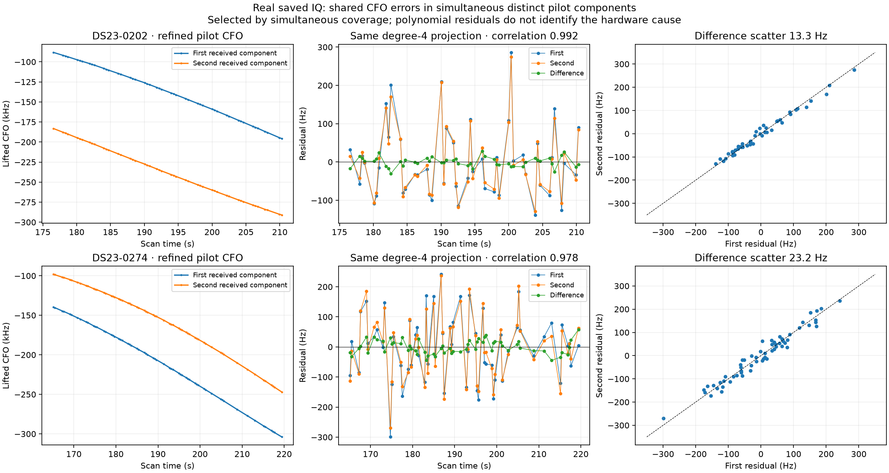
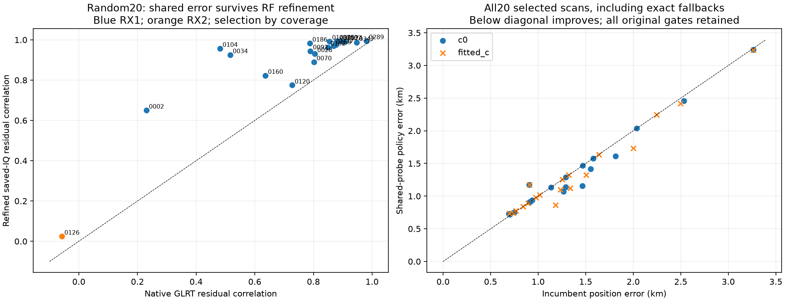
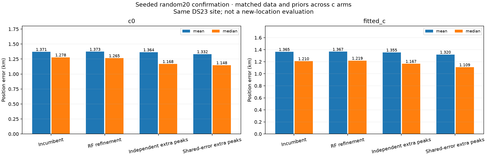

# Simultaneous pilot components: shared frequency error and a positive DS23 confirmation

The same receiver can receive two distinct pilot components during one probe. Their frequency errors often move together. Retaining both components and accounting for this shared error gives a more precise frequency-difference measurement than treating them independently.

On **20 seeded random additional DS23 fast scans**, the prototype reduces fitted-`c` mean position error from **1.365 to 1.320 km** and median from **1.210 to 1.109 km**. The comparison includes every selected scan and exact incumbent fallbacks. Both `c=0` and fitted-`c` improve. This is a modest positive result on other scans at the same site, **not a completed ALGO03, a full-DS23 result, or evidence of 0.5 km accuracy**.

## Hypothesis and RF evidence

Exclusive ownership of a probe can hide an additional received component. The new RF screen instead gives exclusive ownership to each peak, allowing two different paths to use the same probe. A simultaneous frequency difference can cancel receiver/probe error that otherwise appears as approximately independent scatter in the original track likelihood.

The discovery stage uses all public native peaks passing the existing fractional-margin gate. It uses the existing graph configuration, 1,200 polynomial proposal trials per receiver/channel lane, degrees up to four, and the existing residual screens. Aliases use the physical pilot period **227,272.727 Hz**. CFO separation, distinct epochs, active relative curvature and rejection of affine frequency images help distinguish different received components from aliases or simple instrumental copies. A positive residual correlation, interleaved agreement and time-shuffle controls are diagnostic screens; their ranks are not calibrated probabilities after path selection and multiple comparisons.

The largest geometry-qualified simultaneous pair in each scan is selected by probe count, independently of its residual correlation, position error or satellite nomination. This deliberately preserves negative controls.

Saved-IQ refinement then fits CFO, epoch and code rate separately for each component. A joint two-component channel model must improve conditional held-out-symbol prediction over either single component and beat equal-dimensional rolled-sequence controls in both symbol folds. Training designs must have full rank and adequate singular values, and RF fits must be interior. CFO/epoch/rate use the full probe; channel gains use the opposite symbol parity. These are conditional RF diagnostics, not an unbiased validation of every fitted RF parameter or proof of satellite identity.

| Discovery scan | Supported paired probes | First residual SD | Second residual SD | Correlation | Difference SD |
|---|---:|---:|---:|---:|---:|
| DS23-0202 | 47 / 47 | 98.55 Hz | 93.24 Hz | 0.992 | **13.31 Hz** |
| DS23-0274 | 60 / 62 | 112.54 Hz | 110.70 Hz | 0.978 | **23.23 Hz** |

The SDs use the same degree-four projection on matched times, with polynomial degrees of freedom removed. They characterize measured high-frequency residuals; they do not measure absolute Doppler accuracy or establish the physical hardware cause.



The random confirmation selects 20 other available fast scans using seed `20261022`, before inspecting their RF correlation or position errors. All 320 receiver/channel lanes finish. The selected pairs contain 830 probes; **819 support both components** in the conditional IQ test. Their median refined residual correlation is **0.967**. The selected RX2 control has correlation **0.025**, while the selected RX1 pairs range from approximately 0.650 to 0.995. Shared error is therefore common in these RX1 data, not a universal assumption about every receiver or probe.



## Position model

Each scan starts at the existing regional centre `(37.906, -122.545)` in a **25 × 25 km** box. The evaluation GPS coordinate enters only the separate reporter. TLEs and the existing historical phase priors retain their causal epoch/collection cutoffs; there are no post-scan TLEs, satellite whitelists or cross-scan RF position priors.

1. Refine an original winning CFO only when it matches exactly one of the tested native components modulo the physical alias period. Preserve its original alias, physical identity, membership and declared noise. Never replace a third component with one of the selected pair.
2. Nominate the pair using the entire visible causal catalogue, considering both ordered satellite assignments. The proposal fits two causal phase tangents and a regularized relative constant. The top nomination must agree at the regional centre and the current RF-only incumbent position. This is a proposal screen; it omits physical orbit modes and does not certify identity.
3. Offer a secondary peak only when its simultaneous original winner is an active curved observation with the nominated primary label. The secondary family must already have original curved support. Give the secondary peak a separate research identity. Freeze its alias using the refined-control `c=0` fit and reuse it in both `c` arms.
4. Keep every original observation and nuisance prior. Add one independent **300 Hz** fragment-bias prior for each new secondary fragment. New observations enter prediction only: they do not update calibration coefficients at a fixed position. All original predictive tracks and new observations are integrated together, carrying the full covariance of the original curved-data calibration.
5. Run five phase-refresh rounds, each with up to 48 position iterations, from the same regional start. Preserve every original curved and predictive gate and the phase limits. Accept only a pair passing both `c` arms. Otherwise return the exact original signed-prior incumbent, without deleting observations or relaxing gates.

For the simultaneous RF residuals, let `v = (s1² + s2²)/2` and let `g` be their measured covariance, clipped to `[0, v − 5²]` Hz². Equal common-frequency loading gives:

```text
kappa = g / v
conditional_sigma = sqrt(v * (1 - kappa²))

new_value    = y_secondary - kappa * y_original
new_mean     = m_secondary - kappa * m_original
new_features = U_secondary - kappa * U_original
```

Transforming values, physical means and nuisance features together avoids simply subtracting a fitted polynomial from another track. The ideal matched Gaussian conditional factor does not count the original point twice. The existing unseen-Gamma variance factor of two remains in the predictive block.

**Approximation:** the original model uses a powered Gaussian/Gamma bound with its original observation uncertainties, whereas the new conditional factor uses RF-estimated covariance. Their combination is a modular predictive approximation, not a fully calibrated joint sampling density or posterior probability. The reported gains are measured position errors, not an inference from a better in-sample score.

## Controlled results

The discovery scans improved before the random confirmation was run:

| Scan | Incumbent fitted-`c` | Refined original CFO only | Independent extra peaks | Shared-error extra peaks |
|---|---:|---:|---:|---:|
| DS23-0202 | 2.913 km | 2.911 km | 2.891 km | **2.834 km** |
| DS23-0274 | 1.161 km | 1.145 km | 1.134 km | **1.010 km** |

The **20-scan random confirmation**, including every fallback:

| Method | `c=0` mean | `c=0` median | Fitted-`c` mean | Fitted-`c` median | Paired accepted / 20 |
|---|---:|---:|---:|---:|---:|
| Original signed-prior incumbent | 1.371 km | 1.278 km | 1.365 km | 1.210 km | 20 |
| Original CFO refinement only | 1.373 km | 1.265 km | 1.367 km | 1.219 km | 16 |
| Independent extra peaks | 1.364 km | 1.168 km | 1.355 km | 1.167 km | 12 |
| **Shared-error extra peaks** | **1.332 km** | **1.148 km** | **1.320 km** | **1.109 km** | 10 |

All methods use matched observations, nominations, priors and search budgets across the two `c` arms. Independent and shared-error additions use the same added measurements and aliases. Their only intended likelihood change is the same-probe covariance transformation and resulting conditional variance. Lower objectives across different observation sets are not compared as evidence of better localization.



For the shared-error policy, **seven scans improve, three worsen and ten retain the exact incumbent**, in both `c` arms. Thus the result is positive in aggregate, not uniformly beneficial. Fitted-`c` improvements include scan 337 (1.185 → 0.865 km), 92 (2.002 → 1.733 km), 347 (1.338 → 1.121 km), and 375 (1.504 → 1.325 km). The largest regression is the RX2 negative control, scan 126 (0.908 → 1.175 km); its RF residual correlation is only 0.025, so the prototype adds nearly independent evidence there. This motivates a future RF-based eligibility rule, but no such rule was retrofitted into the confirmation table.

The trials offer 520 new secondary measurements across the 20 scans. These are **additional native peaks**, not extra original winning GLRT points. The existing original-GLRT denominator is unchanged; no association-percentage increase is inferred by mixing those denominators.

## Rejections and remaining work

Six complete shared-error trials fail an unchanged paired gate: scans 307, 124, 186, 2 and 102 fail a new predictive-fragment gate in at least one arm; scan 289 fails an original curved-track gate. They retain the incumbent.

Four other cases also retain the incumbent. Scan 34 has an unstable top pair nomination; scan 160 nominates a secondary family lacking the required original curved support. Scans 120 and 70 produce no eligible new fragment with sufficient active curved anchors; the current prototype raises an empty-array error at alias construction rather than returning a structured no-offer result. These are recorded failures, included in the denominator, not successful fits. The reporting policy returns the exact incumbent for them.

Endpoint replay checks all 16 discovery and 128 completed-confirmation method/arm endpoints, including objective values, compatibility decisions and unchanged calibration means at fixed position. Four unavailable confirmation trials retain their separately hash-bound incumbents. The focused helper tests pass (18 tests), and the original ALGO02 scientific source freeze remains verified. Saved IQ and original source recordings are not included in this publication.

The next useful experiments are a separately frozen RF eligibility rule tested on other scans, investigation of the new predictive-gate failures, and using more simultaneous evidence across the scan. A future joint covariance model should distinguish new genuinely curved calibration evidence from linear predictive evidence and retain the original no-linear-calibration rule. The present result supports shared-error cancellation as one ingredient of ALGO03; it does not resolve the remaining kilometre-scale uncertainty.

## Data and provenance

- [All discovery and confirmation method/arm positions, failures and frequency RMS](positions.csv)
- [Random confirmation frequency statistics](frequency.csv)
- [Selection, controlled statistics, per-case gates, protocol and source hashes](evidence.json)

The random set is another subset of the same DS23 stationary-site dataset. It is not a new-location evaluation. The full 410-available-scan signed-prior benchmark remains mean **1.498 km**, median **1.185 km** with fitted `c`; the new shared-error method has not yet been evaluated over that population. The requested full-DS23 mean/median target of **0.5 km** remains unmet.
