# DS23 DBG01 iteration 001: calibration uncertainty and active orbital support

This iteration builds on the existing ALGO02 graph/phase-refreshed engine and
the current ALGO03 conditional-family research approach. It recovers additional
original GLRT observations in the two worst available scans, without removing
their existing observations or relaxing residual gates. Position errors improve
but remain large. **This is a bounded debug iteration, not a new ALGO release.**

The current full-DS23 reference remains the
[410-scan family-replacement assessment](../2026_10_22_ds23_family_cavity_full_assessment/README.md):
fitted-c mean **1.469461 km**, median **1.178102 km**, with three unavailable
members of the 413-scan manifest. The prototypes below have not been evaluated
across that population. They do not establish progress toward 0.5 km on the full
dataset, new sites, or a moving receiver.

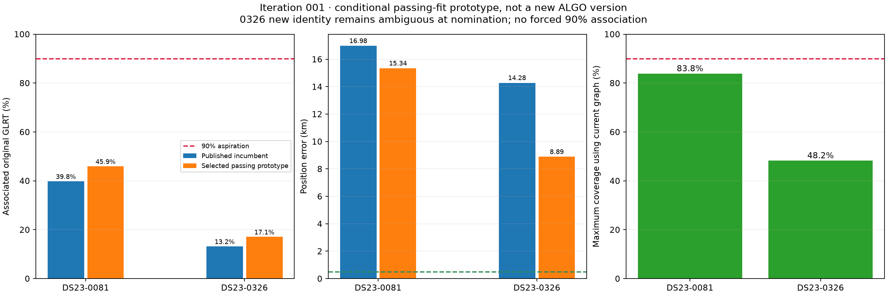

## Selection and controlled results

Scans **0081 and 0326** were the two largest fitted-c errors in the published
equal-assignment-prior benchmark. GPS determines debug priority and report
accuracy only. Inference retains the original **25 × 25 km** box centered at
**37.906, -122.545**, causal catalogue, hardware geometry and physical priors.
Every final prototype starts at the regional center. The evaluation coordinate
is **37.849061591561885, -122.48574968092912**; it is not an initialization,
satellite selector, prior center, fit target, or prototype acceptance criterion.

Both c arms use the same observations, candidates, other priors and search
budgets. Curved evidence can calibrate nuisance terms; linear fragments remain
predictive evidence. All original curved and predictive observations return to
the final fit. Counts below are unique original winning GLRT measurement IDs;
interpolated polynomial samples and alternative peaks are not counted.

| Scan | Method | Associated / all GLRT | Associated % | Error c=0 km | Error fitted-c km | Curved RMS c=0 / fitted-c Hz |
| --- | --- | ---: | ---: | ---: | ---: | ---: |
| 0081 | Published incumbent | 630 / 1,583 | 39.80% | 16.732 | 16.980 | 55.99 / 56.21 |
| 0081 | Covariance-aware single-curve reentry | 677 / 1,583 | 42.77% | 16.081 | 16.290 | 59.51 / 59.72 |
| 0081 | Reentry with active orbital support | **727 / 1,583** | **45.93%** | **15.418** | **15.343** | 57.27 / 57.23 |
| 0326 | Published incumbent | 71 / 539 | 13.17% | 14.550 | 14.282 | 228.89 / 229.16 |
| 0326 | Covariance-aware single-curve reentry | **92 / 539** | **17.07%** | **9.761** | **8.889** | 204.72 / 207.96 |

Association percentages are identical between c arms for these selected fits.
0081 retains its 37 predictive points and increases curved points 593→690.
0326 increases curved points 71→92 and has no predictive points. All original
points are preserved. **All selected endpoints remain on the eastern box
boundary.** More association has not resolved the main localization failure.
RMS is reported separately: the 0081 prototype improves position while increasing
its aggregate RMS slightly, because the observation set has grown.

[Exact position and association table](tables/position_and_association.csv).

## The 90% target needs track recovery as well as satellite association

| Scan | All GLRT | Currently in graph tracks | Outside graph | Maximum association using only existing graph | Minimum outside-graph points needed for 90% |
| --- | ---: | ---: | ---: | ---: | ---: |
| 0081 | 1,583 | 1,327 | 256 | 83.83% | 98 |
| 0326 | 539 | 260 | 279 | 48.24% | 226 |

These are counting ceilings, not estimates of how many points belong to
satellites. Even assigning every existing graph point cannot reach 90%. Future
iterations must distinguish missing graph evidence from failed association and
from measurements that lack sufficient evidence. No gate or identity is forced
to meet the target.

## Hypothesis 1: fixed receiver corrections can suppress a good candidate

0326's incumbent has only two active curved families, **58367 and 67994**,
with **all 71 calibration observations on RX1**. The longest remaining curved
RX2 component is **RX2 CH4 T000**, 21 points over 25.812 seconds. It is one
persisted cubic polynomial piece, with **20.30 Hz** polynomial RMS. A faulty
multi-piece join is not demonstrated here.

The existing reentry screen subtracts a fixed estimated receiver correction
before ranking candidates. At the unused RX2 curve, the curved calibration
posterior has approximately **65,622 Hz** prediction standard deviation. This
is shared, correlated calibration uncertainty, not independent 65 kHz noise on
each point. Ignoring it changes the candidate ordering substantially.

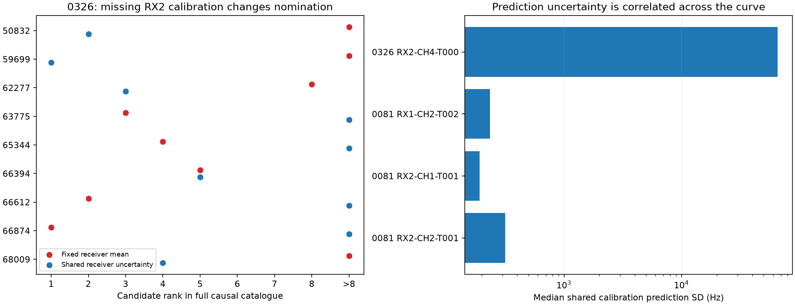

The controlled comparison uses the same curve, causal catalogue, geometry and
candidate priors, either fixing the calibration covariance to zero or propagating
its full correlated posterior. The fixed-calibration leaders include 66874 and
66612. With uncertainty propagated, 59699 and the original nominee 50832 lead.

| 0326 nomination | Predictive score, lower better | Conditional RMS Hz | Refreshed phase seconds |
| --- | ---: | ---: | ---: |
| 59699 | 321.052 | 82.397 | +1.475 |
| 50832 | 323.335 | 273.639 | -0.016 |

The score difference is only **2.283**. This is not a decisive or calibrated
identity probability. The 59699 result remains a conditional association
hypothesis, even though its final joint fit passes the existing gates. The
original 50832 control fails a quadratic residual test after the full regional
refit (BIC gain about 45.7, limit 10), despite RMS below 450 Hz.

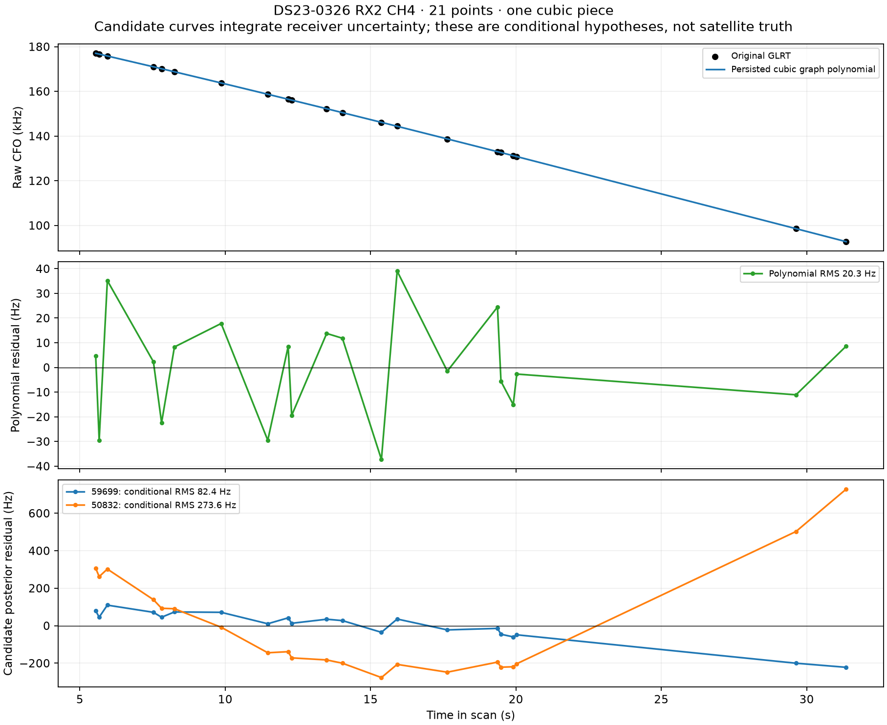

The lower panel shows nomination residuals after conditional nuisance inference;
it is not a pure uncorrected orbital Doppler curve or a final-fit residual plot.
Both candidates receive the same shared uncertainty model. That freedom and the
small predictive score separation are reasons to retain the ambiguity.

## Prototype 1: covariance-aware reentry through the existing engine

1. Inventory unique GLRT ownership and select the three longest wholly unused,
   actively curved graph components with at least 12 points. Only one qualifies
   on 0326. Do not use linear fragments to calibrate offsets.
2. As a broad diagnostic, screen all **1,335 / 1,529 causal satellites** on
   0081 / 0326, at nine fixed regional seeds plus the saved RF endpoint, with
   phases -15…15 seconds at one-second spacing. This coarse stage proposes
   hypotheses; a coarse failure is not proof that a curve has no satellite.
3. At the incumbent RF endpoint, predict each unused curve using calibration
   inferred from incumbent curved observations only. Include full correlated
   radio uncertainty, candidate phase, supported orbital modes and the existing
   300 Hz fragment-constant prior. Moment-match unseen Student phase uncertainty
   only for nomination. Refine the original nominee and seven alternatives
   through five phase refreshes; final fits restore the original model.
4. On 0081, fit all seven nonempty combinations of the three leading RF
   nominations. On 0326, fit the leading hypothesis and original-nominee control.
   Use both c arms from [0,0], five phase rounds and 48 position steps per round,
   including the incumbent's existing near-feasible constrained rescue.
5. Require original curved and predictive gates, phase bounds and phase
   convergence. Select the largest added point set among paired-valid results;
   use deterministic component ordering for ties. Do not rank objectives from
   different observation masks as model evidence.

0081's **RX2 CH2 T001**, 47 points over 64.182 seconds, can return with 68323.
Its **RX1 CH2 T002**, 31 points over 48.091 seconds, still fails with 58524:
approximately 665 Hz conditional RMS, slope z 4.86, quadratic BIC gain 62 and
step z 4.18 in the standalone trial. Those failures remain in the record.

## Hypothesis 2: inactive owners authorize an unsupported orbital model

On 0081, **RX2 CH1 T001**, 50 points over 57.846 seconds, nominates 69253.
Its first regional fit has about **22 Hz conditional RMS** and passes its
conditional mean, slope, quadratic and step screens, yet the final family gate
rejects it.

The orbital-design constructor originally counts owners from **all nominated
curved rows**, including masked-out observations. This enables three additional
orbital-shape coordinates. The final gate then requires those coordinates to
be supported by at least two passing, active receiver/channel owners. Inactive
companions can therefore authorize a model that the active data cannot support.

The bounded correction preserves all incumbent curved/predictive orbital support,
but gives a **newly activated, one-owner family phase only**, disabling its three
unsupported shape coordinates. It neither adds arbitrary polynomial freedom nor
loosens residual gates. An owner-count regression test covers inactive owners
and protects the incumbent design.

The standalone 50-point control passes. Combining it with the failed 58524 curve
still fails. One final cold fit joins only the two already RF-qualified additions,
68323 and 69253: **97 extra original points**, passing both c arms. Selection and
density/gate replay were frozen before evaluating the support-control geographic
errors. All original-mask null objectives reproduce exactly.

This demonstrates a recoverable rejection mechanism in these data. It does not
independently confirm the satellite identities, establish generalization, or
explain the remaining 15.34 km error.

## Associated and unassociated GLRT views

Gray is **all original GLRT**. On associated panels, colors mark accepted
satellite hypotheses. On unassociated panels, **red points are unassociated**
and colored lines are remaining graph polynomials. A colored polynomial line
does not by itself indicate satellite acceptance. Curves use the persisted
Legendre coefficients and explicit physical measurement IDs to restore each
raw-CFO alias gauge. Gaps in membership or alias branch are broken for display.

### 0081

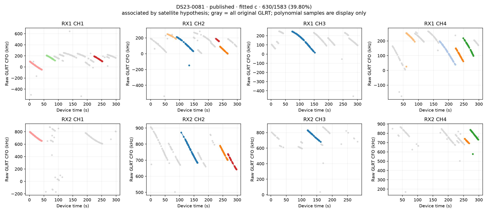
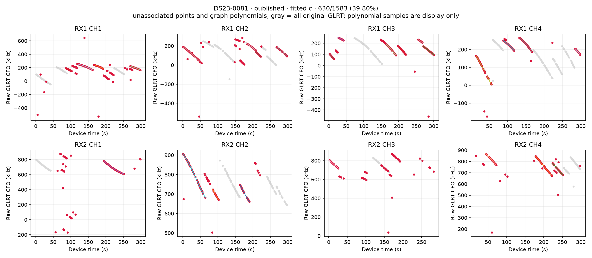
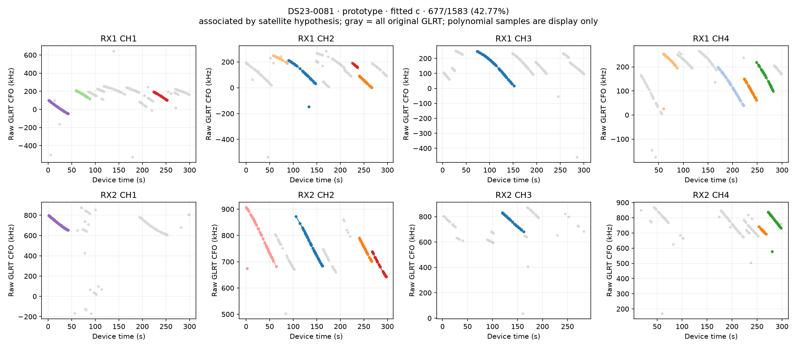
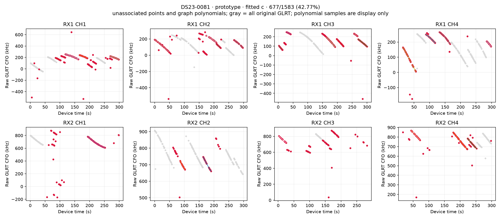
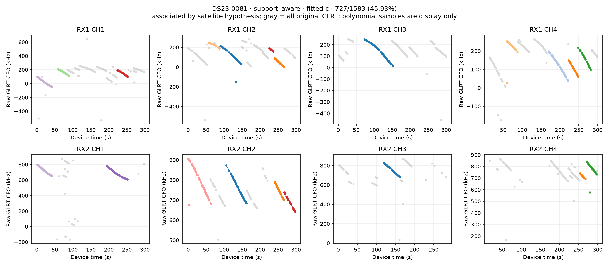
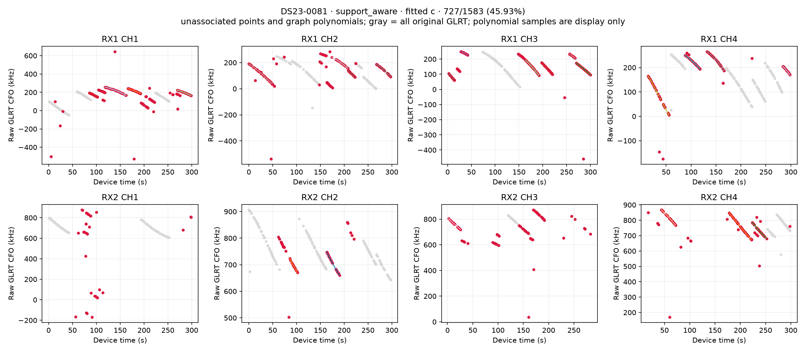

### 0326

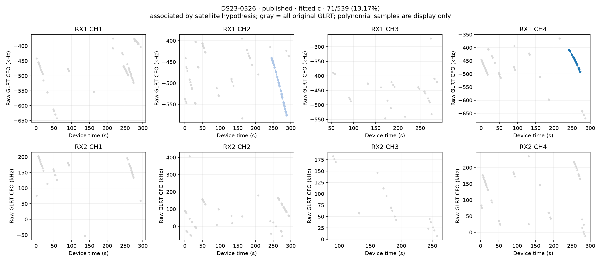
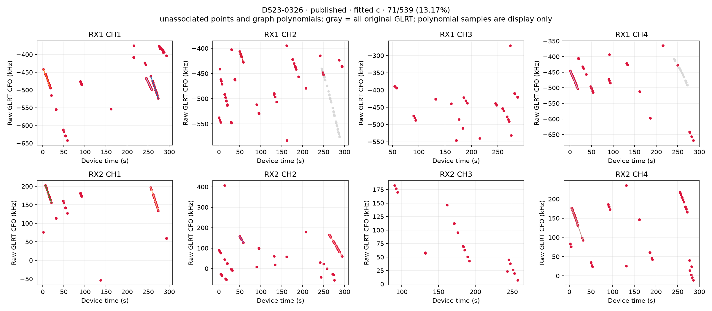
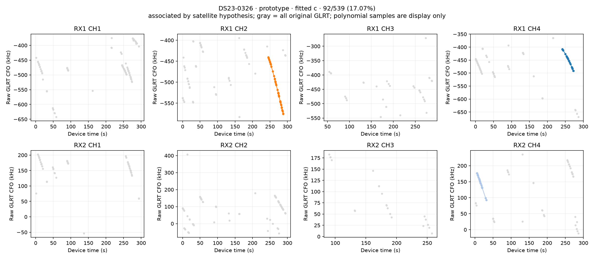
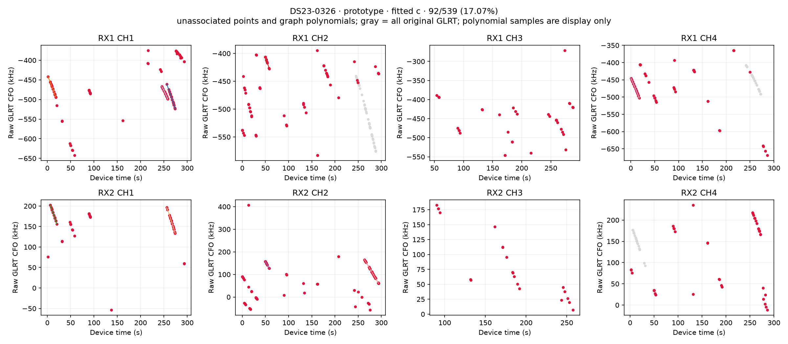

## DBG01 loss maps and regional restarts

The maps and restarts below diagnose the **published incumbent context**, not
the new reentry observation sets. At each of **317 points in a 10 km regional
disk**, plus **289 points in a reference-centered 0.25 km zoom**, nuisance
coefficients and group precisions are refitted with five absolute phase refreshes
for each c arm. Observations, satellite identities and aliases are fixed on
these maps. Orange arrows are finite-difference descent directions of that
conditional loss. These are **not full acquisition/GLRT/graph/catalogue reruns
at each pixel**, nor calibrated geographic probability maps.

Each restart plot uses **81 annotated starting positions in the 10 km disk**.
Thirteen cold RF discoveries per scan supply a bounded assignment bank: the
incumbent plus three finite alternatives ranked by corrected c0 objective at
the regional center. During c0 descent, the engine can reselect among those
four complete assignment hypotheses after accepted steps. Predictive identities
remain fixed. The fitted-c arm follows the c0 phase-round branch schedule,
with the same masks and budget. This is a finite search, not a fresh exhaustive
catalogue search after every step. No within-descent branch switches occurred
in this run; distinct starting branches can still end in different modes.

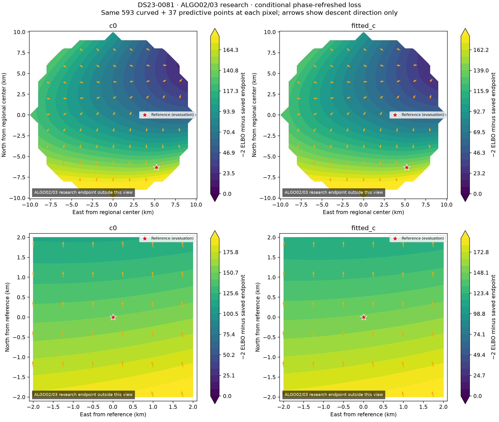
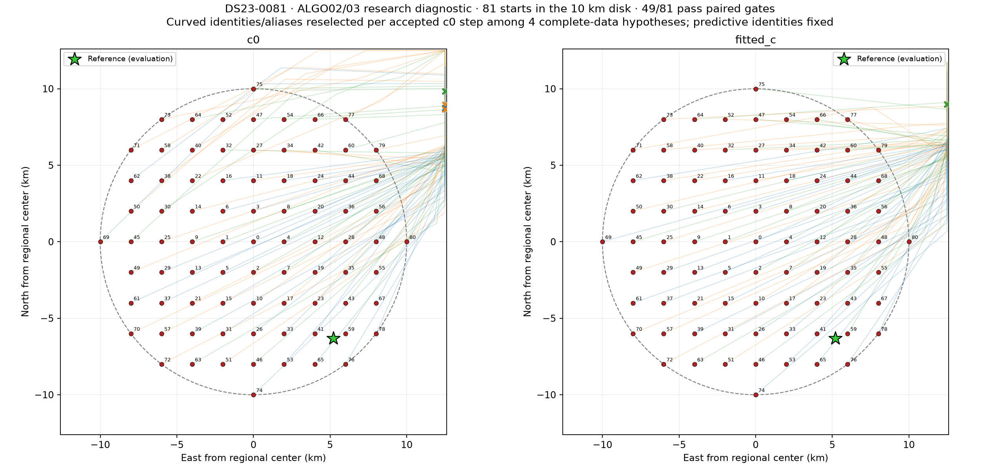
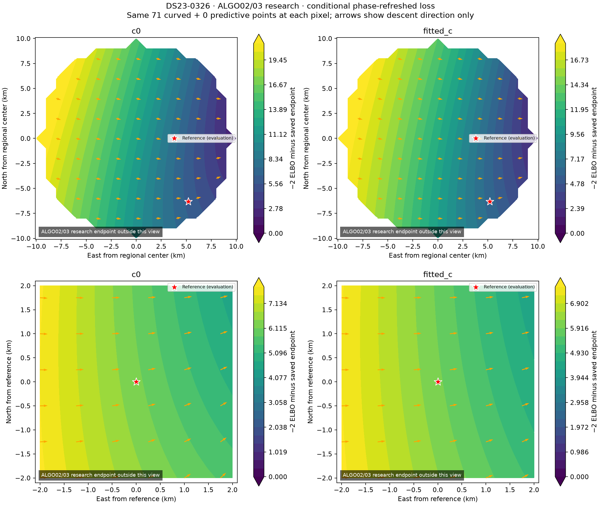
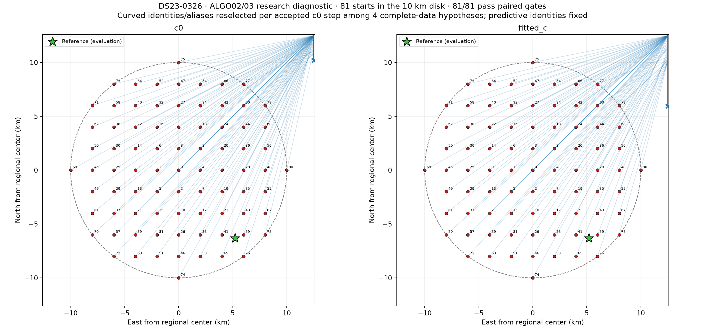

49/81 starts on 0081 and 81/81 on 0326 pass paired acceptance and phase checks.
In 0326 the c0 restart solver reaches a worse approximately 18.11 km endpoint,
while fitted-c endpoints remain approximately 14.28 km. Thus multistart itself
is not a demonstrated repair. The RF-only selection compares corrected,
same-mask c0 loss against the incumbent and requires gain greater than
`2 log(4) = 2.773`. Best gains are **+0.0124** on 0081 and **-0.4309** on
0326. Neither restart is adopted, even though some geographic errors differ.

## Satellite ablations, individual tracks and generic prior controls

Every active family (**8 + 2**) and every retained curved track (**18 + 2**)
is separately removed and refitted from the regional center in both c arms.
These are influence diagnostics. Family deletion also removes its predictive
points; remaining nuisance-design support is preserved. Raw scores from
different observation sets are not compared as evidence for deleting a family.

| Scan | Family removed | Curved + predictive points removed | Error c=0 km | Error fitted-c km | Paired gates |
| --- | ---: | ---: | ---: | ---: | --- |
| 0081 | 58590 | 190 + 11 | 6.376 | 6.904 | pass |
| 0081 | 58593 | 52 + 0 | 20.212 | 20.212 | fail |
| 0081 | 61961 | 84 + 15 | 25.845 | 25.845 | fail |
| 0081 | 63411 | 47 + 0 | 16.481 | 16.512 | pass |
| 0081 | 66356 | 53 + 0 | 17.957 | 18.424 | pass |
| 0081 | 66360 | 25 + 0 | 16.630 | 16.872 | pass |
| 0081 | 66366 | 50 + 11 | 16.029 | 17.265 | fail |
| 0081 | 69254 | 92 + 0 | 14.605 | 14.898 | pass |
| 0326 | 58367 | 26 + 0 | 15.138 | 15.541 | pass |
| 0326 | 67994 | 45 + 0 | 11.699 | 11.700 | pass |

58590 strongly influences 0081, but removing 201 observations still leaves
6.90 km fitted-c error and reduces association to 27.10%. This does not prove
58590 is the wrong satellite or justify choosing its removal using GPS. No
single-family diagnostic fixes either scan to 0.5 km. All track deletions,
including invalid fits, are in the linked table.

| Generic prior control | 0081 error c=0 / fitted-c km | 0326 error c=0 / fitted-c km |
| --- | ---: | ---: |
| Phase width ×2 | 16.762 / 17.009 | 13.956 / 14.398 |
| Phase prior mean zero | 16.732 / 16.980 | 15.999 / 15.644 |

All four control pairs pass the original gates; neither control resolves the
failures. No default prior was changed from this diagnostic.

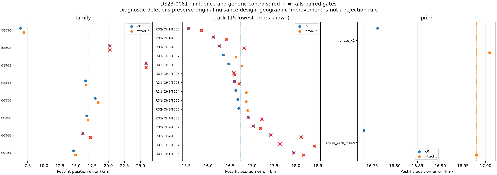
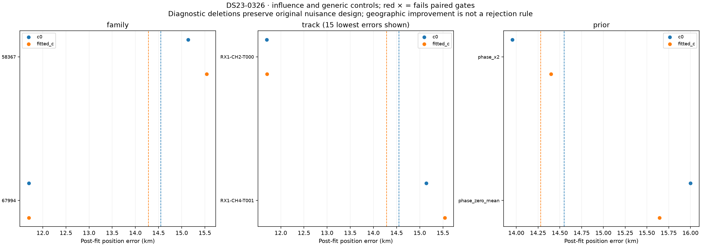

[All family ablations and association counts](tables/family_ablations.csv),
[all family, track and prior interventions](tables/all_interventions.csv).

## Why a noise-like residual does not ensure a good position

At the reference coordinate, refreshed conditional loss is worse than the
incumbent endpoint by **151.265 / 149.445** units on 0081 and
**6.206 / 5.987** on 0326 (c=0 / fitted-c). These fixed-position reference
evaluations are diagnostic oracles, never proposal or adoption evidence.

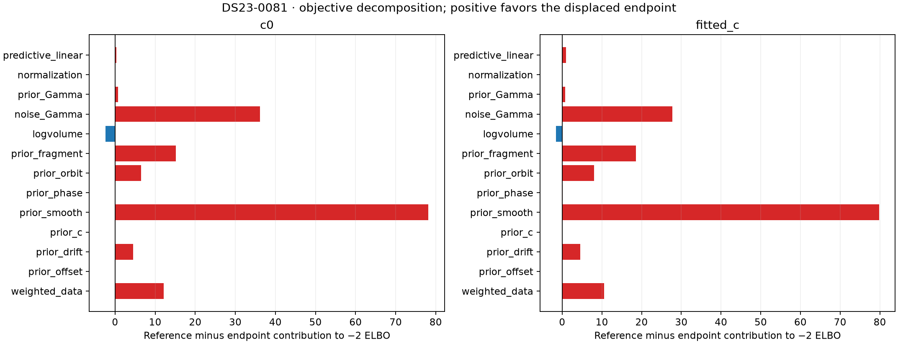
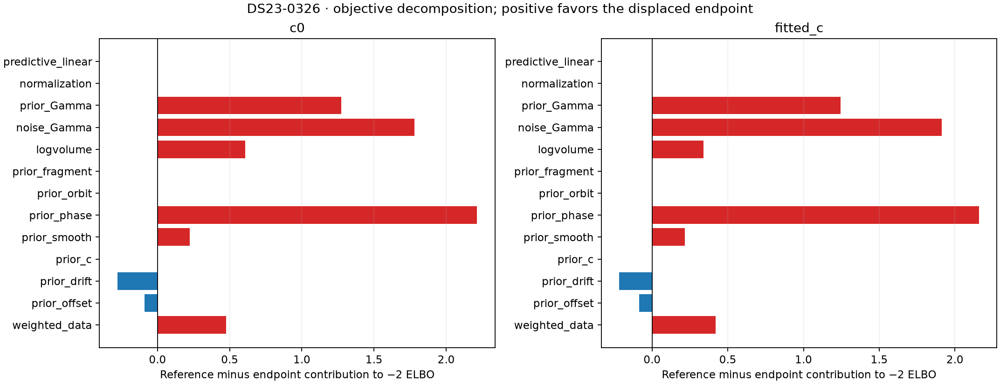

On 0081, the c0 gap includes about **78.16** units of receiver smooth-term
prior, **36.12** of grouped-noise Gamma terms and **15.13** of fragment prior;
the phase-prior difference is only **0.027**. This points toward a coupled
receiver/family/model preference, rather than uniquely blaming phase priors.
On 0326, just two receiver-one families provide weak position separation;
phase-prior, noise-Gamma and prior-Gamma differences contribute approximately
2.21, 1.78 and 1.27. These decompositions locate model preference; they do not
identify which physical model or measurement is wrong.

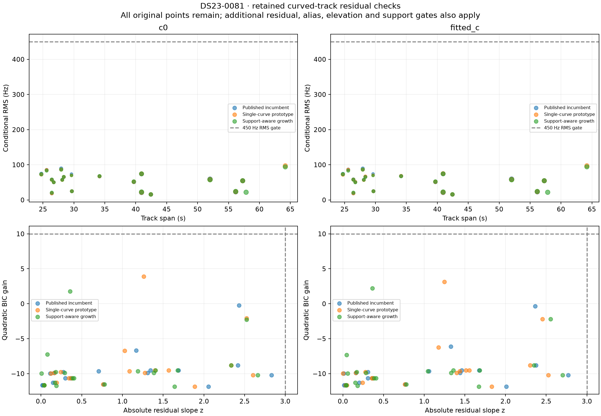
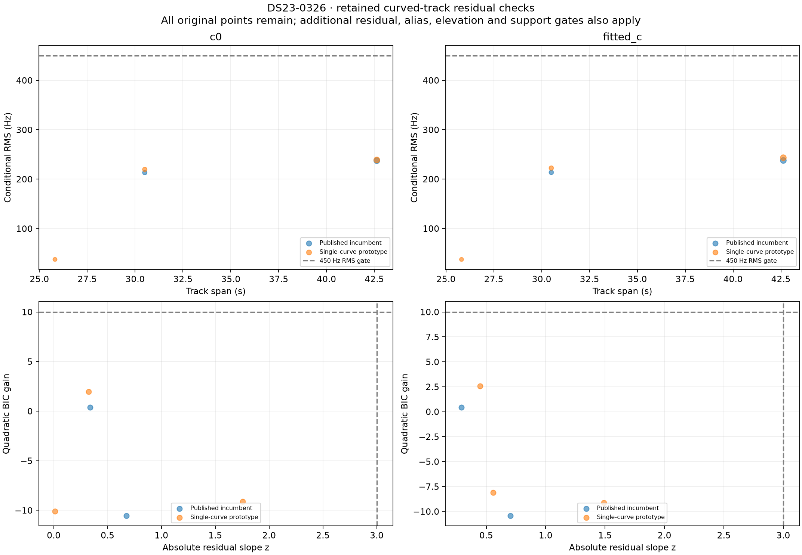

The existing residual screen checks mean and slope z ≤3, quadratic BIC gain ≤10,
maximum step z ≤4, and |lag-one correlation| ≤4/√n, with its existing 75 Hz
noise floor. Profile/conditional compatibility, profile RMS ≤450 Hz,
|profile bias| ≤3,000 Hz, alias consistency, elevation and family support also
apply. Passing fitted residual screens is necessary here but does not prove
identity, independent position information or correct nuisance priors.

[Per-track retained residual diagnostics](tables/residual_diagnostics.csv) and
[all failed reentry gates, including owner-support causes](tables/failed_reentry_gates.csv).

## Verification, reproducibility and limits

- All **244 configured DBG01 analysis jobs**, plus **28 discovery/audit jobs**,
  reached terminal success, with up to 24 processes and one BLAS thread each.
- An independent audit replays **400 DBG01 endpoint arms**, original gates,
  and independent dense density calculations, plus **28 candidate predictive
  densities**. All pass. The grid model and coordinates are saved; every pixel
  was not independently reintegrated by a second implementation.
- Initial reentry independently audits **18 trial endpoint arms**. The final
  active-support control independently audits **6 additional endpoint arms**,
  including the union and the failed control, and reproduces all original-mask
  null objectives. No failed trial is silently adopted.
- **Six focused tests pass**, covering benchmark ranking, physical ID/native-CFO
  mapping, shared unobserved-receiver covariance, combination controls, active
  owner support and the Legendre plotting convention. Visual review corrected a
  reporting-only power-basis error before publication; inference was unchanged.
- TLE element and collection times are checked against the scan cutoff. **A
  following-TLE diagnostic was not run in this configured iteration.** This is
  an explicit omission from that part of the expanded DBG01 diagnostic menu;
  future TLEs are never inference inputs.
- No new RF collection, IQ reprocessing, future observations, stationary pooling,
  manual satellite IDs or location-specific prior changes are used. The work
  reuses persisted ALGO02/03 observations, graphs, inference and diagnostics.
- Nomination conditions on the incumbent RF position; it does not integrate
  full position uncertainty. Candidate scores and fitted residuals are not
  calibrated identity confidence. 0326 remains notably ambiguous.

[Protocol](evidence/protocol.json),
[independent audit](evidence/independent_iteration_audit.json),
[RF-only restart selection](evidence/RF_restart_selection.json),
[active-support audit](evidence/support_finalization_audit.json),
[exact evaluation](evidence/evaluation.json),
[artifact hashes](evidence/artifact_hashes.json),
[research source capsule](source/tools/), [tests](source/tests/).
Per-scan evidence includes candidate nominations, original and prototype point
memberships, endpoint records, conditional surface samples, branch banks and
restart summaries. The source capsule extends existing repository engines;
it is not a standalone replacement pipeline.

## Iteration decision and next batch

Retain the covariance-aware and active-support hypotheses for broader testing,
but **do not promote a new ALGO series version or alter production defaults**.
The results are conditional two-scan engineering evidence. The full-DS23
reference and its available/unavailable denominator remain unchanged.

This batch is closed after bounded tests. Move next to **DS23-0035 and
DS23-0041**, the next two worst published errors, rather than repeatedly tuning
0081/0326. Test whether the same calibration/support failures recur and inspect
missing graph evidence. Publish the next hypothesis, tests, failures and results
even if no improvement is found. A new ALGO number requires a matched full-DS23
comparison, both c arms, association coverage, accuracy, regressions and failure
counts; higher in-sample association alone is insufficient.
