# DS23 DBG01 iteration 002: shared-family ambiguity and unused position evidence

This bounded iteration builds on **ALGO02 and ALGO03**, using the next two
worst published position errors, **0035 and 0041**. Causal graph recovery adds
52 and 31 original GLRT points. Final fitted-c errors improve **5.439→3.741 km**
and **5.220→2.835 km**, but remain far from the target. The experiments also
show that several plausible curved tracks cannot safely share a satellite
correction, and that associated points need not already influence position.

**No new ALGO version is promoted.** These are conditional engineering results
on two inspected scans. The full-DS23 reference remains
[410 available scans](../2026_10_22_ds23_family_cavity_full_assessment/README.md),
fitted-c mean **1.469461 km**, median **1.178102 km**, with three unavailable
members of the 413-scan manifest. This iteration has not established a new full
population mean/median or generalization to new locations.

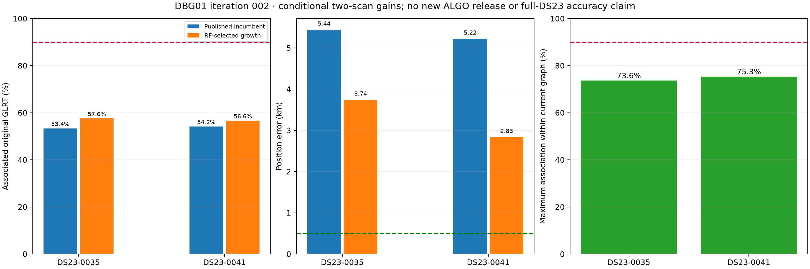

## Controlled results

Both c arms retain the original 25 × 25 km region centered at **37.906,
-122.545**, and start final fits at [0,0]. Observations, candidates, other priors,
residual gates and fit budgets are matched between c=0 and fitted-c. Evaluation
GPS **37.849061591561885, -122.48574968092912** ranks debug priority and evaluates
frozen outcomes only; it does not initialize inference or choose a hypothesis.
No following TLE or manually chosen satellite enters a position fit.

| Scan | Method | Associated / all GLRT | Associated % | Error c=0 km | Error fitted-c km | Curved RMS c=0 / fitted-c Hz |
| --- | --- | ---: | ---: | ---: | ---: | ---: |
| 0035 | Published incumbent | 664 / 1,244 | 53.38% | 5.459 | 5.439 | 68.73 / 68.64 |
| 0035 | RF-selected graph recovery | **716 / 1,244** | **57.56%** | **3.781** | **3.741** | 73.98 / 73.90 |
| 0041 | Published incumbent | 683 / 1,261 | 54.16% | 4.985 | 5.220 | 65.73 / 65.51 |
| 0041 | RF-selected graph recovery | 714 / 1,261 | 56.62% | 2.036 | 2.856 | 64.86 / 64.58 |
| 0041 | Recovery + existing curved evidence in position | **714 / 1,261** | **56.62%** | **2.000** | **2.835** | 63.33 / 63.07 |

All original accepted measurement IDs remain associated in both arms; no original
curved calibration or predictive factor is removed. Counts are unique original
winning GLRT IDs, excluding interpolated polynomial samples and extra peaks.
0035's frequency RMS increases when adding observations despite its improved
position. On 0041, fitted c reduces RMS slightly but has worse geographic error
than c=0. Frequency fit and position accuracy are separate outcomes.

| Scan | Original → final associated graph fragments | Original → final points/fragment | Original → final GLRT used in position |
| --- | ---: | ---: | ---: |
| 0035 | 26 → 28 | 25.54 → 25.57 | 664 → 716 |
| 0041 | 31 → 32 | 22.03 → 22.31 | 653 → 714 |

These are graph fragments, not satellite counts or complete physical passes.
The position count includes curved calibration plus predictive observations,
each counted once. Both scans originally have **14 active curved families**.

[Exact results](tables/position_and_association.csv).

## Hypotheses and bounded prototypes

### 1. Recover unused curved evidence with calibration uncertainty

Reuse iteration 001's full correlated receiver-calibration prediction, complete
causal catalogue, original nominee plus seven refined alternatives, and the
existing physical phase/orbit/fragment priors. The proposed curve is excluded
from nomination calibration. Only actively curved tracks can calibrate; linear
tracks remain predictive evidence. Unseen Student phases are Gaussian-moment
approximations for nomination only; final fits restore the original model.

The first test considers the three longest unused curved components per scan
and all nonempty combinations of their leading qualified nominations, plus
original-nominee single controls. Final fits use five phase rounds and 48
position steps per round, with the existing near-feasible constrained rescue.
Both c arms must pass all original gates and phase convergence checks.

0035 recovers none from these three alone. On 0041, **RX1 CH1 T001**, 31 points
over **47.55 s**, passes with **100474**, replacing its original nomination
60333. No evaluation GPS selects that ID. Error falls to 2.036/2.856 km.

The bounded extension then examines the remaining wholly unused curved tracks
with at least 12 points, up to three more. Only **two** qualify, both on 0035:
**RX2 CH2 T001** (33 points, 34.27 s) and **RX2 CH4 T001** (19 points, 23.97 s).
They independently nominate **68060**, rather than their original 69943.
Neither passes alone; together, with one shared satellite correction, they
pass both c arms and recover **52 points**. This is a conditional hypothesis,
not independent proof of 68060's identity.

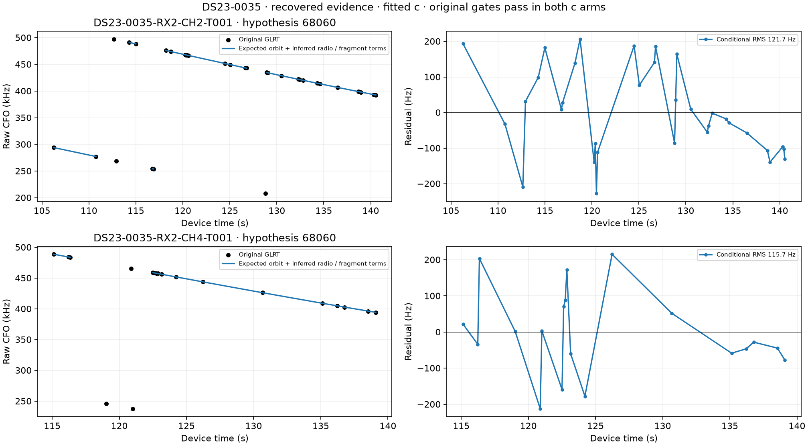
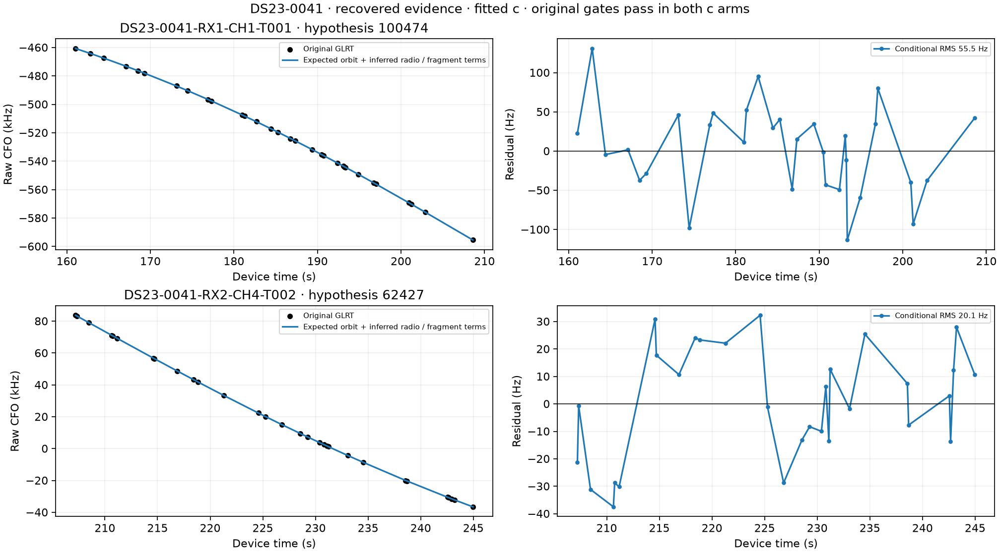

All recovered curves use the existing nuisance terms and gate limits. The
expected curves in these panels include orbital Doppler and inferred radio /
fragment terms. They are not uncorrected nominal Doppler.

### 2. Why the longest remaining curves still fail

Each of the six initial targets has **one persisted graph polynomial piece**;
a mistaken multi-piece join is not demonstrated. Graph RMS is not sufficient
to identify a satellite. In standalone c=0 joint fits:

| Scan / curve | Leading hypothesis | Points | Graph RMS Hz | Joint conditional RMS Hz | Important rejection |
| --- | ---: | ---: | ---: | ---: | --- |
| 0035 RX1 CH1 T000 | 68060 | 47 | 41.35 | 88.56 | lag-one correlation 0.756, limit 0.583 |
| 0035 RX2 CH1 T001 | 64012 | 28 | 96.55 | 547.0 | RMS, slope, quadratic and step structure |
| 0035 RX1 CH3 T001 | 52855 | 34 | 65.90 | 96.10 | lag-one correlation 0.751, limit 0.686; other original factors also fail |
| 0041 RX1 CH1 T000 | 68071 | 62 | 81.18 | 113.22 | lag-one correlation 0.638, limit 0.508 |
| 0041 RX1 CH4 T000 | 68071 | 52 | 88.67 | 127.39 | quadratic BIC gain 23.00, limit 10 |
| 0041 RX1 CH1 T001 | 100474 | 31 | 49.06 | 57.86 | passes |

The two68071 curves together still fail: approximately 102/121 Hz conditional
RMS, correlation 0.572 on CH1 and quadratic BIC gain 17.22 on CH4. The active-owner
phase-only controls from iteration 001 do not fix these failures. Their residuals
contain structure even though their RMS is well below 450 Hz.

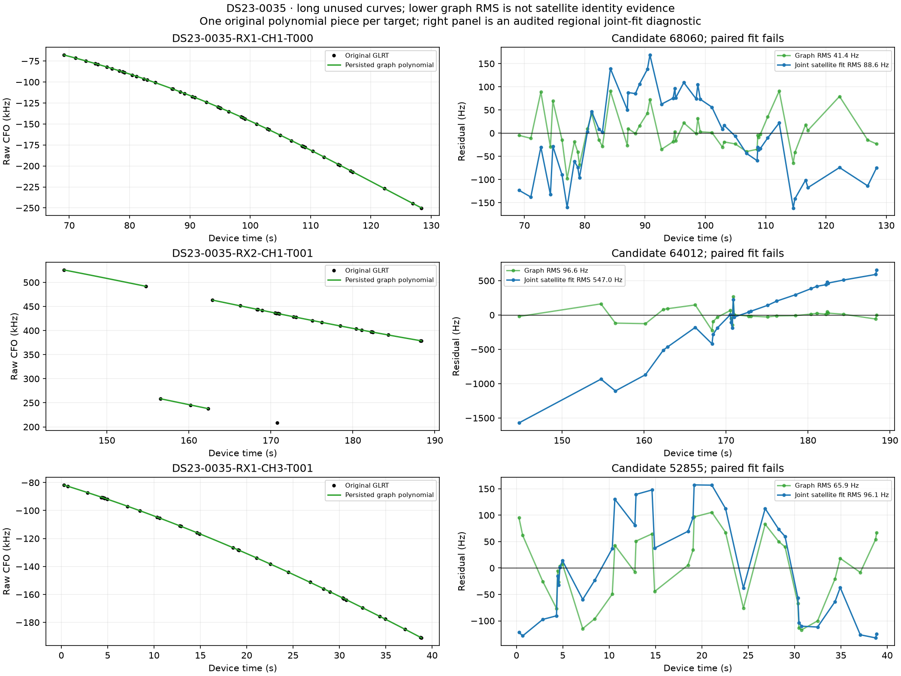
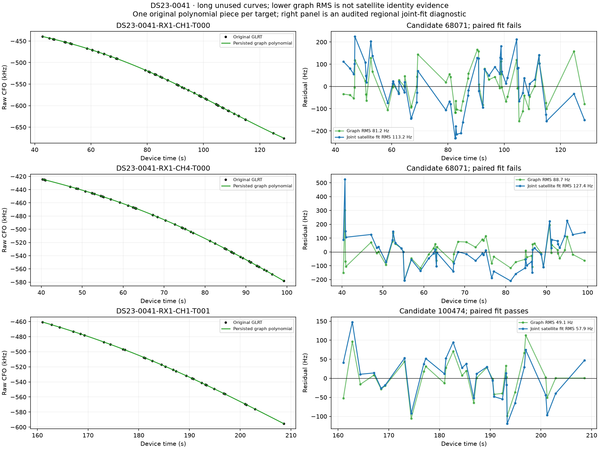

The raw-CFO panels use physical observation IDs and the persisted **Legendre**
polynomials. Integer alias wraps break the displayed lines; they are not physical
discontinuities or evidence of a bad join. Conditional residuals use the
unwrapped numerical observations.

### 3. Shared candidate identity is not enough to merge curves

The long 0035 RX1 CH1 curve and the two recovered RX2 curves all independently
rank 68060 first. A final bounded test fits their **99-point union** under one
shared correction. It fails decisively: the long RX1 curve has **5,613 Hz c=0**
and **5,387 Hz fitted-c** conditional RMS, with mean, slope, curvature and step
failures. The two short RX2 curves remain much better fit. The long curve is
not included, and receiver corrections are not freely shifted to force it.

Independent nominations prefer phase approximately **-0.004 s** for the RX1
curve and **+1.86/+1.92 s** for the two RX2 curves. The accepted pair's joint
phase is approximately +1.75 s. These are incompatible conditional fits, not
three confirmations of one shared emitter. This does not uniquely determine
which identity is wrong; it demonstrates why cross-track consistency matters.

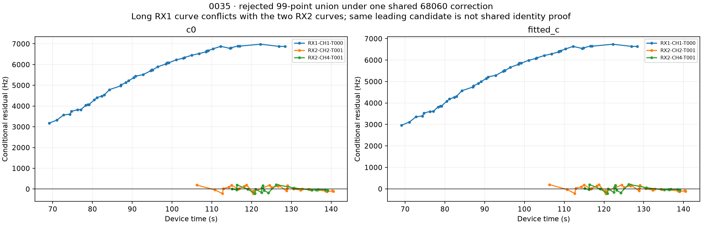

The search also had an omission: it combined leading nominations but tested
original nominees only singly. On the same 52 recovered points, a controlled
family-level search tests the **intersection of qualified top-three candidates**:
68060, 69943, 55609. It uses matched final models, original gates and corrected
normalized c=0 RF evidence, with a 2 log(3) incumbent preference.

| Shared identity, same 52 points | Paired gates | Corrected c=0 loss | Error c=0 / fitted-c km |
| --- | --- | ---: | ---: |
| 68060 | pass | **4181.108** | 3.781 / 3.741 |
| 69943 | pass | 4191.167 | **2.938 / 3.120** |
| 55609 | fail | 4247.285 | 5.273 / 5.253 |

69943 gives a better geographic result but worse RF evidence by 10.059 units.
It is **not adopted using GPS**. No separate-family union is subsequently run,
because the predeclared rule requires an RF-supported identity change first.
This is a useful limitation of the current objective and proposal ranking,
not a demonstrated identity correction or a new algorithm release.

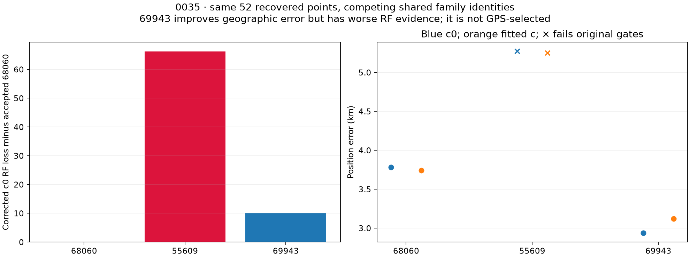

### 4. Associated evidence can be absent from position estimation

On 0041, **RX2 CH4 T002**, 30 actively curved points, is already associated with
62427 by the frozen-calibration extension, with about 27 Hz profile RMS. Its
mask is nevertheless absent from the joint likelihood. Thus the original
association count 683 exceeds its position evidence count 653.

One promotion pass retains that existing ID and alias, and includes the 30
points in the regional fit. Both controls pass all original gates:

| 0041 position evidence | Used points | Error c=0 / fitted-c km |
| --- | ---: | ---: |
| Incumbent | 653 | 4.985 / 5.220 |
| Incumbent + existing curved 30 | 683 | 4.901 / 5.166 |
| Graph recovery | 684 | 2.036 / 2.856 |
| Recovery + existing curved 30 | **714** | **2.000 / 2.835** |

Association stays 714/1261=56.62% in the last two rows. The extra position
evidence improves fitted-c error by only **21.6 m**. Additional points from an
already supported family provide limited new geometry here. Report both
association and likelihood utilization; neither alone measures position
information. There is no applicable promotion on 0035. Linear evidence is never
promoted to calibration.

## Associated and unassociated GLRT panels

Gray is **all original GLRT**. Associated panels color accepted satellite
hypotheses. In unused panels, **red points are unassociated** and colored lines
are remaining graph polynomials. Lines alone do not indicate association.

### 0035

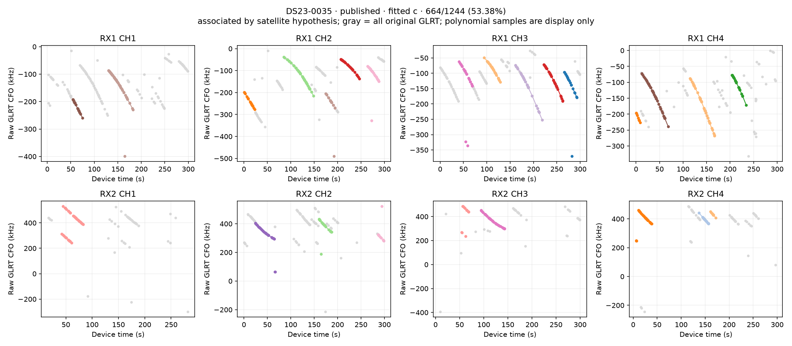
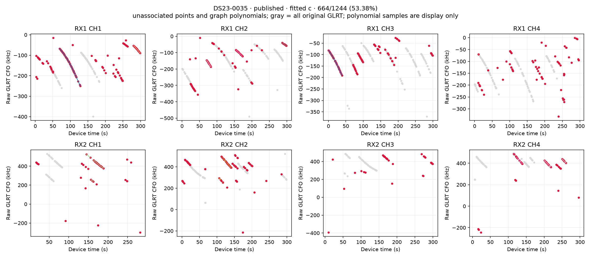
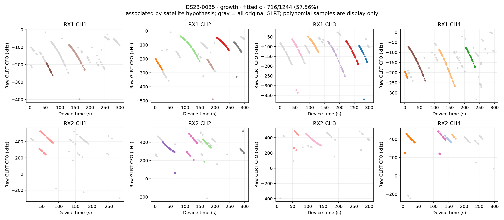
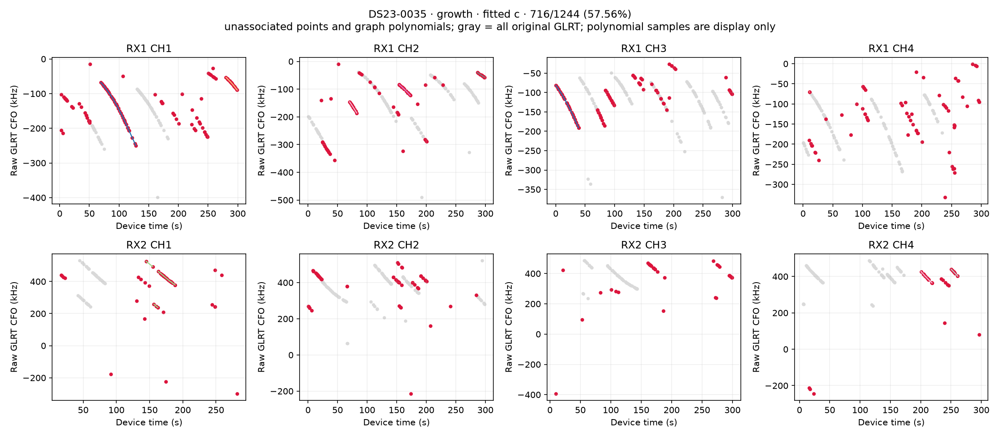

### 0041

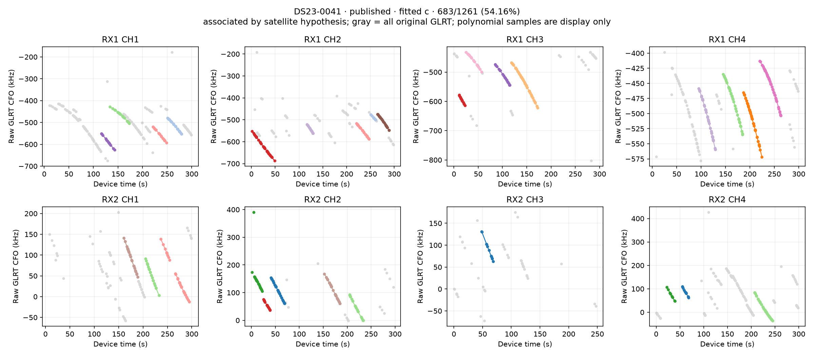
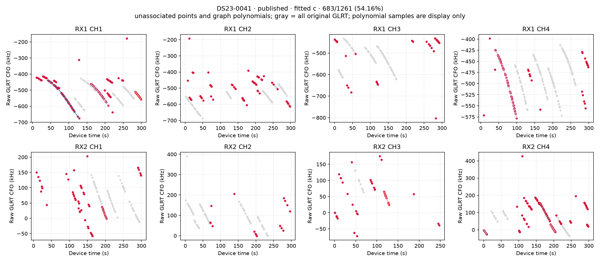
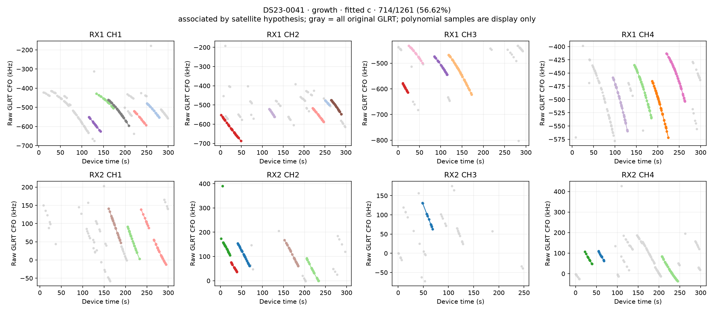
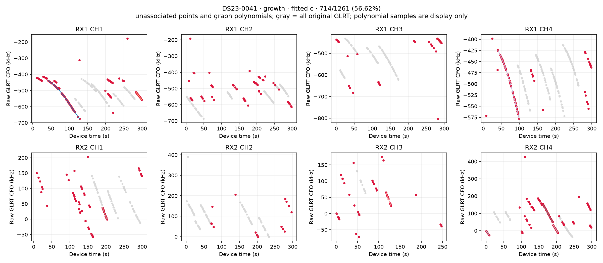

| Scan | Current graph points / all GLRT | Graph-only ceiling | Outside graph | Minimum extra graph points needed for 90% |
| --- | ---: | ---: | ---: | ---: |
| 0035 | 916 / 1,244 | 73.63% | 328 | 204 |
| 0041 | 950 / 1,261 | 75.34% | 311 | 185 |

The 90% aspiration requires more graph evidence even if every existing track
could be associated. It is not reached by relaxing satellite/residual gates.
Final unused counts are 528 and 547, respectively, including outside-graph points.

## DBG01: loss maps, gradient and regional convergence

These maps diagnose the **published incumbent**, using its fixed observations,
identities and aliases. At each of 317 points in the 10 km regional disk and 289
points in a 0.25 km reference-centered zoom, nuisance coefficients and group
precisions are recomputed through five absolute phase refreshes in each c arm.
Orange arrows are finite-difference conditional descent directions. These are
not calibrated probability maps or complete acquisition/GLRT/catalogue reruns.

The separate convergence plots show 81 annotated starts per scan on the 2 km
grid within the disk. Thirteen cold RF discoveries plus original fit branches
provide a bank capped at four complete assignment hypotheses, ranked without
GPS at the regional center. c=0 can switch branches after accepted steps;
fitted c follows the c=0 phase-round branch schedule. Predictive labels remain
fixed. The finite bank is not exhaustive catalogue reassociation at every step.

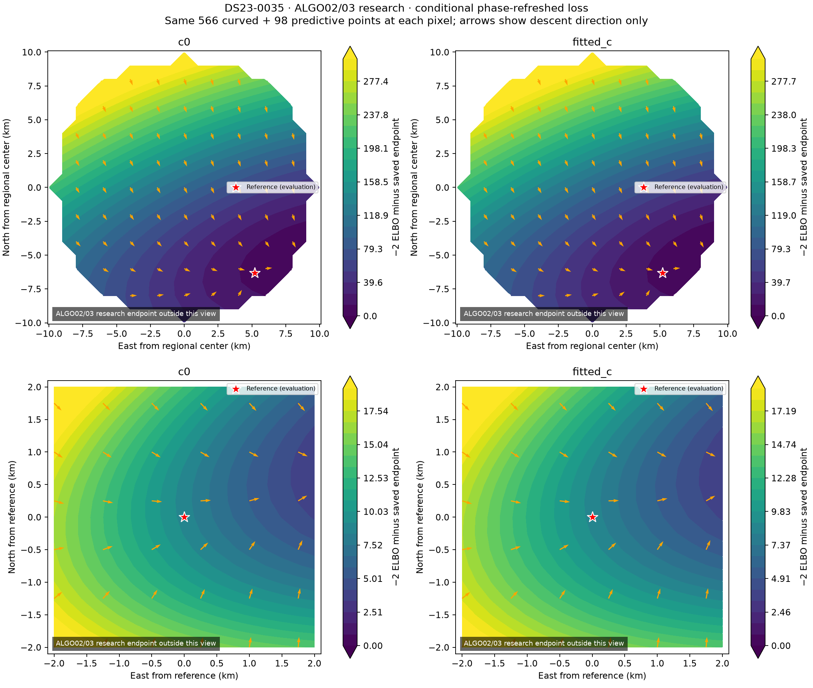
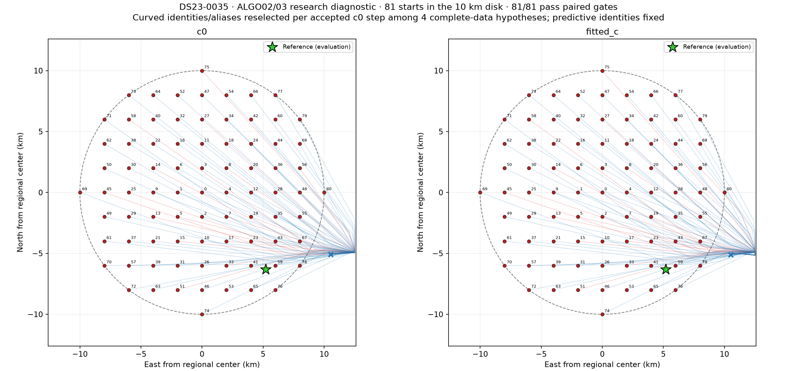
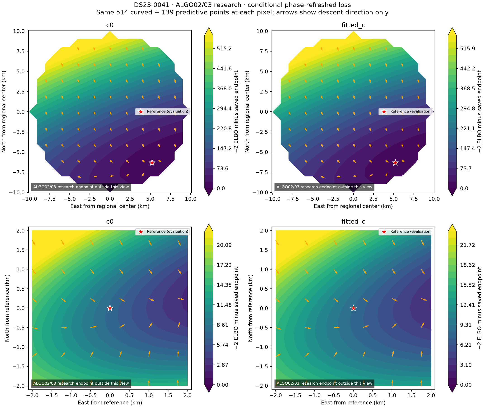
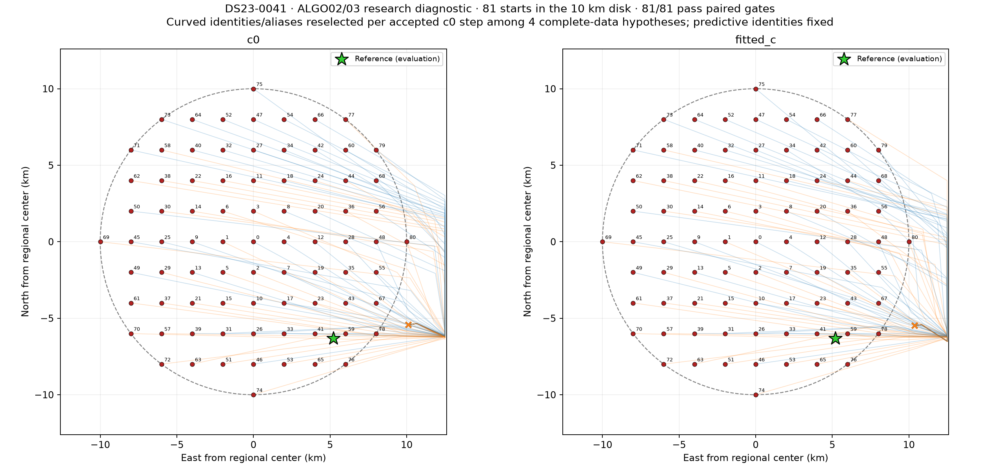

All 81 starts pass paired gates on both scans, but converge back to the same
displaced solutions within numerical precision. 0041 records 56 c=0 within-step
branch switches without changing this conclusion. Best corrected RF gains are
approximately -1.15e-7 and +2.80e-7, below the 2 log(4) adoption threshold. No restart
is adopted. This finite search does not support a simple initialization fix.

## Satellite and track ablations; model preference

All **14 active families per scan** and **19 retained curved tracks per scan**
are individually removed and refitted from the regional center in both c arms.
Family deletion also removes its predictive evidence. Masks differ, so raw
losses are not ranked as evidence for deleting a family. The best valid
fitted-c deletion outcomes are:

| Scan | Family deletion | Error km | Individual track deletion | Error km |
| --- | --- | ---: | --- | ---: |
| 0035 | 66559 | 4.327 | RX1 CH3 T002 | 4.625 |
| 0041 | 66959 | 4.657 | RX1 CH3 T000 | 4.664 |

No single deletion explains away either failure. Every family result and every
track/control result, including gate failures, is retained in the CSVs. The
track influence panels display the 15 lowest-error deletions for readability.

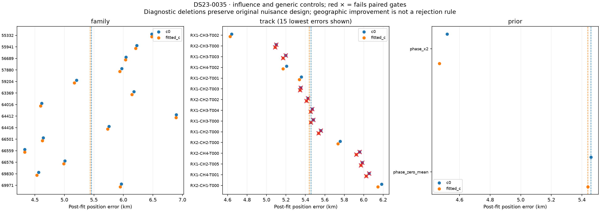
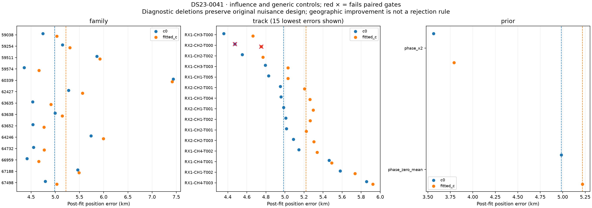

Doubling phase-prior width gives 4.518/4.468 km on 0035 and 3.564/3.792 km on 0041.
Zeroing phase-prior means reproduces each incumbent. These controls pass gates
but do not resolve the scans; no prior setting is selected using GPS.

At the reference coordinate, refreshed conditional loss is worse than the
incumbent by **8.654** and **8.252** fitted-c units. Prior-Gamma contributions
account for approximately 5.59 and 5.99 units, respectively. On 0035 the weighted
data contribution actually improves by about 2.01 units at the reference, while
the full objective still prefers the displaced endpoint. These are coupled
decomposition diagnostics, not proof that one prior is physically wrong.

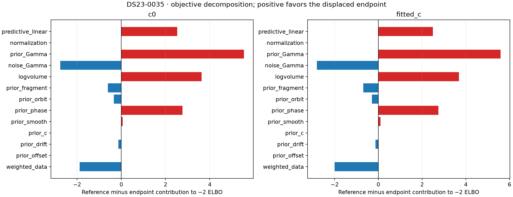
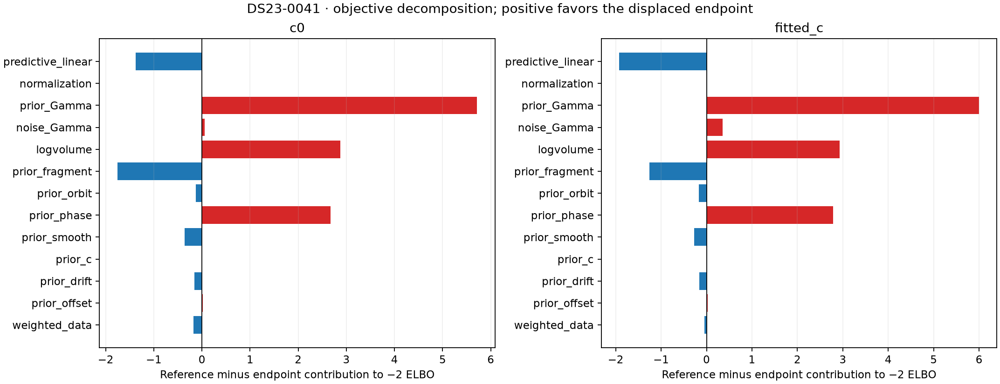
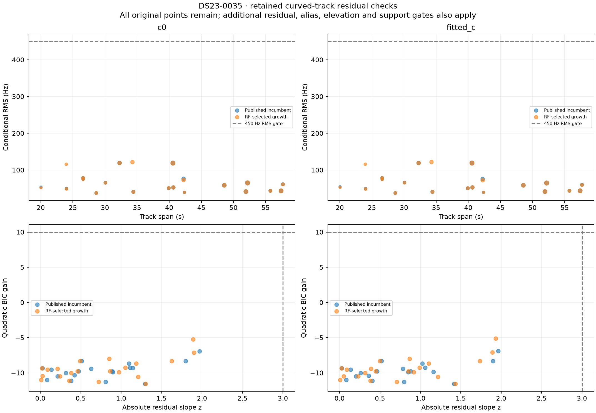
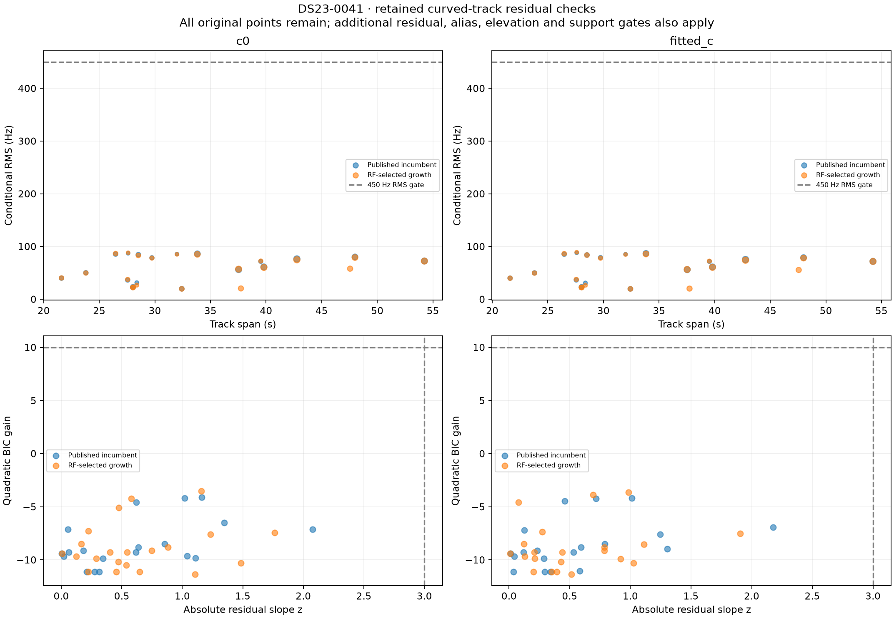

## Following-TLE diagnostic

The read-only local Space-Track archive supplies the earliest element epoch
strictly after scan end, with collection also after scan end, both within 48 h.
The diagnostic preserves the causal candidate inventory: 1,439 of 1,441 elements
are available on 0035, and 1,538 of 1,542 on 0041. Missing future versions are
explicitly labeled and never presented as following elements.

At the **frozen causal RF endpoint and calibration**, candidate phase is
profiled over ±15 s from a quarter-second grid with local refinement. Neither
diagnostic version uses a phase prior or orbital-shape correction; both propagate
the same correlated receiver/fragment uncertainty. This isolates a nominal-orbit
timing comparison, not the exact full Bayesian nomination or final joint fit.
Future elements never enter position inference, selection, or training.

| Initial curve | Leading candidate | Causal → following conditional profile RMS Hz |
| --- | ---: | ---: |
| 0035 RX1 CH1 T000 | 68060 | 99.43 → 109.95 |
| 0035 RX2 CH1 T001 | 64012 | 450.27 → 396.86 |
| 0035 RX1 CH3 T001 | 52855 | 112.09 → 114.66 |
| 0041 RX1 CH1 T000 | 68071 | 111.42 → 111.42 |
| 0041 RX1 CH4 T000 | 68071 | 120.67 → 121.22 |
| 0041 RX1 CH1 T001 | 100474 | 91.38 → 97.16 |

All six leading profiles still fail their structure screens in both versions.
This does not establish that causal TLE age is the main cause of the longest
curve failures, or prove the candidate IDs. The final full joint fit of 100474
does pass, illustrating why this restricted diagnostic is not the final gate.

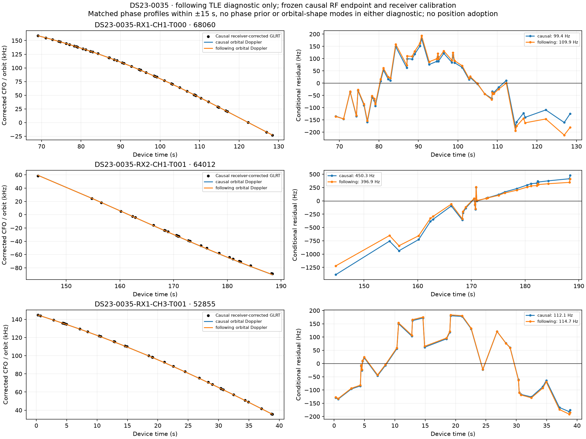
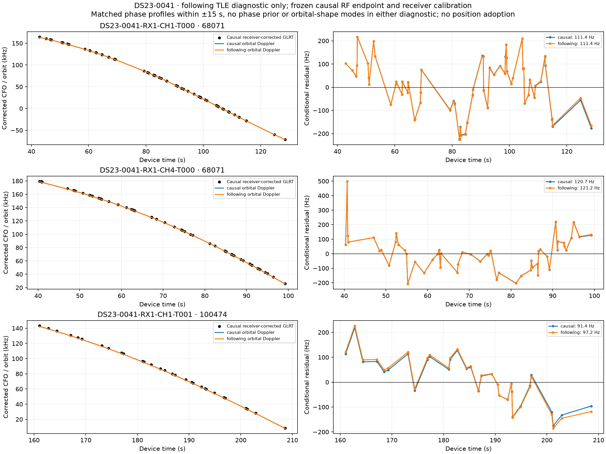

## Integrity and verification

Before ablations, the reused adapter was found to retain pre-replacement base
labels: 57869 on 0035 and 100474 on 0041 were obsolete active-family labels. A
new context binding preserves measurement order/masks and binds all diagnostic
base rows to the current assignments. Original preparations are archived. Both
c-arm incumbent objectives replay with **zero difference**, and all repeated
nomination scores are unchanged. No family ablation ran before the correction.
This fixes the diagnostic grouping, not the published position estimates.

- All **280 configured DBG01 analysis jobs** and 28 discovery/audit jobs finish.
  Execution uses at most 24 DBG01 processes, one BLAS thread each; other stages
  use one or two workers. No new RF collection or IQ reprocessing occurs.
- Independent checks replay **472 DBG01 endpoint arms**, **42 initial candidate
  densities** and **14 additional candidate densities**, with original gates
  and dense covariance/evidence calculations. All pass. Every surface pixel is
  saved, but not independently integrated by a second implementation.
- Further endpoint-arm checks include 30 initial reentry,10 additional-curve,
  4 support-control,6 family-seeded,8 identity-control and 4 promotion checks.
  Some reused endpoints are checked in more than one stage. All pass numerical
  replay; failed scientific gates remain failures and are not adopted.
- **15 focused tests pass**, including 9 new tests and 6 existing regression
  tests. They cover current-label grouping, stage isolation, candidate alternatives,
  shared covariance, curved-only promotion, measurement ownership, Legendre
  coefficients, and display breaks at alias/time gaps.
- Original limits remain: mean/slope z ≤ 3, quadratic BIC gain ≤ 10, maximum step
  z ≤ 4, |lag-one correlation| ≤ 4/√n with the existing 75 Hz floor; profile RMS ≤ 450 Hz,
  |bias| ≤ 3,000 Hz, alias consistency, elevation, family support and predictive
  gates also apply. No linear fragment calibrates nuisance terms.

Protocols, selection decisions, raw candidate/endpoint records, full ablation
tables and source snapshots are in [evidence](evidence/) and [source](source/).
The new source capsule extends the existing engines captured in
[iteration 001](../2026_10_22_ds23_dbg01_iteration_001/README.md); it is a research
adapter, not a standalone released pipeline.

Tables: [positions and utilization](tables/position_and_association.csv),
[all family ablations](tables/family_ablations.csv),
[all family/track/prior interventions](tables/all_interventions.csv),
[retained residual diagnostics](tables/residual_diagnostics.csv),
[all reentry trial gates](tables/trial_gates.csv),
[matched family identity controls](tables/family_identity_controls.csv),
[following profiles](tables/following_TLE_profiles.csv).
[Artifact hashes](evidence/artifact_hashes.json) identify the published files.

## Decision and next batch

Retain the conditional recovery gains and the diagnostic fixes. Do not promote
a new ALGO version, claim new-location performance, relax structure gates, or
select 69943 because its geographic error happens to be better. Both scans still
fail the 0.5 km objective. More same-family points have limited independent
position information, and a common leading satellite candidate can still be
inconsistent across receivers.

Close this batch. Next inspect **0111 and 0390**. Scan 0405 is higher in the
remaining ranking but has already completed DBG01 and bounded recovery controls
without a supported repair; retain that earlier failure evidence rather than
repeat it now. The [next-iteration index](../DS23_DEBUG_ITERATIONS.md) records the
queue. A new ALGO series release requires credible matched full-DS23 improvement,
both c arms, availability, coverage, utilization, regressions and computational
cost. The full-population mean-and-median 0.5 km goal remains active.
