# DS23 DBG01 iteration 003: more associations can move position the wrong way

This iteration extends **ALGO02 and ALGO03** on the next two worst remaining
scans, **0111 and 0390**. Recovering one 18-point curved fragment improves
0111's fitted-c error **4.556→2.422 km**. Recovering a coherent 43-point fragment
on 0390 passes the existing gates but worsens error **4.255→6.725 km**. These
results motivate a frozen, RF-only check of how new evidence predicts the
existing satellite families. It accepts the 0111 addition and rejects the 0390
addition on these inspected development cases.

The preselected **random20 confirmation** finds the broader failure too:
unrestricted growth raises pooled association **69.69→71.35%** but worsens
fitted-c mean error **1.742→2.195 km**. The frozen guard accepts only one
expansion, giving **1.735 km** mean and an unchanged **1.468 km** median.
This is insufficient evidence of a general localization improvement.

**No new ALGO version is promoted.** The full-DS23 reference remains
[410 available scans](../2026_10_22_ds23_family_cavity_full_assessment/README.md),
fitted-c mean **1.469461 km**, median **1.178102 km**; 0012, 0184 and 0286 remain
unavailable. The mean-and-median **0.5 km goal remains unmet**. A temporary
family fold is a diagnostic: accepted final estimates still use all their
original observations. This work does not introduce stationary pooling or a
moving-trajectory model.

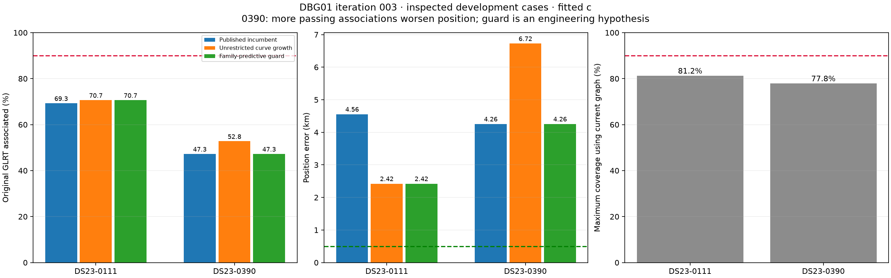

## Matched controls and exact counts

Inference keeps the original **25 × 25 km** regional box, centered at
**37.906, -122.545**. Final joint hypotheses start at regional [0,0], using
five phase refreshes and 48 position steps per refresh, plus the existing
near-feasible constrained rescue. c=0 and fitted-c use identical inference
observations, nominees, priors other than c, gates and budgets. Evaluation GPS
**37.849061591561885, -122.48574968092912** ranks debug priority and scores
frozen results only. All inference TLEs have both element epoch and collection
time at or before the scan cutoff. Following elements appear only in an
explicitly separate diagnostic below.

| Scan | Method | Associated / all GLRT, c=0 / fitted | Associated %, c=0 / fitted | Error c=0 km | Error fitted-c km | Curved RMS c=0 / fitted Hz |
| --- | --- | ---: | ---: | ---: | ---: | ---: |
| 0111 | Published incumbent | 922 / 1330 | 69.32% | 4.810 | 4.556 | 84.79 / 84.79 |
| 0111 | Unrestricted curve growth | 940 / 1330 | 70.68% | 2.725 | 2.422 | 84.59 / 84.57 |
| 0111 | RF family-predictive guard | 940 / 1330 | 70.68% | 2.725 | 2.422 | 84.59 / 84.57 |
| 0390 | Published incumbent | 523 / 1106 | 47.29% | 4.278 | 4.255 | 108.97 / 108.80 |
| 0390 | Unrestricted curve growth | 566 / 1106; 584 / 1106 | 51.18% / 52.80% | 6.707 | 6.725 | 114.51 / 114.07 |
| 0390 | RF family-predictive guard | 523 / 1106 | 47.29% | 4.278 | 4.255 | 108.97 / 108.80 |

Counts are unique original winning GLRT IDs, not interpolated polynomial
samples, extra peaks or duplicated fragments. Every original accepted ID is
preserved in these two cases. The 0390 growth fit uses **566 observations in
both arms**: 502 curved plus 64 predictive. Its fitted-c endpoint additionally
passes 18 post-fit association observations that are **outside the likelihood**.
They explain 584 versus 566; they are not extra localization evidence. They
are not promoted to calibration in this iteration.

| Scan | Incumbent → unrestricted fragments, fitted c | Points/fragment | GLRT in likelihood | Graph-only coverage ceiling | Minimum points outside graph needed to reach 90% |
| --- | ---: | ---: | ---: | ---: | ---: |
| 0111 | 36 → 37 | 25.61 → 25.41 | 922 → 940 | 1080/1330 = 81.20% | 117 |
| 0390 | 23 → 25 | 22.74 → 23.36 | 523 → 566 | 861/1106 = 77.85% | 135 |

Even perfect association of the current graph cannot reach 90%. There are
250/245 original GLRT points outside the graph. This is a ceiling, not a claim
that every outside point is a recoverable satellite observation. Frequency
RMS and geographic accuracy remain separate outcomes.

[Full paired metrics](tables/position_and_association.csv).

## Hypotheses and bounded prototypes

### Recover curves using shared calibration uncertainty

Reuse the existing family-excluded prediction machinery, full causal catalogue,
per-fragment integer aliases and correlated receiver-calibration covariance.
The proposed curves do not calibrate their own nomination. Initially test the
three longest unused actively curved fragments per scan (only one exists on
0111), leading-offer combinations and original nominee single controls.

Then examine **all** wholly unused actively curved fragments with at least
12 points: one on 0111 and eight on 0390. Retain each curve's top three
qualified identities, group common identities with shared cross-curve radio
covariance and independent existing 300 Hz fragment constants, and test up
to eight groups per scan. At most three unions of disjoint passing groups
are allowed. One shared phase and supported physical orbit correction applies
per satellite. Linear fragments do not calibrate offsets or drifts.

The extended screen creates 2/12 common-candidate groups and fits 2/8 groups
on 0111/0390. It finds no additional passing union. The accepted unrestricted
proposals remain **58238 with 18 points** and **66933 with 43 points**. These
are conditional identity hypotheses, not independent satellite truth. Original
final residual, alias, elevation and support gates remain unchanged.

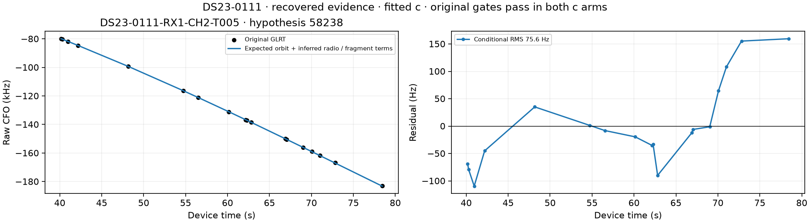
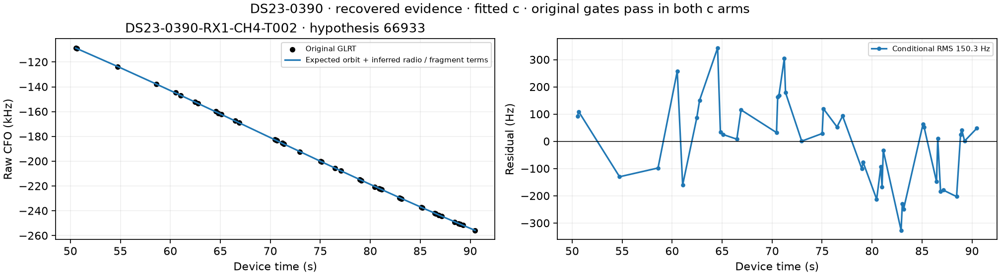

The plotted expected curves include nominal orbital Doppler and inferred
radio/fragment terms. Raw CFO displays use explicit observation IDs, the
persisted **Legendre** polynomial basis and breaks at integer alias wraps.
The interpolation adds no observations.

### Is 0390 simply a bad join or a receiver mismatch?

The four initial long-curve targets each contain **one persisted polynomial
piece**. A mistaken multi-piece graph join is not demonstrated. In particular,
the proposed 0390 RX1 CH4 T002 extends and overlaps an existing curve from
24.88–56.55 s, continuing through 50.53–90.48 s. Original 66933 support also
includes RX1 CH1 and RX1 CH2. **All of this family evidence is on RX1**;
these data cannot identify a cross-receiver discrepancy for this family.

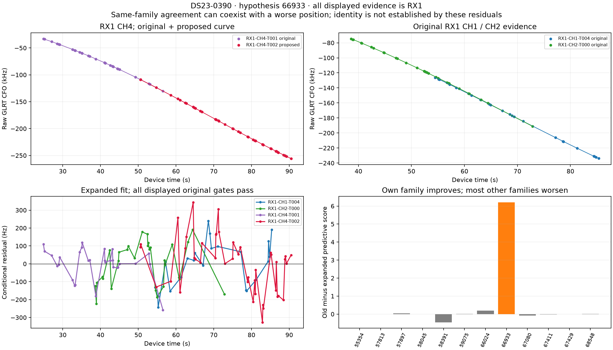

The 43-point addition has approximately 150 Hz final residual RMS and passes
the structure gates in both arms. Existing members also pass. Its own family's
held prediction improves substantially, while seven of the twelve original
families have worse held predictions. A coherent curve with a plausible
family can worsen localization through shared calibration/phase/position
tradeoffs. Rejecting its addition to this estimator does **not** prove the
curve or satellite identity is wrong.

On 0111 the accepted 18-point curve has only 31.47 Hz polynomial RMS, but its
satellite-fit slope z is approximately **2.97**, near the gate of 3, and lag-one
correlation is about **0.703**, near the short-track limit. Its joint fit uses
the existing constrained rescue. These are limited margins, not exceptionally
strong independent evidence.

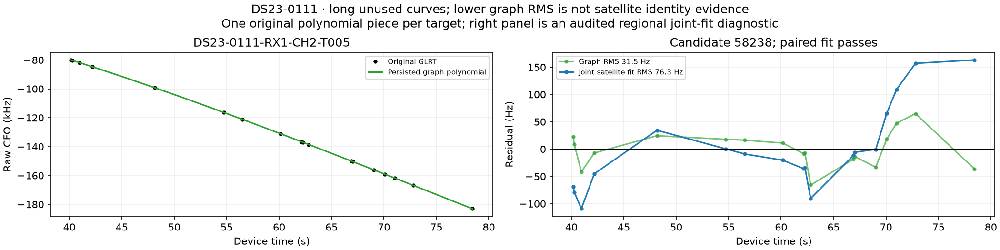
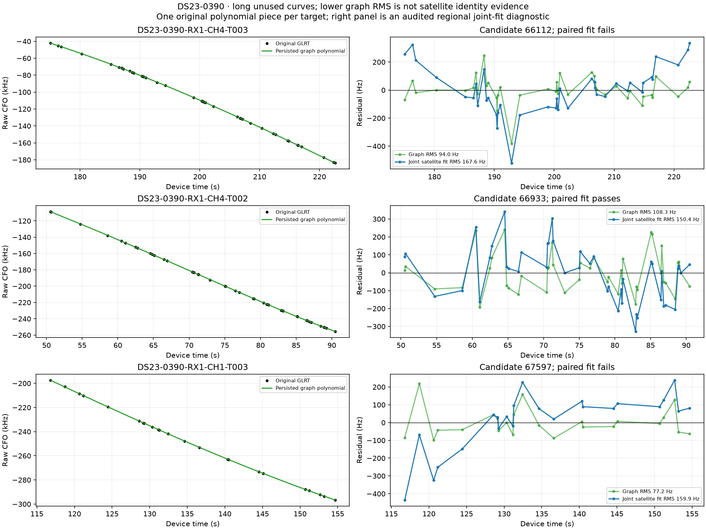

The remaining 0390 long hypotheses fail structured residuals, not just a large
RMS: 66112 retains quadratic BIC gain around 30.8 in its joint fit; 67597 has
slope z around 3.41 and quadratic gain around 22.7. Increasing polynomial
freedom or accepting them by RMS alone would conceal those failures.

### Does additional orbital flexibility explain the missing curves?

A diagnostic counterfactually enables the existing three physical orbit modes
on new single-owner families, with the original prior scales, frozen causal
receiver calibration and no new free polynomial. Actual owner counts and
inference support gates are unchanged. Independent predictive-density checks
pass. After marginalizing other nuisance terms and projecting out constant
and linear components, the largest prior-scale curvature information
eigenvalue is **below 0.01** for every tested curve. The small RMS changes
therefore do not justify relaxing orbital support requirements.

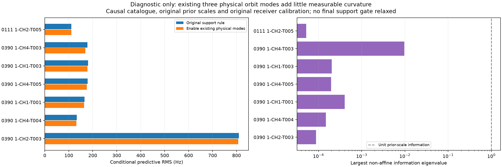

### Do following elements clarify the failures?

This diagnostic takes the earliest archived version with both epoch and
collection strictly **after scan end**, within 48 hours. It holds receiver
calibration and the causal RF endpoint fixed, profiles phase within ±15 s,
and uses the same observations/aliases and correlated radio/fragment
uncertainty. Neither diagnostic arm uses a phase prior or physical orbit-shape
modes. It is not the full final inference score and never supplies a nominee,
calibration, prior or position estimate to the causal algorithm.

| Scan / fragment | Hypothesis | Causal / following RMS Hz | Residual interpretation |
| --- | ---: | ---: | --- |
| 0111 RX1 CH2 T005 | 58238 | 111.07 / 112.19 | Both frozen-calibration profiles fail slope/correlation; final joint refit can pass |
| 0390 RX1 CH4 T003 | 66112 | 177.95 / 155.56 | Quadratic BIC remains 35.57 / 22.72; both fail |
| 0390 RX1 CH4 T002 | 66933 | 146.76 / 138.35 | Both pass this conditional noise screen |
| 0390 RX1 CH1 T003 | 67597 | 180.23 / 168.82 | Slope and quadratic structure remain; both fail |

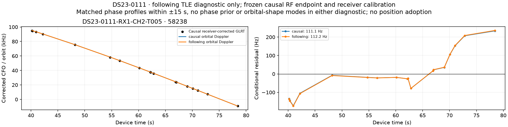
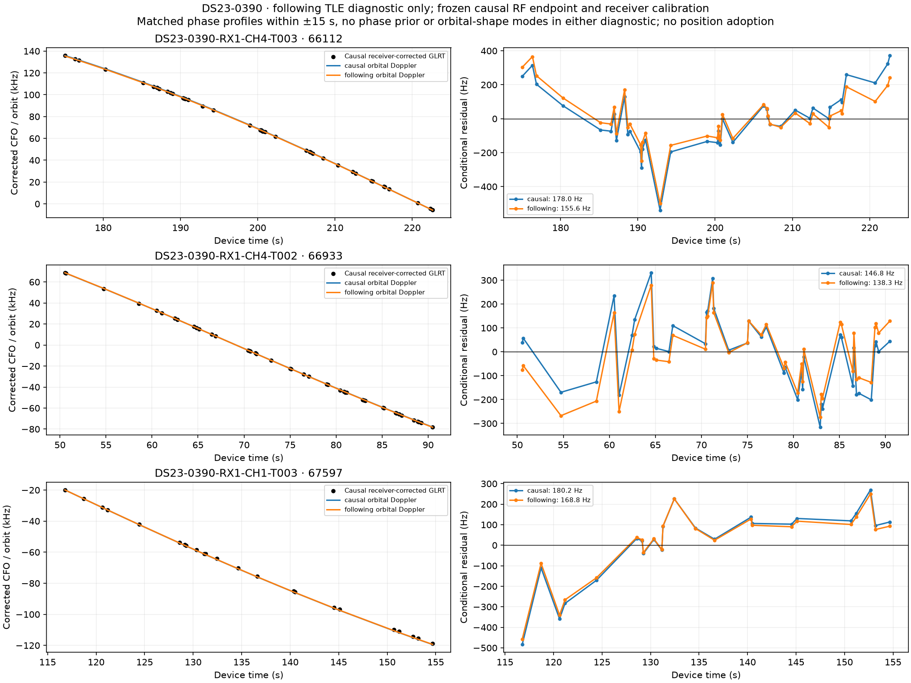

Following TLEs moderately reduce some residuals but do not remove the longest
remaining curves' structure. This does not establish their correct identity
or a localized cause of TLE error.

## RF-only predictive guard

For each original active family, temporarily hold its **original curved IDs**
out of calibration and remove its original predictive entries. Refit the
remaining original evidence in each c arm from the regional center, once
without and once with the new proposal. A proposed curve of the held family
stays in expanded training: it is allowed to predict that family's original
observations. Score the exact same held IDs/aliases/identity in both variants,
propagating full correlated radio uncertainty and existing causal phase/orbit/
fragment priors. All points return to an adopted final fit.

The frozen rule requires, in **both** c arms: total old-minus-new predictive
score above **2 log(2)**, nonnegative median family gain, valid phase convergence
and visibility. Overlapping folds make the total a composite diagnostic, not a
calibrated Bayes factor. The median checks breadth of support; total gain alone
would accept the harmful 0390 expansion.

| Scan | c arm | Total gain | Median family gain | Families improved | Decision |
| --- | --- | ---: | ---: | ---: | --- |
| 0111 | 0 | 3.6194 | +0.01595 | 7/12 | Adopt expansion |
| 0111 | fitted | 3.5354 | +0.01198 | 7/12 | Adopt expansion |
| 0390 | 0 | 6.0773 | -0.00775 | 5/12 | Keep incumbent |
| 0390 | fitted | 5.8804 | -0.00345 | 5/12 | Keep incumbent |

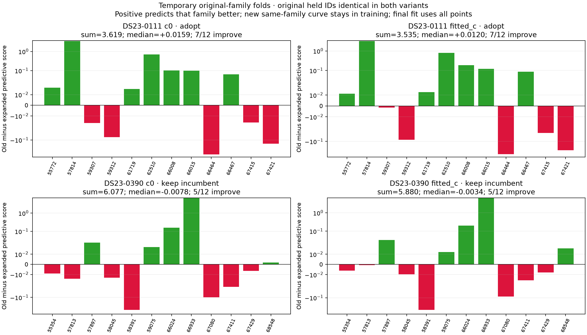

There is **no evaluation GPS or following TLE in this rule**. However, the rule
was designed **after seeing 0390's geographic regression**. These two examples
are engineering evidence, not a blinded validation. Median margins are small.
Training phase changes are below 0.00004 s, predictive changes below 6e-9 s,
and independent predictive-density discrepancies below 6e-10 in these folds;
this checks numerical replay, not robustness to model misspecification.
Original family labels are hypotheses: the guard can preserve bad incumbent
labels and reject useful evidence that conflicts with them. Gaussian predictive
approximations also omit some posterior uncertainty.

## Random20 confirmation: broad growth fails, guard remains too limited

The cohort was frozen with seed **2026102203** before development fold scores
were computed. It excludes the current six debug cases and four other named
engineering cases. It is scan-disjoint for this rule, but belongs to the same
site and a dataset studied by earlier methods; it is not untouched or
new-location validation. All20 scans remain in every summary. Eight have no
paired-valid proposal and retain the exact incumbent. Twelve receive the same
bounded growth procedure; all completed candidate fits and predictive folds
are audited before RF-only decisions are sealed and geographic errors scored.
The guard rule, priors, nominees and budgets are not retuned on these results.

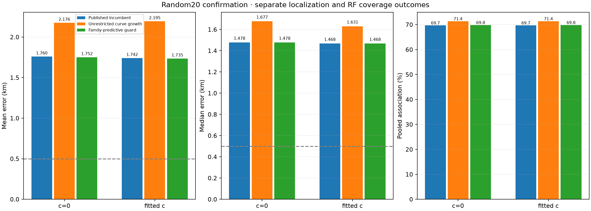

| Method | c arm | Mean km | Median km | P90 km | Pooled GLRT associated | Mean scan association |
| --- | --- | ---: | ---: | ---: | ---: | ---: |
| Published incumbent | 0 | 1.760208 | 1.478049 | 3.608457 | 69.6854% | 66.9324% |
| Unrestricted growth | 0 | 2.176401 | 1.677469 | 4.662510 | 71.3538% | 68.5955% |
| Frozen guard | 0 | 1.752070 | 1.478049 | 3.608457 | 69.8319% | 67.1462% |
| Published incumbent | fitted | 1.742088 | 1.467597 | 3.660107 | 69.6854% | 66.9324% |
| Unrestricted growth | fitted | 2.195018 | 1.630544 | 4.636048 | 71.3538% | 68.5955% |
| Frozen guard | fitted | 1.735452 | 1.467597 | 3.660107 | 69.8319% | 67.1462% |

The denominator is **47,769 original GLRT points**. Incumbent, unrestricted
and guarded policies associate **33,288 / 34,085 / 33,358** respectively.
No original accepted ID is lost. Unrestricted growth improves/worsens/leaves
unchanged **5/7/8** scans at c=0 and **4/8/8** at fitted c. The guard changes
only **0334**, retaining70 additional points and improving fitted-c error
**0.976063→0.843345 km** (132.7 m). It blocks all eight fitted-c regressions
in this sample, but also rejects three improving expansions. This is a
conservative engineering filter, not a demonstrated solution to position bias.

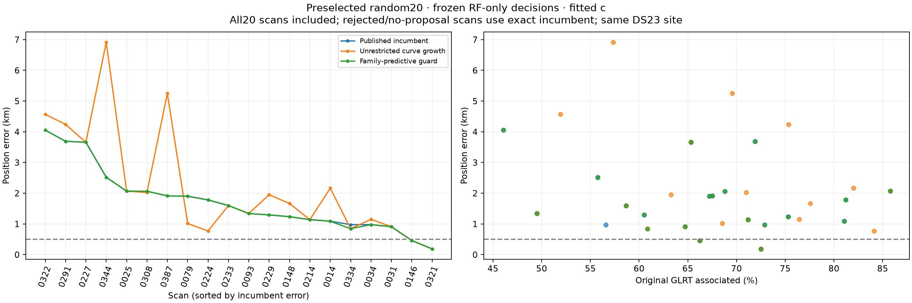

| Scan with proposal | Additional associated points, fitted c | Original / unrestricted error km | Guard adopts? |
| --- | ---: | ---: | --- |
| 0014 | 40 | 1.087 / 2.163 | No |
| 0034 | 125 | 0.976 / 1.149 | No |
| 0079 | 19 | 1.903 / 1.014 | No |
| 0148 | 86 | 1.235 / 1.663 | No |
| 0224 | 91 | 1.780 / 0.772 | No |
| 0229 | 43 | 1.293 / 1.951 | No |
| 0291 | 145 | 3.690 / 4.240 | No |
| 0308 | 24 | 2.063 / 2.024 | No |
| 0322 | 64 | 4.056 / 4.568 | No |
| 0334 | 70 | 0.976 / 0.843 | Yes |
| 0344 | 25 | 2.520 / 6.914 | No |
| 0387 | 65 | 1.912 / 5.247 | No |

These counts include post-fit extensions and therefore can exceed the number
of newly fitted curved points. The [row-level table](tables/confirmation_positions.csv)
separates associated points from likelihood utilization. Geographic gains do
not override the frozen guard, so0079 and0224 are not adopted by their GPS errors.

Unrestricted mean curved RMS changes only **124.205→124.369 Hz** fitted c,
while its mean geographic error worsens by **453 m** and its largest individual
regression is **4.394 km**. The guard's mean improvement is only **6.6 m** across
twenty scans, entirely from one case; median, P90 and count within0.5 km remain
unchanged. This does not justify an ALGO release or a claim of full-DS23 gain.
There is also no justification for repeatedly adjusting the majority threshold
against these geographic outcomes.

Confirmation computes **436 family-fold jobs**, covering218 original families
across twelve proposals, and independently replays **872 training endpoint
arms and872 predictive densities**. All pass; maximum training phase change
is0.00336 s, predictive phase change below9e-8 s, and independent density
discrepancy below5.1e-9. A worker run terminated with exit143 after430 jobs;
the cause is not identified. Only six unfinished jobs were rerun under the
same settings, with hashes proving all430 completed files were preserved.
All436 jobs are terminal and qualified. The observed inference/audit/selection
wall interval is approximately **18.9 minutes** on this host with up to20
single-threaded workers, including recovery; this is not an embedded benchmark.

[Summary](tables/confirmation_summary.csv),
[paired changes](tables/confirmation_paired_changes.csv),
[sealed RF decisions](evidence/confirmation_family_predictive_guard_selection.json),
[evaluation receipt](evidence/confirmation_evaluation.json),
[complete per-case receipt archive index](evidence/confirmation_receipts/index.json).
Each indexed case has a sibling `.tar.gz` archive, plus `common.tar.gz` for
the shared frozen protocols and interruption receipt. No following TLE enters
the confirmation pipeline.

## DBG01: search, family ablations and prior sensitivities

Each scan receives the full configured DBG01 analysis: all **12 active curved
families**, all **25/17 retained curved tracks**, two phase-prior controls,
and **81 regional starts** with a finite association bank. No single-family
deletion solves either scan. Best fitted-c family deletions reach **4.183 km**
on 0111 (remove 59312, 31 curved points) and **3.900 km** on 0390 (remove
57813, 23 curved plus 15 predictive points). These are oracle diagnostics,
not GPS-based rejection rules.

No individual retained curved-track deletion resolves the error either. The
best passing fitted-c deletion leaves **4.183 km** on 0111 (RX1 CH4 T003), and
**4.099 km** on 0390 (RX1 CH3 T000). A slightly lower 4.098 km result on 0390
fails paired gates and is not a valid repair.

Doubling phase width changes fitted-c error to 4.901/3.775 km; replacing the
causal phase mean by zero gives 4.034/3.488 km. These controls are not adopted.
The unchanged full objective prefers the incumbent over the evaluation site
by **17.92/13.91** negative-twice-ELBO units. Prior and normalization terms,
not only point residuals, contribute: phase, receiver smoothness, physical
orbit and fragment terms remain entangled with position.

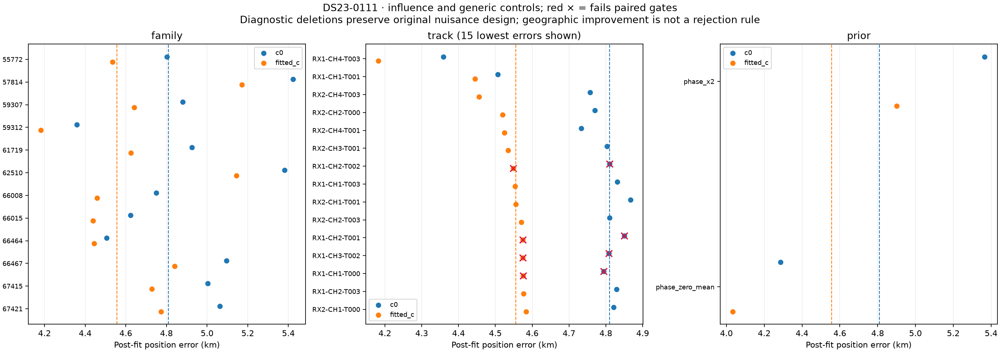
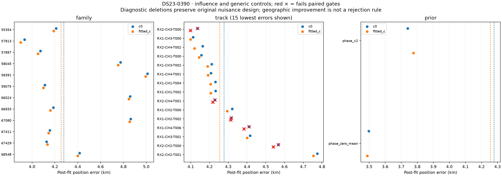
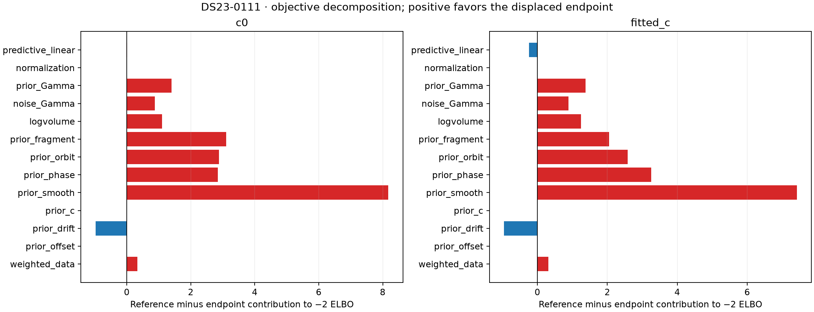
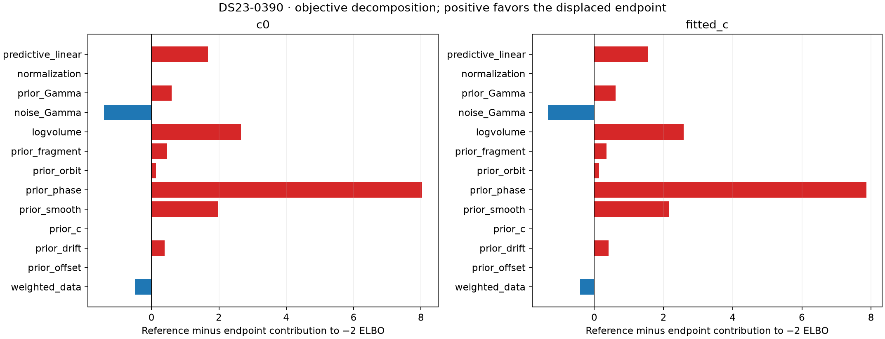

The original 10 km loss maps evaluate **317 points at 1 km spacing** in the
disk around the regional center, plus **289 points at 0.25 km spacing** within
±2 km of the evaluation site. Each pixel fixes position and refreshes nuisance
phases five times using the incumbent observations and assignments. Finite
differences show that conditional objective's gradient. This is **not** a full
pipeline rerun or satellite discovery at every pixel, nor a calibrated position
probability. The evaluation-centered inset is a report diagnostic only.

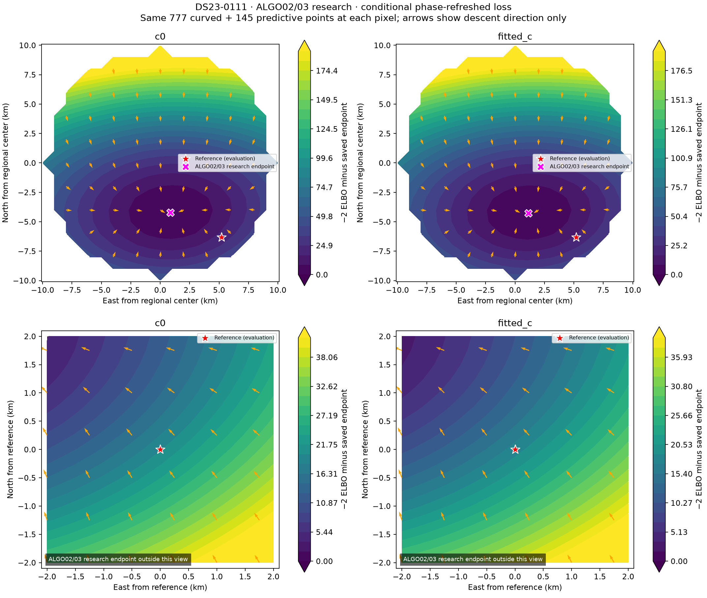
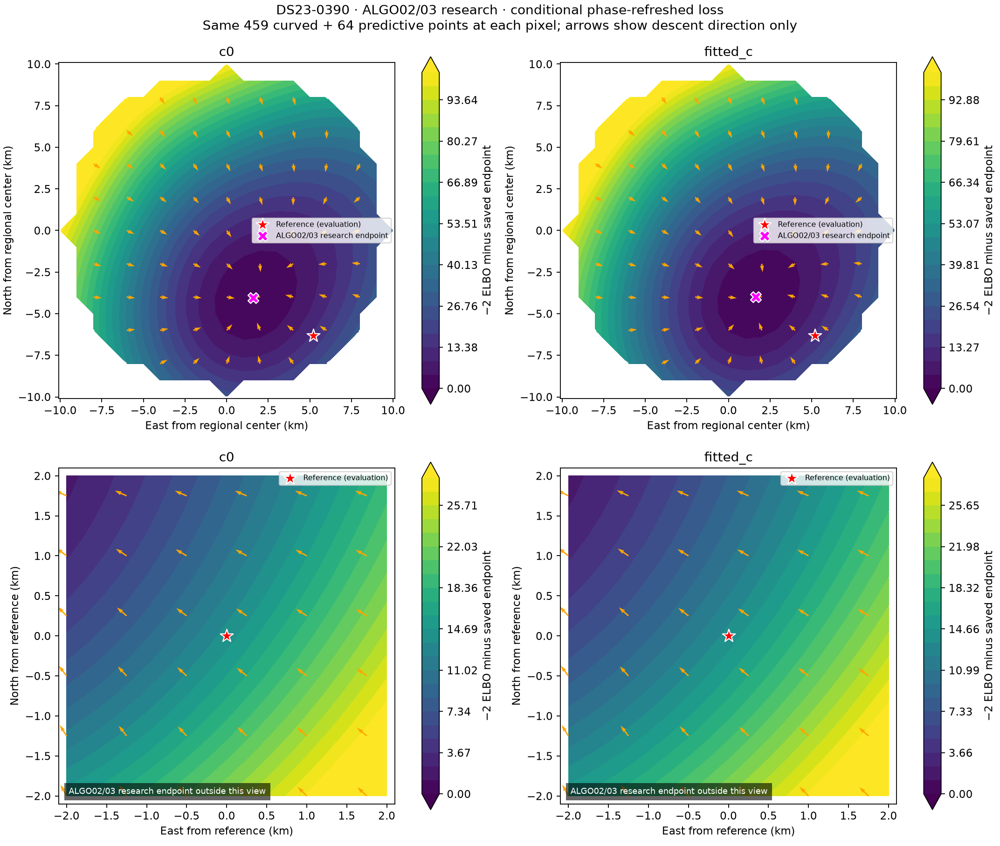

The restart figures begin at **81 positions at 2 km spacing** within the
10 km disk. c=0 can reselect among the finite causal assignment bank after
accepted descent steps; fitted-c follows its phase-round branch schedule.
This is limited discrete re-association, not unrestricted catalogue discovery
at every step. Original measurement masks stay fixed. The best alternatives'
RF gains are only 4.8e-9/1.5e-8 and fail the bank-size adoption penalty;
neither is promoted. These figures describe the **incumbent**, not the changed
observation mask of the recovery fits.

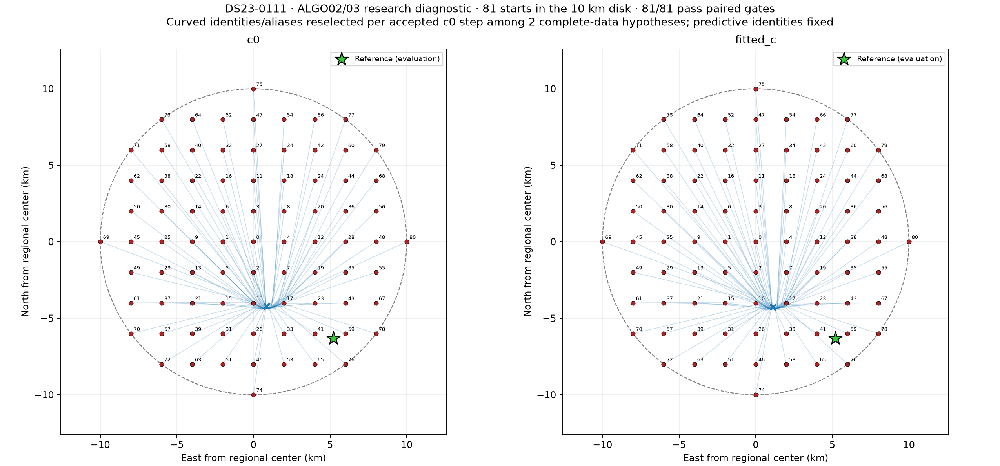
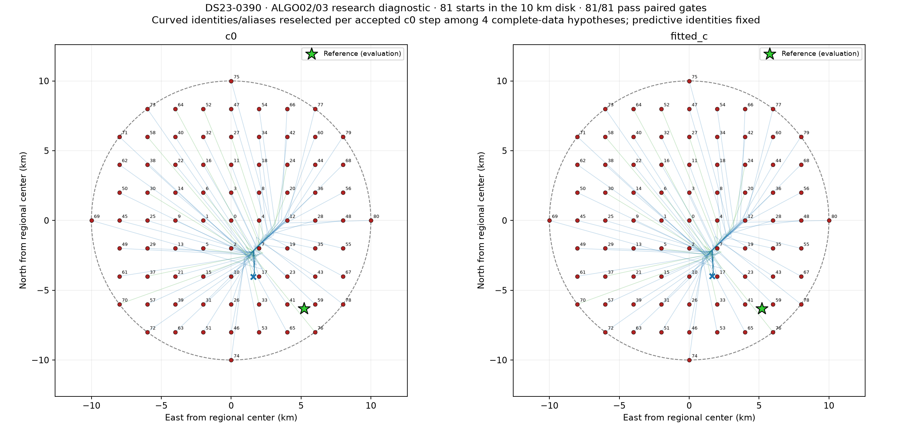

## Associated and unassociated GLRT

Gray always shows **all original GLRT**. In unused panels, red marks
unassociated points and colored lines show unused portions of persisted graph
polynomials. In associated panels, colors identify satellite hypotheses.

| Scan | Published incumbent | Unrestricted growth | RF guard |
| --- | --- | --- | --- |
| 0111 | [Associated](figures/DS23-0111_published_associated_GLRT.png), [unused](figures/DS23-0111_published_unassociated_GLRT.png) | [Associated](figures/DS23-0111_growth_associated_GLRT.png), [unused](figures/DS23-0111_growth_unassociated_GLRT.png) | [Associated](figures/DS23-0111_guarded_associated_GLRT.png), [unused](figures/DS23-0111_guarded_unassociated_GLRT.png) |
| 0390 | [Associated](figures/DS23-0390_published_associated_GLRT.png), [unused](figures/DS23-0390_published_unassociated_GLRT.png) | [Associated](figures/DS23-0390_growth_associated_GLRT.png), [unused](figures/DS23-0390_growth_unassociated_GLRT.png) | [Associated](figures/DS23-0390_guarded_associated_GLRT.png), [unused](figures/DS23-0390_guarded_unassociated_GLRT.png) |

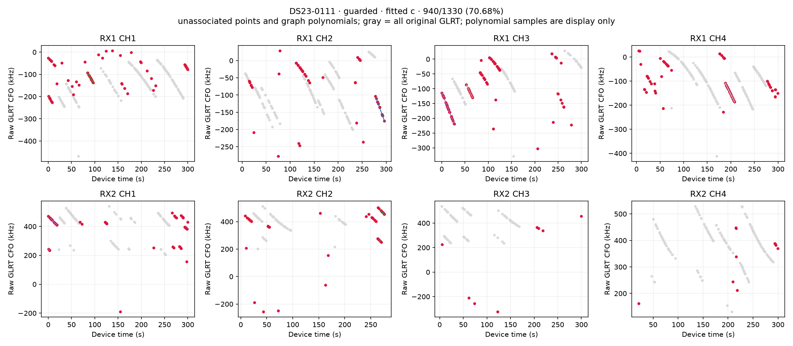
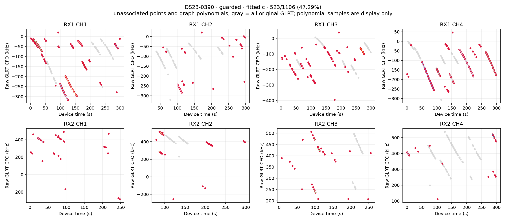

Residual population plots:
[0111](figures/DS23-0111_track_residuals.png),
[0390](figures/DS23-0390_track_residuals.png).

## Reproduction and scientific receipts

The [source bundle](source/tools/report_ds23_dbg01_iteration_003.py), frozen
[protocol](evidence/protocol.json),
[independent audit](evidence/independent_iteration_audit.json),
[guard protocol](evidence/family_predictive_guard_protocol.json) and
[sealed decisions](evidence/family_predictive_guard_selection.json) accompany
the figures. [All raw JSON/CSV scientific receipts](evidence/raw_scientific_receipts.tar.gz)
include inventories, all restarts/ablations/grids, nomination offers, final
fits, family folds and diagnostic following elements. They exclude logs and
duplicate PNGs. Reproduction uses the persisted causal inputs named by the
earlier [full assessment](../2026_10_22_ds23_family_cavity_full_assessment/README.md)
and [iteration 002](../2026_10_22_ds23_dbg01_iteration_002/README.md); it does
not collect RF or rerun IQ acquisition.

```bash
export PYTHONDONTWRITEBYTECODE=1
export PYTHONPATH=/tmp/algo03-feasible-deps:src:tools
export OPENBLAS_NUM_THREADS=1 OMP_NUM_THREADS=1
# Use a fresh output root; frozen evidence refuses silent replacement.
.venv/bin/python -B tools/run_ds23_dbg01_iteration_003.py --stage inventory
# Remaining runner stages: screen, nominations, positions, reentry_audit,
# support, support_finalize, dbg_prepare, dbg_audit_discover, dbg_bank,
# dbg_analysis, independent_audit, restart_selection.
.venv/bin/python -B tools/probe_ds23_all_curve_families.py --stage nominate
.venv/bin/python -B tools/probe_ds23_all_curve_families.py --stage fit --workers 20
.venv/bin/python -B tools/probe_ds23_all_curve_families.py --stage combine
.venv/bin/python -B tools/probe_ds23_all_curve_families.py --stage audit
.venv/bin/python -B tools/probe_ds23_family_predictive_guard.py --stage folds --workers 20
.venv/bin/python -B tools/probe_ds23_family_predictive_guard.py --stage select
```

The original DBG01 independent audit replays **472 endpoint arms** and 28
initial predictive densities. The broadened family test independently checks
14 additional joint prediction densities and 24 endpoint arms (including
repeated controls). The guard checks **96 training endpoint arms and 96
held predictive densities**. Eleven focused tests cover current-label context,
group covariance, fold masks, acceptance, physical curvature projection and
association-versus-likelihood accounting. Audit success establishes numerical
consistency, not satellite identity truth or new-location generalization.

Tables:
[family ablations](tables/family_ablations.csv),
[all interventions](tables/all_interventions.csv),
[failed trial gates](tables/trial_gates.csv),
[predictive scores](tables/family_predictive_scores.csv),
[following profiles](tables/following_TLE_profiles.csv),
[orbit support](tables/orbit_support.csv),
[residual diagnostics](tables/residual_diagnostics.csv).

This bounded two-scan batch and its random20 confirmation are closed. Keep
the incumbent: broad growth regresses and the guard's single-case gain is too
limited for promotion. Move to the next worst DBG01 cases, **0221 and0322**,
rather than repeatedly tuning these two against GPS. 0322 already has a rejected
growth trial in the confirmation; reuse that evidence instead of rerunning it.
Future ALGO promotion requires matched full-DS23 mean, median, tails,
regressions, availability, coverage and runtime results.
