# DS23 DBG01 iteration 004: unsupported orbit parameters and points outside the graph

This bounded iteration builds on **ALGO02 and ALGO03**, examining **0221 and
0322**. Causal graph repairs recover28 and26 original GLRT points, reducing
fitted-c errors **4.133→2.273 km** and **4.056→3.776 km**. A specific support
check problem reproduces on three other scans: the repair recovers231 additional
associated points across19 confirmation scans, but improves their mean by only
**10.9 m**, with an unchanged median and one regression.

We also prototype direct use of **every winning GLRT point outside the graph**,
with satellite/clutter uncertainty instead of forced assignments. It detects
substantial conditional RF evidence, but does **not** establish a validated new
position minimum. Numerical instability and covariance between predictive
blocks are explicitly checked before drawing geographic conclusions.

**No new ALGO release is promoted.** The published
[full-DS23 reference](../2026_10_22_ds23_family_cavity_full_assessment/README.md)
remains410 available scans, fitted-c mean **1.469461 km**, median **1.178102 km**;
0012,0184 and0286 remain unavailable. The mean-and-median **0.5 km goal is unmet**.
These are conditional engineering and same-site confirmation results, not a new
full-population benchmark or proof of generalization to a new location.

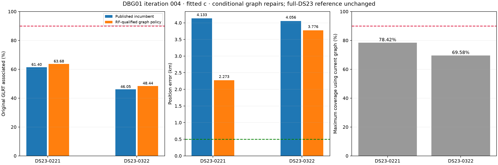

## Controlled results

All inference retains the original **25 ×25 km** box centered at **37.906,
-122.545**. Reentry and branch-control fits start at regional[0,0], using five
phase refreshes and48 position steps. c=0 and fitted-c use the same observations,
nominees, other priors, gates and budgets. Evaluation GPS
**37.849061591561885,-122.48574968092912** ranks debug priority and evaluates
frozen outcomes only. All inference elements have epoch and collection time
at or before the scan cutoff. Following TLEs are diagnostic only.

| Scan | Method | Associated / all GLRT | Associated % | Error c=0 km | Error fitted-c km | Curved RMS c=0 / fitted Hz |
| --- | --- | ---: | ---: | ---: | ---: | ---: |
| 0221 | Published incumbent | 754/1228 | 61.40% | 4.067 | 4.133 | 175.91 /175.82 |
| 0221 | RF-qualified graph repair | **782/1228** | **63.68%** | **2.376** | **2.273** | 174.92 /174.89 |
| 0322 | Published incumbent | 501/1088 | 46.05% | 4.071 | 4.056 | 163.78 /163.61 |
| 0322 | Repair with active-owner support | **527/1088** | **48.44%** | **3.791** | **3.776** | 172.85 /172.68 |
| 0322 | Earlier64-point shared-family growth, not adopted | 565/1088 | 51.93% | 4.579 | 4.568 | 175.53 /175.44 |

All original accepted IDs remain associated. For these two graph repairs,
associated points equal points used in position:0221 has632 curved plus150
predictive points;0322 has506 curved plus21 predictive points. Counts are unique
original winning GLRT IDs, not interpolated samples or extra native peaks.
Frequency fit and geographic accuracy are separate:0322's RMS rises despite
the small position improvement, and the larger64-point fit has worse position.

| Scan | Original → repaired fragments | Points/fragment | Graph-only coverage ceiling | Points outside graph | Minimum outside points needed to reach90% |
| --- | ---: | ---: | ---: | ---: | ---: |
| 0221 | 29→30 | 26.00→26.07 | 963/1228 =78.42% | 265 | 143 |
| 0322 | 22→23 | 22.77→22.91 | 757/1088 =69.58% | 331 | 223 |

Perfect association of the existing graph still cannot reach90%. The outside
points are not automatically valid satellite detections; they need independent
association evidence. [Exact paired metrics](tables/position_and_association.csv).

## 1. What prevents the long curves from entering?

Reuse the existing full-causal-catalogue nomination, shared receiver-calibration
covariance, phase/physical-orbit priors, integer aliases and joint residual gates.
Proposed curves do not calibrate their own nomination. On0221, test the two
wholly unused actively curved fragments, their combination and original-nominee
controls. On0322, reuse the **exact previously completed trials** from the
[random20 experiment](../2026_10_22_ds23_dbg01_iteration_003/README.md), rather
than repeating fits. Reuse requires identical incumbent IDs, curved/predictive
counts and both RF endpoints; the copied trials receive fresh independent audits.

0221 **RX1 CH4 T002**,28 points over27.79 s, passes with hypothesis **60261**.
Its addition reduces fitted-c error to2.273 km. The longest unused curve,
**RX1 CH1 T003**,23 points over33.79 s, nominates64435 but retains quadratic
structure: joint conditional RMS267.2 Hz and quadratic BIC gain15.95, above10.
It is not accepted merely because its RMS is below450 Hz.

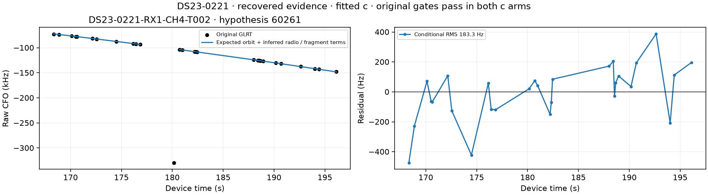
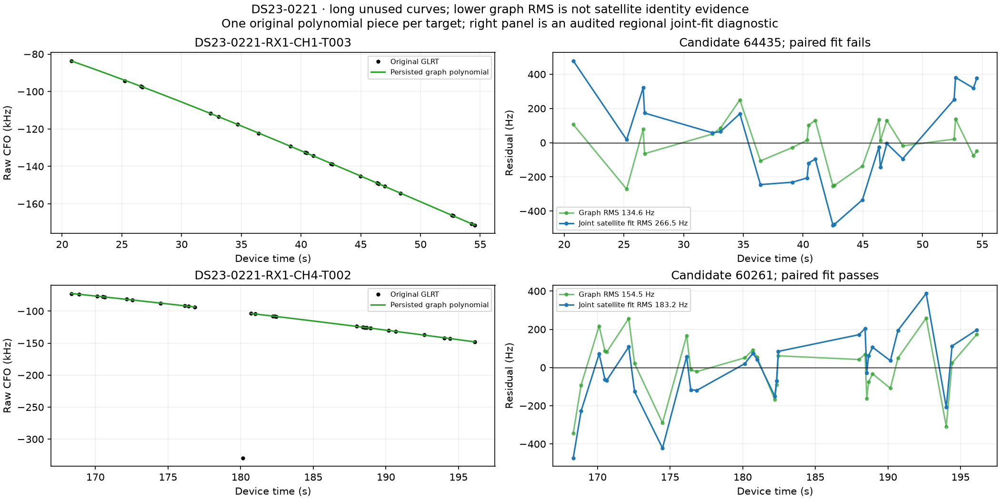

0322's three initial long targets also contain **one persisted polynomial
piece each**. A mistaken multi-piece graph join is not demonstrated. The
38-point RX1 CH4 T000 hypothesis62422 retains curvature and serial correlation;
the24-point RX1 CH3 T001 hypothesis63571 has quadratic BIC gain about10.8 in
the joint fit. Another26-point curve has a different failure, examined next.

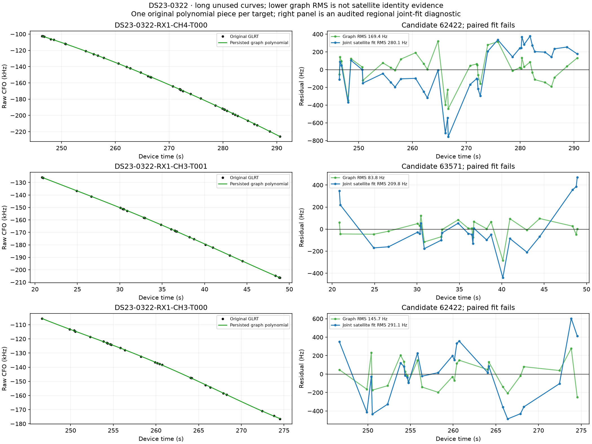

The figures join explicit physical observation IDs to raw CFO and use the
persisted **Legendre** polynomial basis. Integer alias wraps break display
lines; they are not physical discontinuities. Expected orbit curves include
inferred receiver and fragment terms, not just nominal Doppler. Satellite
identities remain conditional hypotheses rather than external truth.

## 2. A curve can pass frequency checks but fail an unnecessary support requirement

0322 **RX1 CH3 T000**,26 points, nominates **62422**. Its original joint fit
has approximately291 Hz residual RMS, acceptable mean/slope/curvature/step/
correlation checks, unchanged aliases, about116–120 Hz profile bias, and
minimum predicted elevation **45.2°**. Nevertheless, it is rejected.

The cause is the support check. The model counts other **masked-out nominees**
as owners of62422 and enables three physical orbit-shape parameters. The final
gate correctly requires two **active, passing receiver/channel owners** for
those parameters, but only this one curve is active. Thus a frequency-compatible
curve is rejected because the fitted model contains unsupported extra terms.

The repair preserves every incumbent mode and measurement, keeps the new
family's phase, and disables its three unsupported shape parameters. It does
not relax the two-owner rule, make linear tracks calibrators, or loosen a
residual/visibility gate. The26-point phase-only addition then passes both c
arms and gives3.776 km fitted-c error. This is a support bookkeeping repair,
not proof of62422's identity.

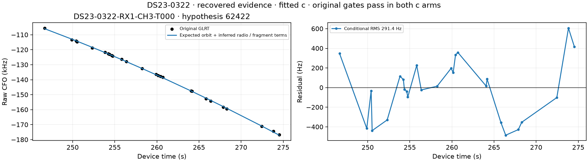
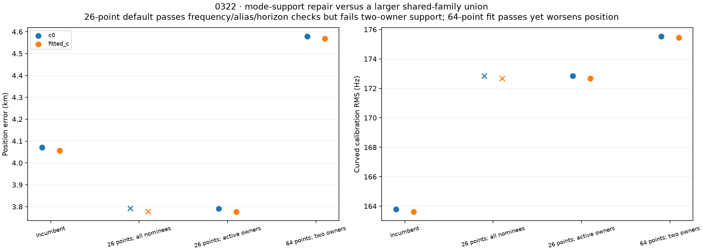

The earlier64-point union activates two owners, legitimately retains the
physical modes, and passes. Its fitted-c error is **4.568 km**. It is reused
and independently replayed, not refitted or promoted because it contains more
points. [Support and union metrics](tables/support_and_union.csv).

### Confirmation on19 other scans

Exclude0322, which motivated the rule, from the earlier preselected random20.
Freeze the mechanical test before new fits or geographic scoring: offer only
previously rejected proposals that pass **every non-owner gate**, then remove
new one-owner shape terms while preserving protected incumbent modes. Already
valid broad-growth proposals are not offered. Test at most two eligible repairs
per scan; otherwise retain the exact incumbent.

This is scan-disjoint confirmation for the current repair, on the same previously
studied DS23 site. It is not an untouched cohort or new-location evaluation.
Three scans accept repairs;16 retain their exact results. Four trial repairs
receive eight independently replayed paired endpoint/density checks. No original
accepted point is lost.

| Policy | c arm | Mean km | Median km | P90 km | Pooled GLRT associated |
| --- | --- | ---: | ---: | ---: | ---: |
| Incumbent | 0 | 1.638600 | 1.339351 | 2.928385 | 70.2363% |
| Owner-only repair | 0 | 1.629115 | 1.339351 | 2.928385 | 70.7311% |
| Incumbent | fitted | 1.620286 | 1.337187 | 2.747136 | 70.2363% |
| Owner-only repair | fitted | 1.609421 | 1.337187 | 2.747136 | 70.7311% |

The denominator is46,681 original GLRT points. Association increases
**32,787→33,018**, a gain of231 including post-fit extensions.

| Changed scan | Added curved / associated points | Original → repaired fitted-c error km |
| --- | ---: | ---: |
| 0014 | 79 /98 | 1.086781→1.152460 |
| 0148 | 50 /74 | 1.234758→1.068819 |
| 0321 | 59 /59 | 0.186867→0.080694 |

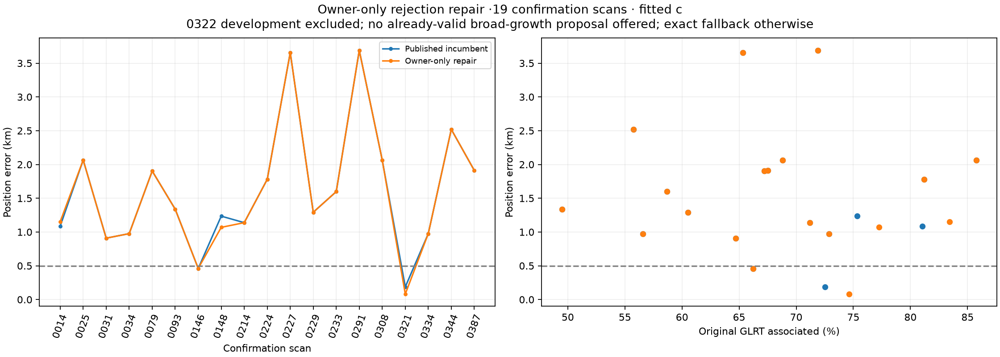

Two positions improve, one worsens and16 are unchanged. Mean fitted-c frequency
RMS changes only122.131→122.053 Hz. The repair generalizes in recovering
evidence, but the **10.9 m** mean position gain, unchanged median/P90 and66 m
regression on0014 do not justify a new ALGO release. Do not exclude0014 or
retune eligibility using its geographic error.

[All19 paired rows](tables/owner_confirmation_positions.csv),
[aggregate metrics](tables/owner_confirmation_summary.csv).

## 3. No single ablation resolves the remaining error

DBG01 covers all **11/12 active curved families**, all **18/20 retained curved
tracks**, two phase-prior controls and81 regional starts per scan. Best passing
fitted-c family deletions leave **2.990 km** on0221 (60266) and **3.576 km** on
0322 (64453). Best single-track deletions leave **4.050/3.576 km**. A2.709 km
0322 family-deletion result fails paired gates and is not a valid repair.

Doubling phase width gives4.328 km on0221;0322's3.687 km result fails gates.
Zeroing the causal phase mean gives3.574/3.914 km. These are diagnostic
sensitivities, not GPS-selected prior replacements.

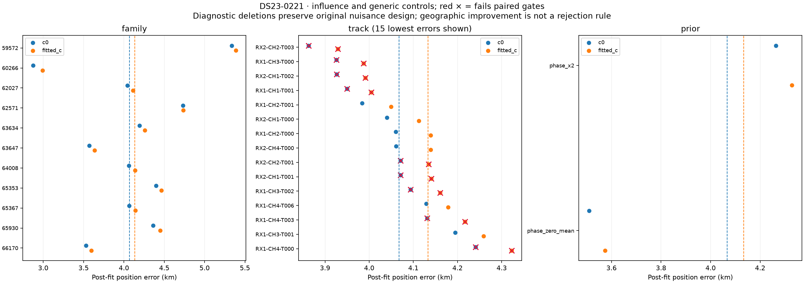
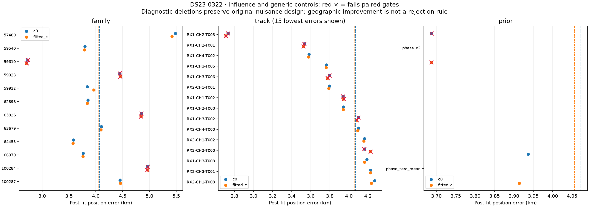

The incumbent objective prefers its RF endpoint over the evaluation site by
**9.748/7.190** negative-twice-ELBO units, fitted c. On0221, the receiver smoothness
prior contributes+10.295 units at the evaluation site, partly offset by other
terms. On0322, noise-Gamma terms contribute+6.706 units, with smoothness
contributing-2.988. This identifies different model/prior tradeoffs; it does
not establish which prior should be changed or prove a particular satellite
wrong. The current objective, not just optimization effort, favors displacement.

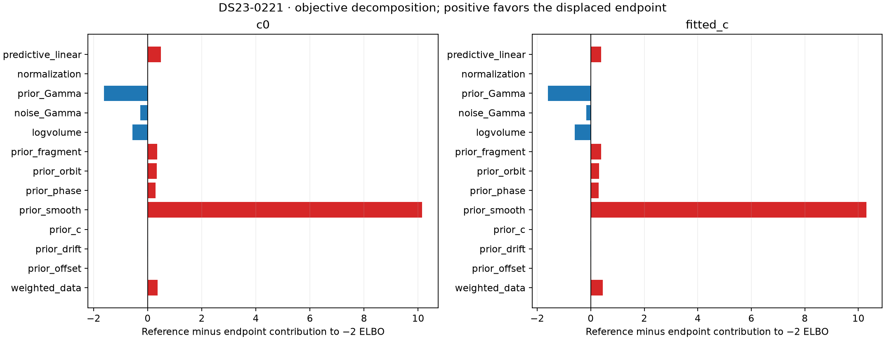
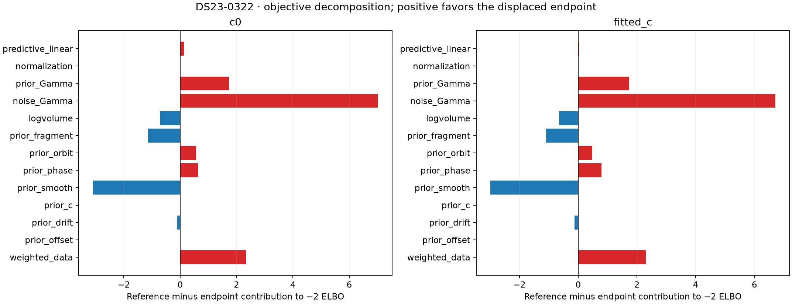

### What the10 km maps and starts actually compute

The standard maps evaluate317 positions at1 km spacing in the disk around
the regional center, plus289 positions at0.25 km spacing within±2 km of the
evaluation site. At each pixel, position is fixed and nuisance phases refresh
five times. Observations, aliases and incumbent assignments stay fixed. Arrows
are finite-difference descent directions. This is a conditional RF objective,
not a calibrated probability or a full pipeline rerun per pixel. The
evaluation-centered inset is reporting only.

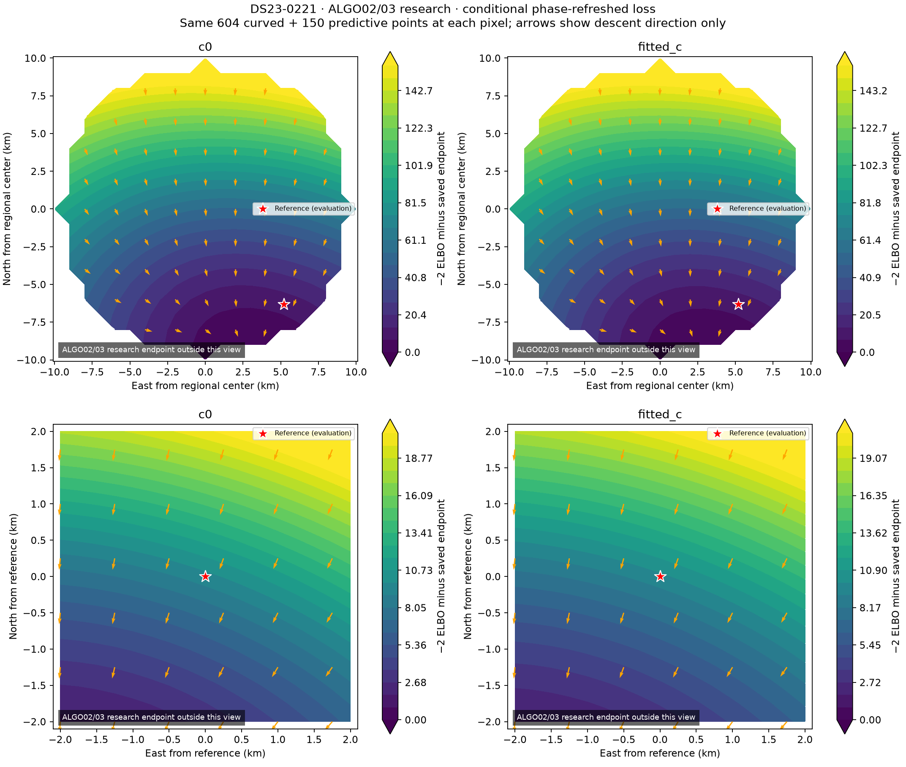
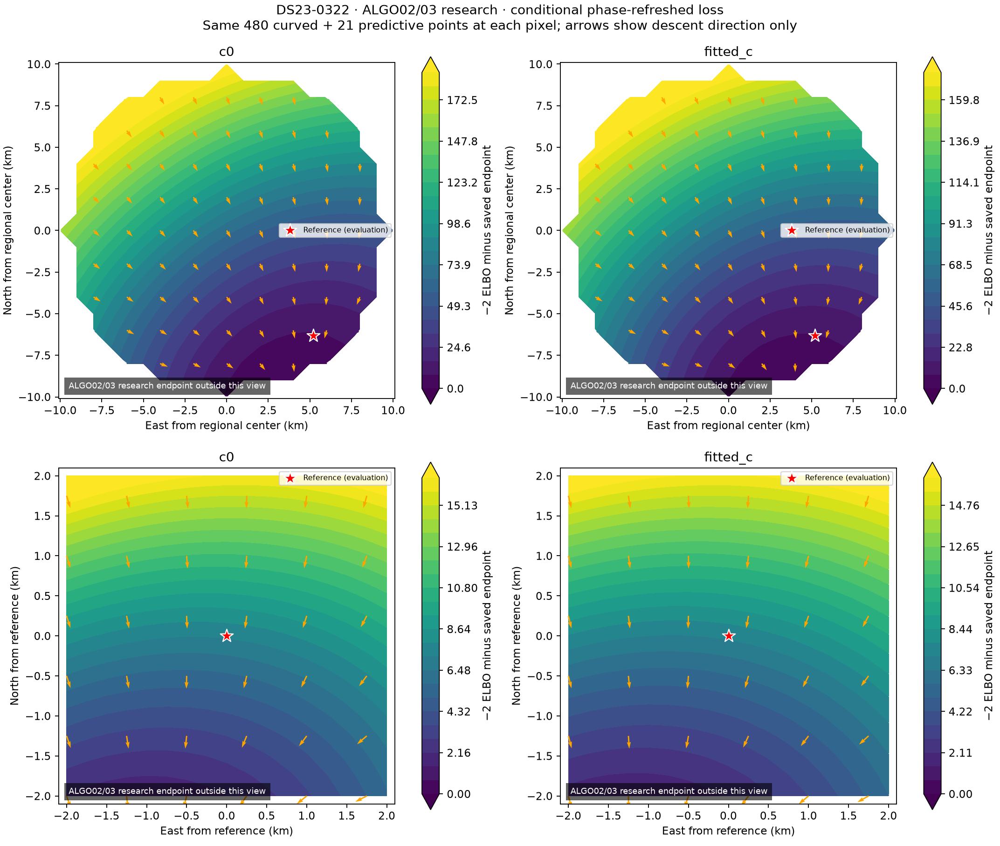

The81 starts use2 km spacing in the10 km disk. c=0 can switch among a finite
causal bank after accepted steps; fitted-c follows its phase-round schedule.
The banks contain2/4 hypotheses. Catalogue discovery is not repeated at every
step. On0221, the best compatible restart gains only-6.2e-9 RF units, so none
is adopted. On0322, **no restart endpoint passes all gates**; its plotted
convergence must not be interpreted as81 qualified position solutions.

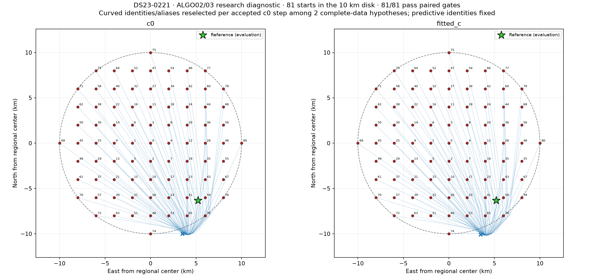
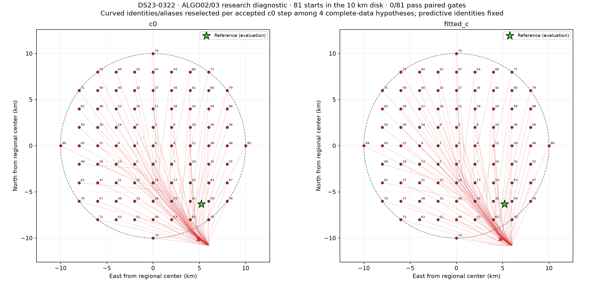

A bounded follow-up cold-fits every existing bank branch using the normal
paired near-feasible rescue, retaining the valid incumbent. On0322, all four
branches can produce valid fits; branch3 requires rescue and reaches3.909 km
fitted-c error. Its corrected c=0 gain **1.171** is below the declared bank
penalty **2.773**, so it is not adopted. No tested branch exposes a strong,
qualified near-truth solution. This remains a finite-bank diagnostic, not a
global-optimality proof.

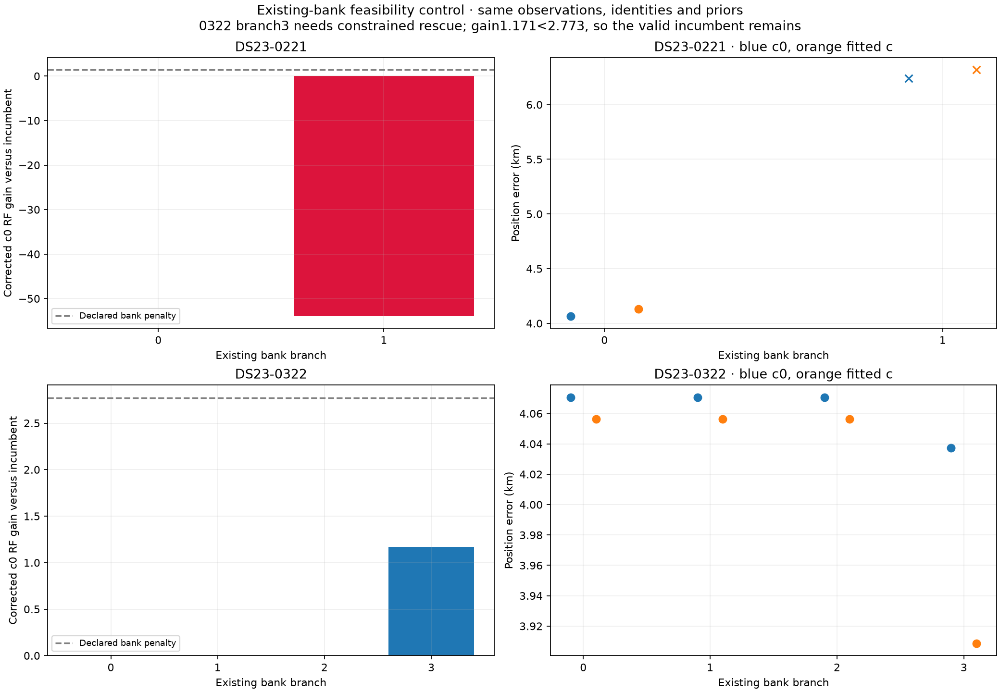

## 4. Direct use of points outside the graph

The new research prototype uses all265/331 original orphan winning points,
without selecting only those close to a predicted curve. Candidates are all
families inferred from the active curved tracks, not manually supplied IDs.
At each point, the signal model is an equal mixture of visible families'
wrapped-Gaussian CFO predictions. Clutter is uniform on the alias period
`1/4.4e-6 Hz`. A scan-wide signal fraction has a uniform prior and is integrated
by Gauss–Legendre quadrature. Full correlated Gaussian calibration uncertainty
at the curved model's Gamma precisions is shared across all orphan points.

Two fixed hypotheses use either no additional fragment constant or the existing
300 Hz Gaussian scale shared per family/RX/channel/RF lane. No orphan point
enters the curved calibration normal equations. All original curved and linear
observations remain. This is a conditional approximate predictive model;
original family labels are hypotheses, and Gaussian uncertainty is not a
calibrated full hierarchical posterior.

### Numerical qualification before position inference

Direct prior draws collapse to roughly1–3 effective nuisance samples. An
EM-guided Gaussian-mixture importance proposal improves this. EM supplies only
numerical proposals; every draw receives its exact prior/proposal density ratio.
The sampler retains a10% prior component and three EM proposals, preserving
uninformed prior directions. It does not substitute EM coefficients for the
stored curved calibration.

The frozen requirements are independent-seed loss disagreement≤0.5, at least32
effective draws, and64-versus128-node quadrature difference≤0.05. One bounded
sample escalation from1024 to16,384 is permitted. Only0221's strict zero-extra-
constant hypothesis qualifies **both** c arms at the incumbent endpoint.
Neither300 Hz hypothesis, nor0322's paired strict hypothesis, qualifies. Their
position searches are not run.

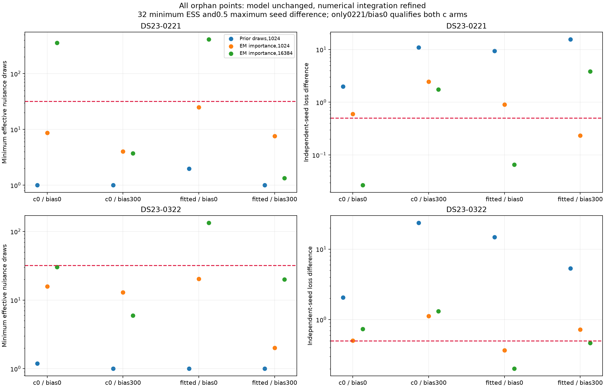

0221's conditional regional search uses25 coarse points over the original box,
then three3×3 refinements at3,1 and0.25 km. Both arms evaluate identical pools;
c=0 RF scores choose refinement centers. The coarse calculation uses1024 draws
for exploration. The final pool contains all nine fine-grid points plus both
original RF endpoints, checked with two16,384-draw integrations.

**Every proposed fine-grid point fails the paired numerical requirements.**
The only eligible positions are the two original RF endpoints. The selector's
large RF gain is against the *all-clutter observation model*, not evidence of
a new position minimum. Returning an incumbent point is not convergence to a
new, qualified minimum. No orphan-driven position update is adopted.

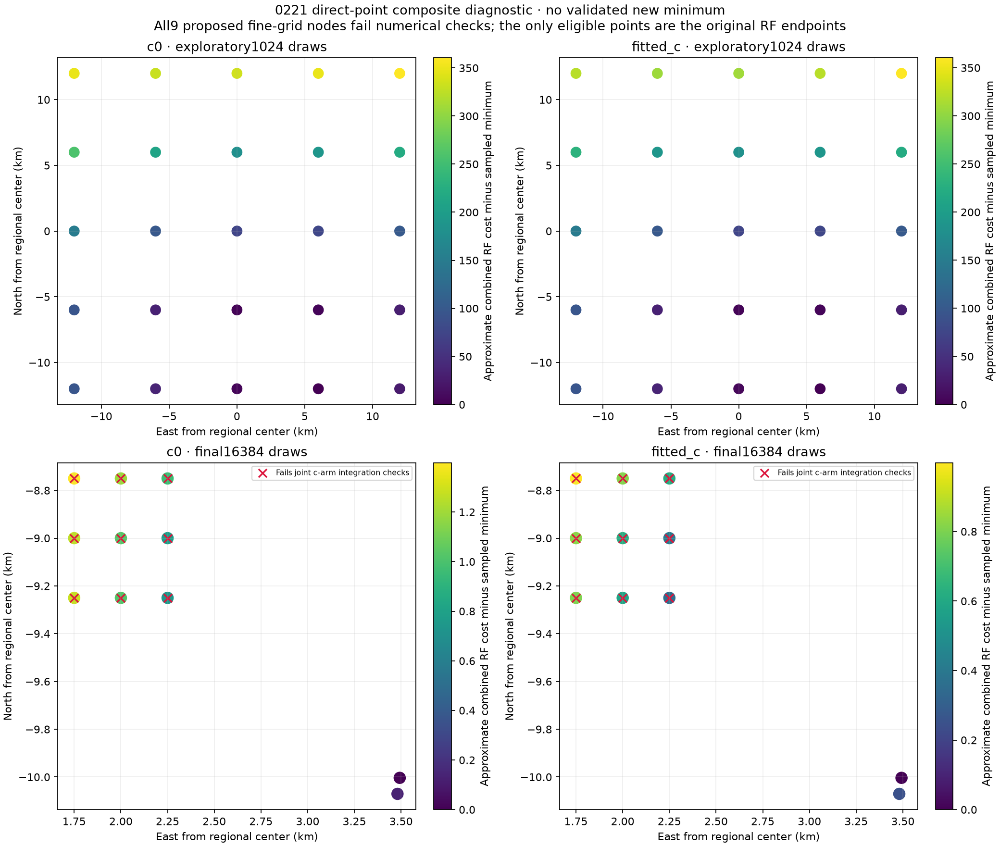

A driver path-conversion error interrupted the first pass after the25 coarse
nodes. The exact initial source is archived; the mechanical path fix resumes
identical requests and preserves completed hashes. Coordinates, scores,
priors, integration settings and RF selection rules are unchanged by that fix.

### Preserve covariance with existing linear evidence too

The initial diagnostic multiplies the old linear predictive block and the new
orphan block after separate integration; this is a **composite approximation**.
They share calibration uncertainty, so it is not their full joint predictive
density. A separate control analytically conditions the Gaussian integral on
the existing linear block before integrating orphan likelihoods. It includes
the original300 Hz linear-fragment constants and independently replays the old
linear normalization to within1e-5. Original curved calibration outputs remain
unchanged; the conditioning is an integral factorization, not a new linear
calibration estimate.

The joint control evaluates frozen original and composite-selected RF endpoints
only. It is not a new regional optimization. On0221, effective samples exceed
900 and independent-seed differences are below0.1 RF units. It confirms
substantial conditional signal-versus-clutter evidence, not a location gain.

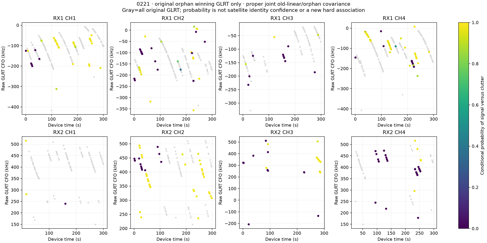

At the original fitted-c endpoint, the model's expected signal count is about
**157.4 of265**. No point exceeds99% signal probability, and these probabilities
are not verified satellite identities or accepted polynomial tracks. **Zero
new hard associations are claimed from this diagnostic.** Uniform family
weights, a global clutter fraction and uncertain geometry limit individual
confidence even when collective RF structure is strong. A future test could
use temporal continuity to distinguish coherent paths from isolated matches;
that extension is not implemented or validated here.

## 5. Following TLEs do not remove the long-curve discrepancies

Use the earliest archived element with both epoch and collection after scan
end, within48 hours, strictly for diagnosis. Hold the causal RF endpoint,
receiver calibration, observations and aliases fixed. Both diagnostic arms
profile phase within±15 s without a phase prior or physical orbit-shape modes.
These are not final inference scores or noncausal position estimates.

| Curve | Hypothesis | Causal / following profile RMS Hz |
| --- | ---: | ---: |
| 0221 RX1 CH1 T003 | 64435 | 266.31 /266.29 |
| 0221 RX1 CH4 T002 | 60261 | 211.31 /215.27 |
| 0322 RX1 CH4 T000 | 62422 | 274.40 /276.33 |
| 0322 RX1 CH3 T001 | 63571 | 221.90 /223.59 |
| 0322 RX1 CH3 T000 | 62422 | 290.90 /291.20 |

The long38-point62422 and24-point63571 profiles retain structure under either
version; the26-point62422 profile passes its conditional noise screen under
both. This is consistent with its support-check problem. Following elements
do not supply a general residual repair or establish identity truth.

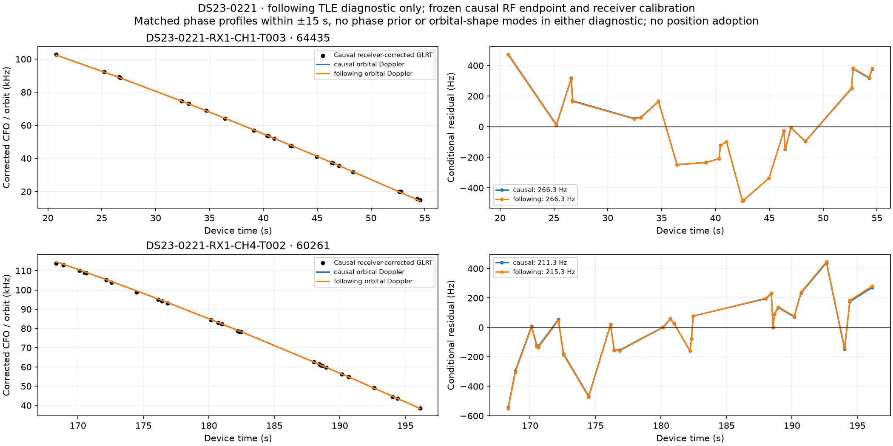
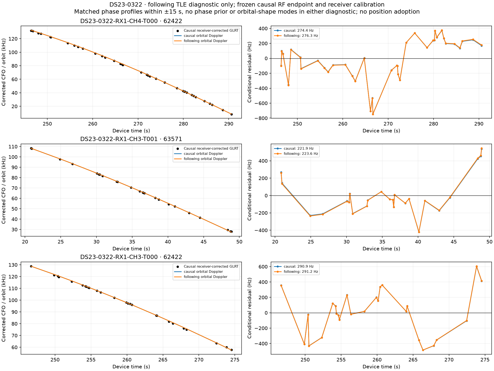

## Associated and unassociated GLRT

Gray shows all original GLRT. In unused panels, red marks unassociated points
and colored lines show unused parts of graph polynomials. Associated panels
color satellite hypotheses. The orphan-probability figure above uses a separate
signal/clutter color scale and must not be read as hard association.

| Scan | Incumbent | Graph repair |
| --- | --- | --- |
| 0221 | [Associated](figures/DS23-0221_published_associated_GLRT.png), [unused](figures/DS23-0221_published_unassociated_GLRT.png) | [Associated](figures/DS23-0221_graph_policy_associated_GLRT.png), [unused](figures/DS23-0221_graph_policy_unassociated_GLRT.png) |
| 0322 | [Associated](figures/DS23-0322_published_associated_GLRT.png), [unused](figures/DS23-0322_published_unassociated_GLRT.png) | [Associated](figures/DS23-0322_graph_policy_associated_GLRT.png), [unused](figures/DS23-0322_graph_policy_unassociated_GLRT.png) |

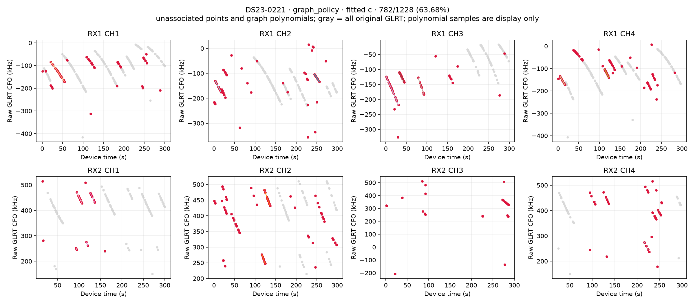
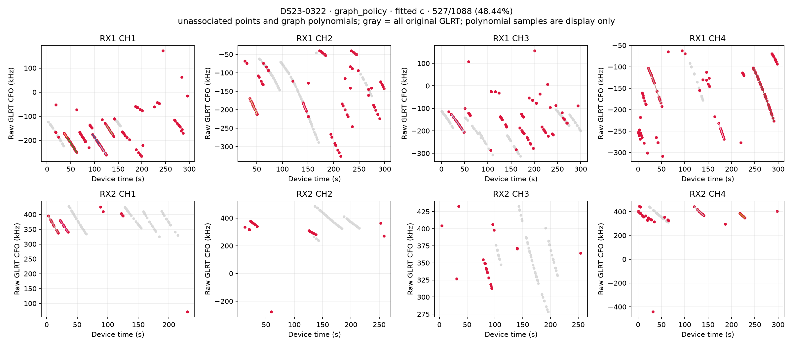

Retained-track RMS/structure populations:
[0221](figures/DS23-0221_track_residuals.png),
[0322](figures/DS23-0322_track_residuals.png).

## Reproduction and decision

The [source bundle](source/tools/run_ds23_dbg01_iteration_004.py) reuses the
existing ALGO02/ALGO03 engines and persisted causal inputs from the linked
[full assessment](../2026_10_22_ds23_family_cavity_full_assessment/README.md).
No IQ is reprocessed, no RF is collected, and no stationary history is pooled.
The [complete scientific receipts](evidence/raw_scientific_receipts.tar.gz)
contain frozen protocols, all DBG01 endpoints/maps/starts, nomination offers,
trial fits, reuse receipts, support controls, all orphan qualification and
regional-search nodes, the joint-covariance control,19-scan confirmation and
finite-bank controls. The earlier0322 group is linked by hash in
[its fresh replay receipt](evidence/reused0322_group_audit.json) and preserved
in iteration003's corresponding confirmation archive.

Run with one BLAS thread per process:

```bash
export PYTHONDONTWRITEBYTECODE=1
export PYTHONPATH=/tmp/algo03-feasible-deps:src:tools
export OPENBLAS_NUM_THREADS=1 OMP_NUM_THREADS=1
# Use a fresh output root; inference receipts preserve completed evidence.
.venv/bin/python -B tools/run_ds23_dbg01_iteration_004.py --stage inventory
# Remaining runner stages: screen, nominations, positions, reentry_audit,
# dbg_prepare, dbg_audit_discover, dbg_bank, dbg_analysis,
# independent_audit, restart_selection, support, support_finalize.
.venv/bin/python -B tools/probe_ds23_orphan_mixture.py --stage qualify
.venv/bin/python -B tools/probe_ds23_orphan_adaptive.py
.venv/bin/python -B tools/refine_ds23_orphan_importance.py
.venv/bin/python -B tools/probe_ds23_orphan_position.py --workers 10
.venv/bin/python -B tools/control_ds23_orphan_joint.py
.venv/bin/python -B tools/confirm_ds23_owner_only_reentry.py
.venv/bin/python -B tools/control_ds23_dbg01_feasible_bank.py
```

Twelve focused tests cover current-context reuse, queue selection, alias-period
normalization, shared draw dependence, exact conjugate importance weights,
joint predictive covariance, immutable grid resumption and feasible-branch
selection. The main DBG01 audit replays **462 endpoint arms** and **35 candidate
densities**. Additional support,19-case repair and bank controls have explicit
endpoint and density replays. Numerical success does not establish correct
identities, calibrated geographic confidence or new-location generalization.

Tables:
[family ablations](tables/family_ablations.csv),
[all interventions](tables/all_interventions.csv),
[residual diagnostics](tables/residual_diagnostics.csv),
[orphan integration](tables/orphan_integration.csv),
[following profiles](tables/following_TLE_profiles.csv),
[bank control](tables/feasible_bank_control.csv).

This batch is closed. Preserve the repair and its19-scan evidence without
promoting a new ALGO version. Next DBG01 cases are **0272 and0068**. Avoid
repeating these difficult scans without a new transferable hypothesis. Full
DS23 mean/median≤0.5 km remains the objective; no local fit, recovered-point
count or conditional likelihood gain substitutes for that requirement.
