# DS23 DBG01 iteration 006: constrained recovery adds points but worsens position

This bounded iteration reviews **0069 and 0291**, continuing from ALGO02 and
ALGO03 research. The proposed support-aware constrained optimizer recovers
76 curved observations in 0291, and association reaches **74.95%**. However,
fitted-c position error worsens **3.690→7.030 km**. A scan-disjoint confirmation
also regresses: mean **1.614→1.678 km**, median **1.337→1.598 km**, relative to
the supported-mode control, despite 105 additional associations.

**Do not adopt this extension or promote a new ALGO version.** Retain the
incumbent, close this batch, and move to **0227 and 0400**. The report includes
the failed prototype because the current iteration-publication policy covers
all bounded results. The full-DS23 archived reference remains fitted-c mean
**1.469461 km**, median **1.178102 km**; the 0.5 km goal remains unmet.

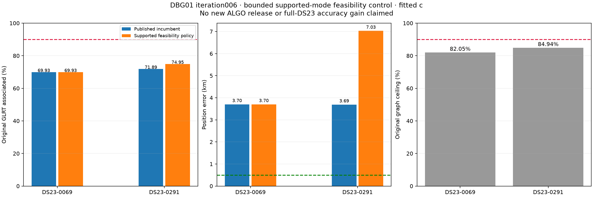

## Controls and measurement accounting

Both c=0 and fitted-c use the same observations, candidate identities, aliases,
other priors, regional box and search budgets within each approach. Inference
uses causal TLE epochs **and collection times**, the original 25×25 km box
centered at **37.906,-122.545**, and regional start [0,0]. Evaluation GPS
37.849061591561885,-122.48574968092912 supplies debug priority and reported
errors only. It does not select hypotheses or fit priors. No new RF, IQ
reprocessing, stationary RF pooling or moving-trajectory model is introduced.

Association uses unique original winning GLRT IDs. Original accepted IDs
remain retained in every reported prototype. Polynomial samples are display
only. Distinguish observations in the position likelihood from additional
graph fragments that pass post-fit extension gates.

| Scan | Original GLRT | Associated | Unused inside graph | Outside every graph | Graph-only ceiling | Outside-graph observations needed for90% even with perfect graph coverage |
| --- | ---: | ---: | ---: | ---: | ---: | ---: |
|0069|1,337|935|162|240|82.05%|107|
|0291|4,176|3,002|545|629|84.94%|212|

Both scans already have substantial association. Reaching 90% requires evidence
outside the original graph, as well as resolving existing track identities.
These ceilings do not imply that all unused GLRT is satellite signal.

## Controlled position results

The prototype policy below selects the largest passing whole-track addition
by the declared RF/gate rule. Its poor geographic result remains visible;
we do not silently replace the experiment with a GPS-selected output. The
published algorithm release remains the incumbent.

| Scan / approach | Associated points | % | Associated fragments | Points/fragment | Points in position likelihood | c=0 error km | Fitted-c error km | Fitted-c curved RMS Hz |
| --- | ---: | ---: | ---: | ---: | ---: | ---: | ---: | ---: |
|0069 incumbent / no passing recovery|935|69.93|33|28.3|935|4.145|3.704|72.79|
|0291 incumbent|3,002|71.89|96|31.3|3,002|3.696|3.690|201.66|
|0291 supported constrained recovery|3,130|74.95|100|31.3|3,078|6.733|7.030|201.23|

0291 adds **76 curved position observations**. A further52 original points
pass post-fit graph extension, giving 128 additional associations in total.
Those 52 are not used in the position likelihood. A slightly lower curved RMS
does not indicate better location; here position error nearly doubles.

Complete matched results: [positions and associations](tables/position_and_association.csv).

## 0069: the long curves do not fit the proposed family

The two longest wholly unused curved tracks have one persisted polynomial
piece each: RX 1 CH 3 T 000 has 30 points spanning 52.32 s; RX 1 CH 4 T 001 has 35
spanning 30.36 s. Their graph RMS values are 84.6 and 66.6 Hz.

The covariance-aware full available causal catalogue search proposes 65040
for both. Joint single-track and 65-point union fits fail: the fitted-c
single-track conditional RMS values are 2,452.6 and 1,322.8 Hz, with slope
z scores 5.16/5.71 and quadratic BIC gains 199.0/190.2. Disabling unsupported
new one-owner orbit-shape coordinates barely changes these failures.

This is substantial model/identity incompatibility, not a narrowly missed
threshold. Normalized minimum gate slacks are below-17, far outside the
prespecified-0.25 eligibility limit for constrained refinement. No numerical
rescue is attempted on these tracks. A low polynomial RMS does not validate
the nominated satellite or prove that the catalogue contains its source.

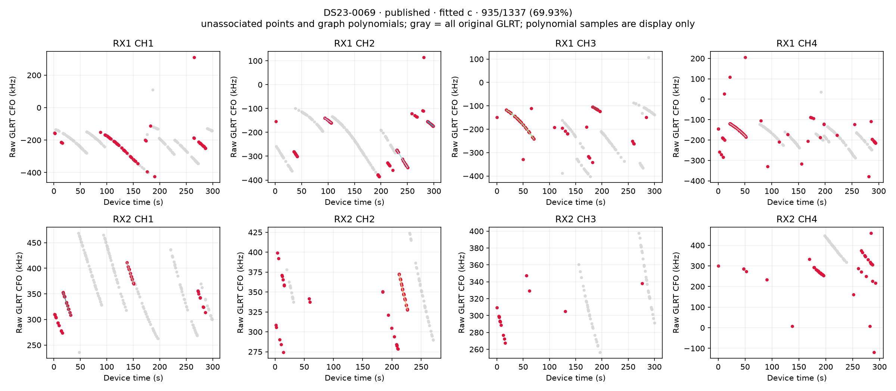
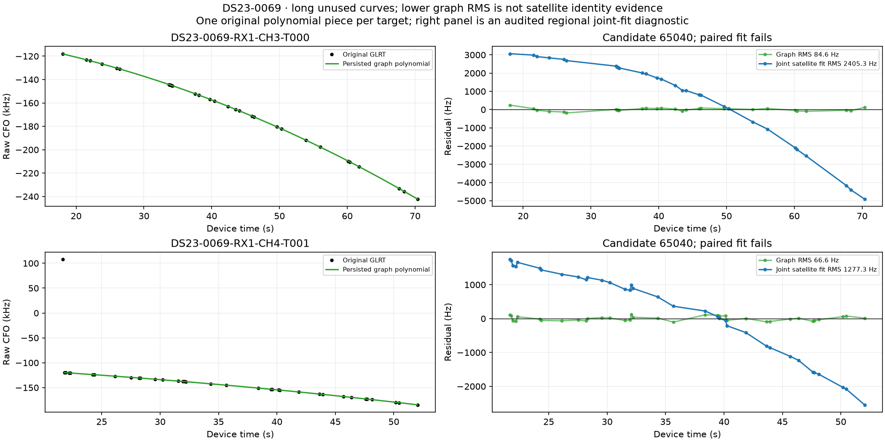
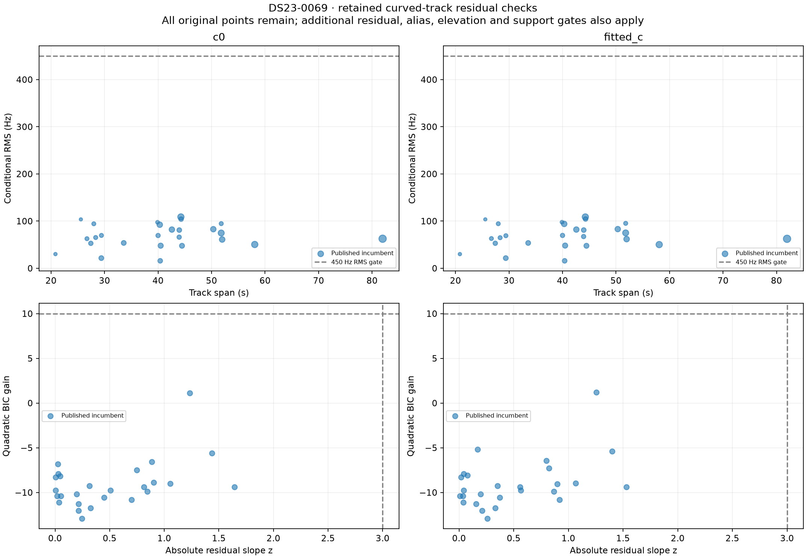

Following-TLE diagnostics also leave large residuals. With the same frozen
causal receiver posterior, matched phase profiles and no orbit-shape modes,
the causal/following conditional RMS values are 967.5/974.7 Hz and 535.3/539.9 Hz.
Following elements do not repair these candidate hypotheses. These profile
numbers condition differently from the regional joint-fit numbers above.

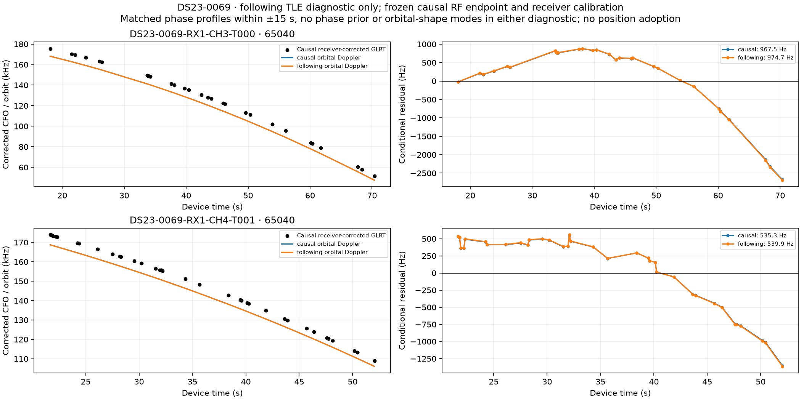

## 0291: a real implementation gap, but an unsuccessful algorithm change

Three unused graph tracks illustrate different rejection mechanisms:

| Whole track | Points | Hypothesis | Default fitted-c conditional RMS Hz | Main failure |
| --- | ---: | ---: | ---: | --- |
|RX2 CH2 T003|30|56304|114.6|Quadratic residual BIC10.56 exceeds10|
|RX1 CH4 T004|46|67822|217.7|Quadratic residual BIC10.68 exceeds10|
|RX1 CH3 T001|41|66543|513.2|RMS exceeds450 Hz|

The first two are close to residual feasibility. The existing default
configuration fitter can run a bounded constrained rescue, but its initial
support slack rejects newly active one-owner families before this rescue.
The separate support-aware fitter removes their unsupported three orbit-shape
coordinates while preserving all incumbent modes, but **does not run that
constrained rescue**. Combining these existing pieces is a plausible numerical
repair and is what this experiment tests.

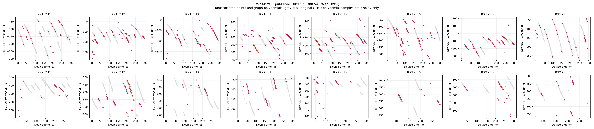
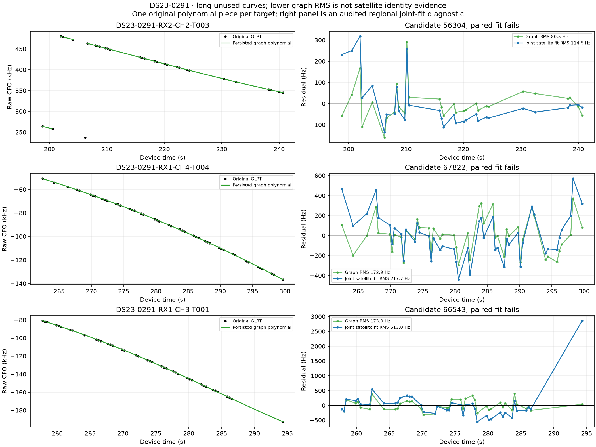

### Frozen refinement rule

Use at most the two previously rejected support-aware proposals already
selected by the existing deterministic single/pair ordering. Require both
arms' minimum original normalized slack to be at least-0.25. Starting from
the existing cold-fit endpoints, run five phase-refresh rounds, each with at
most 40 SLSQP iterations, minimizing the same normalized RF objective under
the **unchanged** residual, alias, horizon, support, regional and15 s phase
limits. No observation is trimmed, no identity/alias is changed, and no
nuisance parameter or relaxed prior is added. If both disjoint proposals
qualify, test one whole union, with the same bounded near-feasible rescue.

The underlying cold fits remain five 48-step regional fits from[0,0]. The
constrained iterations are additional declared compute, not a change to the
c-arm matching. The constraint solver's success flag alone is insufficient:
all final gates, phase refresh and independent endpoint/density checks must
replay. RF score comparisons across different observation masks are not used.

### Results: the constraints can be met at a worse location

| Added curved observations | Hypotheses | c=0 error km | Fitted-c error km | Final paired gates |
| --- | --- | ---: | ---: | --- |
|46|67822|4.383|4.383|Pass|
|30|56304|5.495|5.606|Pass|
|76|Both, disjoint union|6.733|7.030|Pass|

The single-track c=0 normalized RF cost increases by 7.24 and 4.60 relative to
the corresponding unconstrained supported-mode fits on the same observations.
In fitted-c the increases are 9.06 and 5.13. Feasibility requires sacrificing
RF optimum and moving the position; satisfying the binary noise gate does
not establish that this movement is physically correct. All three trials
worsen geographic error. This is why the extension is rejected for release.

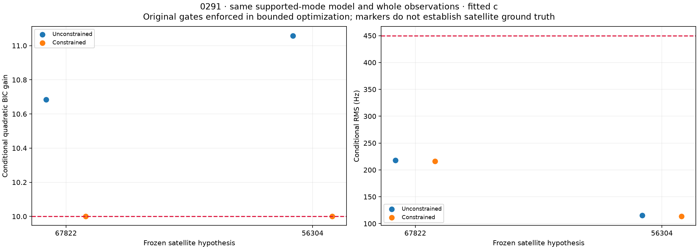
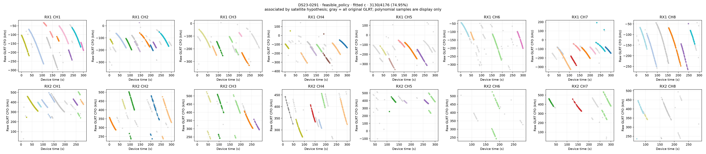
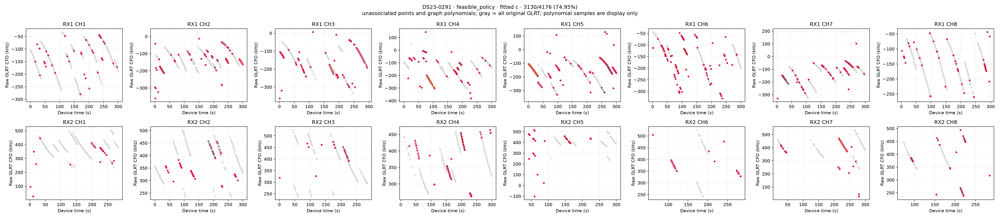
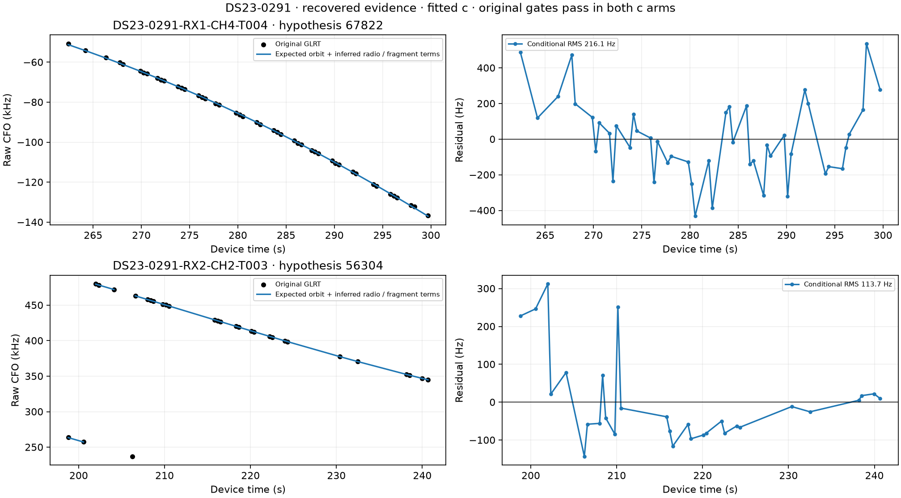
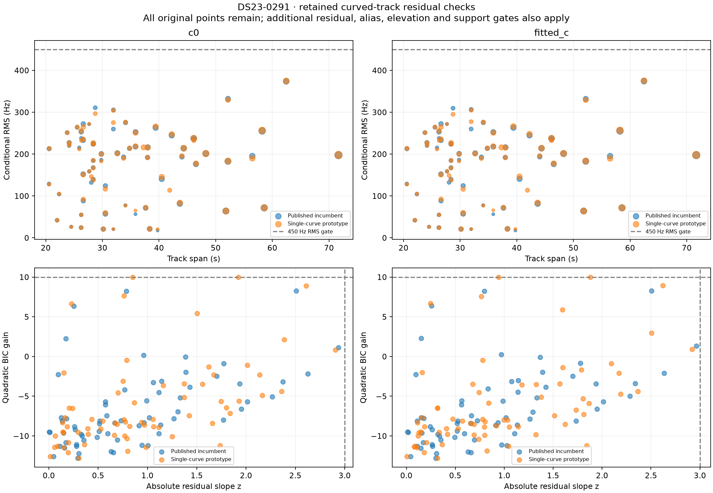

## 19-scan disjoint confirmation

The pre-existing random 20 cohort contains 0291. Exclude that development scan
before confirmation, leaving 19;0069 is not in the cohort. These cases have
been studied previously at the same site, so this is scan-disjoint confirmation,
not untouched or new-location validation. Its membership differs from
iteration 004's 19-case confirmation, which excluded 0322 instead; do not compare
their means as if they were identical populations.

Reuse the exact frozen nominations and independently verify their original
accepted IDs and RF endpoints against the current incumbent. Compare the
incumbent, the original unconstrained supported-mode control, and the bounded
constrained extension. The final RF-only policy takes the larger valid whole
addition; ties preserve the control. No extra control/refinement union is
invented. Seal this selection before geographic scoring.

The development error was already inspected when the final 19-case protocol
was frozen. The original metadata field
`no_current_GPS_scoring_before_confirmation_protocol_frozen` is too broad:
it applies to the **confirmation cases**, not the development scan. The
scientific refinement rule was unchanged, and the 19 new geographic outcomes
were not scored until their RF policy was sealed. This scope correction is
recorded with the raw receipts; this is not an untouched validation set.

| Method | c=0 mean / median km | Fitted-c mean / median km | Associated original GLRT | % |
| --- | ---: | ---: | ---: | ---: |
|Incumbent|1.658 /1.339|1.640 /1.337|30,286|69.47|
|Supported-mode control|1.634 /1.339|1.614 /1.337|30,543|70.06|
|Supported constrained extension|1.701 /1.617|1.678 /1.598|30,648|70.30|

The new constrained step changes two cases beyond the control.0014 gains 40
additional associations but error worsens 1.152→1.846 km.0146 gains 65 but
worsens 0.460→0.976 km. Thus the adverse development result also appears in
the confirmation set. There is no evidence warranting an expensive full-DS23
rerun or ALGO promotion of this extension.

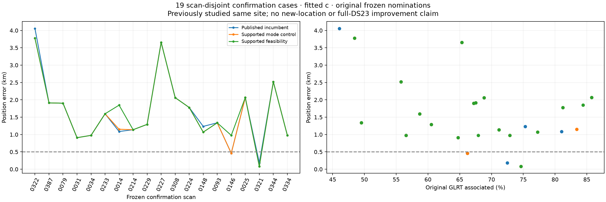

## Standard DBG01: local minima and family influence

Each scan has a 10 km loss/gradient map and 81-start experiment. The fixed-map
grid recomputes continuous nuisance fits at each position; it does not rerun
acquisition, GLRT, graph building and unlimited catalogue search at each pixel.
The restart experiment can change associations within an RF-discovered finite
four-branch bank during descent and refresh phase. All 81 endpoints qualify in
each scan, but their corrected c=0 RF gain is effectively zero against the
2 log 4=2.773 bank penalty. Neither restart policy is adopted.

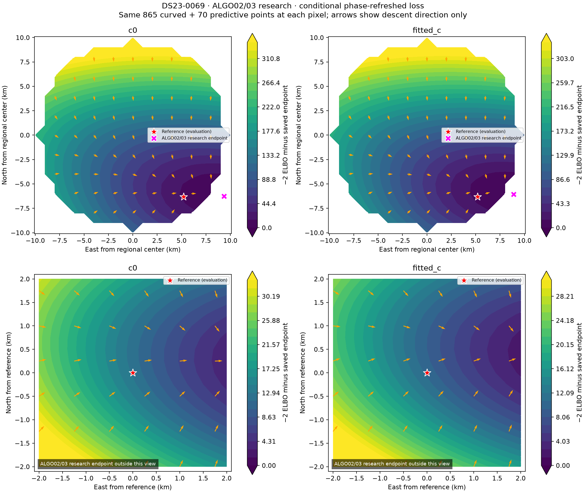
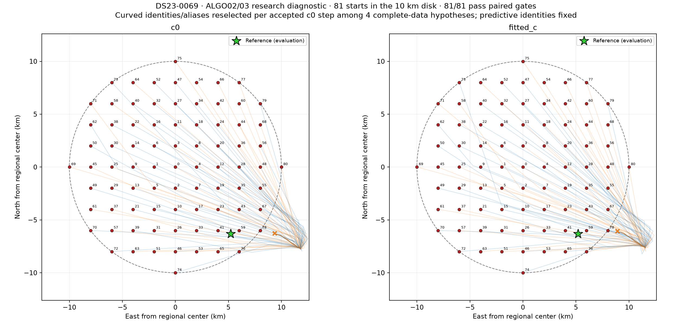
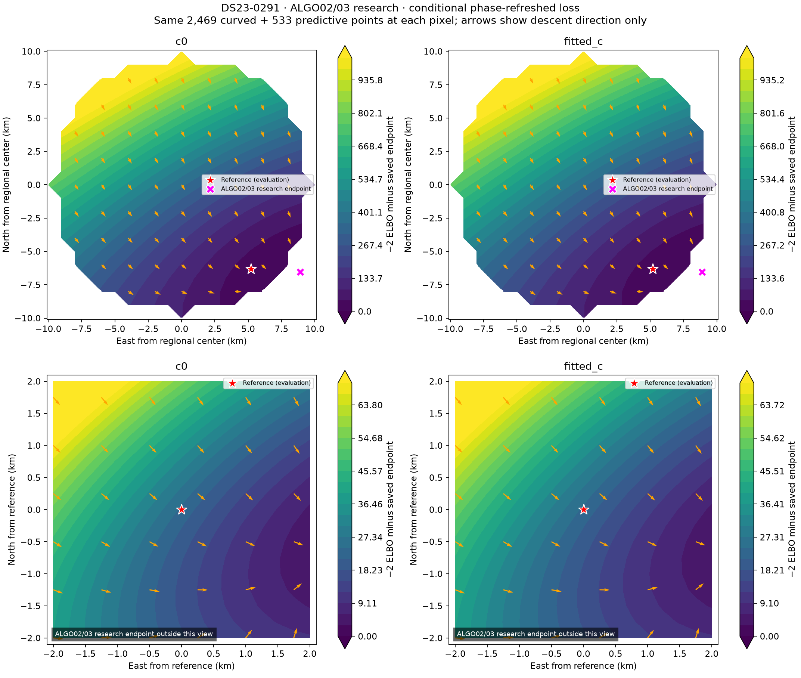
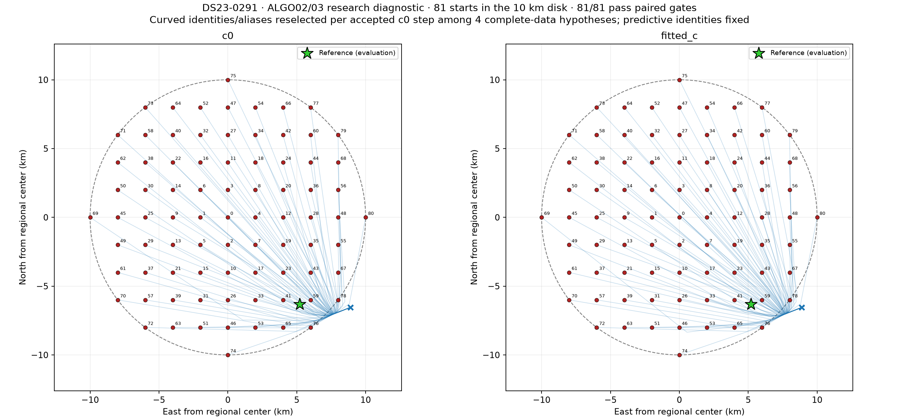

All 14/24 active families and 26/66 retained curved tracks are ablated. No single
deletion solves either scan.0069's best passing family deletion remains 3.386
km.0291's best passing family deletion remains 3.422 km; its lowest-error
single-track deletion,2.923 km, fails the paired residual gates. The wider
phase-prior control gives 3.122 km on 0069 but fails gates, and 3.584 km on 0291
while passing. No deletion or prior is chosen using GPS error.

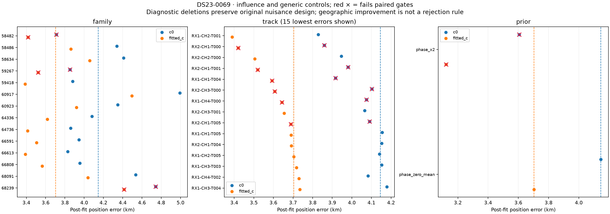
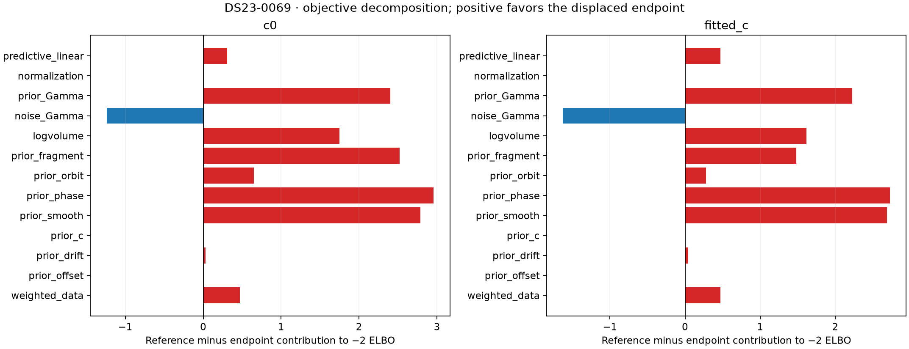
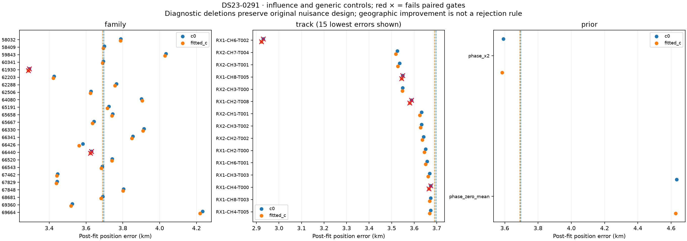
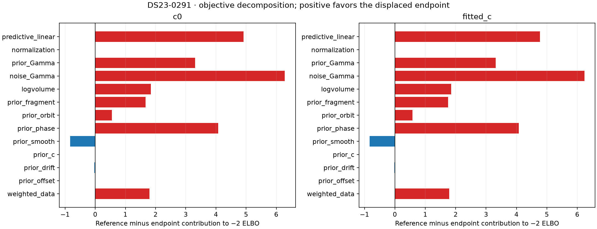

Following elements are a separate diagnostic, with both epoch and collection
after scan end and within 48 h. All requested 4/9 candidate versions are
available. They do not enter inference.0291's frozen candidate profile RMS
changes 124.3→122.5 Hz for 56304,218.3→218.4 for 67822 and 513.0→511.7 for 66543.
These modest changes do not validate the constrained position movement.

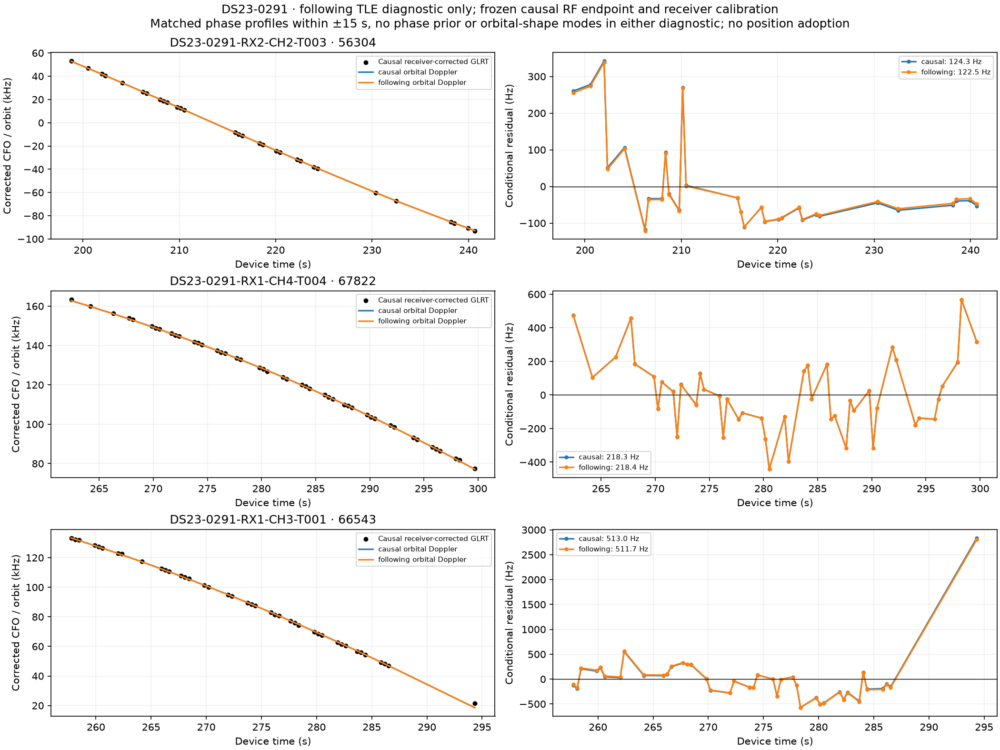

## Full-population baseline qualification and catalogue scope

Iteration 005 found that 0068's archived posterior phase exceeds 15 s although
its phase reference is clipped. Audit the saved endpoints for **all410**
available DS23 scans, checking exact input hashes, the existing equal-assignment
RF selection, recorded residual gates, posterior phase, refresh convergence
and regional bounds. Reproduce every published benchmark error. This audit
reads saved metadata; it is **not a fresh numerical replay of all410 scans**.

In each c arm,409 pass all these checks. Only 0068 fails phase, at 15.1648 s
for c=0 and 15.1218 s for fitted-c, satellite 58133. All 410 pass the recorded
residual, refresh and box checks. Legacy records without a top-level refresh
field use their recorded final history change; no refresh status is guessed.

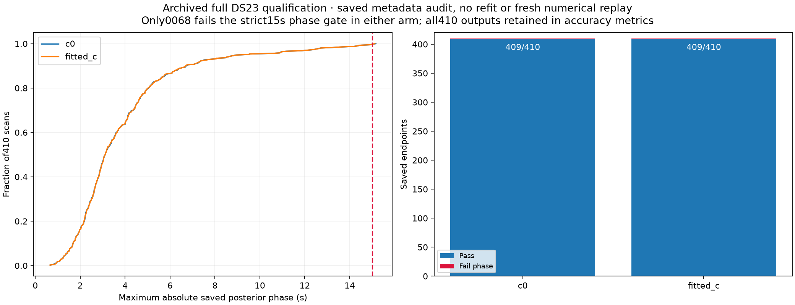

Retain the historical benchmark, including 0068, and label its qualification
exception. Do not remove it to improve means. The audit reproduces c=0 mean
1.479378/median 1.190706 km and fitted-c mean 1.469461/median 1.178102 km. The phase
inconsistency is therefore a specific validation defect, not a broad explanation
of the localization floor.

A separate read-only catalogue-scope check shows that the latest Space-Track
archive before0069 contains11,123 named records, **all Starlink**, with zero
OneWeb records. Here “full causal catalogue search” means all available causal
Starlink candidates, not every orbital transmitter. This is a limitation to
investigate, not evidence that the unused curves belong to another constellation.
No new catalogue identity or noncausal element is inserted into the fits.

## Decision and next work

Keep ALGO02/ALGO03 and the current full-population incumbent. The support-aware
bookkeeping control remains distinct from the failed constrained-recovery
extension. Increasing association through a residual-feasible position can
increase geographic bias; do not force the estimator to move solely to admit
more points. The confirmation gives a reason to stop this prototype rather
than broaden its threshold or tune a GPS-informed acceptance rule.

Close 0069/0291 and continue to 0227/0400. Revisit closed cases only for a
transferable new hypothesis. Candidate identity uncertainty, catalogue scope
and predictive physical uncertainty remain more useful leads than another
local optimizer restart. Any new ALGO-series release still requires a
credible matched full-DS23 gain in mean, median, tails, availability and
individual regressions, alongside association, qualification and compute.

## Evidence, tests and reconstruction

DBG01 independently replays 600 endpoint arms and 35 nomination densities.
Every constrained trial also replays both arms' objective, curved/predictive
gate decisions and independent normalized density. Nine focused tests cover
queue/context wiring, posterior versus clipped-reference phase qualification,
missing metadata, RF-only archived selection, bounded feasibility criteria and
the exact list/array endpoint adapter.

Tables:
[positions/association](tables/position_and_association.csv),
[family ablations](tables/family_ablations.csv),
[all interventions](tables/all_interventions.csv),
[residual diagnostics](tables/residual_diagnostics.csv),
[following profiles](tables/following_TLE_profiles.csv),
[constrained trials](tables/constrained_trials.csv),
[before/after gates](tables/constrained_gate_comparison.csv),
[confirmation positions](tables/confirmation19_positions.csv),
[confirmation summaries](tables/confirmation19_summary.csv),
[archived qualification](tables/archived_qualification.csv), and
[qualification summaries](tables/archived_qualification_summary.csv).

[Development evaluation](evidence/evaluation.json) and
[confirmation evaluation](evidence/confirmation19_evaluation.json) contain the
sealed numerical outcomes. Raw scientific receipts are partitioned without
duplicating files:
[0069 restarts](evidence/raw_DS23-0069_restarts.tar.gz),
[0069 remaining receipts](evidence/raw_DS23-0069_other.tar.gz),
[0291 restarts](evidence/raw_DS23-0291_restarts.tar.gz),
[0291 remaining receipts](evidence/raw_DS23-0291_other.tar.gz), and
[shared protocols, qualification and confirmation](evidence/raw_shared.tar.gz).
The original failed metadata-reader and directory-adapter executions remain
recorded; repairs change no scientific rule or nomination and overwrite no
completed scientific outcome.

Source snapshots are in [source/tools](source/tools) and
[source/tests](source/tests), building on the previous ALGO02/ALGO03 research
sources already published. Reproduce in the existing dependency environment
using original persisted scan inputs. Run `run_ds23_dbg01_iteration_006.py`
through inventory, screen, nominations, positions, audit, support/finalization,
DBG01 discovery/bank/analysis, independent audit and RF restart selection.
Then run the supported-feasibility prototype, archived qualification audit,
disjoint confirmation and report generator. Following-TLE preparation uses
the existing read-only archive port and is separate from inference. Freeze a
new output directory/hash for a clean reproduction with repaired input
adapters; do not overwrite the historical protocols or fixtures.

Additional complete GLRT views:

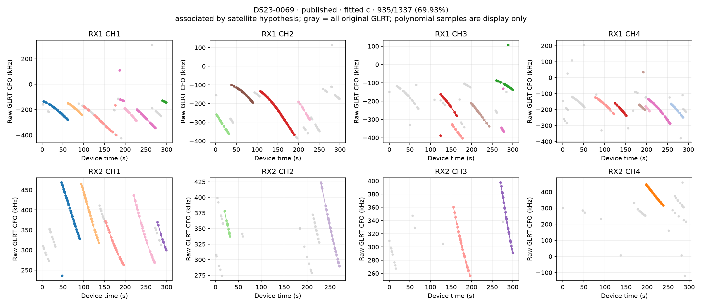
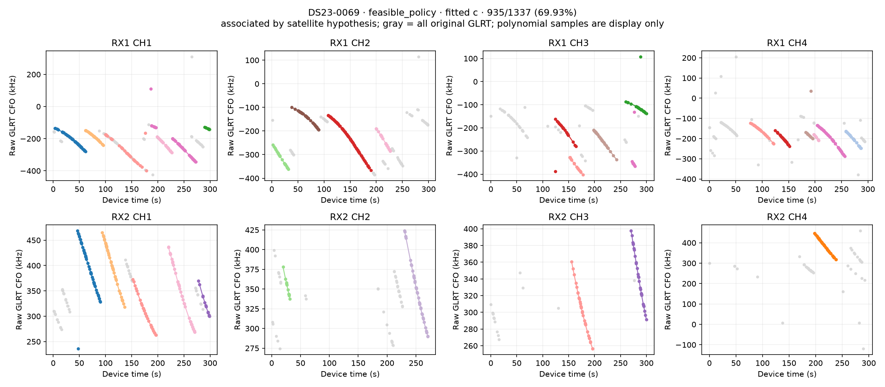
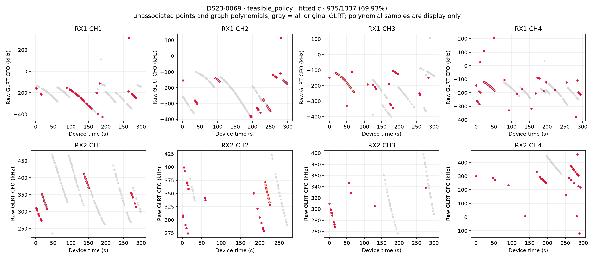
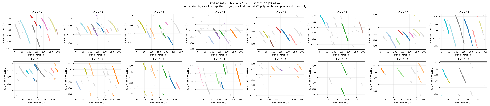
