# DS23 DBG01 iteration 007: grouped new-family prediction, full-population assessment

Building on **ALGO02 and ALGO03 research**, this experiment finds satellite
families from multiple unused linear fragments while leaving receiver
calibration to the original curved evidence. Across all **410 available DS23
scans**, fitted-c association rises **70.0804%→71.2161%** and mean position
error improves **1.469461→1.448708 km**. Median error is essentially unchanged,
**1.178102→1.178987 km**, and three scans regress by more than 500 m.

**Retain the incumbent; do not publish a new ALGO release.** The gain is small,
fast-scan mean error worsens slightly, and both fast and adaptive medians
worsen. The mean-and-median 0.5 km goal remains unmet. Publish this bounded
experiment, including regressions, and advance the debug queue from 0227/0400
to **0157/0207**. The current user policy requires reporting negative as well
as positive iteration results; an iteration number is not an ALGO version.

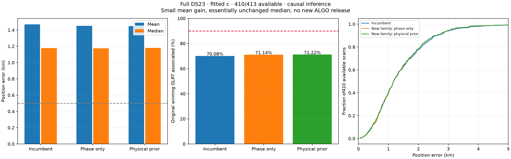

## Comparison contract and provenance

The reference is the [410-scan family-cavity assessment](../2026_10_22_ds23_family_cavity_full_assessment/README.md),
using its `equal_assignment_priors` results. Every saved reference position
error is independently reproduced to1e-8 km before comparison. This is an
extension of the existing [ALGO02](../ALGO02/README.md) and subsequent ALGO03
research engines, not a replacement acquisition or polynomial constructor.

The original DS23 manifest has413 scans.0012,0184 and0286 remain unavailable;
the same410 observations/cases appear in every method. No failed proposal,
regression, large-error scan or archived phase exception is removed.

Inference uses only TLEs with both element epoch and collection time causal
to the scan. All new cold position fits start at the center of the original
**25×25 km box**, **37.906,-122.545**, with east/north start[0,0]. Evaluation
GPS **37.849061591561885,-122.48574968092912** ranks debug cases and scores
sealed outputs only. It does not choose candidates, aliases, priors or a
winning position. No new RF collection, IQ reprocessing, motion model or
stationary history pooling is introduced.

Within each approach, c=0 and fitted-c use identical measurements,
candidate sets, aliases, other priors, search limits and fallback policy.
The phase-only ablation intentionally removes the three new-family orbit
shape coordinates; all remaining choices are matched. Original curved
Student/Gamma likelihood/prior behavior is unchanged. New-family phase
uncertainty uses a **declared Gaussian approximation at the existing causal
forecast mean and width**, not the original Student prior. Consequently this
is a test of the complete declared extension, not a pure uncertainty-coordinate
ablation of the incumbent.

Association counts unique original winning GLRT IDs, never polynomial
samples. Counts distinguish data in the position likelihood from graph
fragments accepted only after the final position fit. This extension does not
search alternative GLRT peaks or points outside the persisted graph.

## Why test groups of linear fragments?

The default curved-only recovery finds no passing addition in either debug
case.0400 has no wholly unused curved track with at least12 points, although
several visible linear tracks remain. A single short line is easy to explain
with the wrong satellite and a frequency offset. Independent lines on
different RX/channel owners, at overlapping or nearby times, can constrain a
**shared satellite phase and physical correction** under an already calibrated
radio model. This tests the user's proposed overdetermination idea while
keeping linear observations out of calibration.

The original hardware/band offsets, receiver drift and smooth radio terms
remain in their existing design and priors. Prediction retains the full
curved-calibration covariance rather than treating its mean as exact. At a
fixed position, adding the linear groups changes neither the original
curved-calibration coefficients nor their observation membership. Position
itself may move; calibration is then recomputed from the same curved data
at that new position.

## Frozen algorithm

1. Inventory original association IDs in both c arms. Offer only wholly
   unused graph tracks classified as linear, at least8 points and6 s span.
2. Form pairs/triples spanning at most60 s, with at least two distinct
   RX/channel owners and a connected overlap/gap graph with gaps at most10 s.
   Reject shared physical IDs. Rank by point count then component key; keep
   at most24 groups. Nomination has a240 s per-scan cap.
3. Search the full **available causal Starlink catalogue** with a Gaussian
   phase screen, then refine the best seven above-horizon candidates. This
   is bounded coarse-to-fine search, not an exhaustive continuous-phase
   identity proof or an all-constellation catalogue search.
4. A group must prefer the same candidate in both arms, with unchanged
   aliases, passing fixed-radio residual tests, a score gap exceeding
   `2 log(100)` to the next refined candidate, and a gain over independent
   broad polynomial priors exceeding the declared search penalty
   `2 log(number_of_groups × catalogue_size × 27)`. Recheck a normalized
   wrapped polynomial null to avoid arbitrary CFO gauge effects. Scores are
   conditional proposal evidence, not calibrated identity probabilities.
5. Select at most two disjoint groups, using the frozen RF ordering and
   aliases. Exclude any family already in curved or predictive evidence.
   Candidate selection is sealed before the new position fits.
6. Add one shared Gaussian phase coordinate per new satellite. The primary
   method also retains three existing causal physical orbit directions
   derived from mean motion, inclination and RAAN uncertainty. The phase-only
   control has one coordinate per family; the primary has four. Add the
   existing300 Hz Gaussian fragment constants and unseen predictive noise
   scale ofsqrt(2). These are constrained priors, not arbitrary polynomials.
7. Evaluate all old and new predictive measurements in **one joint Gaussian
   density**, retaining cross-covariance through the same curved radio
   posterior. With old/new predictive residual vector `r`, shared design
   `U`, curved precision `G`, new modes `V` and fragment indicator `B`, the
   integrated covariance is `diag(sigma²) + [U,V] blockdiag(G^-1,I) [U,V]' +
   300² B B'`. Include its log determinant and Gaussian normalization.
   Predictive posterior radio updates are not used to pass residual gates.
8. Cold-fit each matched arm for five phase-refresh rounds, at most48
   position steps per round. Refresh old and new phases against absolute
   causal priors; require final changes≤0.01 s, absolute phases≤15 s and the
   original regional box. Require all original curved/predictive gates and
   new fixed-radio RMS≤450 Hz, bias≤3000 Hz, unchanged alias, above-horizon
   geometry and noise-structure checks. Keep the exact incumbent unless
   **both** arms pass. There is no GPS-based acceptance guard.

This is evidence conditional on the existing curved calibration and regional
solution. It does not establish that every qualified new identity is correct.
The linear tracks can influence position through the predictive likelihood;
they cannot repair a biased receiver posterior by calibrating it themselves.

## Full DS23: all410 available cases, both c arms

| Arm | Method | Mean km | Median km | P95 km | Associated original GLRT | % | Fragments | Points/fragment |
| --- | --- | ---: | ---: | ---: | ---: | ---: | ---: | ---: |
|c=0|Incumbent|1.479378|1.190706|3.224087|726,622|70.0994|24,588|29.55|
|c=0|New family, phase only|1.459648|1.203723|3.061119|737,669|71.1652|25,238|29.23|
|c=0|New family, physical prior|1.457882|1.207581|3.064169|738,458|71.2413|25,280|29.21|
|Fitted c|Incumbent|1.469461|1.178102|3.156696|726,425|70.0804|24,583|29.55|
|Fitted c|New family, phase only|1.451062|1.174745|3.064474|737,370|71.1363|25,232|29.22|
|Fitted c|New family, physical prior|1.448708|1.178987|3.064409|738,197|71.2161|25,275|29.21|

The primary accepts217/410 scans, adds **11,861 predictive likelihood
points**, improves122 cases by more than1 m and worsens92;196 are within1 m
of the reference. There were232 scans with selected proposals;15 primary
proposals fail paired gates and fall back. Phase-only accepts203 and rejects29.
All410 jobs are terminal, with no failed-job or nomination-timeout exclusions.

Fitted-c net association increases by11,772 rather than exactly11,861.
Post-fit extensions are recomputed at each endpoint:101 formerly accepted
post-fit-only IDs are lost, while12 other post-fit IDs are gained. The losses
are0216:85 and0255:16. c=0 loses43 post-fit-only IDs on0065/0255. New likelihood
IDs take precedence over conflicting post-fit extensions; duplicate physical
ownership is prohibited. **All original likelihood measurements and curved
calibration counts remain in place.** We do not claim that all original
post-fit association IDs survive. This accounting is tested and is separate
from the frozen RF selection policy.

Mean original curved frequency RMS changes only **110.62459→110.62236 Hz**
in fitted-c. Position conclusions come from the geographic comparison, not
this very small frequency change. Maximum fitted-c error remains16.979794 km;
the hardest closed case is not repaired by this extension.

A descriptive10,000-resample paired scan bootstrap gives a95% interval of
**[3.95,39.18] m** for the primary fitted-c mean improvement. The median
improvement interval is **[-52.49,32.83] m**, spanning harm and benefit. These
are same-site scan resamples; temporal dependence is not modeled, and this
does not demonstrate new-location generalization or independent confirmation
after repeated research on DS23.

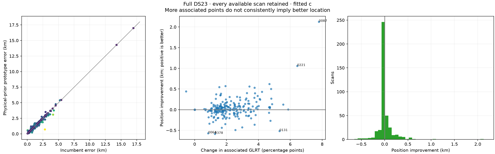
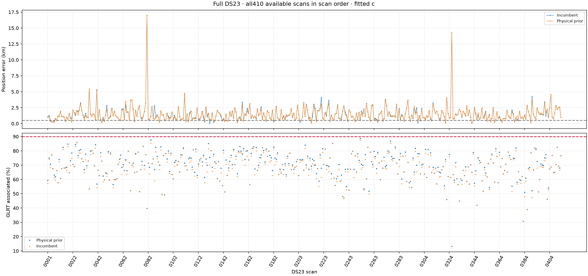

Machine-readable results: [all positions and coverage](tables/full_DS23_positions.csv),
[summary with bootstrap intervals](tables/full_DS23_summary.csv),
[per-scan changes](tables/full_DS23_changes.csv),
[full evaluation receipt](evidence/full_DS23_evaluation.json).

### Fast/adaptive and random confirmation

| Fitted-c population | Method | Cases | Mean km | Median km | GLRT associated |
| --- | --- | ---: | ---: | ---: | ---: |
|Fast|Incumbent|204|1.240377|1.031316|72.1566%|
|Fast|Physical prior|204|1.242341|1.044628|73.1420%|
|Adaptive|Incumbent|206|1.696320|1.333925|65.2061%|
|Adaptive|Physical prior|206|1.653070|1.343882|66.6947%|
|Random20|Incumbent|20|1.175855|0.935509|70.8031%|
|Random20|Physical prior|20|1.121819|0.955625|71.7113%|

The random20 cohort was frozen with seed2026102207, excluding only0227 and
0400, before inspecting corrected development position errors. Membership
is reproducible and scan-disjoint from these two cases. The scans were
previously studied at the same site; this is not an untouched dataset.
Its mixed result led to the unchanged full410 run. All20 outcomes, including
regressions, and both development outcomes are reused without refitting.
The full population confirms a small mean gain, not the requested median gain.
Full matched subgroup tables are [here](tables/subgroup_summary.csv).

### Diagnostic ablation of the three largest regressions

| Scan | Incumbent fitted-c km | All new families km | New families | Remove-one diagnosis, fitted-c km |
| --- | ---: | ---: | --- | --- |
|0378|0.607|1.191|67978|Drop67978→0.607, exact incumbent|
|0064|2.930|3.502|58437|Drop58437→2.930, exact incumbent|
|0131|0.055|0.572|59038,60331|Drop59038→0.362; drop60331→0.247|
|0087, largest improvement|2.826|0.701|58176,59782|Drop58176→1.650; drop59782→1.369|

All ablated results pass their paired gates.0131 shows two contributions in
the wrong direction, rather than a single obviously failing fragment.0087
shows useful independent contributions from both additions. This establishes
the influence of the additional evidence, **not which identity or physical
prior is wrong**. Residual feasibility alone cannot certify localization.
The four cases were selected after evaluation for explanation; none of their
ablations becomes an RF policy or replaces a full-run output. Both c arms
and all deletions are retained in [the ablation table](tables/new_family_ablations.csv).

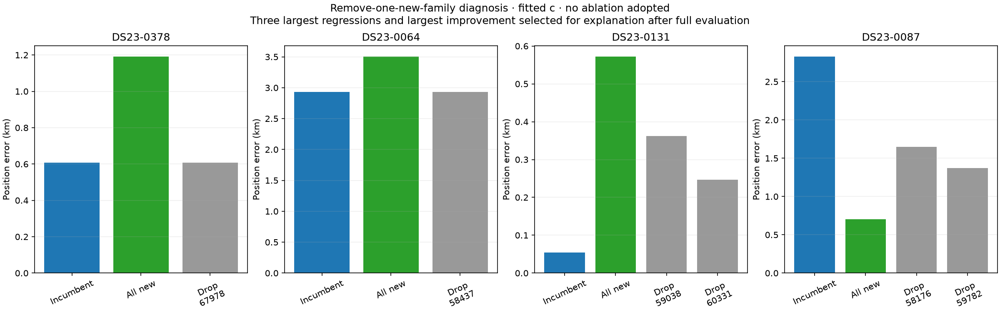

## Bounded DBG01 cases:0227 and0400

| Scan | Original GLRT | Associated | Unused inside graph | Outside graph | Graph-only ceiling | Outside-graph points needed for90%, even with complete graph recovery |
| --- | ---: | ---: | ---: | ---: | ---: | ---: |
|0227|1,439|940|186|313|78.25%|170|
|0400|1,306|957|82|267|79.56%|137|

These ceilings show why the present graph-only extension cannot reach90%.
They do not assert that every unused point is real satellite signal.

| Scan / method | Associated | % | Fragments | Points/fragment | New predictive points | c=0 error km | Fitted-c error km |
| --- | ---: | ---: | ---: | ---: | ---: | ---: | ---: |
|0227 incumbent|940|65.32|41|22.93|0|3.599|3.657|
|0227 phase only|994|69.08|45|22.09|54|3.046|3.105|
|0227 physical prior|994|69.08|45|22.09|54|3.064|3.124|
|0227 endpoint-core child, development only|1,013|70.40|46|22.02|73|2.727|2.779|
|0400 incumbent|957|73.28|35|27.34|0|3.218|3.389|
|0400 phase only|982|75.19|37|26.54|25|3.021|3.229|
|0400 physical prior|982|75.19|37|26.54|25|3.022|3.229|

Original curved calibration remains771 points in0227 and850 in0400. New
linear evidence is predictive only. The endpoint-core child adds19 to the54
new group points; it is **not included in the random20 or full410 method**.
The frozen full result uses0227 error3.124 km, not the child result2.779 km.
Exact values and original-ID losses are in [development results](tables/development_positions.csv).

### Original and new associations

Gray means **all original GLRT**, including already associated observations.
In unused views, red points are unassociated; colored curves are their graph
polynomials. In associated views, color indicates satellite hypothesis.
Polynomial interpolation adds no observations.

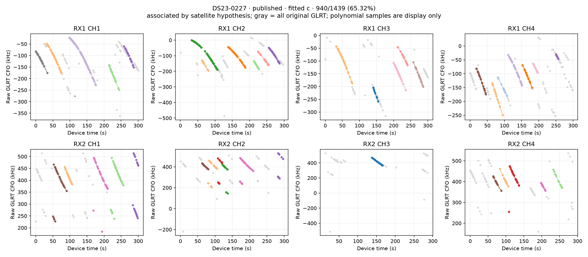
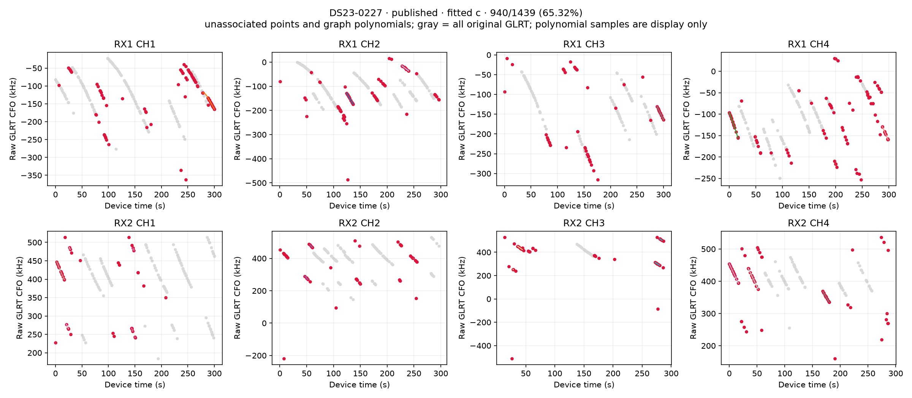
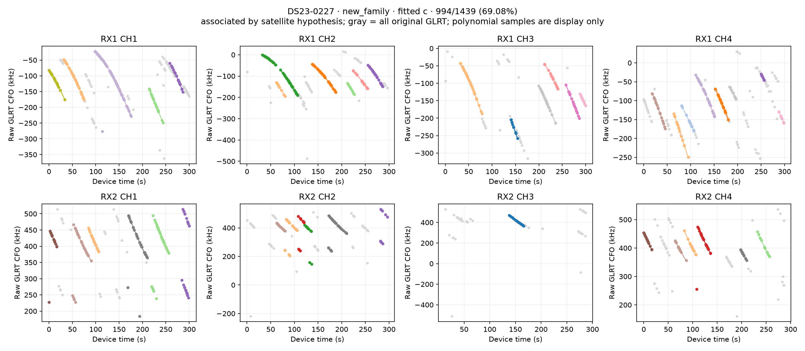
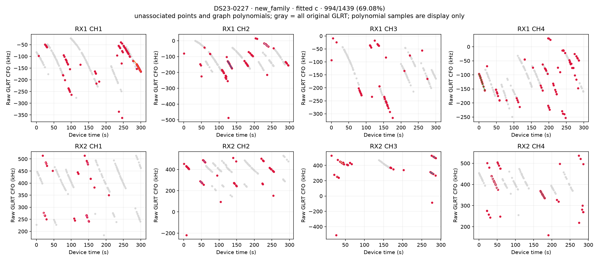
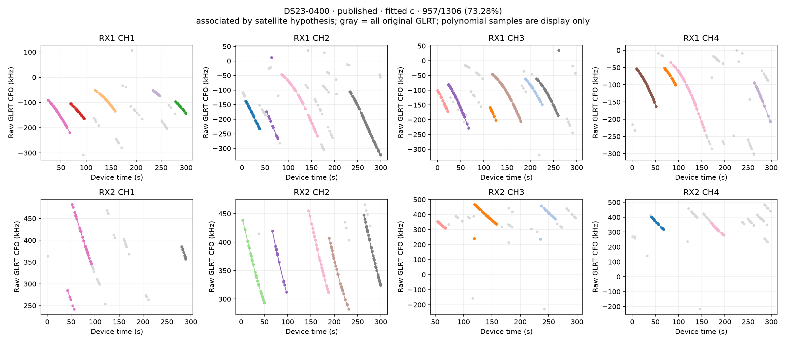
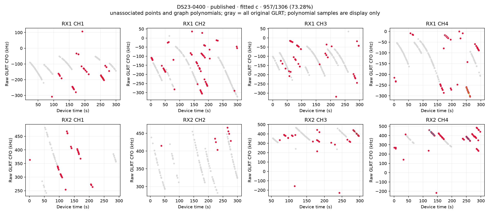
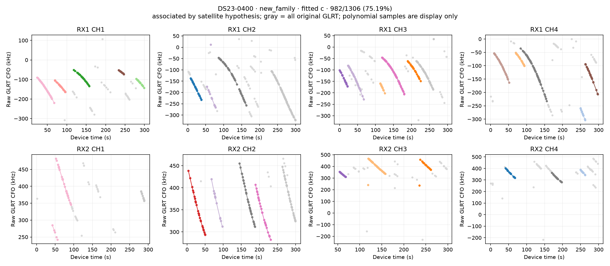
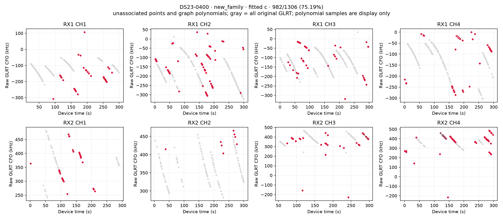

### Which groups were recovered?

0227's early RX2 CH1 T005 and RX2 CH4 T001 support **63684**,33 observations.
Its late RX1 CH3 T004 and RX1 CH4 T008 support **67025**,21 observations.
0400's RX1 CH4 T005 and RX2 CH4 T003 support **57461**,25 observations.
Each group shares a satellite correction under the original radio posterior.
The following figures show native GLRT, expected orbit plus radio mean, and
fixed-radio residuals. The constant residual mean is shown descriptively;
noise gates use the declared Gaussian fragment-bias profile.

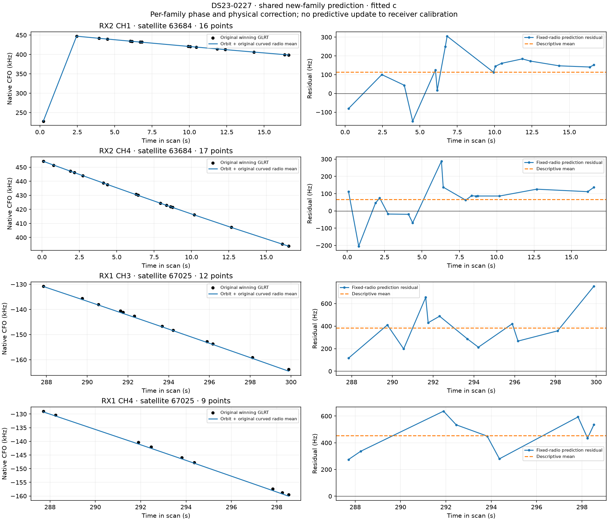
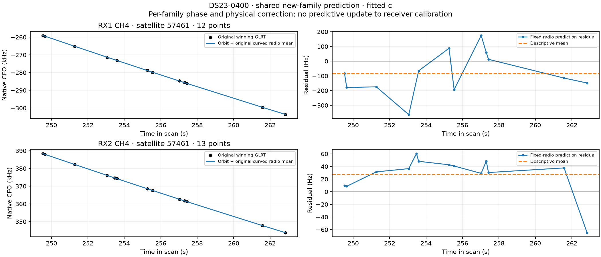

### 0227: a high-leverage endpoint creates misleading curvature

The longest wholly unused curved graph component is RX1 CH1 T002,20 points
from277.999 to299.750 s, stored as one quartic. Its first point is separated
from the rest by **9.987 s**, against a typical0.421 s cadence. Its quartic
leverage is **0.9999095**: the extra flexibility almost interpolates that
single point, despite poor independent support through the gap.

The full quartic graph RMS is145.5 Hz. On the remaining19 points, BIC favors
degree2:199.69, versus203.31 linear,201.71 cubic and204.58 quartic. The
quadratic core extrapolation misses the first point by10.7 kHz. BIC values
across different observation counts are not themselves a model comparison;
the core fit here is a leverage diagnosis only.

The independently discovered67025 family predicts the19-point core well,
while missing the leading observation by about10.7 kHz. At the original
fixed RF position, compare models covering the **same20 observations**:
whole-track satellite; core satellite plus one uniform-alias-period clutter
observation; and a normalized wrapped broad polynomial null. A multiplicity
penalty covers target/family/endpoint choices. In fitted-c, whole-track
cost2358.27 versus core-plus-clutter280.94 and unknown-curve328.57 gives
penalized improvement44.86, above the declared `2 log(100)` requirement.
Core gate RMS is184.8 Hz with fixed receiver calibration.63684 fails this
test by a large margin. Neither following TLE nor evaluation GPS is used.

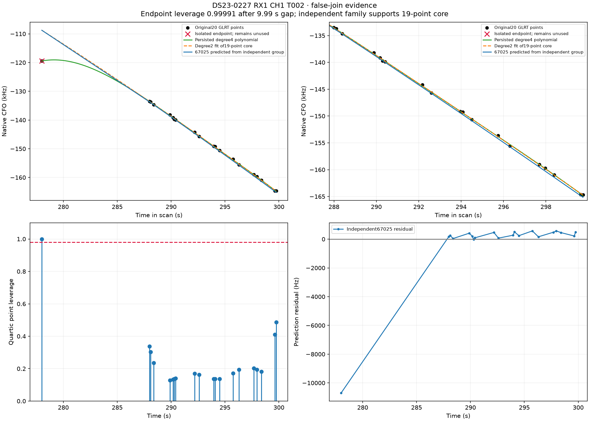

This is strong evidence for an inconsistent join or unsupported endpoint,
not proof of the isolated point's source. The separate child prototype adds
a derived19-point predictive view, leaves the original20-point polynomial
and all measured CFOs unchanged, and keeps the first observation unassociated
in the original GLRT denominator. Its paired cold refit passes and improves
0227 to2.779 km fitted-c. It still does not meet the location goal. The rule
has not been confirmed across the full population and is not a release.

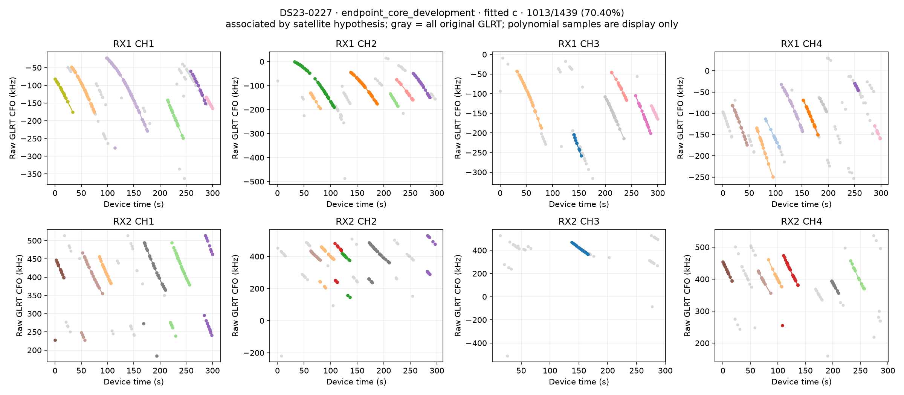
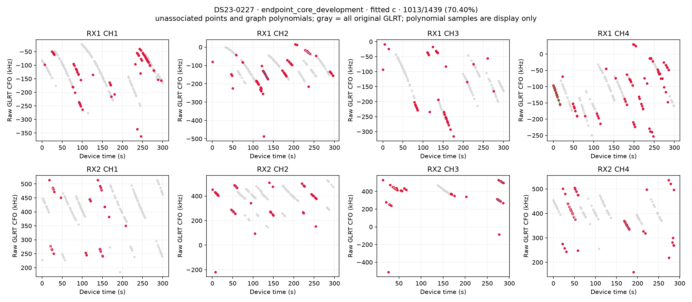

### Long unused tracks and following-TLE diagnostics

DBG01 now inspects the three longest wholly unused tracks with at least8
points **including linear tracks**, rather than silently returning none when
curved targets are absent. Causal and earliest real following TLEs use the
same fixed causal receiver posterior, phase-profile search and no orbit
shape modes. Following epochs and collection times must both occur after
scan end, within48 h. These profiles are diagnostic and do not change any
identity, calibration, prior or position result.

| Scan / component | Hypothesis | Points | Causal profile RMS Hz | Following profile RMS Hz |
| --- | ---: | ---: | ---: | ---: |
|0227 RX1 CH1 T002, whole quartic|66871|20|1780.92|1781.15|
|0227 RX2 CH4 T007|55491|10|545.59|543.93|
|0227 RX2 CH1 T005|63684|16|112.40|108.26|
|0400 RX2 CH4 T001|55954|19|33.04|33.03|
|0400 RX2 CH3 T003|64210|11|42.43|33.84|
|0400 RX2 CH4 T003|57461|13|29.14|29.11|

These are candidate hypotheses, not identity ground truth. For example,
0227's single early line also admits48291 with91.8 Hz RMS; the simultaneous
group provides the additional discrimination.0400 has plausible low-RMS
single-line hypotheses55954/64210 that the declared multi-owner grouping
does not independently qualify. They remain unused, rather than being
forced into the likelihood. Following TLEs barely alter most profiles and
do not repair0227's whole quartic. All three refined hypotheses per target,
including bad alternatives, are in [the profile table](tables/unused_track_TLE_profiles.csv).

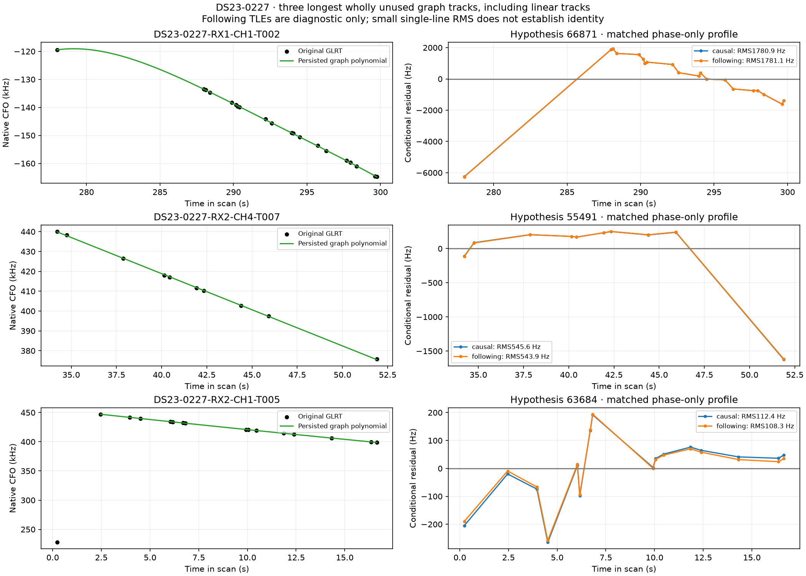
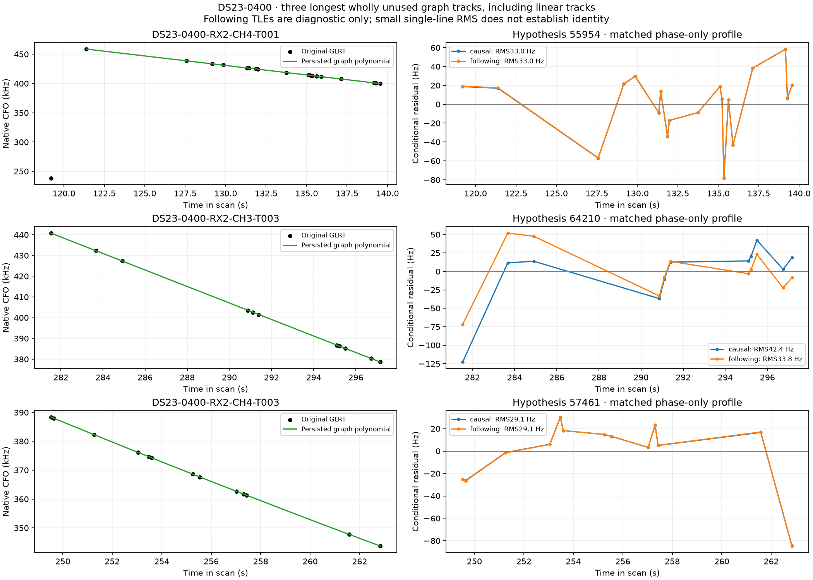

## Standard DBG01: loss, gradient, restart paths and ablations

The incumbent maps evaluate317 locations at1 km spacing in a10 km regional
disk, plus289 locations at0.25 km spacing within±2 km of the evaluation
reference. At each pixel, observations/identities/aliases stay fixed while
nuisance variables and five absolute-prior phase refreshes are recomputed.
These are conditional profiled losses, **not probabilities or full acquisition
reruns**. Reference-centered panels use GPS expressly as a diagnostic view.

The restart panels use81 starts on the2 km grid within the disk. Thirteen
cold discovery seeds construct a finite bank of at most four complete-data
curved assignments. Each accepted c=0 descent step can reselect an assignment
from this bank; fitted-c follows the c=0 branch schedule. Original predictive
identities remain fixed. Lines are recorded accepted solver steps; circles
are starts and crosses are final points. This is finite-bank reassociation,
not a full catalogue search for every point at every solver step.

0227's81 starts collapse to the same3.657 km fitted-c error.0400's81 starts
collapse to a second branch near3.374 km. Its normalized c=0 RF improvement
of2.881 exceeds the2.773 branch-search penalty and passes both-arm gates.
This is a qualified local restart proposal: fitted-c error improves slightly
3.389→3.374 km, while c=0 error worsens3.218→3.351 km. It is not substituted
into the archived full-population reference or combined with the independently
frozen new-family experiment. These maps diagnose the incumbent and must not be described as new-family
prototype convergence maps. The new-family prototype itself has the declared
regional-center cold starts only.

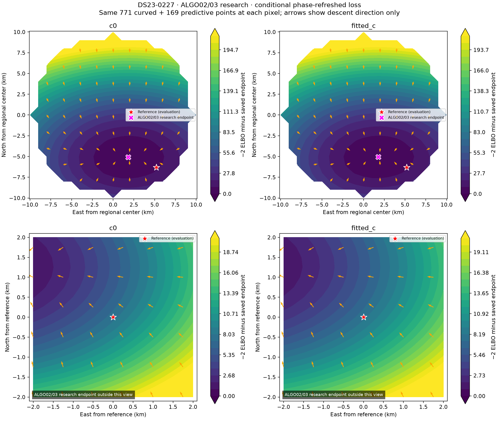
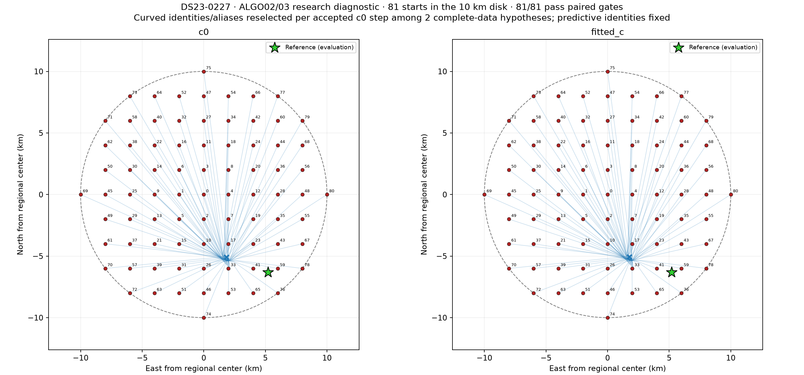
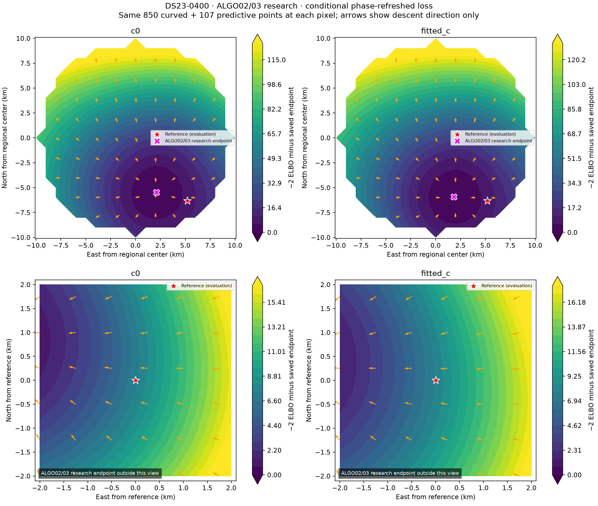
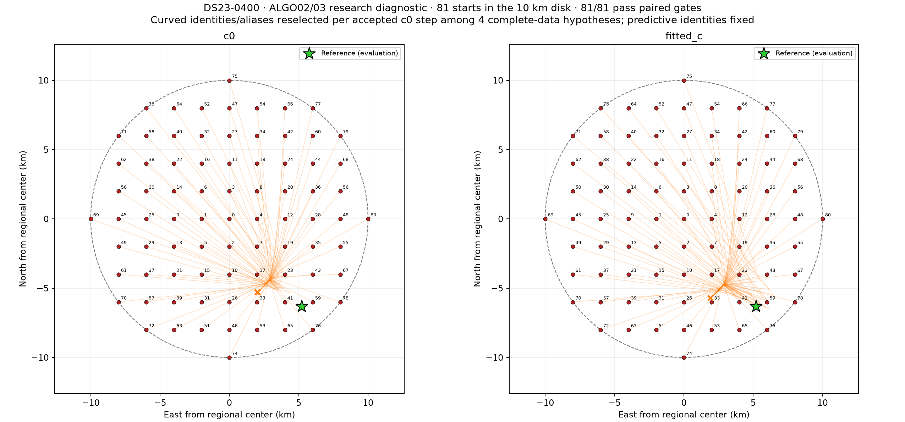

Every active family and retained curved track is individually removed and
refitted in both arms.0227's best geographic family deletion removes59471:
error2.459 km, still far from0.5 km.0400's best removes66530:2.938 km.
Several different families influence the error; there is no single deletion
that solves either scan. These are influence diagnostics, not GPS-selected
deletion rules, and costs across changed observation masks are not ranked
as identity evidence.

The predeclared prior controls also move both minima. Doubling phase width
gives0227/0400 fitted-c errors3.134/2.573 km; resetting learned phase means
to zero gives2.451/2.455 km. These geographic improvements do not validate
a scan-specific prior override. They motivate examining transferable phase
forecast calibration, with a future frozen test if warranted. Original
priors remain unchanged in the reported full comparison.

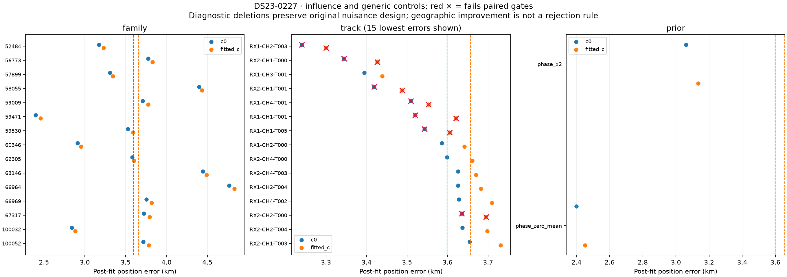
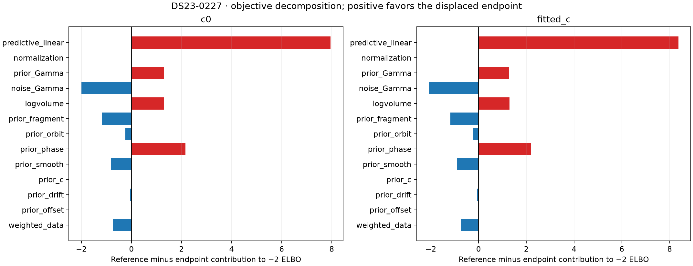
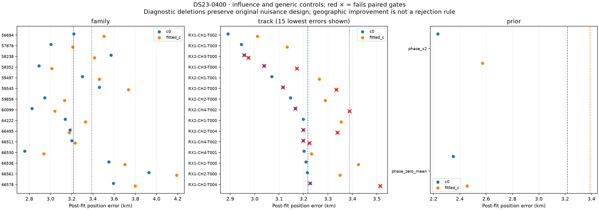
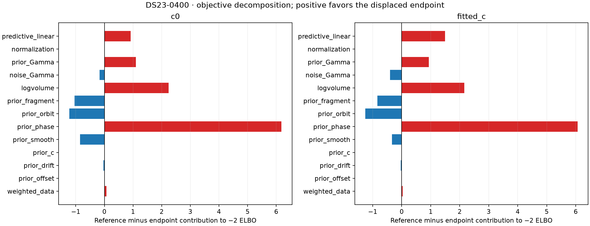
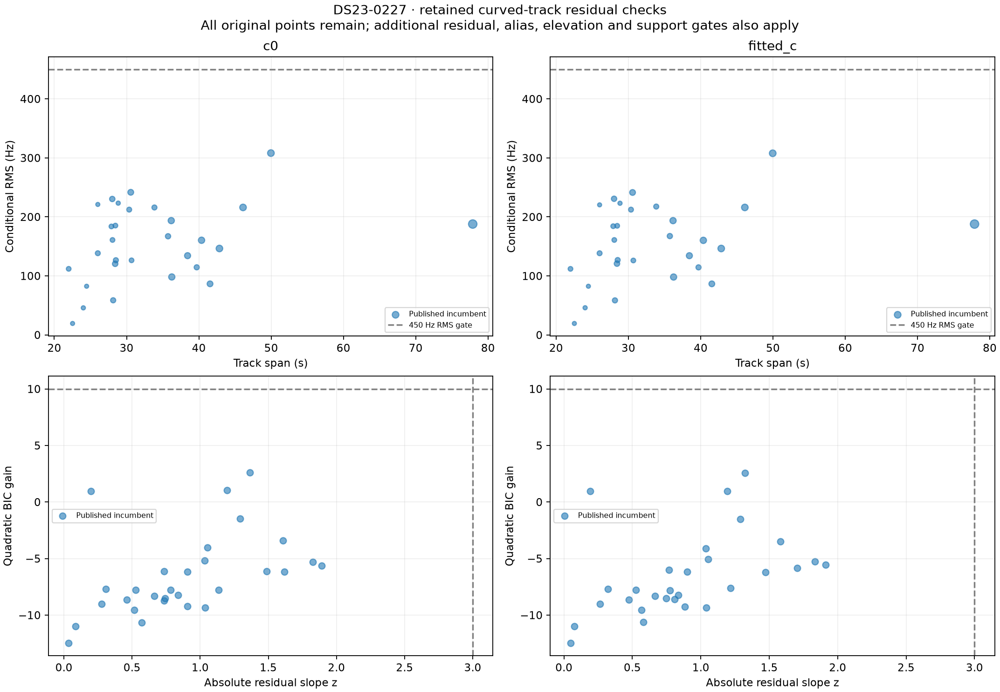
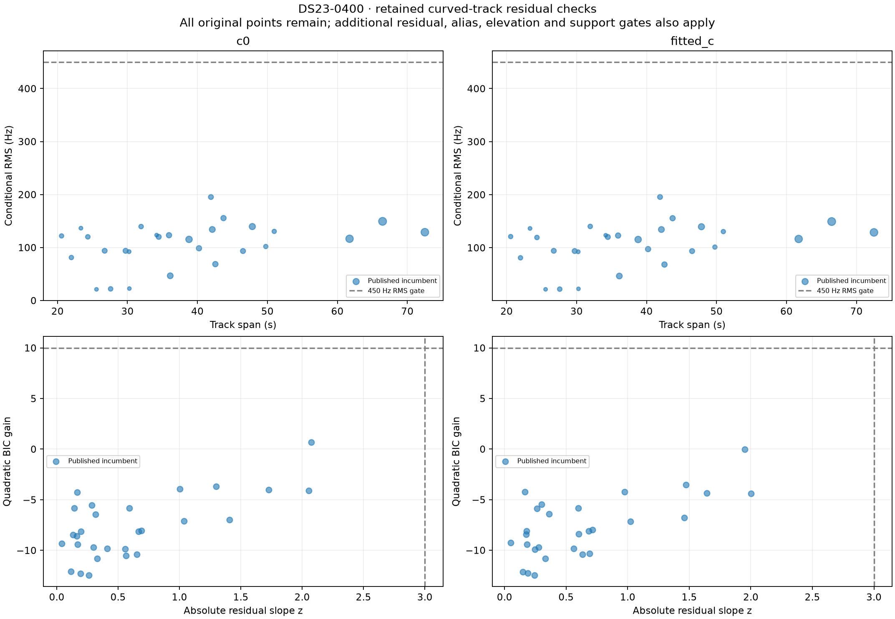

Full [family ablations](tables/family_ablations.csv),
[all interventions](tables/all_interventions.csv) and
[residual diagnostics](tables/residual_diagnostics.csv) retain failures as
well as passing results. All514 endpoint arms and seven nominee-density
checks in the independent DBG01 audit pass. The earlier archived full-scan
audit still has409/410 strict phase-qualified outputs;0068's inherited phase
exception remains included in full accuracy/coverage metrics.

## Numerical corrections, tests and scientific limits

An initial development implementation incorrectly indexed a paired geometry
API as if it returned a family-by-time grid. It broadcast the first frequency
across native timestamps. Those position trials are **invalid**, preserved
with source/receipts, and excluded from every reported result. The corrected
version checks vector shapes and is tested at multiple times against the
independent grid propagation API, including phase derivatives and elevation.
Frozen RF group IDs/aliases are identical before and after this correction.
The corrected source was frozen before random20 and full410 inference.

The earlier dense-covariance replay alone did not catch the wrong orbital
mean: it verified algebra for the supplied inputs. The added geometry parity
test checks the scientific mean as well. Each accepted fit additionally
replays the normalized joint predictive density with an independent dense/SVD
calculation and verifies zero predictive change to original curved-calibration
coefficients at the same position.

The component-owned tests cover wrapped alias invariance, cross-group radio
covariance, timestamp-wise scientific geometry, reproducible sampling,
multi-owner/disjoint nomination, predictive subset numeric membership,
endpoint leverage controls, paired alias selection, original-ID ownership
and loss accounting, inclusion of regressions, linear debug targets and
Alpha5 following-archive lookup. The archive adapter is read-only; following
elements are never used for inference.

**25 component-owned tests pass.** Their source is saved with this report;
the generated validation receipt also checks all internal report links,
frozen source hashes, full-result archive membership and population accounting.

The full run uses30 processes with one BLAS thread each; the host exposes24
logical cores. It completes388 new cases in approximately **661 s**, reusing
the20 frozen confirmation cases and two corrected development cases. This
includes nomination and both physical/phase-only methods in both c arms,
excludes original acquisition and reused-case compute, and is not an
embedded-device runtime estimate. Coverage evaluation is a separate read-only
16-process stage. No multi-hour RF campaign is started.

The primary limitations are short-line identity ambiguity, conditioning on
potentially biased original calibration/association, a Gaussian approximation
for new-family phase, finite search/multiplicity approximations, and absence
of new-location validation. The result supports recovering more evidence,
but does not show that association percentage alone is the localization
bottleneck. Further work should test independently supported orphan curves
and transferable uncertainty/phase calibration; it should not increase
weights or relax noise gates merely to reach90%.

## Reproduction and saved evidence

The report includes [the full inference protocol](evidence/full_protocol.json),
[execution receipt](evidence/full_execution.json),
[unique-ID coverage evaluation protocol](evidence/coverage_evaluation_protocol.json),
[random20 protocol](evidence/random20_protocol.json),
[independent DBG01 audit](evidence/independent_DBG01_audit.json),
[source snapshots](source/tools/) and [owned tests](source/tests/).
`full_results_00.tar.gz` through `full_results_08.tar.gz` contain every full
case's frozen selection and saved endpoint trials, including rejected trials.
Separate development archives preserve nomination, real following-TLE and
endpoint diagnostic details; case DBG01 archives preserve grids, restart
paths, family/track ablations and prior controls. The full evaluation JSON
and CSV tables recompute all published population statistics.

Large duplicate coarse-catalogue residual arrays and the radio input corpus
remain on the existing bulk disk. [The raw hash manifest](evidence/full_raw_sha256.json)
records the size and digest of every case's inventory, nomination, selection,
result and ID-coverage receipt, including reused cases. This is explicit
provenance, not a claim that all raw RF data are committed to Git.

From the repository root, use the existing research environment with
`PYTHONPATH=/tmp/algo03-feasible-deps:src:tools`, `PYTHONDONTWRITEBYTECODE=1`,
`OPENBLAS_NUM_THREADS=1` and `OMP_NUM_THREADS=1`. The drivers are
`run_ds23_dbg01_iteration_007.py`, `probe_ds23_linear_family_groups.py`,
`probe_ds23_new_family_prediction.py`, `confirm_ds23_new_family_prediction.py`,
`run_ds23_new_family_full.py`, `evaluate_ds23_new_family_prediction.py`, and
`report_ds23_dbg01_iteration_007.py`. Preserve frozen output paths; new
scientific changes require new output directories and protocols.
