# DS23 DBG01 iteration 008: recover a curved family, separate a bad endpoint, test the remaining bottleneck

This bounded ALGO02/ALGO03 investigation covers **0157 and 0207**. Existing
whole-curve recovery reduces 0157 fitted-c error **3.384→1.335 km** by admitting
46 observations of satellite 62026. The existing support-aware control admits
24 observations of 64261 in 0207, reducing error **3.321→3.108 km**.

A new temporal search, seeded by those recovered families, reaches **75.41%
GLRT association** in 0207. However, it worsens location relative to the graph
parent, **3.108→3.270 km**. In 0157, both temporal variants fail a recovered
curve's residual gate and are rejected. A separate 0207 core experiment
recovers 21 additional points, but gives essentially no further fitted-c
accuracy improvement. **Do not promote a new ALGO version.**

The main transferable findings are a TLE/GPS-independent receiver curvature
consistency check, an inconsistent endpoint in a rejected graph track, and a
hard 20-second curvature-classification cutoff that excludes a short but
measurably curved core. These explain missing associations; fixing them does
not by itself resolve the remaining position bias. Close this batch and move
to **0028 and 0311**, rather than repeatedly tuning these cases.

The full-DS23 incumbent remains 410 available scans, fitted-c mean
**1.469461 km**, median **1.178102 km**. The [previous full-population
experiment](../2026_10_22_ds23_dbg01_iteration_007/README.md) improved the mean
slightly but not the median and was not adopted. The goal of **both mean and
median ≤0.5 km remains unmet**.

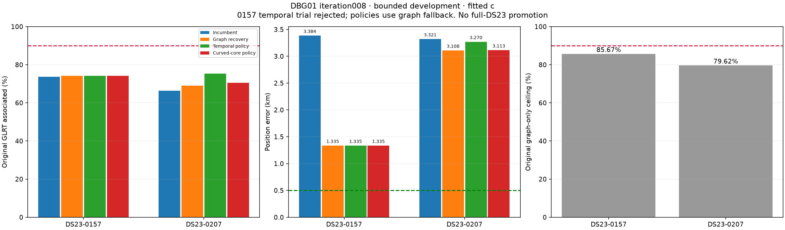

## Frozen inputs, controls and measurement accounting

All inference starts from the original **25×25 km regional box**, centered
at **37.906,-122.545**. New cold fits start at east/north [0,0]. Evaluation
GPS **37.849061591561885,-122.48574968092912** supplies debug priority and
post-selection error measurements only. Candidate identities, aliases and
priors are selected from RF evidence and causal TLE history. Both TLE element
epoch and collection time must precede the scan cutoff. Following TLEs are
isolated diagnostics. No new RF, IQ reprocessing, motion prototype or
stationary history pooling is introduced.

Every approach has matched c=0/fitted-c observations, aliases, candidates,
other priors and search budgets. Existing hardware/band offsets, receiver
drift, smooth receiver terms and physical orbit priors are retained. A role
ablation explicitly compares the same 21 measurements as predictive versus
curved calibration evidence; its role-dependent noise treatment and orbital
support change are reported below. No test chooses a geographic winner.

Counts are unique original winning GLRT IDs. Polynomial samples and derived
views add no measurements. All original **likelihood** observations survive
the reported qualified graph and core variants. Post-fit-only associations
can change at the new position: 0157 loses a 35-point RX2 CH2 T000 extension
to 59684 while gaining the 46-point curved track. Thus net association rises
by only 11. Those 35 points were not in the incumbent position likelihood;
they remain visible as original GLRT and are not deleted.

| Scan | All GLRT | Incumbent associated | Unused inside graph | Outside graph | Original graph-only ceiling | Outside-graph observations required for90% even with perfect graph recovery |
| --- | ---: | ---: | ---: | ---: | ---: | ---: |
|0157|1,731|1,274|209|248|85.67%|75|
|0207|1,403|932|185|286|79.62%|146|

The temporal prototype can use unused winning GLRT outside the graph.
The ceiling is for the original graph, not for every possible future method,
and does not assert that every unused observation is satellite signal.

## Controlled results

| Scan / approach | Associated | % GLRT | Fragments | Points/fragment | Curved likelihood points | Predictive likelihood points | c=0 error km | Fitted-c error km |
| --- | ---: | ---: | ---: | ---: | ---: | ---: | ---: | ---: |
|0157 incumbent|1,274|73.60|58|21.97|846|0|3.321|3.384|
|0157 graph recovery|1,285|74.23|58|22.16|892|0|1.209|1.335|
|0157 temporal policy, rejected trial falls back|1,285|74.23|58|22.16|892|0|1.209|1.335|
|0207 incumbent|932|66.43|38|24.53|805|127|2.763|3.321|
|0207 support-aware graph recovery|969|69.07|40|24.23|829|127|2.599|3.108|
|0207 temporal, independent and persistent identical|1,058|75.41|46|23.00|829|216|2.701|3.270|
|0207 isolated core as predictive evidence|990|70.56|41|24.15|829|148|2.593|3.116|
|0207 isolated core as curved calibration|990|70.56|41|24.15|850|127|2.556|3.113|

The core variants contain only the 21-point core plus their graph parent,
not the other 68 temporal observations. They are separate controlled trials.
Their counts must not be added together. The full temporal variant's 89
extra predictive points include that core. All reported source measurements
remain in the denominator, including the unresolved isolated endpoint.

Frequency fit is separate from location accuracy. In 0207 the core-calibration
variant lowers overall curved RMS to **110.75 Hz** from the support-aware
parent's **111.78 Hz**, yet fitted-c error worsens slightly.
A passing RF fit and a larger point count do not certify a better position.

Complete [qualified-policy results](tables/position_and_association.csv) and
[all prototype trials, including rejections](tables/prototype_trials.csv)
retain both c arms, points in the likelihood, post-fit association counts,
original-ID losses and RMS.

## 0157: useful curved evidence was missing from the position likelihood

The longest wholly unused actively curved track is **RX1 CH4 T004**, 46
points over **260.55–299.51 s**, in one persisted polynomial component.
Covariance-aware all-causal-catalogue nomination proposes **62026**. A cold
whole-track fit with the original Student/Gamma and physical priors passes
both arms' residual, alias, visibility, phase and support checks. It adds
46 calibration observations without changing any incumbent likelihood value.

This supplies genuinely useful independent geometry: fitted-c error falls
by about **2.05 km**. The net association increase is much smaller because
the previously described 35-point post-fit extension no longer qualifies
at the new position. The qualified parent still uses only 892 of the 1,285
associated observations in its position likelihood; post-fit membership is
not the same as position information.

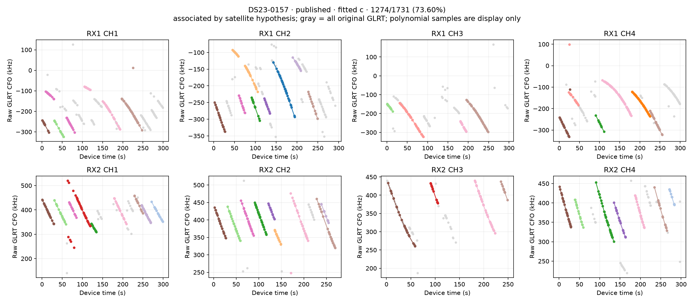
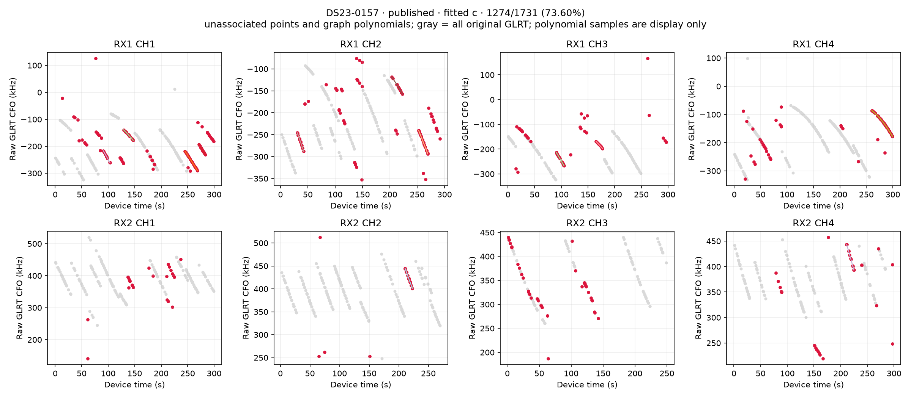
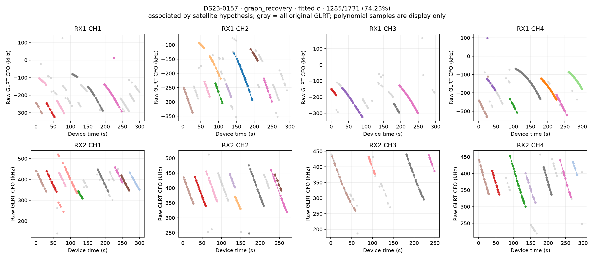
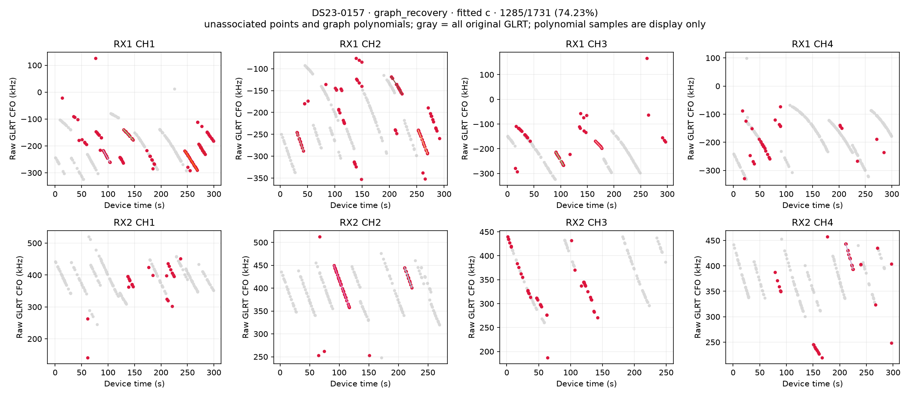
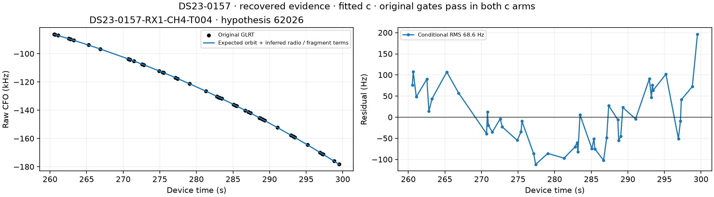

### Bounded identity alternatives

To test whether the admitted satellite was merely the first plausible curve,
retain up to three existing qualified causal nominees with conditional RMS
≤750 Hz, on at most two unused curved targets. Freeze each alias from the
existing c=0 nomination. Fit whole identical masks with unchanged priors and
cold budgets. Rank only identical-mask normalized RF objectives, correcting
the known unused-Student-coordinate constant; changing an otherwise valid
identity requires a c=0 gain exceeding `2 log(pool size)` and positive
fitted-c gain. Evaluation GPS never selects an identity.

For 0157 the candidates are **62026,64294,63791**. Only62026 passes paired
gates. Corrected fitted-c RF costs are **6952.37,7014.32,7026.80** respectively;
the latter two are rejected. Thus these bounded alternatives do not overturn
the recovered identity. This is not an exhaustive satellite identity proof.
0207 has no target with two nominees meeting the frozen eligibility rule.
All trials and errors are in [the alternatives table](tables/same_mask_alternatives.csv).

## 0207: support policy, a misleading endpoint and measurable short curvature

The two longest unused curved tracks both nominate **64261**:
RX2 CH4 T001 has24 points over0.35–29.85 s, and RX2 CH1 T000 has22 points
over1.84–24.44 s. The first fits the satellite with noise-like residuals.
Its default rejection is an orbital-mode support issue: it is the only newly
active curved owner, while the original nominal design retains three shape
coordinates based on masked-out owners. The existing support-aware control
removes those unsupported new shape coordinates, preserves all incumbent
modes, and admits the whole24-point curve. No residual threshold is relaxed.

The CH1 track is different. Its default fitted-c residual quadratic BIC gain
is **31.26**, against a gate of10. Adding both whole curves gives **33.74**
for CH1, although CH4 remains noise-like. It is not a narrowly missed RMS gate
or a problem solved by allowing one shared orbital correction to both tracks.

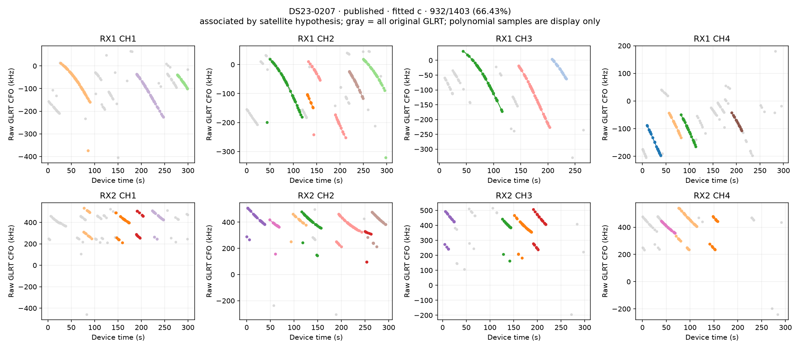
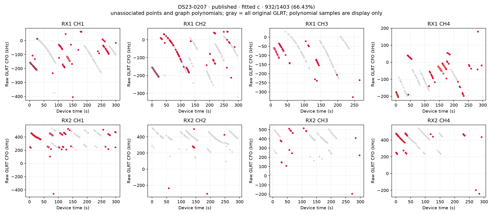
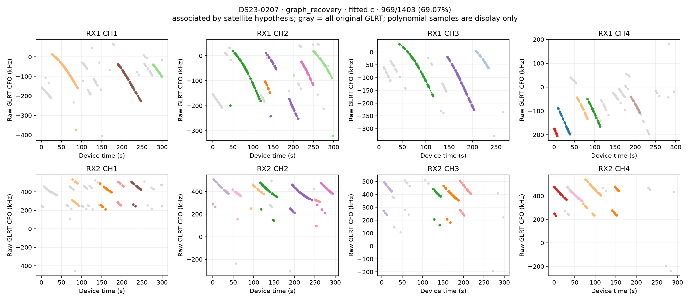
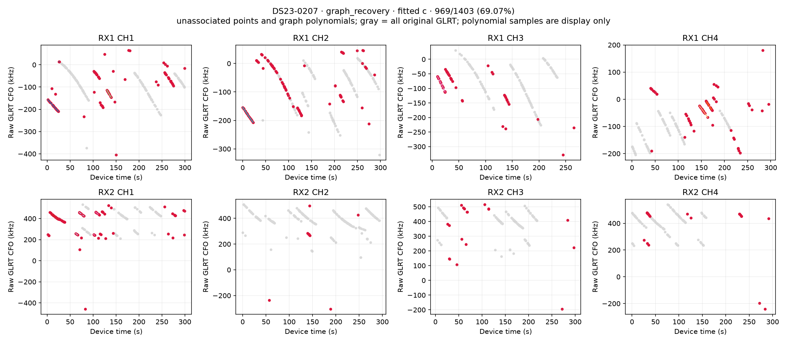
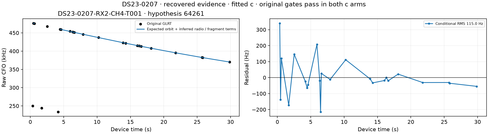

### A check that does not depend on position or a TLE

For two tracks on the **same receiver**, divide CFO by actual RF normalized
to11.5 GHz. Under the current radio model, a common satellite's Doppler and
the receiver's nonlinear smooth term become common. Arbitrary separate
affine terms absorb native whole-fragment aliases, band constants and linear
drift. The remaining **curvature must agree** if the identity and shared
receiver model are correct.

Fit shared nonlinear Legendre coefficients up to degree4 with separate track
affine terms, and compare with separate polynomials on exactly the same
observations. Both models profile one common unknown white-noise variance;
BIC penalizes their different parameter counts. For the original pair,
the independent-curvature model wins by **35.10 BIC units** over all46
observations, and **22.73** on the39 observations in their overlap.
This comparison is invariant to native constant aliases and linear offsets.
It requires no geographic point, ephemeris, learned receiver offset or
position optimizer.

This is evidence against the same-satellite hypothesis **under the current
shared receiver model**, not a calibrated identity probability. Channel-specific
distortion, an incorrect graph join or another missing radio effect could
also explain incompatibility. White-noise and finite-degree approximations
limit the diagnostic. We do not turn this BIC result into a deletion gate.

### The temporal path identifies a 21-point core

The frozen HMM independently selects **21 of CH1's22 original points** for
64261. The omitted observation is the isolated first point; the following
gap is **8.679 s**, or **16.68 times** the median cadence. Its leverage in
the persisted quadratic is **0.9236**. The original graph quadratic has
only63.1 Hz RMS, so polynomial fit quality alone conceals the incompatibility.

The21-point core remains curved: linear RMS **340.1 Hz**, quadratic RMS
**61.2 Hz**, quadratic-versus-linear BIC improvement **68.97**. Curvature is
supported throughout the core, rather than supplied by the omitted point.
The existing classifier nevertheless calls it non-curved because its span
is only **13.927 s**, below a hard20 s threshold.

The all-times shared-curvature comparison now favors the common curve:
`BIC(shared)−BIC(independent) = −6.47` on45 points. This is a separate
within-mask comparison, not a comparison of raw BIC across46 versus45
measurements. The core-only overlap test is ineligible because the reference
track has fewer than eight observations in that shorter overlap; we do not
claim stronger overlap confirmation than the data supply.

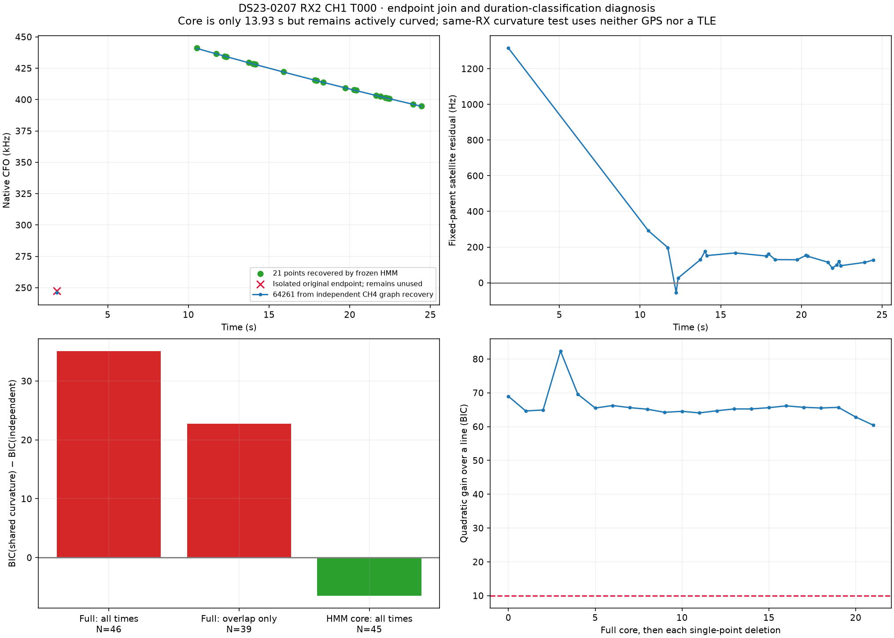

The leading point's source remains unresolved. It stays visible and unused;
we do not label it satellite noise solely because this identity fails there.
Native CFO plots break prediction lines at alias changes. The apparent
large CFO jump between the isolated point and core is partly a display gauge;
the physical rejection is assessed in the unwrapped original coordinates.

### Explicit duration and role ablations

The first core-calibration experiment uses the unchanged20 s classifier and
offers no core. Its no-offer receipt is retained. A **separate** experiment
permits spans≥10 s with at least12 points only if both nonlinear amplitude
≥250 Hz and quadratic BIC improvement>10 survive **every single-point
deletion**. For this core the minima are **285.53 Hz** and **60.46 BIC**.
Those deletions are diagnostics; no core observation is removed from a fit.
The published classifier is unchanged.

Eligibility also requires an existing frozen HMM path in both c arms that
equals all but one endpoint of a wholly unused curved graph track, an endpoint
gap≥5 median cadences and original polynomial leverage≥0.9. At most one
such core per case is offered. The engineering rule was specified after
inspecting this case and therefore requires independent confirmation before
any release; it is not described as untouched validation.

Both role variants use the same21 original CFO values, candidate and alias,
five phase rounds and48 position steps per round from[0,0]. The source
22-point component remains present and masked out. A derived numeric view
adds21 observations; it does not rewrite a persisted graph or trim any
incumbent likelihood row.

Predictive use preserves the graph parent's curved calibration and full
shared covariance. Curved use inherits the original source's fixed support
power and existing hierarchical noise/phase priors. Its second active
RX/channel owner also qualifies64261 for the existing three physical orbit
coordinates. These role/noise/support differences are part of the stated
ablation. Both variants pass, but fitted-c errors **3.116/3.113 km** are
slightly worse than the graph parent's3.108 km. Neither establishes a new
accuracy improvement.

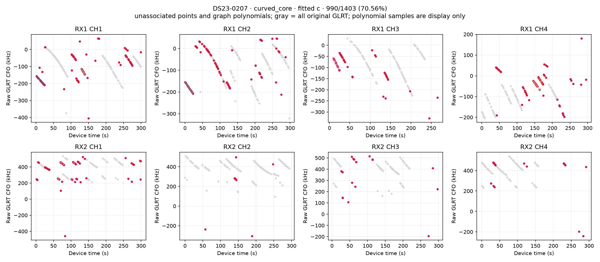

## Graph-seeded temporal recovery

The earlier temporal experiment considered only incumbent curved families.
This test first seals the existing RF-qualified graph parent, including62026
or64261, and searches **all remaining original winning GLRT** for those and
all other active parent families. It nominates no additional satellite from
outside the causal parent catalogue and does not read new IQ.

Lanes are physical RX/channel/actual-RF combinations. Use a clutter state,
wrapped CFO densities and a signal-fraction prior of0.5. Compare independent
states with a5 s persistence HMM; gaps above10 s reset persistence. At least
eight points and6 s are required per path. Marginal calibration variances
are used only for HMM discovery. Each path then faces the **full shared
Gaussian receiver covariance** and all active families in both arms.

The lane coherence control requires the native score to beat the maximum
of19 frozen time/CFO permutations plus `2 log(20)`. Path checks require the
same best family and aliases in both arms, nominal class probability≥0.99,
gain over uniform clutter above the declared methods/lanes/families penalty,
and marginal uncertainty below one twentieth of an alias period. Neither
post-selection probability nor the permutation statistic is a calibrated
identity confidence or p value.

At most24 paths are ranked by c=0 correlated RF gain. Screen each **whole**
offered path once at both parent endpoints with the original residual,
alias and horizon checks; freeze the survivors before the new cold fit.
No failed final fit is rescued by iteratively dropping points or paths.
The final fit integrates old/new predictive evidence in one joint covariance
and must preserve all parent likelihood and association IDs in both arms.
Otherwise use the exact graph parent.

Receiver geometry must numerically match every original track's basis.
The adapter supports the existing coarse and fine bases, verifies parity,
and rejects unknown bases. Appended native paths inherit the same basis;
using a default coarse basis for a fine-basis scan would be incorrect.

In0207, both temporal methods select the same six paths totaling89 points,
including the21-point64261 core. All gates and parent-ID retention pass.
Association rises69.07→75.41%, but fitted-c error worsens3.108→3.270 km.
The new evidence has modest positional leverage and does not repair the
global conditional model minimum.

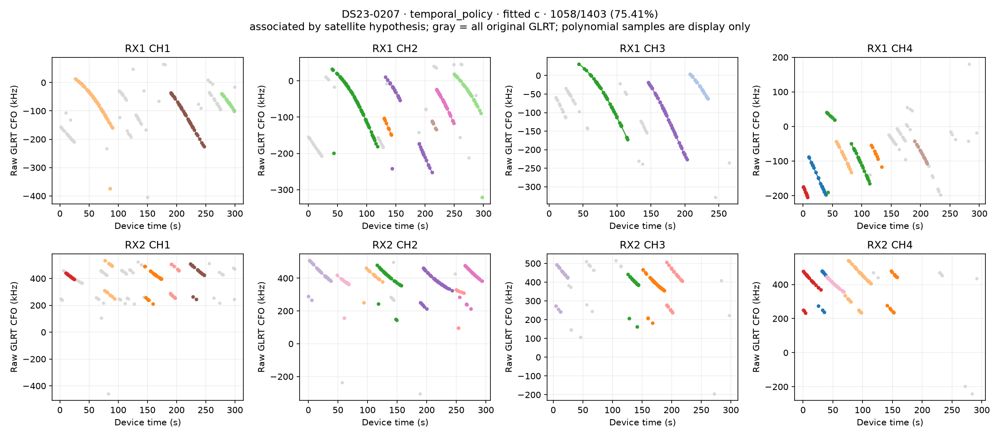
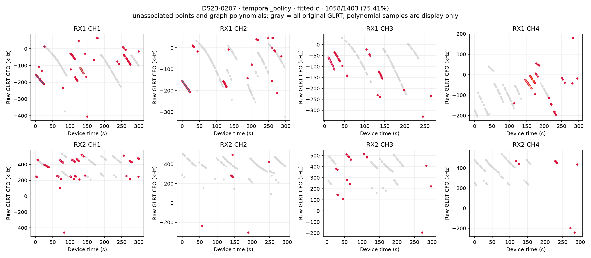

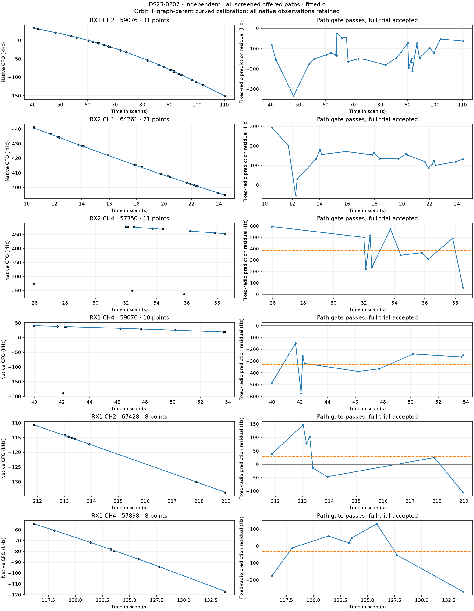

In0157, the screened independent/persistent variants add130/72 offered
predictive points. Their fitted-c errors would be2.853/2.973 km, substantially
worse than the graph parent. Every new path passes its own gate, but the
recovered46-point62026 curve fails the unchanged lag-one autocorrelation
screen. For the persistent variant, ACF **0.6134** exceeds
`4/sqrt(46)=0.5898`; RMS is72.6 Hz, slope and quadratic checks pass, and
step z=3.456 stays below4. This trial is rejected and the1.335 km graph
parent retained. More passing paths cannot override a failing parent curve.

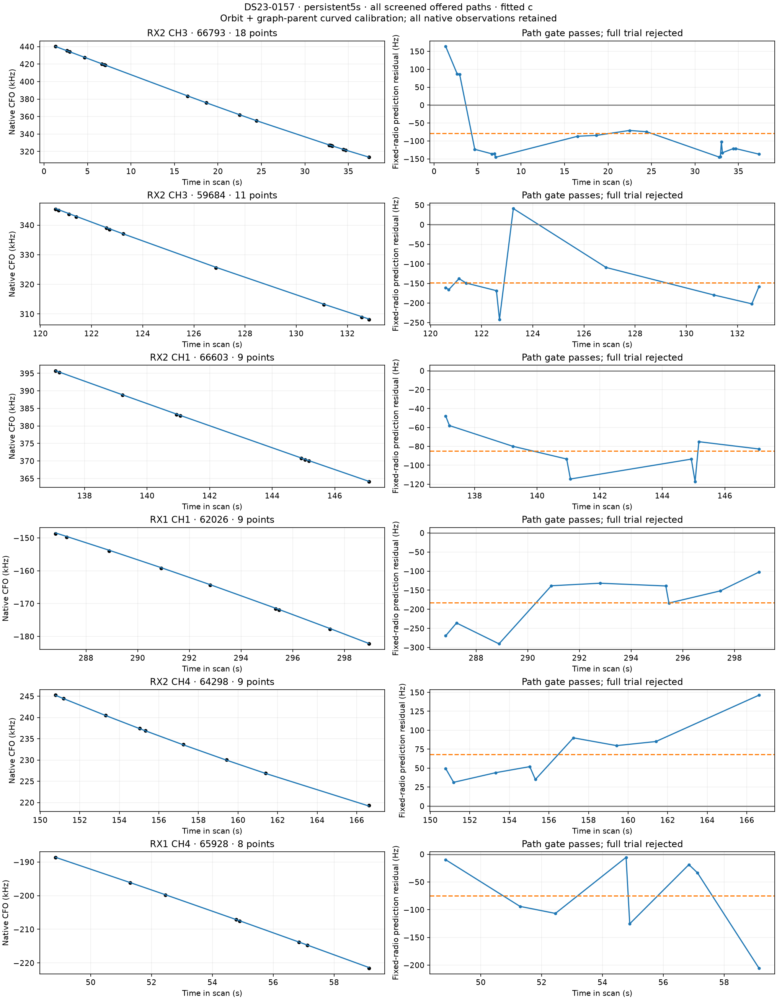
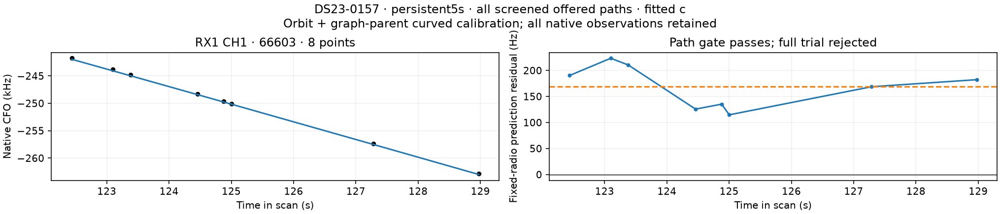
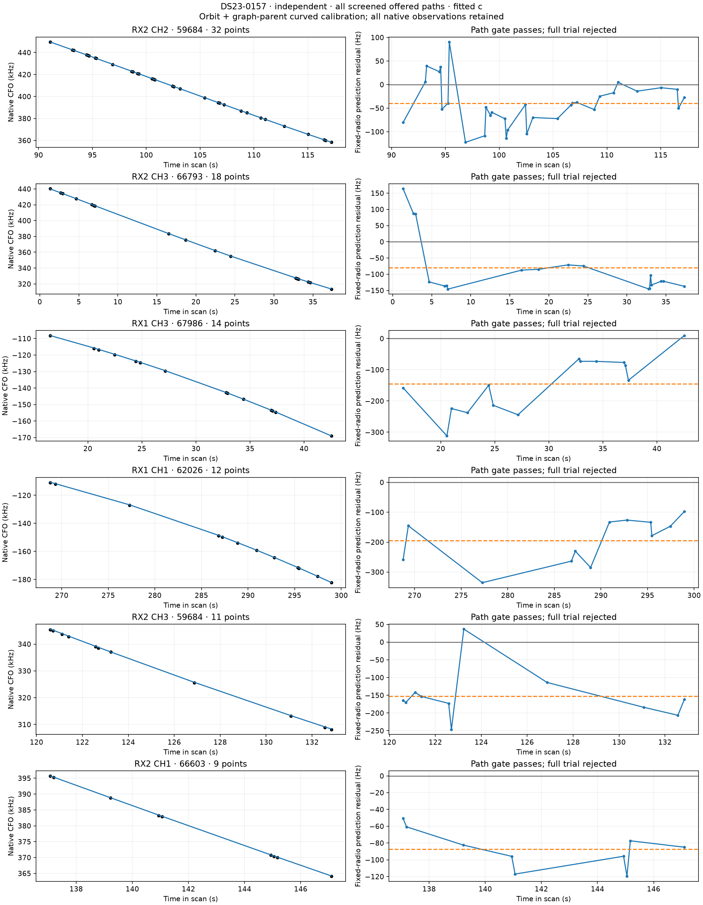
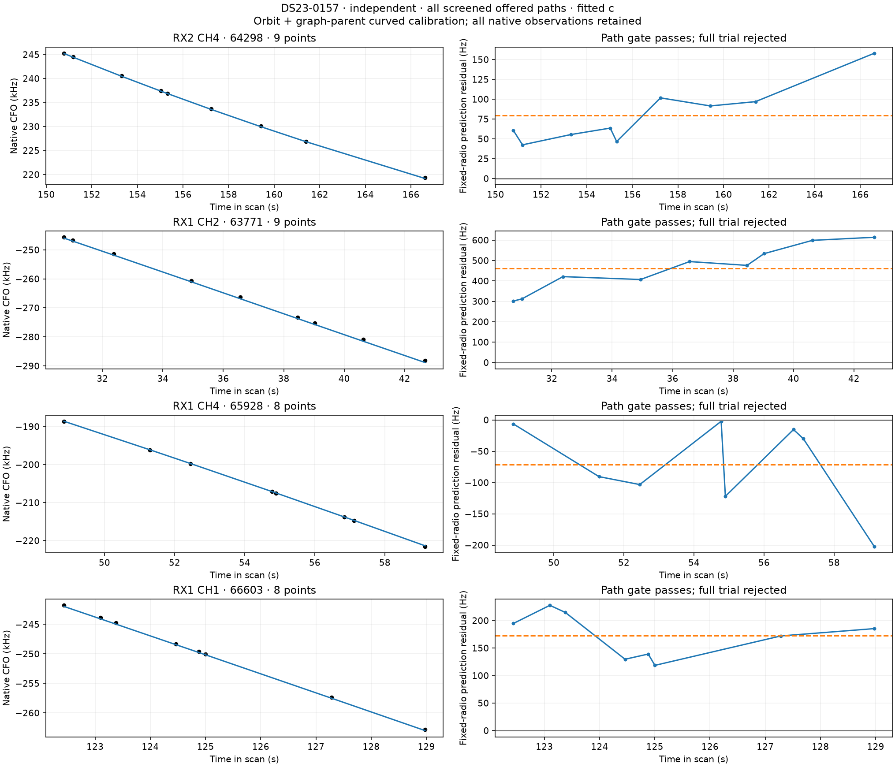

[Path provenance](tables/temporal_paths.csv) records owners, times, identities,
original graph versus outside-graph counts, whole-path checks and final trial
status. Rejected-trial counts must not be presented as final association gains.

## Following TLEs: diagnostic only

The three longest unused whole tracks, including linear tracks, are screened
against the available causal Starlink catalogue. Matched phase-only profiles
use the same frozen causal receiver posterior; following elements must have
both epoch and collection after scan end, within48 h. They do not choose an
identity, alter any prior or enter the position algorithms.

| Scan/component | Hypothesis | Causal RMS Hz | Following RMS Hz |
| --- | ---: | ---: | ---: |
|0157 RX1 CH4 T004|62026|64.94|64.18|
|0157 RX1 CH1 T002|58115|39.38|39.32|
|0157 RX1 CH2 T010|58115|44.38|44.73|
|0207 RX2 CH4 T001|64261|116.34|112.61|
|0207 RX1 CH1 T000|67094|78.59|78.62|
|0207 RX2 CH1 T000, full22|64261|222.96|213.57|

Following elements do not remove the whole-track CH1 discrepancy. An alternative
62064 profile improves strongly with following elements but remains around
750–803 Hz on the two curved0207 targets, and is not adopted. Small RMS
for a single linear candidate does not prove identity. All three hypotheses
per target remain in [the diagnostic table](tables/following_TLE_profiles.csv).

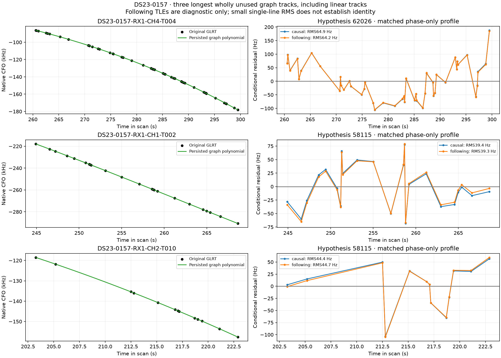
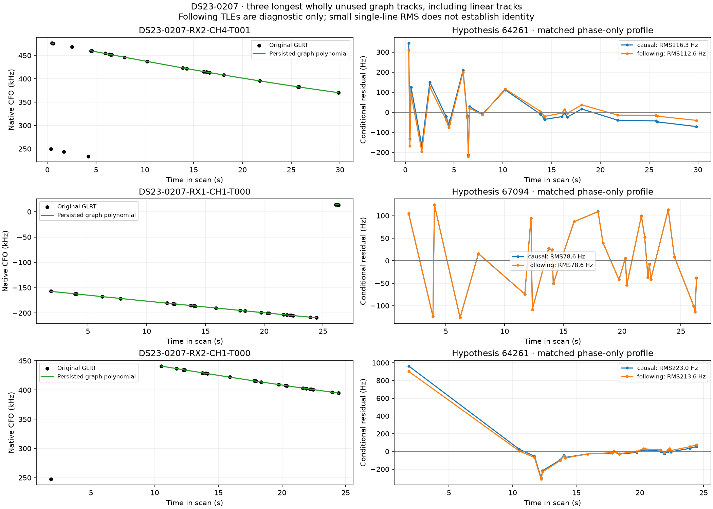

## Standard DBG01: gradients, starts and family influence

The incumbent surfaces evaluate317 positions at1 km spacing in a10 km
regional disk and289 at0.25 km spacing within±2 km of evaluation GPS.
Each pixel keeps observations, identities and aliases fixed, while nuisance
variables and five absolute-prior phase refreshes are recomputed. These
are **conditional profiled losses**, not normalized probabilities or complete
acquisition/association reruns.

The restart views use81 initial positions on the2 km disk grid. Thirteen
cold discovery seeds build a finite bank of at most four complete-data
curved assignments. c=0 can reselect a bank branch after each accepted
descent step; fitted-c follows its branch schedule. Original predictive
identities remain fixed. Lines are recorded accepted solver steps, red
circles are starts and crosses are endpoints. The finite bank is not an
exhaustive catalogue search.

All0157 starts end near3.533 km fitted-c error on a different branch, but
**none passes paired gates**. Their endpoint marks are failed diagnostics,
not81 accepted convergences. All0207 starts return to the incumbent3.321 km
minimum with passing gates. Neither case passes the RF restart-selection
rule. These maps diagnose the incumbent, not the new temporal/core models.

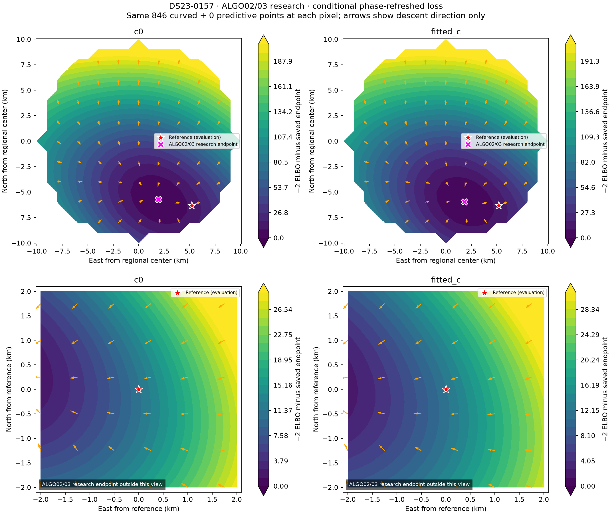
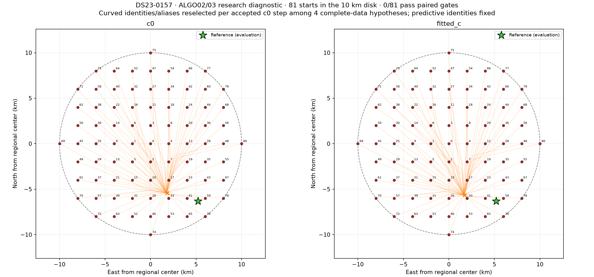
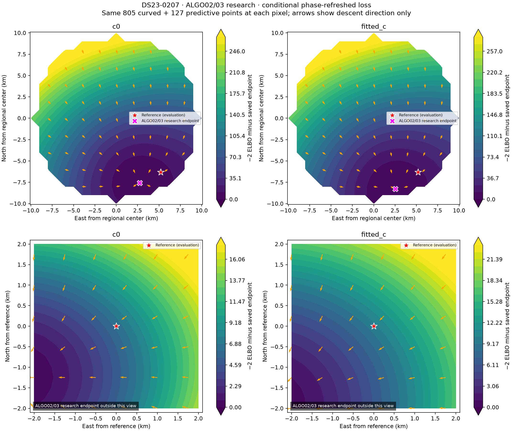
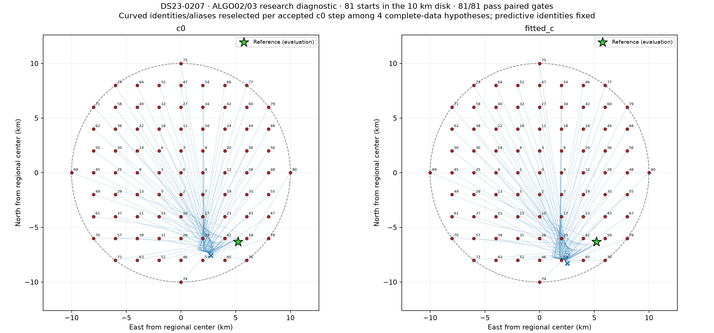

All active families and retained curved tracks are individually removed
and refitted in both arms.0157's best family deletion,59684, gives3.012 km,
far less useful than recovering62026.0207's geographically best deletion,
67178, gives2.847 km but fails paired gates; the best passing deletion,
64254, gives3.142 km. No individual family deletion solves either scan.
These are influence diagnostics; GPS does not define a deletion policy.

The predeclared phase-width×2 sensitivity gives0157/0207 fitted-c errors
2.383/2.155 km; resetting learned phase means to zero gives2.682/2.196 km.
These indicate sensitivity to phase uncertainty, not validation of a
scan-specific prior change. All prototype inference above preserves the
original causal phase priors. A future prior change must be transferable,
frozen and tested across matched populations.

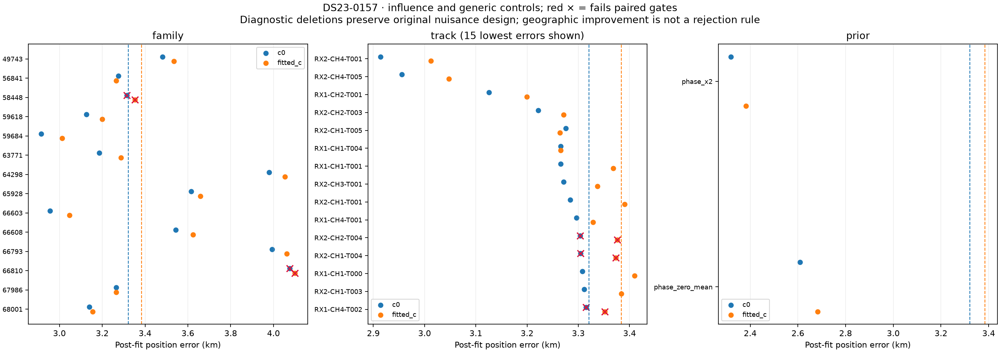
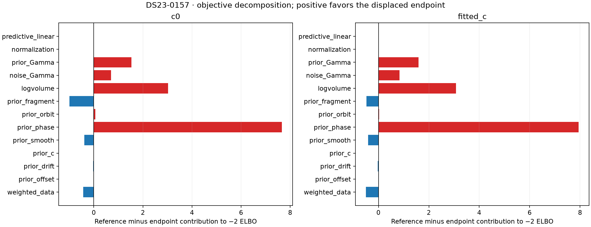
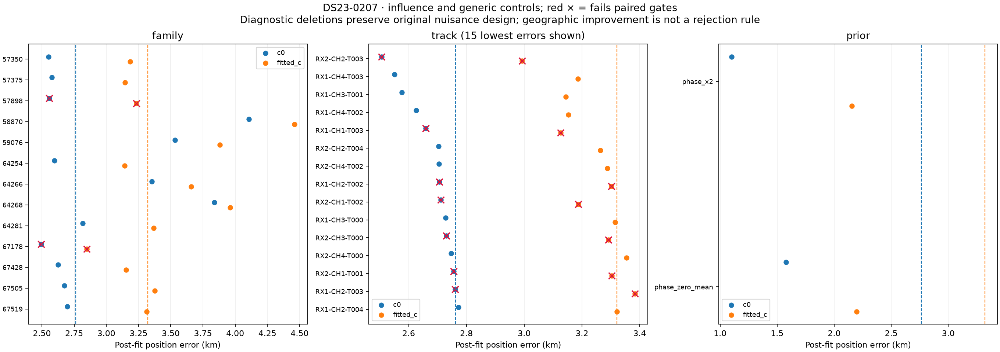
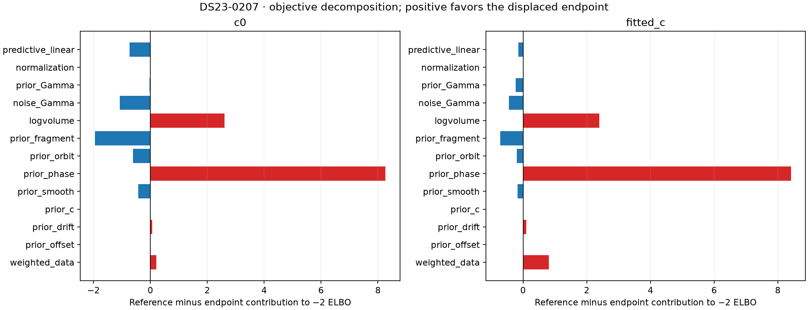
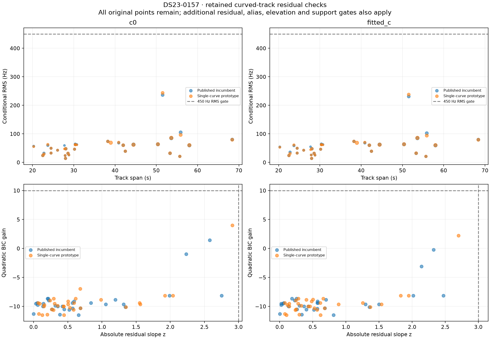
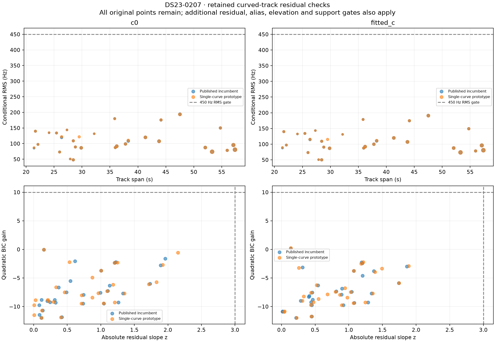

Full [family ablations](tables/family_ablations.csv),
[all interventions](tables/all_interventions.csv),
[residual diagnostics](tables/residual_diagnostics.csv), and
[curvature model comparisons](tables/curvature_consistency.csv) support these
claims. All **512 endpoint arms and21 nominee-density checks** in the
independent audit pass numerical replay, including rejected endpoints.
Grid coordinates/model provenance are recorded; not every pixel is
independently reintegrated a second time.

## Decision, validation and reproduction

This iteration separates three problems: missing curved-family evidence;
an inconsistent endpoint join that a low polynomial RMS concealed; and a
duration heuristic that misses genuine short curvature. The prototypes
recover evidence without forcing noise gates. They also show that resolving
those association issues is insufficient to achieve the required position
resolution. The remaining conditional prior/geometry bias is substantial.

**18 component-owned tests pass**, covering exact coarse/fine native geometry,
unknown-basis rejection, predictive-only membership, frozen protected modes,
alias-invariant same-RX curvature comparisons, distributed curvature under
single-point deletion, derived curved calibration row accounting, unchanged
source CFOs and incumbent masks, and bounded RF candidate selection.
Every predictive/core refit independently replays its joint Gaussian
density and verifies no predictive update to its curved-calibration mean
at fixed position. Curved-role fits intentionally learn from the added core.

Raw archives are split into shared, per-case restart and per-case other
evidence files. They preserve the original graph-reentry trials, temporal
discovery and frozen selections, the no-offer20 s core test, the explicit
10 s duration ablation, following-TLE versions, all DBG01 grids/paths and
family/track/prior controls. [Evaluation](evidence/evaluation.json),
[protocol](evidence/protocol.json), [batch execution](evidence/batch_execution.json),
[independent audit](evidence/independent_iteration_audit.json),
[native curvature evidence](evidence/native_curvature_consistency.json),
[source snapshots](source/tools/) and [tests](source/tests/) are included.
Large original RF inputs remain in the existing corpus; no runtime dependency
on a reference repository is introduced.

Use the existing research environment with
`PYTHONPATH=/tmp/algo03-feasible-deps:src:tools`, `PYTHONDONTWRITEBYTECODE=1`,
`OPENBLAS_NUM_THREADS=1`, and `OMP_NUM_THREADS=1`. The entry points are
`run_ds23_dbg01_iteration_008.py`, `diagnose_ds23_iteration008_tracks.py`,
`probe_ds23_graph_seeded_paths.py`, `probe_ds23_iteration008_alternatives.py`,
`probe_ds23_curved_temporal_core.py`, `probe_ds23_supported_temporal_core.py`,
and `report_ds23_dbg01_iteration_008.py`. Preserve frozen output directories.
The new variants remain inspected same-site development; no full-DS23 or
new-location improvement is claimed, and no ALGO version is promoted.
